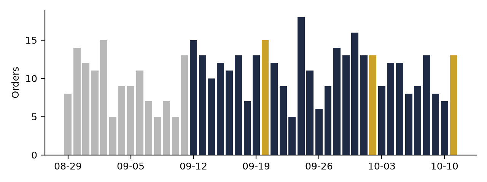
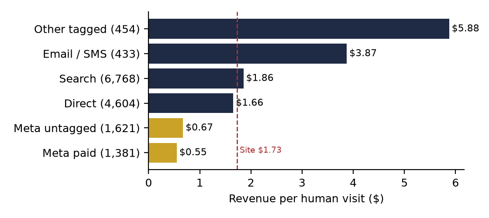
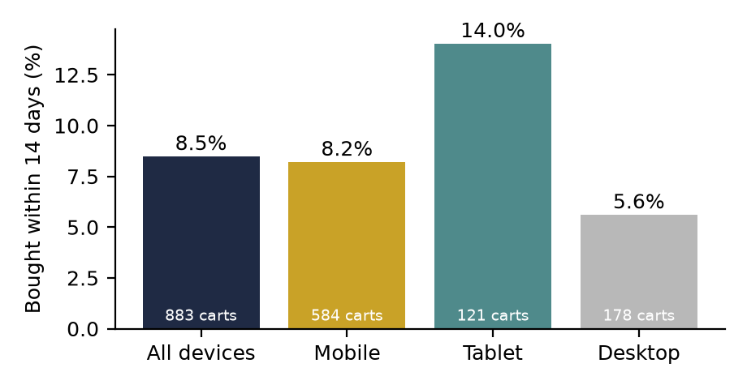
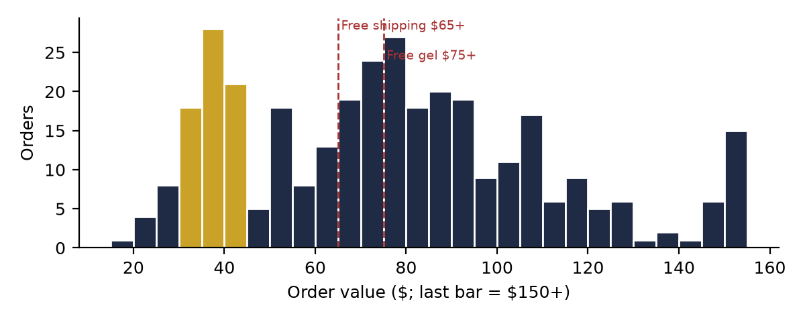
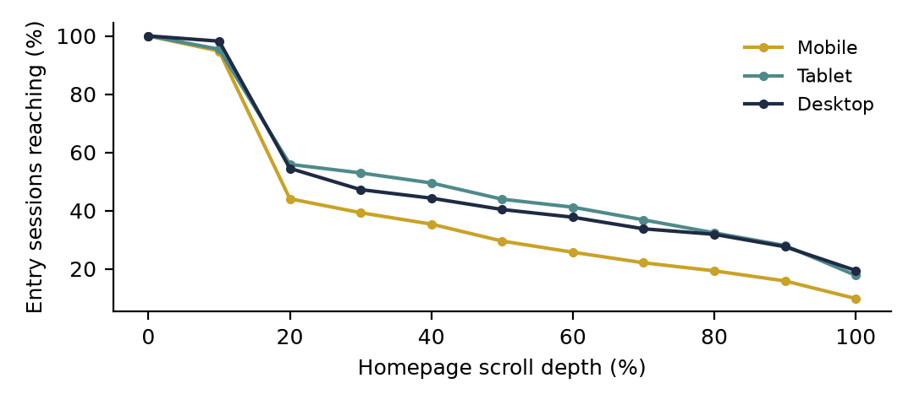
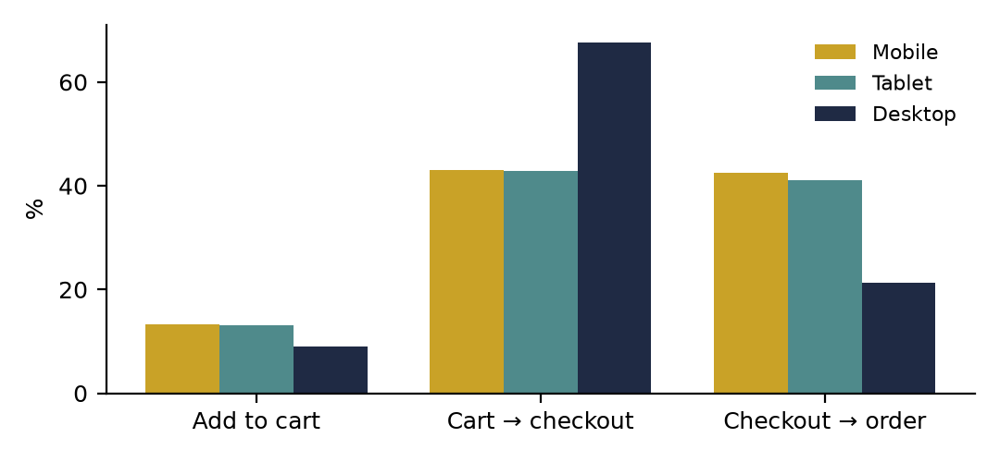

**HEATMAP**

**Ceremonia**

**Site Opportunity Report**

ceremonia.com | 12 September – 11 October 2026, with late August for context | Prepared 12 October 2026

This report combines a full re-analysis of the order, traffic, campaign, product, page and behavioural datasets for ceremonia.com: 339 orders, 15,269 human visits and the complete click and scroll record for the site's homepage. Ceremonia is a small-volume store — a single order moves most rates by a fraction of a point — so every finding below is stated with its counts, and segments under about 100 visits are flagged as directional.

# Contents

The biggest wins, first · At a glance · The month in numbers · Opportunity 1 — Stop funding the Meta campaigns that produce no orders · Opportunity 2 — Land paid social on pages that can carry a $65 basket · Opportunity 3 — Bring back the shoppers who leave a full bag · Opportunity 4 — Basket size: the $65 and $75 lines · Opportunity 5 — The homepage is the shop floor · Opportunity 6 — Fix the dead ends · Opportunity 7 — The desktop question · Opportunity 8 — Clean the measurement before moving money · Worth watching · What's working · Suggested next 30 days · Method and caveats

# The biggest wins, first

Six moves cover most of the opportunity in this report. Two stop paid-social money from leaking, one recovers revenue the site has already earned the right to, one raises the value of every order, one improves the page that takes a quarter of all entries, and one keeps every number trustworthy. Each is detailed in the section referenced.

**1. Stop the Meta campaigns that produce nothing — starting with one that is growing.**

Campaign 120250462604600082 took 620 visits in the window, put 131 of them in the cart and 22 into checkout — and produced no orders at all. It has grown every week (164 → 202 → 254 visits) and is still running. Two more campaigns (…366746300082 and …302640800082) took 368 visits with no orders. In the same account, …366605980082 earns $3.38 a visit — more than any other channel except email. Pause the zero-order sets and move their budget to the winner. (Opportunity 1)

**2. Re-point paid social away from single low-price products.**

Social traffic lands mostly on two single-product pages — the $18 Pequi Flyaway Gel (912 entry sessions, $0.26 each, 93% see one page) and Guava Gloss Drops (660 sessions, $0.22). The site's free-shipping line is $65. Meta visitors add to cart at 17.7% — above the site's 12.4% — but only 23% of those carts reach checkout, against 47% across the site. Build Your Own Ritual, a bundle page, earns $1.44 per social session on the same traffic. (Opportunity 2)

**3. Build a real cart-recovery programme.**

Around 1,700 shoppers a month leave a cart, and only 8.5% buy within 14 days — half Loop-class recovery rates. Recovered buyers spend $93.80, above the $79 average order; 60% of non-buyers never come back at all. Each point of recovery is worth about $1,600 a month. (Opportunity 3)

**4. Use the $65 free-shipping line as a basket tool.**

37% of orders (124) land under $65 and pay for shipping, and one in five (67) sits in a single-product cluster at $30–$45. A cart progress bar plus one-tap minis ($13–$18) and kits is the cheapest way to lift a $79.35 average order: every +$1 is about $340 a month. (Opportunity 4)

**5. Make the homepage's first screen sell.**

The homepage takes about 4,500 entry sessions a month — a quarter of all entries — and converts search and email arrivals well ($2.70 and $6.56 a session). But only 44% of mobile entrants scroll past the first fifth of the page, and shoppers who scroll least convert best. Product-forward first screens beat storytelling here. (Opportunity 5)

**6. Clean the measurement before moving money.**

16% of raw traffic is dead sessions. 42% of Meta visits arrive with no campaign tag (62% in the week of the 30 September spike). Desktop conversion fell from 2.4% to 0.6% over four weeks while "direct" desktop product visits doubled. Coupon extensions take last-click credit on 17 orders. Until these are settled, channel and device trends should not be read at face value. (Opportunities 7 and 8)

# At a glance

| **#** | **Finding** | **Recommended action** | **Priority** |
|----|----|----|----|
| 1 | Meta campaign …604600082: 620 visits, 131 cart-add visits, 22 checkouts, 0 orders — growing weekly, 254 visits last week. Two more Meta campaigns took 368 visits at 0 orders; …366605980082 earns $3.38 a visit. | Pause the zero-order sets today; move budget to …366605980082 and the ASC Evergreen set. | High |
| 2 | Social lands on Pequi Flyaway Gel ($18) and Guava Gloss Drops: 1,572 sessions at $0.22–$0.26, 82–93% one page. Meta carts reach checkout 23% of the time vs 47% site-wide. Build Your Own Ritual earns $1.44 per social session. | Land social on bundles, kits and the ritual builder — offers that clear $65. | High |
| 3 | 883 carts abandoned 12–27 September: 8.5% bought within 14 days ($7,035, $93.80 each). Desktop recovers worst (5.6%); 60% of non-buyers never return. | Sequenced two-week recovery flow with a checkout-starter track and SMS where consented. | High |
| 4 | Median order $75.65; 124 orders (37%) under the $65 free-shipping line; 67 orders at $30–$45. High-value buyers over-index on kits, minis and travel sizes. | $65 progress bar in the Rebuy cart drawer; minis and kits as one-tap add-ons. | High |
| 5 | Homepage: ~4,500 entry sessions; 44% of mobile entrants reach 20% scroll depth, 10% reach the bottom. Shallow scrollers convert 4.6%; deep scrollers 1.8%. | Put best-sellers, kits and the quiz in the first two mobile screens; keep quick-add. | High |
| 6 | Dead ends: /pages/meet-ceremonia (315 entries, 0 buyers), four blog guides (~590 search entries, 0 orders), perfume mist (311 entries, 1 buyer), /pages/community (90 campaign entries, 0 orders). | Add shoppable modules and a next step to each; stop sending paid traffic to meet-ceremonia. | Medium |
| 7 | Desktop converts 1.30% vs mobile 2.41%; desktop checkouts complete 21% of the time vs 42%. Desktop "direct" visits doubled (296 → 615 a week) at 0.68% conversion. | Check desktop traffic for automation first; then walk the desktop checkout end to end. | Medium |
| 8 | 2,906 dead sessions (16.0%); 42% of Meta visits untagged; 27% of human visits from identified non-US countries (89% of orders are US); coupon extensions last-click 17 orders. | Tag every Meta ad, confirm geo-targeting, filter dead sessions everywhere, review coupon-extension leakage. | Medium |
| 9 | Returning visitors convert at 3.94% and earn $3.41 a visit — twice new visitors ($1.47) — and supply 26% of matched revenue on 13% of visits. Klaviyo flows run at tiny volumes. | Grow the flows: replenishment, back-in-stock, browse abandonment. | Medium |
| 10 | Orders rose 21% against the prior fortnight (11.3 vs 9.4 a day), but site revenue per visit fell from $2.24 to about $1.55 as Meta volume grew. | Watch revenue per visit weekly alongside orders; volume bought at $0.55 dilutes the average. | Watch |

# The month in numbers

| Orders | 339 |
|----|----|
| Revenue | $26,900 |
| Average order | $79.35 (median $75.65) |
| Orders by device | Mobile 73% · Tablet 20% · Desktop 7% (order share) |
| Human visits | 15,269 — 65% mobile, 20% desktop, 14% tablet |
| Dead sessions (excluded) | 2,906 (16.0% of raw traffic), almost all single-page |
| Visits by channel | Search 44% · Direct 30% · Meta untagged 11% · Meta paid 9% · Other tagged 3% · Email/SMS 3% |
| Returning visitors | 13.5% of visits, converting 3.94% against 1.90% for new |
| High-value orders (≥$120) | 36 orders, $5,927 — 22% of revenue |
| Versus the prior fortnight | Orders +21% (11.3 vs 9.4 a day) · Visits +28% · Average order $79.35 vs $76.51 · Conversion 2.17% vs 2.29% |

### Weekly orders across the period

| **Week starting** | **Orders** | **Revenue** | **Average order** |
|----|----|----|----|
| 7 Sep (from 12th) | 28 | $2,039 | $72.82 |
| 14 Sep | 81 | $6,707 | $82.80 |
| 21 Sep | 70 | $5,381 | $76.87 |
| 28 Sep | 90 | $6,964 | $77.38 |
| 5 Oct (through 11th) | 70 | $5,809 | $82.98 |

The store ran at 5–18 orders a day. The three highest-revenue days were 20 September ($1,560), 2 October ($1,381) and 11 October ($1,233). Unusually, those peak days were not traffic days — they averaged 424 visits against 518 on other days — they were conversion days: 3.07% of visits ordered against 2.09%, and a quarter of cart-adders bought in the same visit (24.8% vs 16.9%). The lift was broad — every channel converted better on those days, Meta included (2.9% against 0.8% normally), and coupon-extension referrals supplied 7 of the 39 buying visits — which fits an offer or code running on those days. There is no promotion calendar in this data to confirm it.

*Figure 1. Daily orders, 29 August – 11 October 2026. Gold days are the three peak-revenue days of the window (20 September, 2 and 11 October); grey days are the pre-window context.*

Two contexts matter for reading the month. First, growth: the window ran 21% more orders a day than the fortnight before, on 28% more visits — the funnel held (12.4% of visits added to cart in both periods) while conversion slipped slightly from 2.29% to 2.17% as colder paid-social traffic grew. Second, the product franchise: four Guava products — the Leave-In Conditioner, the Hair Oil, the Protect & Repair Wash Duo and the Rescue Spray — headline 46% of revenue. This is a replenishable, routine-based line, which makes recovery and retention (Opportunities 3 and 4) the strategic levers.

# Opportunity 1 — Stop funding the Meta campaigns that produce no orders

## What we saw

*Figure 2. Revenue per human visit by referrer channel, 12 September – 11 October 2026. Visit counts in brackets.*

Meta campaigns with material volume in the window (campaign IDs as tagged in the ad links):

| **Campaign** | **Visits** | **Cart-add visits** | **Checkouts** | **Orders** | **Rev / visit** |
|----|----|----|----|----|----|
| Meta — 120250462604600082 | 620 | 131 | 22 | 0 | $0.00 |
| Meta — 120250366746300082 | 217 | 1 | 0 | 0 | $0.00 |
| Meta — 120250302640800082 | 151 | 23 | 4 | 0 | $0.00 |
| Meta — 120250366605980082 | 190 | 43 | 16 | 8 | $3.38 |
| Meta — JW ASC Evergreen (all products, max conversion volume) | 60 | 16 | 9 | 2 | $1.22 |
| Meta — Facebook_UA (creative tag) | 204 | 46 | 12 | 2 | $0.44 |
| Instagram — link_in_bio | 307 | 26 | 7 | 1 | $0.24 |

- Meta as a whole is a fifth of human traffic and 7% of revenue. Tagged and untagged Meta visits together numbered 3,039 in the window, ordered at 0.86% and earned $0.61 each — against the site's 2.17% and $1.73.

- The waste is concentrated. Campaign …604600082 alone took 620 visits with no orders, and its creatives show the shape of the problem: …618340082 and …618270082 put 30 and 25 visitors in the cart from about 115 visits each — strong intent — and converted none. Creative …106170082 took 111 visits and produced one cart add.

- It is growing, not winding down: 164 visits in the week of 21 September, 202 the next, 254 in the week of 5 October — with 65 cart-add visits and 8 checkouts that week, and still no order.

- The winner is in the same account: …366605980082 earns $3.38 a visit with 8 buying visits from 190 — better than search ($1.86) and direct ($1.66). The ASC Evergreen set earns $1.22 on early volume.

- These figures credit each visit to the link it arrived on. A shopper introduced by Meta who returns through Google or direct counts there — read the table as where buying visits arrive, not each campaign's full contribution. But a campaign with 131 cart adds and no order in its own visits over four weeks is not an attribution artefact.

## Why it matters

The three zero-order campaigns took 988 visits in the window, and the largest of them is still growing. Ad spend is not in this data, so the monthly size is those campaigns' full spend in Ads Manager — every dollar of it has no order on the visit it bought. The same account already has a set earning $3.38 a visit, more than search.

## Recommended actions

- Pause …604600082, …366746300082 and …302640800082 today. Together they took 988 visits in the window and produced no orders.

- Before relaunching …604600082, check its offer against the landing page: a 21% cart-add rate with a 12–17% cart-to-checkout rate is the signature of a surprise between the ad and the cart — price, shipping cost, or an advertised gift that doesn't appear.

- Move the budget to …366605980082 ($3.38) and the ASC Evergreen set ($1.22), and brief the next creative batch against whatever …366605980082 is showing.

- Judge every Meta campaign weekly on revenue per visit and orders, not cart adds — this account's cart adds do not convert into orders.

# Opportunity 2 — Land paid social on pages that can carry a $65 basket

## What we saw

Where social traffic enters the site (entry sessions, report window):

| **Landing page** | **Social entry sessions** | **Orders** | **Rev / session** | **See one page only** |
|----|----|----|----|----|
| /products/pequi-flyaway-gel ($18) | 912 | 6 | $0.26 | 93% |
| /products/guava-gloss-drops | 660 | 3 | $0.22 | 82% |
| Homepage | 477 | 2 | $0.50 | 42% |
| /products/build-your-own-ritual | 352 | 6 | $1.44 | 75% |
| /pages/meet-ceremonia | 271 | 0 | $0.00 | 76% |
| /products/perfume-mist-de-guava | 143 | 0 | $0.00 | 77% |
| /products/mercadobundle-001 | 131 | 0 | $0.00 | 76% |

- Social is the channel most likely to leave after one page — 77% of social entry sessions see one page, against 56% for search — and earns $0.39 a session against search's $1.81.

- The landing choices fight the store's economics. The free-shipping line is $65 and the announcement bar promises a free Pequi Flyaway Gel at $75. Sending cold traffic to an $18 gel means the shopper must find $47 more of product to avoid shipping — on a page most of them never leave.

- Meta visitors want to buy: 17.7% of Meta paid visits add to cart, above the site's 12.4%. But only 23% of those carts reach checkout against 47% across the site. The intent is there; the basket does not survive the cart.

- The pages that work for social are baskets: Build Your Own Ritual earns $1.44 a social session, more than five times the gel page. Across all traffic, /collections/kits converts 7.4% of visitors and the bestsellers collection 7.1%.

## Why it matters

Paid social is the only channel growing quickly — Meta visits went from 433 in the week of 14 September to 1,398 in the week of 28 September — and the site's revenue per visit fell from $2.24 to about $1.55 as it grew. If the 1,572 social sessions on the two single-product pages earned what Build Your Own Ritual earns on the same channel, that would be worth up to about $1,900 a month. Treat that as an upper bound: the ritual builder's social visitors may be a different audience.

## Recommended actions

- Re-point the gel and gloss-drop prospecting ads to Build Your Own Ritual, /collections/kits or a bundle landing that clears $65 in one add.

- If a single-product ad must stay, make the gift-with-purchase and the shipping line visible on the product page's first screen, with a one-tap "complete the routine" bundle beside the add button.

- Stop sending social traffic to /pages/meet-ceremonia, the perfume mist page and the Mercado bundle page until each has a working next step (Opportunity 6).

- Track social single-page share weekly (77% today) and Meta cart-to-checkout (23% today) as the scoreboard for this change.

# Opportunity 3 — Bring back the shoppers who leave a full bag

## What we saw

We followed every cart abandoned between 12 and 27 September — 883 abandoned-cart sessions, each followed for 14 days.

| **Device** | **Carts** | **Bought within 14 days** | **Rate** | **Recovered revenue** |
|----|----|----|----|----|
| All devices | 883 | 75 | 8.5% | $7,035 |
| Mobile | 584 (66%) | 48 | 8.2% | $4,149 |
| Tablet | 121 | 17 | 14.0% | $1,866 |
| Desktop | 178 | 10 | 5.6% | $1,020 |

*Figure 3. Share of abandoned carts that became orders within 14 days, 12–27 September cohort, by device. Cart counts on each bar.*

- The 75 recovered buyers spent $7,035 — $93.80 each, $14 above the site average order. Shoppers who come back buy bigger baskets.

- 60% of non-buyers never came back at all (488 of 808). Email alone cannot reach them; they need SMS, retargeting, or a reason to return.

- Desktop recovers worst: 5.6% against 8.2% on mobile and 14.0% on tablet (the tablet figure rests on 17 buyers).

- Browse abandonment is the bigger, colder pool: 1,831 "showed interest" sessions in the same period bought at 3.6% within 14 days ($6,288), and the highest-intent browsers (the "super shopper" cohort, 519 visitors) bought at 8.5%.

- Recovery in this data is mostly shoppers returning on their own. The Klaviyo flows visible in the tags — Welcome, Back in Stock, Browse Abandonment, Retentics replenishment and reactivation — each carried only a handful of visits in the window.

## Why it matters

Cart abandoners are the largest warm audience the site has: about 1,700 abandoned-cart sessions a month at current volume. Each point of recovery is about 17 more orders a month — roughly $1,600 at the recovered buyer's $93.80. Lifting recovery from 8.5% to 12% would be worth about $5,600 a month — an upper bound, but the gap between this store's 8.5% and the mid-teens rates seen elsewhere says most of it is unclaimed.

## Recommended actions

- Build a sequenced recovery flow covering the full two weeks: a same-hour reminder, a day-one follow-up, and two more touches in week two.

- Split checkout starters into their own track — shorter delays, a direct resume-checkout link, SMS where consented — and measure it separately.

- Use the recovery message to close the shipping gap: "you're $X from free shipping" with a mini or kit suggestion converts the abandoned $30–$45 basket into a $65 one (Opportunity 4).

- Make the Rebuy cart drawer persist between visits and greet a returning cart-holder with their items.

- Track one number: abandoned carts that become orders within 14 days (8.5% today), by device, monthly.

# Opportunity 4 — Basket size: the $65 and $75 lines

## What we saw

*Figure 4. Order-value distribution, 12 September – 11 October 2026 (339 orders). Gold bars: the 67 orders between $30 and $45. Dashed lines: the free-shipping line ($65) and the free-gel line ($75).*

- Average order is $79.35 (median $75.65). At 339 orders a month, every +$1 of average order is about $340 a month.

- The thresholds already work for those who reach them: half of all orders land at or above $75, and the curve rises from $65 upward. There is a visible dip at $45–$50 and $55–$65 — shoppers either stop at one product or go well past the line.

- The leak sits below $65: 124 orders (37%) pay for shipping, and 67 of them (20%) form a single-product cluster at $30–$45 — one Leave-In ($30), one Hair Oil ($34) or one Rescue Spray ($27) plus shipping.

- Most baskets already hold more than one item: 60% of orders paid more than 1.5 times the headline product's price. The attach habit exists; it just doesn't reach the single-product buyer.

- High-value shoppers point to the attach items. The 35 visitors who placed ≥$120 orders over-index on kits (/collections/kits, 7.8x), travel sizes (13.2x), minis (10–16x) and bundles (the Bestsellers Bundle 30x, the Sunday Reset Duo 28x). These rest on single-digit visitor counts — directional, but consistent.

- The minis exist and sell: Mini Guava Leave-In ($15), Mini Guava Beach Waves ($13) and Mini Papaya Scalp Scrub ($18) all appear in orders.

## Why it matters

A threshold works when baskets sit just below it. Here the gap is wider — $20–$35 for the single-product buyer — which is exactly the price of one more full-size product or two minis. The store already has the attach products and a cart drawer (Rebuy) that can show them; it needs a reason on screen at the moment the basket is decided.

## Recommended actions

- Add a progress bar to the Rebuy cart drawer: "$X away from free shipping", then "$X away from your free Pequi Flyaway Gel".

- Offer minis and the kit range as one-tap add-ons in the drawer, priced to close a $30–$45 basket to $65.

- Put kits and Build Your Own Ritual in the journey for single-product buyers — on the product page, in the drawer, and in the recovery flow.

- Track average order, the share of orders under $65 (37% today) and attach rate weekly.

# Opportunity 5 — The homepage is the shop floor

## What we saw

The homepage is the store's largest single entry point — about 4,500 entry sessions a month, a quarter of all entries:

| **Homepage entry channel** | **Entry sessions** | **Orders** | **Rev / session** | **See one page only** |
|----|----|----|----|----|
| Search | 2,249 | 74 | $2.70 | 35% |
| Direct | 1,451 | 38 | $2.04 | 52% |
| Social | 477 | 2 | $0.50 | 42% |
| Campaign (email) | 173 | 15 | $6.56 | 43% |
| Website referral | 115 | 4 | $2.91 | 42% |

*Figure 5. Share of homepage entry sessions reaching each scroll depth, by device, 12 September – 11 October 2026.*

- It works as a destination: homepage entries convert at 3.33% and earn $2.69 a visit, the best of any large entry class. Visits that reach the homepage at any point convert at 3.92%.

- But almost nobody scrolls it. 95% of mobile entrants pass the first tenth of the page; only 44% reach a fifth, 30% the halfway mark and 10% the bottom. Desktop and tablet hold slightly better (55–56% at a fifth, 18–19% at the bottom).

- The shoppers who scroll least buy most: visits scrolling only 1–10% of the homepage convert at 4.6% ($4.05 a visit); those reaching the bottom convert at 1.8%. Homepage arrivals largely know what they want — the menu is their tool. The menu drawer is the page's most-clicked element (274 clicking sessions), and visits that use the menu convert at 5.7%.

- The page carries a Shopify consent banner in the first viewport, a press bar (Refinery29, Allure), reviews and testimonials, and quick-add tiles — "Add to bag" on the Guava Leave-In is among the top five clicks.

## Why it matters

Every half-point rise in homepage entry conversion is about 22 orders — roughly $1,800 — a month at current volume. The page already converts search and email visitors well; what it needs is to serve the shopper who knows what they want within the first screen, and give social arrivals ($0.50 a session) something to do.

## Recommended actions

- Put best-sellers, kits and the hair quiz in the first two mobile screens, with quick-add kept on every tile.

- Move reviews up: review-clickers convert at 4.8% site-wide, more than twice the average, and the reviews block currently sits below the depth most mobile visitors reach.

- Keep the menu prominent and test a "Shop best-sellers" entry at the top of it.

- Check the consent banner's footprint on mobile: anything covering the first screen costs more here than on a page people scroll.

# Opportunity 6 — Fix the dead ends

## What we saw

Several well-fed destinations convert at or near zero:

| **Destination** | **Entries** | **Main source** | **Buyers** | **The page next door** |
|----|----|----|----|----|
| /pages/meet-ceremonia | 315 | Social (271) | 0 | Homepage entries: 2.9% buyer rate |
| Four blog guides (scalp oil, hair type, scalp massager, why guava) | ~590 | Search | 0 | Product pages: 1.9% entry-buyer rate |
| /products/perfume-mist-de-guava | 311 | Social (143), no campaign | 1 | Guava Leave-In: 5.1% entry-buyer rate |
| /pages/community (WhatsApp invite) | 90 | Email campaign | 0 | Email to homepage: $6.56 a session |
| /pages/about-us, /pages/contact-us | 197 | Mixed | 0 | — |

- /pages/meet-ceremonia is a brand story page taking paid social traffic: 271 social entry sessions, 76% leaving after one page, no buyers.

- The blog ranks in Google and sends nobody to the shop: the scalp-oil guide took 230 search entries with 93% leaving after one page; the hair-type, scalp-massager and why-guava posts add about 360 more. These are shoppers researching exactly the problems Ceremonia's products solve.

- The fragrance pages leak: Perfume Mist de Guava took 311 entries and one entry-buyer; Perfume de la Tierra 380 entries and three. The fragrance collection converted none of its 114 entries.

- The WhatsApp Community email sent 67 visits to /pages/community with no orders — a fine engagement goal, but it took a campaign slot that earns $3–$6 a visit when it points at product.

## Why it matters

Together these pages take about 1,300 entries a month and produce one or two orders. None needs new traffic — each needs a next step: a product module, a kit, a quiz link. Even at a third of the product pages' entry-buyer rate, that is a handful of orders a month from traffic already arriving for free.

## Recommended actions

- Remove /pages/meet-ceremonia as a paid destination; if brand storytelling is the ad's goal, end the page with best-sellers and the quiz.

- Add a "shop the routine" module to the top four blog guides, above the fold and again at the end, linking to the specific products each post discusses.

- Audit the fragrance pages against the Guava Leave-In page: price anchoring, reviews, the gift-with-purchase line, and a scent sampler or mini.

- Pair engagement emails (WhatsApp, community) with a product block so the click still has somewhere to buy.

# Opportunity 7 — The desktop question

## What we saw

| **Device** | **Visits** | **Add-to-cart rate** | **Cart → checkout** | **Checkout → order** | **Visit → order** | **Revenue per visit** |
|----|----|----|----|----|----|----|
| Mobile | 9,983 (65%) | 13.2% | 43.0% | 42.4% | 2.41% | $1.86 |
| Tablet | 2,206 (14%) | 13.1% | 42.9% | 41.1% | 2.31% | $1.89 |
| Desktop | 3,080 (20%) | 9.0% | 67.6% | 21.3% | 1.30% | $1.18 |

*Figure 6. Funnel steps by device, 12 September – 11 October 2026, human visits.*

- Ceremonia's weak device is desktop, the reverse of most stores. Desktop visitors add to cart less (9.0% vs 13.2%), and the 188 desktop checkouts completed only 21% of the time (40 orders) against 42% on mobile.

- The desktop numbers moved during the window: desktop conversion ran 2.39% in the week of 14 September, then 1.13%, 1.25% and 0.59% in the final week, while desktop visits rose from about 500 to 850 a week.

- The growth is "direct" desktop traffic landing on product pages: direct desktop visits went from 296 to 615 a week, converting at 0.68% (16 buyers from 2,339 visits) — against 2.1% for desktop search. It is heaviest on weekdays (100–200 desktop visits a day against 40–60 at weekends).

- Desktop carts reach checkout unusually often (67.6%) and then fail at checkout. That pairing — clicking through to checkout without finishing — fits both a real checkout problem and automated traffic that the dead-session filter does not catch.

## Why it matters

If the desktop gap is real, closing half of it (1.30% → 1.86%) is about 17 orders — roughly $1,350 — a month. If it is automation, it is distorting every desktop and direct number in this report, and possibly the retargeting audiences built from site visitors. The first job is to tell which.

## Recommended actions

- Inspect the growth in direct desktop product entries: user agents, IP ranges, session length, whether they ever scroll. If it is automation, add it to the filter and exclude it from audiences.

- Then walk the desktop checkout end to end — Shop Pay, PayPal, address entry, discount field — on Chrome and Safari, and compare with the mobile flow.

- Track desktop checkout completion weekly (21% today) once the traffic is clean.

# Opportunity 8 — Clean the measurement before moving money

## What we saw

- One visit in six was not a shopper. Dead sessions — one page or none, no click, no scroll, no order — numbered 2,906 in the window, 16.0% of raw traffic, typically 60–110 a day and spiking to 281 on 30 September. They are excluded from every figure in this report.

- The 30 September spike was untagged Facebook traffic: 1,484 human visits that day (against about 500 normally), 623 of them untagged Meta mobile visits, and orders barely moved (16). In that week 62% of Meta visits arrived without a campaign tag; across the window, 42% did. Untagged traffic cannot be judged or optimised.

- 27% of human visits come from identified non-US countries (another 10% have no country), but 89% of orders (301 of 339) are US. Six markets — Spain, India, the UK, Canada, France and Australia — sent 1,546 visits with 97 cart adds and no orders. If Ceremonia does not sell to them, the traffic is wasted spend or noise; if it does, checkout is failing them.

- Coupon extensions take last-click credit: of the 32 orders in the "other tagged" channel (which looks like the site's best at $5.88 a visit), 17 arrived through Checkmate, FatCoupon, Capital One Shopping, CouponChief or Couponology. That is a margin question, not a channel to scale.

- Google Ads is essentially absent from the tagged traffic (5 visits); Google's contribution is organic search and free Shopping listings ("sag_organic", 1,013 visits at 3.06%). If Google Ads is running, its links are not tagged.

- One experiment trace was detected (a Shoplift test, "Guava LIC Anniversary", seen on a single visit on 2 September). No analysable experiment ran in the window.

## Why it matters

The money decisions in Opportunities 1 and 2 depend on reading Meta correctly, and today two in five Meta visits carry no campaign. The desktop question, the international share and the coupon-extension credit each move the site's headline numbers by more than most of the improvements in this report.

## Recommended actions

- Add a UTM template at the Meta account level so every ad link carries campaign, ad set and ad.

- Confirm geo-targeting on every Meta ad set; exclude markets the store does not ship to.

- Make the dead-session filter permanent in every dashboard, with a visible "automated share" line.

- Review coupon-extension leakage: which codes they apply, and whether those codes should exist.

- Verify whether Google Ads is running and, if so, tag it.

# Worth watching

### The volume line

Orders ran 21% above the prior fortnight, but revenue per visit fell from $2.24 (week of 14 September) to $1.51–$1.60 in the last three weeks. Growth bought at $0.55 a visit lifts orders and drags every average down; watch both lines together.

### Campaign …604600082

Still growing (254 visits last week) with no order in four weeks. If it is paused, Meta's average should jump within days.

### The desktop slide

2.39% → 0.59% in four weeks. Whether it is automation or a checkout break, it shows up here first.

### The 30 September spike

1,484 human visits in a day, mostly untagged Facebook mobile. Whether it repeats decides how urgent tagging and bot rules are.

### Search momentum

Search revenue per visit rose from $1.28 (week of 7 September) to $1.98 (week of 5 October), with one dip along the way. It is now the store's best large channel.

# What's working

We checked these areas closely. Each is healthy and needs no change today.

- Organic search and free Shopping listings. 6,768 visits at $1.86 and trending up; Google's free product listings earn $1.97 a visit at 3.06% conversion.

- The Guava franchise. Leave-In, Hair Oil, Wash Duo and Rescue Spray headline 46% of revenue; the Leave-In page is the best large entry page on the site (5.1% of its 467 entries buy).

- The collection corridor. Visits that go from a collection to a product convert at 8.8% and earn $7.80; /collections/meet-your-new-hair-ritual touches $9,390 of buyer-visit revenue.

- Email. Campaign email and SMS earn $3.87 a visit; email arrivals on the homepage earn $6.56 a session. The Guava Gloss Drops restock send produced three orders from 64 visits.

- Mobile checkout. Mobile checkouts complete 42% of the time, and shoppers who click Shop Pay convert at 48%.

- Frustration is contained. Eleven rage-click sessions across the whole window on the homepage, out of thousands of clicking sessions — the announcement-bar arrows are among the few repeat offenders.

- New channels with signal. Amazon Shop Direct (31 visits, 8 buyers) and ChatGPT (179 visits, 3 buyers) are small but real — worth tracking as their own lines.

# Suggested next 30 days

| **Week** | **Action** | **Owner** |
|----|----|----|
| 1 | Pause Meta …604600082, …366746300082 and …302640800082; shift budget to …366605980082 and ASC Evergreen. | Paid media |
| 1 | Add the account-level UTM template; confirm geo-targeting on every ad set; stop sending social to /pages/meet-ceremonia. | Paid media |
| 1 | Investigate the direct desktop traffic growth; add the dead-session filter and automated-share line to dashboards. | E-commerce / Dev |
| 2 | Re-point gel and gloss-drop prospecting to Build Your Own Ritual and kits; add the gift and shipping lines to product pages' first screen. | Paid media / E-commerce |
| 2 | Launch the two-week sequenced cart-recovery flow with a checkout-starter track and SMS where consented. | CRM |
| 2 | $65 / $75 progress bar in the Rebuy drawer; minis and kits as one-tap add-ons. | E-commerce |
| 3–4 | Homepage re-order: best-sellers, kits and quiz into the first two mobile screens; reviews higher. | E-commerce / Dev |
| 3–4 | Shop-the-routine modules on the top four blog guides; fragrance page audit; desktop checkout walkthrough. | E-commerce / Content |
| 4 | Review: Meta revenue per visit, social single-page share, 14-day cart recovery, share of orders under $65, desktop conversion, automated share. | E-commerce |

# Method and caveats

- Figures are order totals as recorded on ceremonia.com for 12 September – 11 October 2026, with 29 August – 11 September for context. The first week runs from the 12th and the last through the 11th.

- Traffic, funnel and per-visit figures use human visits only; dead sessions (one page or none, no click, no scroll, no order) are excluded and reported separately. 98% of order revenue matches a tracked human visit.

- Volumes are small. A rate built on fewer than about 100 visits or 10 orders is directional; those are flagged in the text. Monthly dollar sizes are estimates from this window's volumes and assume the change described; they are upper bounds, not forecasts.

- Recovery figures follow the 12–27 September abandonment cohorts for 14 days each, at session level: a shopper who abandons twice counts as two chains. Recovered revenue traces any order in the 14-day window.

- Landing-page tables by channel use entry sessions as recorded by the page pipeline, which counts slightly differently from the human-visit totals; compare rows within a table, not across tables.

- Channel and campaign values credit the visit to the link it arrived on (last touch). Assisted value is not visible in this data. Ad spend is not in this data; revenue per visit is on-site value only.

- Order-line analysis uses the highest-priced line per order; multi-item baskets are inferred from order value against item price. Order value is the recorded order total; whether it includes shipping and tax is not confirmed, so threshold counts near $65 and $75 are approximate.

- Buyers are counted by device, not by named account. The 30-day purchase-history flag counts the visit's own order, so it cannot measure repeat-purchase rate; returning-visitor figures use the visit's returning flag instead.

- There is no confirmed promotion calendar in this data. The $65 free-shipping and $75 free-gel offers were read from the live homepage on 12 October and may not have applied for the whole window.
