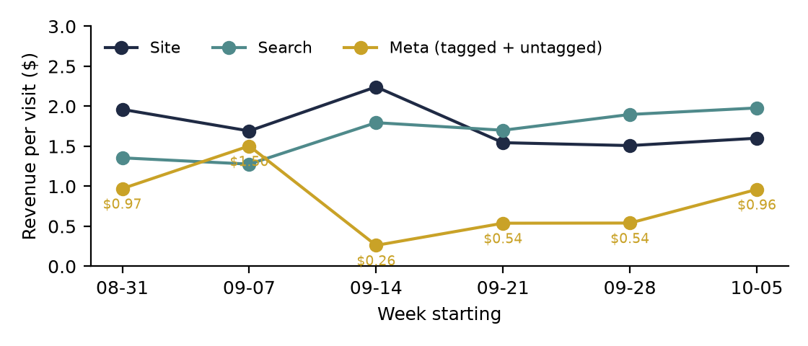

**HEATMAP · Today's Plan: Stop Paying for Meta Visits That Can't Convert**

Ceremonia · ceremonia.com
Prepared October 12, 2026 | Data through October 11, 2026
A one-hour ad-account intervention · three switches that change tomorrow's numbers

---

**Ceremonia**

**Today's Plan: Stop Paying for Meta Visits That Can't Convert**

PREPARED OCTOBER 12, 2026 · DATA THROUGH OCTOBER 11, 2026

The full analysis found the leaks; this document is today's fix. Three switches in Meta Ads Manager, about an hour of work in total, each taking effect as soon as it is made. The latest week of data (starting October 5) confirms all three leaks are still open: the campaign that has never produced an order took its biggest week yet (254 visits, 65 cart adds, no orders); social traffic is still landing on an $18 gel page where 93% of visitors leave after one page; and Meta traffic still arrives partly untagged and partly from markets that never order. Nothing in this plan needs new creative, new code or a meeting — it needs Ads Manager and an hour.

> **Why these three and not the bigger ideas.** Cart recovery and the $65 basket work are worth more in total, but they take days to build and weeks to measure. The three moves below are the only findings where the waste is happening today and stops tomorrow — tomorrow's Meta budget is committed tonight. Everything else stays queued for the week (section 06).

# Contents

| 01 The Situation This Morning | 02 Action 1 — Pause the Zero-Order Campaigns |
|----|----|
| 03 Action 2 — Re-Point Social Away From the $18 Gel | 04 Action 3 — Tag Every Ad and Check the Map |
| 05 How to Read Tomorrow | 06 The Rest of the Week |
| A Data and Method |  |

# 01 The Situation This Morning

The store ran 70 orders and $5,809 in the week of October 5 — 10 orders a day on an $82.98 average order, in line with the window's 11.3 a day. Organic search is the steady engine: $1.98 a visit last week, its best reading of the month. Meanwhile three paid-social leaks are active in the latest week of data:

| **Leak** | **Latest reading (week starting Oct 5, unless noted)** | **What it is worth** |
|----|----|----|
| Meta campaign 120250462604600082 | 254 visits, 65 cart-add visits, 8 checkouts, 0 orders — its largest week. 620 visits and 0 orders across the window, growing every week. Two more campaigns (…366746300082, …302640800082) took 368 visits at 0 orders. | Every dollar of their spend — none of it has a traceable order |
| Social landing on single low-price products | Pequi Flyaway Gel ($18) and Guava Gloss Drops took 1,572 social entry sessions in the window at $0.22–$0.26 each; 82–93% saw one page. Build Your Own Ritual earns $1.44 per social session. | Up to about $1,900 a month |
| Untagged and out-of-market Meta traffic | 18% of Meta visits untagged last week; 42% across the window, 62% in the week of the 30 September spike. Six markets with no orders sent 1,546 visits in the window. | Unknown — until it is tagged, it cannot be judged |

Table 1 — The three live leaks, with the numbers as of the most recent week of tracked data. Sizes are monthly estimates from current volumes, not forecasts.

*Figure 1 — Revenue per visit by week: Meta (tagged and untagged) against the site and organic search. Meta spent three straight weeks at $0.26–$0.54 before recovering to $0.96 last week — still about half the site.*

Each fix is a setting, not a project. None of them touches the site, the checkout or the email programme.

# 02 Action 1 — Pause the Zero-Order Campaigns

Owner: paid media. Time: about 15 minutes. This is the clearest of the three. The campaign has had four weeks to produce one order and has produced none — while getting bigger every week.

In Meta Ads Manager, this morning:

- Pause campaign 120250462604600082 (620 visits, 131 cart-add visits, 22 checkouts, 0 orders). Its creatives …618340082 and …618270082 put 55 shoppers in the cart from about 230 visits and converted none; creative …106170082 produced one cart add from 111 visits.

- Pause …366746300082 (217 visits, 1 cart add, 0 orders) and …302640800082 (151 visits, 23 cart adds, 0 orders).

- Move the budget to …366605980082 — $3.38 a visit, 8 buying visits from 190 — and the JW ASC Evergreen set ($1.22 on 60 visits so far).

- Before any relaunch of …604600082: open the ad and its landing page side by side. A 21% cart-add rate with only 12–17% of carts reaching checkout means shoppers like what they see and then meet a surprise — shipping cost on a small basket, a price that differs from the ad, or a gift that doesn't appear in the cart.

Expected result: about 1,000 visits a month stop flowing to campaigns with no orders; the freed budget moves to a set that already earns more per visit than organic search. The saving is the campaigns' full spend — Ads Manager has the number.

# 03 Action 2 — Re-Point Social Away From the $18 Gel

Owner: paid media. Time: about 20 minutes. Social is Ceremonia's fastest-growing channel and its weakest: 77% of social entry sessions see one page, and they earn $0.39 a session against search's $1.81. Most of it lands on two single-product pages:

- Find the prospecting ads pointing to /products/pequi-flyaway-gel (912 social entry sessions in the window, $0.26 each, 93% one page) and /products/guava-gloss-drops (660 sessions, $0.22, 82% one page).

- Change their destination to /products/build-your-own-ritual ($1.44 per social session on the same channel) or /collections/kits (7.4% of all its visitors buy). Do not pause the ads — the creative is earning cart adds; the page is losing them.

- The economics are on the page: free shipping starts at $65 and the free gel at $75. An $18 landing product asks a cold shopper to find $47 more on a page most of them never leave. A bundle landing clears the line in one tap.

- While you are there, remove /pages/meet-ceremonia as a destination: 271 social entry sessions in the window, no buyers.

Expected result: if the re-pointed sessions earn what Build Your Own Ritual already earns from social, the change is worth up to about $1,900 a month at current volumes. Treat that as an upper bound — the ritual builder's social visitors may differ — but even a third of it beats today's $0.24.

# 04 Action 3 — Tag Every Ad and Check the Map

Owner: paid media. Time: about 15 minutes. Two in five Meta visits in the window arrived without a campaign tag, so they cannot be judged — and more than a quarter of human visits come from identified non-US countries while 89% of orders are American:

- Add a UTM template at the ad-account level (source, medium, campaign ID, ad set ID, ad ID) so every ad link carries it, including boosted posts and Advantage+ sets. On 30 September, 623 untagged Facebook mobile visits hit the site in a single day; in that week 62% of Meta visits were untagged.

- Open every active ad set's location targeting. Spain, India, the UK, Canada, France and Australia sent 1,546 visits in the window with 97 cart adds and no orders. If the store does not ship there, exclude them; if it does, flag it to e-commerce — checkout is failing them.

- Check whether website-visitor audiences include all traffic. One raw visit in six is a dead session, and desktop "direct" product traffic doubled in four weeks at 0.68% conversion; neither belongs in a lookalike seed.

Expected result: from tomorrow, every Meta visit can be credited to a campaign, and no budget goes to markets with no order trail. This is what makes Actions 1 and 2 measurable.

# 05 How to Read Tomorrow

Five numbers tell you whether the switches worked. Direction should be visible within two or three days; at Ceremonia's volume give it a full week before judging size — a single order moves Meta's weekly revenue per visit by about 13 cents.

| **Watch** | **Now** | **Target** |
|----|----|----|
| Meta revenue per visit (tagged + untagged) | $0.96 last week ($0.26–$0.54 the three weeks before) | Above $1.20 within two weeks |
| Visits to campaigns with no orders | 254 last week to …604600082 alone | Zero |
| Social single-page share | 77% of social entry sessions | Under 65% |
| Share of Meta visits with a campaign tag | 82% last week, 58% across the window | Above 95% |
| Orders vs the same day last week | 10 a day last week | Hold or rise |

Table 2 — The scoreboard for this plan. Read revenue per visit by channel on filtered, human-only traffic.

One caution: Ceremonia's best days (20 September, 2 and 11 October) converted at 3.07% on below-average traffic, with every channel lifting at once — the pattern of an offer or code. If a promotion, restock email or launch lands inside the reading window, note it beside the numbers — it will move orders on its own.

# 06 The Rest of the Week

These are the larger plays from the Site Opportunity Report. They are deliberately not today's work — queue them once the three switches are on.

| **When** | **Action** | **Size** |
|----|----|----|
| Tue | Investigate the direct desktop traffic growth (296 → 615 visits a week at 0.68%); filter it if automated, then walk the desktop checkout (21% of checkouts complete vs 42% on mobile). | Half the desktop gap ≈ $1,350 / month — if it is real |
| Tue | Launch the two-week sequenced cart-recovery flow with a checkout-starter track and SMS where consented. 8.5% of abandoned carts recover today; 60% of non-buyers never return. | Each point of recovery ≈ $1,600 / month |
| Wed | $65 / $75 progress bar in the Rebuy cart drawer, with minis and kits as one-tap add-ons. 37% of orders pay shipping; 67 sit at $30–$45. | Every +$1 of average order ≈ $340 / month |
| Thu | Homepage first screen: best-sellers, kits and quiz into the first two mobile screens; reviews higher. 44% of mobile entrants pass 20% scroll. | Every half-point of homepage entry conversion ≈ $1,800 / month |
| Fri | Shop-the-routine modules on the four blog guides (~590 search entries, 0 orders); review coupon-extension leakage (17 orders last-clicked by Checkmate, FatCoupon and others). | Free traffic, currently idle |

Table 3 — The queue behind today's plan, drawn from the Site Opportunity Report's suggested 30 days.

# A Data and Method

- Figures come from Heatmap visit, page, event and order records for ceremonia.com, September 12 – October 11, 2026, with August 29 – September 11 for context. "Last week" is the week starting October 5 (Mon–Sun).

- Dead sessions — 2,906 visits, 16.0% of recorded traffic in the window — are excluded from every visit-based figure. No visit with an add to cart, checkout or order is ever excluded.

- Channel and campaign are the link the visit arrived on (last touch); revenue per visit is on-site value and excludes ad spend, which is not in this data.

- Landing-page figures by channel use entry sessions from the page pipeline; Meta weekly figures combine tagged Meta links and untagged Facebook/Instagram referrals.

- Sizes are monthly estimates from this period's volumes and assume the change described; they are not forecasts. The upper bound in Action 2 assumes re-pointed traffic behaves like Build Your Own Ritual's existing social traffic. Ceremonia's volumes are small; campaign-level rates on under 100 visits are directional.

- Shipping and gift thresholds ($65 and $75) were read from the live homepage on October 12.

- Sources: Ceremonia Site Opportunity Report and User Journey Opportunity Analysis (October 12, 2026); latest-week figures re-run from the underlying data.
