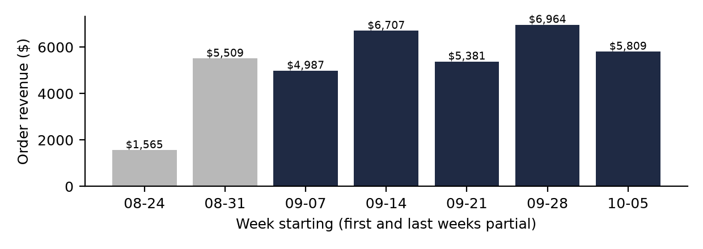
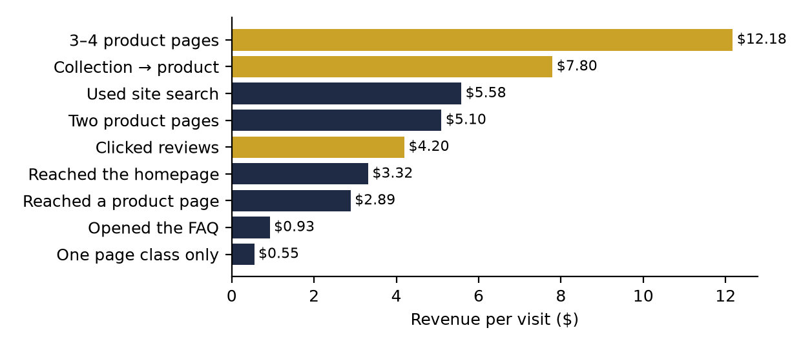
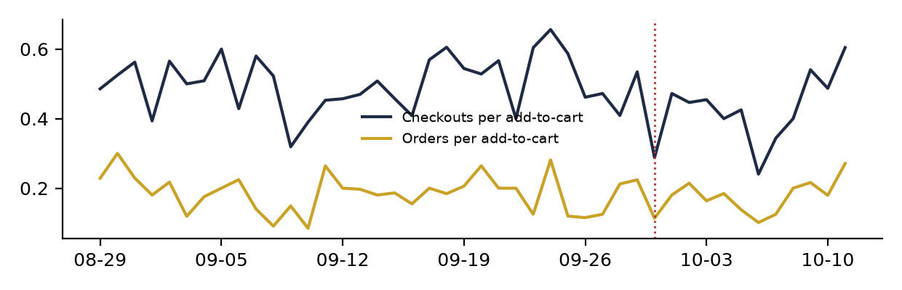

**HEATMAP · User Journey Opportunity Analysis**

Ceremonia · ceremonia.com
Prepared October 12, 2026 | Data window September 12 – October 11, 2026
Site behaviour, funnel and shopper-journey analysis · four and a half weeks of tracked visits

---

**Ceremonia**

**User Journey Opportunity Analysis**

PREPARED OCTOBER 12, 2026 · DATA WINDOW SEPTEMBER 12 – OCTOBER 11, 2026

This report follows how shoppers actually move through ceremonia.com — the paths they take from landing page to product, cart and order, how paid-social growth reshaped those paths, how returning visitors carry a disproportionate share of the business, and where the journey data points to recoverable revenue. All figures come from tracked visits and matched orders for September 12 – October 11, 2026, with late August for context. About 98% of order revenue matches a tracked human visit, and 2,906 dead sessions (16.0% of recorded traffic) are excluded throughout. Ceremonia's volumes are small — 339 orders, 15,269 human visits — so rates on fewer than about 100 visits are flagged as directional.

> **How to read a journey.** A journey is the sequence of store pages in a visit, grouped as home, product (/products/…), collection, content (/pages/… and /blogs/…) and other. Repeated views of the same class count once. On this site "other" mostly holds product pages recorded with a full domain — including the main paid-social landing pages (the Pequi Flyaway Gel, Guava Gloss Drops, Build Your Own Ritual) — so "product-style page" in this report combines the two. Product tiles carry a quick-add "Add to bag", so a buying visit can skip the product page; "leaves after one page" means no second store page, not necessarily no order.

# Contents

| 01 The Month in Journeys | 02 The Journeys That Make Money |
|----|----|
| 03 Where the Journeys Leak: The One-Page Landing | 04 How Paid-Social Growth Reshaped the Funnel |
| 05 Returning Visitors Are Worth Twice a New One | 06 Behaviour Signals Worth Watching |
| 07 Where the Journey Data Points | A Data and Method |

# 01 The Month in Journeys

Across the report window the site took 339 orders worth $26,900, at an average order of $79.35. Human traffic ran 65% mobile, 20% desktop and 14% tablet, and arrived 44% from search, 30% direct, 20% from Meta (tagged and untagged) and 3% from email. Beneath those totals, the journey data shows what a channel report cannot: two visits in three never move past one kind of page — and the ones that do are worth five to twenty times as much.

| **Measure** | **Value** | **Reading** |
|----|----|----|
| Orders / revenue | 339 / $26,900 | Average order $79.35, median $75.65 |
| Where visits land | 59% a product-style page · 24% homepage · 13% a collection · 4% content | The site is entered through product pages and the homepage |
| Most common journey | One page class, then leaves | 10,086 visits (66%), ordering at 0.83%, $0.55 each |
| Best common journey | Home → collection → product | 316 visits; 9.2% ordered, $7.78 each — 11.5% of matched revenue |
| The homepage effect | Visits that reach the homepage at any point | 4,385 visits; 3.9% ordered; $3.32 each |
| Second-product effect | Visits viewing 2+ product pages | 6.6–18.6% ordered; $5.10–$17.70 each |
| Peak days | 20 September, 2 and 11 October | 13.7 orders a day at $2.97 a visit, against 11.0 and $1.62 otherwise |

Table 1 — Journey context for the report window, September 12 – October 11, human visits.

*Figure 1 — Weekly order revenue, late August – October 2026 (grey: weeks before the window; the first and last bars are partial weeks). The two pre-window weeks ran about $716 a day against $897 inside the window; the growth is traffic, with conversion slightly lower.*

# 02 The Journeys That Make Money

The site's default journey is to land on one page and stay there. The money sits in journeys that move. Once a shopper crosses a page class — homepage to collection, collection to product, anything to a second product — conversion runs five to fifteen times higher than a one-class visit.

*Figure 2 — Revenue per visit by journey pattern, September 12 – October 11. Gold bars: collection-to-product journeys, multi-product journeys and review readers.*

| **Journey anywhere in the visit** | **Visits** | **Order rate** | **Revenue per visit** |
|----|----|----|----|
| One page class only | 10,086 | 0.83% | $0.55 |
| Product page only | 3,266 | 1.07% | $0.65 |
| Reached a /products/ page | 6,178 | 3.5% | $2.89 |
| Two different product pages | 759 | 6.6% | $5.10 |
| Three or four product pages | 341 | 12.6% | $12.18 |
| Collection → product | 1,370 | 8.8% | $7.80 |
| Reached the homepage | 4,385 | 3.9% | $3.32 |
| Clicked reviews | 708 | 4.8% | $4.20 |
| Used site search | 667 | 7.2% | $5.58 |
| Opened the FAQ | 524 | 0.95% | $0.93 |

Table 2 — Journey patterns, September 12 – October 11, all devices.

- Movement is the buying signature. Home → collection → product converts at 9.2% ($7.78 a visit) and is the single largest revenue journey. Home → other → collection (124 visits) converts at 12.1% and collection → product → collection (119 visits) at 10.9% — shoppers who browse the range buy the routine.

- The second product view is the cheapest conversion on the site. Visits seeing two product pages convert at 6.6%; three or four, 12.6% ($12.18 a visit); five to eight (97 visits, directional), 18.6%. Ceremonia sells routines — leave-in plus oil plus spray — and the journey data says shoppers who compare buy several.

- Collections are the corridor that works. Visits that walk collection → product convert at 8.8%, and /collections/meet-your-new-hair-ritual is the site's top revenue-touching page ($9,390 of buyer-visit revenue). Collection landings alone convert at 1.2%; the corridor pays when it leads to a product.

- Proof-seeking is purchase intent — but the FAQ is not. Review-clickers convert at 4.8%, more than twice the site. FAQ-openers convert at 0.95%, less than half — the FAQ looks like where doubts go to die (see section 06).

> **So what:** every element that moves a shopper to a second product works on the highest-value step in the journey — "complete the routine" on every product page, kits and the ritual builder in the cart drawer, collection links from the homepage's first screen. Judge merchandising by how often it produces a second product view, not by landing-page traffic.

# 03 Where the Journeys Leak: The One-Page Landing

Two visits in three see exactly one page class. Quick-add means a few of them still buy, but the leak is real where paid traffic lands on pages with no next step:

| **Entry channel (site-wide)** | **Sessions** | **See one page only** | **Revenue per session** |
|----|----|----|----|
| Social (Meta-led) | 3,501 | 77% | $0.39 |
| Direct | 5,082 | 66% | $1.42 |
| Campaign (email) | 652 | 65% | $5.01 |
| Search (Google-led) | 6,615 | 56% | $1.81 |

Table 3 — Entry sessions by channel and single-page share, report window. Social combines the largest single-page share with the lowest value.

| **Landing page** | **Visits** | **Buyer rate** | **Single reading** |
|----|----|----|----|
| Homepage | 4,975 | 3.5% | Works — but only 44% of mobile entrants scroll past the first fifth of the page |
| /products/pequi-flyaway-gel ($18) | 1,431 | 1.4% | Top entry page; 912 social entries at $0.26, 93% one page |
| /products/guava-gloss-drops | 1,579 | 3.9% | 660 social entries at $0.22 — fine for search, weak for social |
| /pages/meet-ceremonia | 355 | 0% | A brand story page taking 271 paid-social entries |
| Four blog guides | ~590 entries | 0% | Search traffic researching scalp and frizz problems, no route to product |
| /products/perfume-mist-de-guava | 451 | 1.8% | 311 entries, 1 entry-buyer |

- Paid social lands shoppers on an $18 product with a $65 free-shipping line. Meta visitors add to cart at 17.7% — more than the site's 12.4% — and then only 23% of those carts reach checkout against 47% site-wide. The basket is too small to survive the cart.

- The same traffic does well on a bundle: Build Your Own Ritual earns $1.44 per social session, more than five times the gel page.

- Meet-ceremonia, the blog guides and the fragrance pages are the same defect in three places: a destination that gives the visitor nothing to do next (Site Opportunity Report, Opportunity 6).

- Scroll is a form of movement this site barely gets. On the homepage, 95% of mobile entrants pass the first tenth, 44% reach a fifth, and 10% reach the bottom. The first two screens carry the whole page.

> **So what:** paid social needs a landing page that sells a basket, and every one-page destination needs a visible second step — the ritual builder, kits, best-sellers or the quiz. Moving two points of one-page visits (about 300 visits a month) into a product view is worth up to about $700 a month at the observed gap between $0.55 and $2.89 a visit; re-pointing the social landings is worth up to about $1,900 (Site Opportunity Report, Opportunity 2). Treat both as upper bounds — shoppers who browse further are partly different people.

# 04 How Paid-Social Growth Reshaped the Funnel

The window's growth against the prior fortnight is a traffic story. Visits rose 28%, the add-to-cart rate held to a decimal, and conversion slipped slightly as colder traffic arrived. The peak days did the opposite: fewer visits, and much higher conversion.

| **Funnel step** | **Pre-window (29 Aug – 11 Sep)** | **Report window** | **Peak days (20 Sep, 2 & 11 Oct)** |
|----|----|----|----|
| Visits per day | 399 | 509 | 424 |
| Orders per day | 9.4 | 11.3 | 13.7 |
| Visits adding to cart | 12.4% | 12.4% | 12.3% |
| Cart visits that order (within visit) | 18.4% | 17.6% | 24.8% |
| Visit → order | 2.29% | 2.17% | 3.07% |
| Revenue per visit | $1.78 | $1.73 | $2.97 |

Table 4 — Funnel by phase, human visits. The funnel is stable; the mix is not. Peak days are the three highest-revenue days of the window.

- Growth arrived at the door, not in the store. Visits per day rose 28% and orders 21%; add-to-cart held at 12.4%. The new visits were cheaper — Meta grew from 433 visits in the week of 14 September to 1,398 in the week of 28 September — and site revenue per visit fell from $2.24 to $1.51 over the same fortnight.

- Peak days lift every channel at once. 20 September, 2 and 11 October ran below-average traffic but converted a quarter of cart-adders in the visit. The traffic mix was normal (returning visitors 12% of visits against 13.5%), but every channel converted better — Meta at 2.9% against 0.8% — and coupon-extension referrals supplied 7 of 39 buying visits. That is the signature of an offer or code running on those days; there is no promotion calendar in this data to confirm it, and it is worth matching against Ceremonia's own.

- The desktop slide is the one funnel number that moved: desktop conversion fell from 2.39% (week of 14 September) to 0.59% (week of 5 October) while desktop "direct" visits doubled. Until that traffic is checked for automation, read desktop trends with caution (Site Opportunity Report, Opportunity 7).

*Figure 3 — Checkouts and orders per add-to-cart visit, daily, 29 August – 11 October. No step change in the checkout event; the 30 September dip is the untagged Facebook spike (dotted line), not a behaviour change.*

> **Watch out:** on 30 September the site took 1,484 human visits — three times normal — 623 of them untagged Facebook mobile visits, with 281 more excluded as dead sessions. Orders barely moved (16). Daily rates around that date are diluted; compare weeks, not days.

# 05 Returning Visitors Are Worth Twice a New One

Returning visitors are 13.5% of visits but convert at 3.94% and earn $3.41 a visit — more than twice new visitors (1.90%, $1.47). They supplied 82 of 333 matched orders (25%) and 26% of matched revenue.

| **All visitors** | **Week of 14 Sep** | **Week of 21 Sep** | **Week of 28 Sep** | **Week of 5 Oct** |
|----|----|----|----|----|
| New: order rate | 2.22% | 1.69% | 1.80% | 1.65% |
| New: revenue per visit | $1.70 | $1.29 | $1.39 | $1.35 |
| Returning: order rate | 5.34% | 4.09% | 3.01% | 3.66% |
| Returning: revenue per visit | $5.19 | $3.19 | $2.43 | $3.21 |

Table 5 — New vs returning visitors by week. Weekly returning counts are 465–531 visits, so single weeks move by a point on a handful of orders.

- The dilution is in new traffic. New-visitor conversion slid from 2.22% to 1.65% as Meta volume grew; returning visitors dipped in the spike week and recovered. The site's falling average is a mix effect, not a weaker store.

- Email-engaged shoppers convert at twice the rate: visits from devices that clicked an email in the prior 14 days convert at 3.95% ($3.21) against 2.07% for the rest. Campaign email arrivals on the homepage earn $6.56 a session — the best entry on the site.

- Repeat clicks look like intent, on thin data: devices with one email visit in a period bought at 5.3% (16 of 304), two email visits at 10.3% (4 of 39). Directional only.

- The product line is built for replenishment — the Leave-In, Hair Oil, shampoo and conditioner run out — and Klaviyo's replenishment and reactivation flows (Retentics) exist. But each carried only a handful of visits in the window. The retention machine is installed and barely switched on.

- One limit: this data cannot measure repeat-purchase rate directly. The 30-day purchase-history flag counts the visit's own order, so "bought before" here is every buyer by construction. Returning-visitor figures use the visit's returning flag instead.

> **So what:** two moves follow. First, turn up the flows the store already owns — replenishment timed to product size, back-in-stock, browse abandonment — because returning and email-engaged visitors are worth twice the rest. Second, watch the new-visitor line weekly: it is where paid-social dilution shows up first, and it fell a third in a month.

# 06 Behaviour Signals Worth Watching

Five smaller journey signals ran through the period. None is an emergency; each points to a page, merchandising or measurement question worth answering before the next campaign.

- The FAQ is where doubts go. FAQ-openers (524 visits) convert at 0.95%, under half the site rate, and earn $0.93 a visit. Shoppers open the FAQ when something is unresolved — shipping cost, international delivery, ingredients, returns. Read which questions get opened; the answers belong on the product page.

- Shallow homepage visits convert best. Visits that scroll only 1–10% of the homepage convert at 4.6% ($4.05); those reaching the bottom convert at 1.8%. Homepage arrivals largely know what they want — the menu drawer (274 clicking sessions, 5.7% conversion among menu users) is their tool. Product-forward first screens beat storytelling here.

- Product pages work in the first minute. Visits spending 15–60 seconds on product pages convert at 4.3%; under 15 seconds, 2.3%; ten minutes or more, 2.6%. Long dwell is not engagement here — it is hesitation.

- Search users are the hottest small cohort. 667 visits used site search and converted at 7.2% ($5.58). Predictive search is among the homepage's top clicks (52 sessions). Make the search box visible on mobile.

- The popup cohort is small but warm. 717 visits interacted with the popup and converted at 3.4% ($2.48), above the site average. List growth is throttled by reach, not quality.

# 07 Where the Journey Data Points

Read together, the journey evidence ranks the opportunities differently from traffic volume. The largest leaks sit at the first page: paid-social shoppers who land on a single cheap product, see one screen, and leave. Then comes the under-used retention window, and then the movement and proof mechanics.

| **Priority** | **Move** | **Journey evidence** |
|----|----|----|
| 1 · High | Land paid social on baskets — Build Your Own Ritual, kits, bundles — and pause the Meta campaigns with no orders | Social: 77% one page at $0.39; the gel page 93% one page; the ritual builder earns $1.44 from the same channel; up to ~$1,900 a month (upper bound) |
| 2 · High | Give every one-page destination a second step: "complete the routine" on product pages, shop modules on blog guides, a next step on meet-ceremonia | 66% of visits see one page class at $0.55; two product views earn $5.10, three or four $12.18 |
| 3 · High | Turn up the owned flows: replenishment, back-in-stock, browse abandonment, cart recovery | Returning visitors earn $3.41 vs $1.47; email-engaged visitors convert at twice the rate; flows run at a handful of visits |
| 4 · Medium | Product-forward homepage first screen: best-sellers, kits, quiz, search, reviews higher | 44% of mobile entrants pass 20% scroll; shallow scrollers convert 4.6%; search users 7.2%; review-clickers 4.8% |
| 5 · Medium | Move FAQ answers onto product pages: shipping line, international policy, ingredients | FAQ-openers convert at 0.95%, under half the site |
| 6 · Medium | Fix journey measurement: Meta tagging, the desktop traffic check, the dead-session filter | 42% of Meta visits untagged; desktop conversion 2.4% → 0.6% while direct desktop visits doubled |

Table 6 — Opportunity ranking from journey evidence. Dollar figures are monthly estimates from the window's volumes and are upper bounds.

Track weekly:

- Share of visits seeing a second page class: 34% now.

- Social single-page share: 77% now; Meta cart-to-checkout: 23% now.

- New-visitor revenue per visit against returning: $1.35 vs $3.21 in the final week.

- Visits from email clicks and flows as a share of all visits: about 6% now.

These four numbers catch every leak this analysis found.

# A Data and Method

- Figures are visit- and order-level aggregates from ceremonia.com tracking for the stated windows.

- About 98% of order revenue matches a tracked human visit, so visit-level revenue understates order totals slightly.

- Dead sessions (one page or none, no click, no scroll, no order) are excluded; the filter rules are documented in the accompanying data guide.

- Journeys use the order of page classes in each visit, with consecutive repeats counted once. Because product tiles carry quick-add, a buying visit can be a single tracked page.

- Page-class "other" holds product URLs recorded with a full domain; "product-style pages" in section 01 combines it with /products/ entries.

- Entry-channel and landing-page tables use entry sessions from the page pipeline, which counts slightly differently from human-visit totals; compare rows within a table.

- Shoppers are counted by visit and device, not named account; cross-device shoppers count as two. The 30-day purchase-history flag includes the visit's own order and is not used to estimate repeat rates.

- Volumes are small: weekly segments of a few hundred visits move by a point on a handful of orders. Rates on fewer than about 100 visits are directional.
