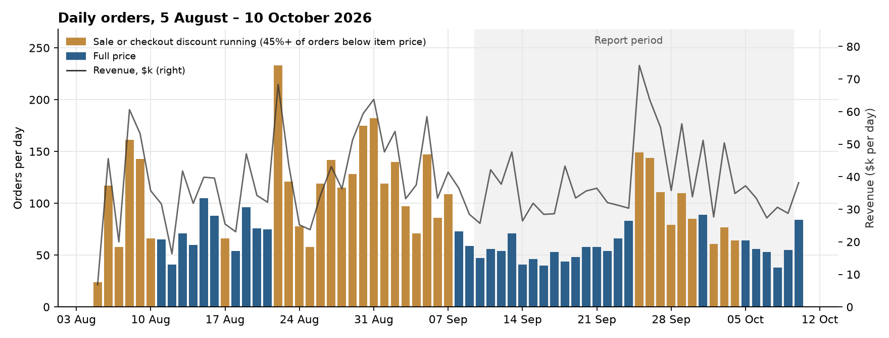
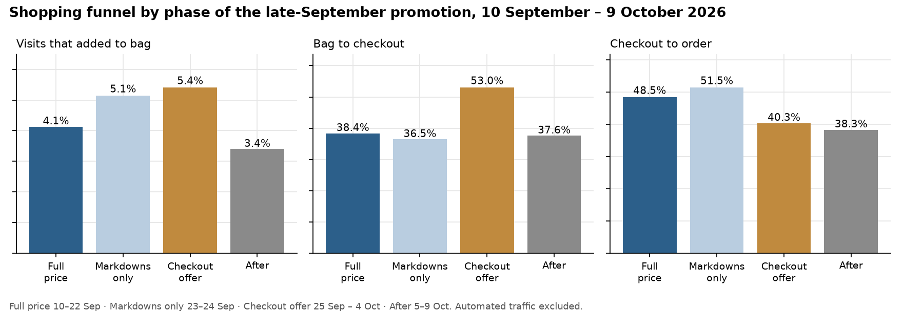
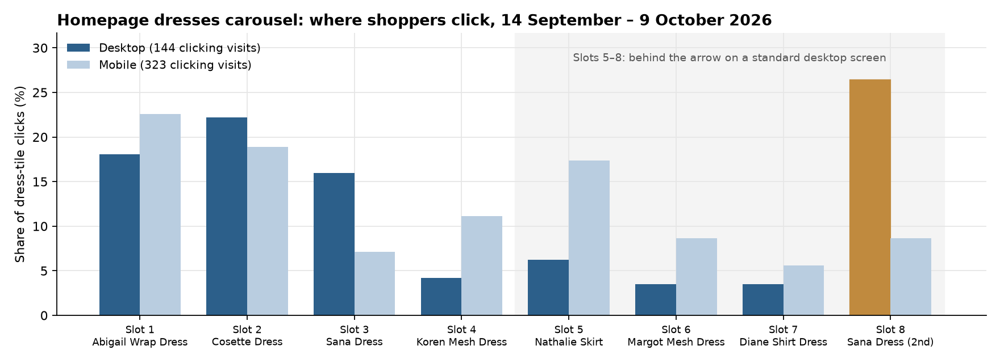
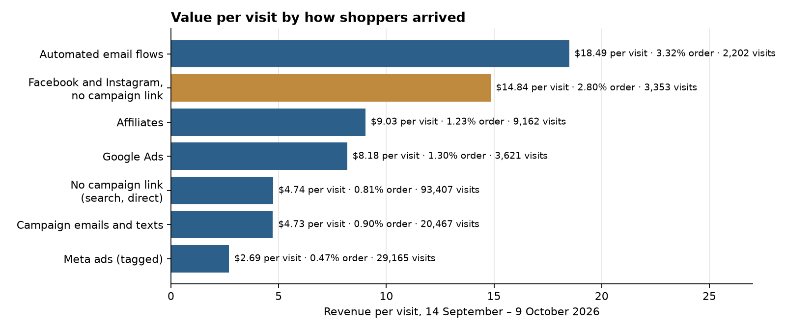

# DVF — Site Opportunity Report

**Site:** [dvf.com](https://dvf.com)
**Period reviewed:** 10 September – 9 October 2026, with August for context
**Prepared:** 11 October 2026

---

## The biggest wins, first

Five moves cover most of the opportunity in this report. Two are service plays that pay back quickly, one makes promotions accountable for margin, and two fix what shoppers and the reporting can't see today. Each is detailed in the section referenced.

**1. Welcome back the shopper who left a bag — by name where you know it.** A return visit with a bag waiting is worth about seven times a first visit: **$23.56 per visit against $3.31**, at a 4.5% order rate. These visits are 6% of traffic and about 30% of revenue, and today the site treats them like any other arrival. Greet them — "Welcome back, your bag is saved" — with a one-tap resume-checkout beside a continue-shopping path. About one bag return in five arrives from an email, which identifies the shopper and allows a personal greeting. Most come back on their own, through search, direct or a bookmark: 6,527 visits in four weeks, ordering at 4.9%. If the greeting lifts their order rate by 10–25%, it is worth about **$15,000–$40,000 over four weeks**. Start on mobile, where two thirds of these shoppers are and where recovery is weakest. *(Opportunity 1)*

**2. Give high-value buyers a concierge.** One order in nine is $1,000 or more, and those orders carry **36% of revenue**. Assign every $1,000+ order a stylist or client-services owner who follows up personally. Today about 12% of these buyers come back to buy again within the month. A pilot with 150 of them, measured against a matched group on the standard flow, is worth about **$10,000–$30,000 a quarter** if it lifts that by five to ten points. *(Opportunity 4)*

**3. Answer the returns question on the product page.** One in eight high-value buyers reads the returns-and-exchanges policy before committing to a four-figure order. That is about **40 times** the rate of all visitors and over 30 times the rate of other buyers. The answer currently lives one click away from the product. Put the summary inline, next to Add to Bag, on items over $500. It costs almost nothing to do. *(Opportunity 4)*

**4. Keep running promotions, but set a margin target for each one and fix the checkout offer.** The 24 September – 4 October promotion added about **$135,000** in revenue over full-price days. After allowing for the sales that would have happened anyway, about $80,000–$115,000 of that was new. Against it, shoppers paid about **$36,000** less than item prices at checkout, and markdowns took off up to **$84,000** more. Whether the promotion made money depends on margin, and the site has run a sale or checkout discount on about half the days since early August. Two changes: give the next promotion a margin target and test markdowns without the checkout overlay, and audit the checkout offer itself. Once it went live, the share of checkouts that became orders fell from 49% to 40%. Holding the full-price rate would have been worth up to about **$75,000**. *(Opportunity 2)*

**5. Fix the measurement before moving money.** Facebook and Instagram visits that arrive without a campaign link are worth **$14.84 per visit**, against **$2.69** for tagged Meta ads, and they brought in about $50,000 this month that the channel report doesn't show. About 23,000 automated visits are also labelled as Facebook traffic, and Meta's link format changed in mid-September. Until links follow one scheme and automated visits are filtered, Meta's numbers can't support budget moves. *(Opportunity 5)*

Two supporting plays sit behind these. One is a desktop layout test for the homepage dresses carousel, where the hidden second Sana tile drew a quarter of desktop clicks *(Opportunity 3)*. The other is a "save your picks" prompt for deep browsers who leave without a bag, which widens the recoverable pool beyond bag abandoners *(Opportunity 1)*.

---

## At a glance

| # | Finding | Recommended action | Priority |
| --- | --- | --- | --- |
| 1 | Shoppers who leave a full bag are the site's best prospects. Their return visits are 6% of traffic and bring in about 30% of revenue. Bag shoppers who come back through an automated email order at 5.9%, against 2.3% from a campaign email. | Greet returning bag shoppers on site, widen the automated flow, add the bag to campaign emails, and start with mobile. | **High** |
| 2 | A markdown and 20%-off promotion from 23 September to 4 October added about $135,000 in revenue. The discounts cost about $36,000 at checkout plus up to $84,000 in markdowns. Checkout completion fell once the offer went live. Sales ran on about half the days since early August. | Set a margin target for the next promotion, test markdowns without the checkout offer, and audit the checkout offer. | **High** |
| 3 | On desktop, the dresses carousel shows about four of its eight dresses. A second Sana tile in the last slot drew a quarter of desktop clicks. | Confirm the Sana tiles, then test a desktop layout that shows more of the row. | **Medium** |
| 4 | One order in nine is $1,000 or more, and those orders bring in over a third of revenue. About half of them come from shoppers with no visit in the 30 days before, and a quarter from shoppers who had left a bag. These buyers read the returns policy about 40 times as often as other visitors. | Put the returns answer on the product page, merchandise the curated paths, and pilot a personal service path. | **High** |
| 5 | Affiliates and untagged Facebook and Instagram visits are worth three to five times as much per visit as tagged Meta ads. About 23,000 automated visits are labelled as Facebook traffic. | Fix campaign links and filter automated traffic before moving Meta budget. Grow the affiliate program around Rakuten. | **Medium** |
| 6 | In the week of 5 October, desktop traffic to All Clothing rose about fourfold while buyers held steady. The extra visits carried no campaign link. | Confirm the source of that traffic. | **Watch** |
| 7 | Search revenue per visit rose during the promotion and is back at its mid-September level. | No change now. Watch mobile search over the next two full-price weeks. | **Watch** |

---

## The month in numbers

| | |
| --- | --- |
| Orders | **2,054** |
| Revenue | **$1.15M** |
| Average order | **$560** (median $426) |
| Traffic by device | Mobile 55% · Desktop 29% · Tablet 15% |
| Traffic by source | Direct 38% · Campaign links 24% · Search 21% · Social 17% |
| New visitors | 84% of visitors |
| Automated traffic left out | About 25,000 visits (12%), almost all desktop visits labelled Facebook with no campaign link |

**Daily orders across the period**

| Week starting | Orders per day | Revenue per day |
| --- | --- | --- |
| 14 Sep | 47 | $32,500 |
| 21 Sep | 95 | $46,100 |
| 28 Sep | 81 | $41,400 |
| 5 Oct (Mon–Fri) | 53 | $31,500 |

Orders ran near 50 a day through mid-September, when the site was at full price. They rose during a promotion that began on 23 September, peaked at 149 on 25 September, and came back to the mid-September level in the week of 5 October, after the promotion ended.

The longer view matters for how to read that. Since early August, a sale or checkout discount has run on 33 of 67 days, and four of the six weeks before this report's period carried one. Full-price weeks were the exception, not the rule. Full-price revenue held steady through them, at about $32,000–$37,000 a day.

*Gold bars are days when 45% or more of orders paid less than the item price, the mark of a sale or checkout discount. On full-price days that share runs at about 30–35%.*

---

## Opportunity 1 — Bring back the shoppers who leave a full bag

**What we saw**

We followed every shopper who added to bag or started checkout between 10 and 25 September without buying. Each one was followed for 14 days.

| Device | Shoppers | Bought within 14 days | Rate |
| --- | --- | --- | --- |
| All devices | 2,699 | 221 | **8.2%** |
| Mobile | 1,814 | 136 | 7.5% |
| Desktop | 451 | 45 | 10.0% |
| Tablet | 474 | 51 | 10.8% |

- The 221 shoppers who came back and bought spent **$142,144**, about $640 each.
- **1,370** of these shoppers (51%) came back to the site. **1,149** of them came back and left again without buying. They are the warmest audience on the site.
- The 8.2% blends two periods. Shoppers who left a bag on 10–13 September, whose two weeks ended before the promotion, bought at about **6%**. Those who left one on 18–25 September bought at about **13%**, because the promotion gave them a reason to return. Use about 6% as the full-price baseline.
- Leaving a bag is about **three times** as strong a signal as browsing. Shoppers who browsed with interest but left no bag bought later at about 3%, against about 11% for bag shoppers over the same days.
- Returning visitors are worth about twice as much as new ones. On the homepage, returning visitors order at **2.88%** and bring in **$18.69** per visit. New visitors order at **1.56%** and bring in **$9.56**. Returning visitors are about 15% of homepage traffic.

**What the last visit says about this one**

We sorted every visit from 14 September to 9 October by what the same shopper did on their visits in the 30 days before.

| Shopper's history | Visits | Order rate | Revenue per visit |
| --- | --- | --- | --- |
| First visit | 116,345 | 0.55% | $3.31 |
| Browsed before | 21,860 | 0.70% | $4.46 |
| Browsed deeply last visit, no bag | 10,842 | 1.07% | $4.71 |
| Returning, last seen over 30 days ago | 1,729 | 1.56% | $9.57 |
| **Left a full bag** | **10,219** | **4.54%** | **$23.56** |
| Bought before | 644 | 9.01% | $41.94 |

- A return visit with a bag waiting is worth about **seven times** a first visit. These visits are 6% of traffic and bring in about 30% of revenue.
- A deep browse with no bag adds little. Shoppers who viewed more than three pages, or clicked, scrolled and stayed over a minute, were worth $4.71 on their next visit, close to the $4.46 of a light browser. The bag is what marks a shopper as ready to buy.

**How bag shoppers come back**

| Return visit arrived from | Visits | Order rate | Revenue per visit |
| --- | --- | --- | --- |
| Their own return (search, direct, bookmark) | 6,527 | 4.86% | $25.68 |
| Automated email flow | 440 | **5.91%** | **$34.22** |
| Campaign email | 1,645 | 2.31% | $11.11 |
| Meta ads | 1,233 | 2.92% | $15.43 |

- **Most bag shoppers come back on their own.** About two in three return visits arrive with no campaign link. About one in five comes from an email, mostly campaign sends; the automated flow carries about one in 25.
- **The automated flow works.** It brings bag shoppers back at the highest value of any email. Part of that edge comes from who it reaches: shoppers the site can identify, who have opted in. So the gap overstates what other shoppers would do with the same message.
- **Campaign emails bring back nearly four times as many bag shoppers** at less than half the order rate. On mobile, bag shoppers who returned from a Klaviyo email ordered at 2.1%, and bag shoppers who came back on their own ordered at 6.2%.
- **Meta retargeting reaches bag shoppers too**, at about 60% of the value of a shopper's own return.

**Why it matters**

The largest group is the one with no message at all: 6,527 own-return visits in four weeks. The site recognizes them only by what they left in the bag. A greeting with a one-tap path back to the bag that lifts their order rate by 10–25% would add about **$15,000–$40,000 over four weeks**.

The campaign-email group is the quickest email lever. Adding a "still in your bag" block to campaign sends would not make them perform like the automated flow. If it closed a quarter to a half of the gap, the four weeks would have produced about **$7,000–$14,000** more.

Mobile holds two thirds of these shoppers and has the lowest rate of buying later. If mobile matched desktop's 10%, the same 16 days would have produced about **45 more orders, roughly $29,000**.

**Recommended actions**

1. **Recognize returning bag shoppers on site.** Greet them in the header or on the homepage — "Welcome back, your bag is saved" — with a one-tap resume-checkout and a continue-shopping path, and keep the bag saved between visits. Start on mobile. Test it against no greeting.
2. **Widen the automated abandoned-bag flow.** Extend it across the full 14 days these shoppers stay warm, and make sure both bag adds and checkout starts trigger it.
3. **Put the bag in campaign emails.** For recipients with an open bag, add a "still in your bag" block with the saved items and a one-tap link to the bag. Test it against the standard send.
4. **Design for mobile first.** Use SMS or push where you have consent, with a one-tap link back to a saved bag.
5. **Invite deep browsers to save.** A shopper who views several products and leaves without a bag has the value of a light browser. A "save to wishlist" or "save your picks" prompt on that visit gives the next email something to bring them back to.
6. **Track it as one number:** the share of abandoned bags that become orders within 14 days. At full price that is about 6%. Every percentage point on this group is about 27 orders. Review it by return channel each month, and read promotion months separately.

---

## Opportunity 2 — Make promotions accountable for margin

**What we saw**

| Date | Orders | Revenue |
| --- | --- | --- |
| Thu 25 Sep | 149 | $74,177 |
| Fri 26 Sep | 144 | $63,450 |
| Sat 27 Sep | 111 | $55,124 |
| Full-price day, 10–23 September | ~53 | ~$34,300 |

Those three days brought in more than **$190,000**, about 17% of the month's revenue. They were the peak of a promotion that built over several days:

| Date | What changed |
| --- | --- |
| 23 Sep | Markdowns went live on a group of styles. Orders for marked-down items rose from about 3 a day to 23. |
| 24 Sep | The "New Markdowns" email, the largest send of the month. Most clicks went to the Sale page. |
| 25 Sep – 4 Oct | 20% off at checkout: the "20% off Selects" email on 25 September, Private Sale texts on 26 and 28 September, the Private Sale email on 30 September, and a new Private Sale page. |
| 25–26 Sep | The Sasha Dress at $329, half its usual $658. It went back to $658 on 27 September. |

- **The lift came more from buying than from traffic.** Visits per day rose about 27% across the promotion. The share of visits that ordered rose from 0.78% to 1.14%, and to 1.41% on the peak days of 25–27 September.
- **Markdowns alone moved orders, not revenue.** On 23–24 September, before the checkout offer, orders rose to about 75 a day, 42% above full price. Revenue fell about 10%, to about $30,800 a day, because the extra orders were smaller. The revenue lift came when the checkout offer and the email and text sends arrived on 25 September.
- **Email and texts did the most.** Orders traced to email and texts went from about 6 a day at full price to about 16 a day across the promotion, and 23 a day at the peak. The 20% email and the Private Sale messages sent shoppers to the Private Sale page, and 2.6% of visits that started there ordered.
- **Two thirds of buyers never opened a sale page.** They bought from product pages with the checkout offer. Dresses stayed at 70% of orders.
- **Search shoppers held their spend; affiliate shoppers traded down.** The average order from search held at about $600 ($613 at full price, $596 across the promotion). The average order from affiliate links fell from $957 to $600, and to about $300 at the peak.
- **One creator made the Sasha Dress the top seller, at half price.** Anne Sisteron's ShopMy links sent about 1,170 mobile visitors straight to the Sasha Dress in two days. It sold 36 on 25–26 September, against 3 in the ten days before, and 14 of those orders trace directly to ShopMy links. Selling at half price gave up about $11,800 against its usual price. Other dresses rose too, from about 35 orders a day to 87, so the Sasha post rode the wider promotion rather than driving it alone.
- **Orders got smaller, but large orders held.** The average order over the promotion was $488, against $653 at full price. Orders of $1,000 or more held at about 8 a day across the promotion and rose to about 12 on 25–27 September.
- **About 4,000 desktop visits from Facebook on 25 September produced no orders** and look automated. They are left out of the figures above, along with similar traffic through the month.

**What the discount cost**

- **At checkout.** On the checkout-offer days, 25 September to 4 October, 54% of orders paid less than the item price, against about 30–35% at full price. Those orders paid about **$36,000** less than item prices.
- **In markdowns.** From 23 September to 4 October, 447 orders included marked-down items. Against each style's usual full price, the markdowns took off up to **$84,000**. That is an upper bound, because some of those buyers would not have bought at full price.

**The checkout offer and checkout completion**

The offer pulled far more shoppers from the bag into checkout: 53% of bags reached checkout, against 38% at full price. Fewer of those checkouts finished. At full price, 49% of visits that started checkout placed an order, and on the markdown-only days 52%. Once the 20% offer went live the rate fell to 40%, and it stayed near 38% in the week after. Some of the drop is shoppers starting checkout just to see the discount. Some may be friction: a code that doesn't apply, an exclusion that surfaces late, a total that differs from the banner. If completion had held at the full-price rate, the offer days would have produced about 150 more orders, **up to about $75,000**.

**Was it new money?**

Across the 11 days from 24 September to 4 October, the site averaged about **96 orders and $46,600 a day**, against 53 orders and $34,300 at full price. That is about **$135,000** more revenue. A fair share of that would have been bought anyway, by shoppers who waited for the sale or who would have bought at full price. Our estimate is that **$80,000–$115,000** was new. The week after showed little sign of borrowing. Orders were back at 53 a day, and revenue at about $31,500 a day, about 8% below the full-price level.

Set against the discounts — about $36,000 at checkout and up to $84,000 in markdowns — the promotion's revenue gain and its price cost are in the same range. Whether it made money depends on product margin, which this data doesn't include.

**The pattern since August**

The late-September promotion was not unusual. Since early August, a sale or checkout discount has run on about half of all days: the weeks of 3, 24 and 31 August, part of the week of 17 August, and the late-September promotion. Sale weeks lifted orders well above full price, to 100–120 a day in late August, at average orders of $330–$390. Full-price weeks held steady at about $32,000–$37,000 a day. The risk is that shoppers learn the calendar and wait.

**Why it matters**

Promotions are the biggest lever on daily orders, and DVF is already pulling it often. The open questions are margin and frequency, not whether promotions work.

**Recommended actions**

1. **Set a margin target before the next promotion.** Pull discount and margin totals for the late-September promotion and the August sales, and agree what a promotion must return after discount. Measure the next one against about 53 orders and $34,300 a day at full price.
2. **Audit the checkout offer.** Walk through the 20% offer on mobile and desktop: code entry, exclusions, error messages, and whether the total matches the banner. Watch checkout completion daily during the next promotion; the full-price rate is about 49%.
3. **Test markdowns without the checkout overlay.** Markdowns alone lifted orders 42%. A promotion that runs markdowns plus email and texts, without a site-wide checkout discount, will show how much of the lift the 20% buys.
4. **Space promotions out.** With a sale on about half of all days since August, set a minimum gap between promotions and track full-price revenue per day between them.
5. **Lead with email and texts.** Send them to a dedicated page like Private Sale, where visits converted at 2.6%.
6. **Book a creator for one hero product, at a smaller discount.** The Sasha post shows a creator can focus a promotion on one piece. Judge creators on new customers as well as revenue per visit, and test whether the product sells at less than half off.
7. **Run the bag follow-up through the promotion.** A sale gives shoppers a reason to return to their bag. Pair the next promotion with the abandoned-bag program in Opportunity 1.

---

## Opportunity 3 — Test a desktop layout for the dresses carousel

**What we saw**

The homepage dresses carousel is one row of eight tiles.

- On a standard desktop screen, the first three tiles and part of the fourth are visible. Tiles five to eight are reached with the arrow. On mobile, shoppers swipe through the row.
- Tiles 4–7 get **17%** of desktop dress-tile clicks and **43%** on mobile. Mobile shoppers find the whole row, and desktop shoppers mostly stay with the first few tiles.
- 143 desktop visitors and 192 tablet visitors used the carousel arrow during the period.
- Quick-add is used on the first three tiles and almost never further along.
- **Sana appears twice**, in slot 3 and in slot 8. On desktop, the slot 8 Sana drew about a quarter of dress-tile clicks and the only two dress orders that came from the carousel.

The numbers are small — 144 desktop visits clicked a dress tile in four weeks — and the tracking can't confirm which product each tile showed on a given day. Treat this as a test to run, not a proven fix.

**Recommended actions**

1. **Confirm the two Sana tiles.** If slot 8 is a second colorway, it's drawing attention, and it's worth testing in the first three slots on desktop. If it's a duplicate listing, give slot 8 to another dress and keep one Sana in a visible position.
2. **Put the dresses you most want to sell in slots 1–4.** That is the part of the row desktop shoppers see without the arrow.
3. **Test a desktop layout that shows more of the row.** Options include smaller tiles, a peek of the fifth tile, or a clear "Shop all dresses" link beside the arrow. Measure clicks on tiles 5–8 and dress orders from the homepage over at least four weeks.

---

## Opportunity 4 — Give high-value shoppers a personal path

**What we saw**

| Order size | Orders | Share of orders | Revenue | Share of revenue |
| --- | --- | --- | --- | --- |
| $2,000 and up | 44 | 2.1% | $155,475 | 13.5% |
| $1,000 and up | 234 | 11.4% | $410,982 | **35.7%** |

The largest single order in the period was **$13,559**. Two of the largest orders, $13,559 and $12,617, each came from a shopper's single visit.

**Who the high-value buyer is**

We traced 200 of the 234 orders back to the visits that produced them. They come from about 190 buyers.

- **About half buy with no recent history.** In 94 of the 200 orders, the buyer had no visit in the 30 days before. A quarter (51) had left a bag on an earlier visit, and 16 had bought before. Above $2,000, the split is the same: 19 of 39 had no recent visit, and 12 had left a bag.
- **Most buy once, but not all.** About 12% of these buyers came back and bought again on another visit within the month. That is the baseline a service path has to beat.
- **They are decisive, not leisurely.** The median high-value buying session lasts 155 seconds with 12 interactions — essentially the same as an ordinary buying session (160 seconds, 13). They do not browse more; they decide faster.
- **Mobile brings the volume, desktop brings the size.** 62% of high-value buyers are on mobile (average order $1,664); desktop buyers are fewer but average $2,366.
- **Most arrive without a campaign link.** About 60% carried none. By source: direct 37%, search 28%, email 12%, Meta ads 8%, affiliates 8%, and Facebook or Instagram without a link 6%. 77% are in the US.
- **They land on product pages and the homepage.** Of the 200 orders, 67 started on a product page, 58 on the homepage, 22 on the New or Fall 2026 collections, and 45 on other collections.

What sets them apart is **where they go across their visits**:

| Page | Share of high-value buyers | Share of all visitors | Over-index |
| --- | --- | --- | --- |
| Returns & Exchanges policy | 12.8% | 0.3% | **40×** |
| On-site search | 8.0% | 1.2% | 6.8× |
| New arrivals | 30% | 6.8% | 4.4× |
| Dresses | 28% | 6.8% | 4.1× |
| Fall 2026 collection | 13% | 3.4% | 3.8× |
| DVF x Henry Zankov | 10% | 2.8% | 3.7× |
| Sale | 11% | 3.5% | 3.1× |
| All Clothing | 19% | 13.2% | 1.4× — barely over |

Three readings:

1. **The returns policy is part of the high-value purchase decision.** One in eight high-value buyers reads it. That is 40 times the rate of all visitors, and still over 30 times the rate of other buyers, so it isn't just that buyers read more. A shopper considering a $1,300 dress wants the exit terms before committing, and today that answer lives on a separate page away from the product.
2. **They shop edits, not the warehouse.** New arrivals, dresses, the fall collection, and the designer collaboration all over-index about fourfold. The 527-item All Clothing page — the natural home of generic traffic — barely registers. High-value buyers behave as if they came for something specific.
3. **They use on-site search about seven times as often as the average visitor.** Search is a buying tool for this group, not a fallback.

**Why it matters**

Two levers fall out. First, reassurance at the point of commitment: the returns answer belongs on the product page itself for higher-priced items. Second, a relationship after the first order: about 12% buy again within the month today, and a named contact can raise that. A discount prompt aimed at this group cuts against the grain. They pay full price, and $1,000+ orders held at about 8 a day across the promotion, while smaller orders nearly doubled.

A concierge pilot with 150 of these buyers, measured against a matched group on the standard flow, is worth about **$10,000–$30,000 a quarter** on that group alone if it lifts repeat purchases by five to ten points at their average order of about $1,750.

**Recommended actions**

1. **Put the returns and exchange summary on the product page** for items over $500 — inline, near Add to Bag, no extra click.
2. **Assign an owner** for orders above $1,000: a stylist or client-services contact who follows up after purchase. Start with a 150-buyer pilot and a matched holdout group.
3. **Offer a direct line** to that team on high-ticket product pages, such as chat, an appointment, or a call-back.
4. **Report large orders separately** in weekly reviews. A single $10,000+ order can move a week's revenue per visit on its own, and seeing those orders separately keeps the underlying trend clear.
5. **Merchandise the curated paths with full-price statement pieces.** That means homepage slots 1–4 (the desktop-visible row in Opportunity 3) and the New, Dresses, Fall 2026, and collaboration collections. All Clothing is not where these shoppers browse.
6. **Treat on-site search as a revenue surface for this group.** Check that new arrivals, dresses, and collections rank well for the terms big spenders type.
7. **On sessions with high-value signals — collection or search entry, a high-priced product view — lead with trust content** (returns, shipping, stylist access) rather than a discount offer.
8. **Track two numbers alongside the weekly large-order list:** the share of $1,000+ buyers who buy again within the month (about 12% today), and the share of $1,000+ orders from shoppers with no visit in the prior 30 days (about half today).

**Caveats**

- Buyers are counted by device, not by named account. One person on two devices counts as two buyers; one device shared by a household counts as one. The buyer counts and repeat rate are approximations of people.
- "No recent history" means no recorded visit in the 30 days before. A shopper who visited earlier, or on another device, would look new.
- The engagement medians and history figures use the 200 of 234 high-value orders whose visits could be matched.
- The $1,000 cutoff is a per-order threshold chosen because it cleanly separates the top eleventh of orders. The patterns hold at the $2,000 cut as well, on smaller counts.

---

## Opportunity 5 — Measure channels properly before moving spend

**What we saw**

Visits from 14 September to 9 October, by how shoppers arrived, with automated traffic left out:

| Channel | Visits | Order rate | Revenue per visit | Average order |
| --- | --- | --- | --- | --- |
| Automated email flows | 2,202 | 3.32% | **$18.49** | $550 |
| Facebook and Instagram, no campaign link | 3,353 | 2.80% | **$14.84** | $513 |
| Affiliates | 9,162 | 1.23% | **$9.03** | $689 |
| Google Ads | 3,621 | 1.30% | $8.18 | $630 |
| No campaign link (search, direct) | 93,407 | 0.81% | $4.74 | $568 |
| Campaign emails and texts | 20,467 | 0.90% | $4.73 | $486 |
| Meta ads (tagged) | 29,165 | 0.47% | $2.69 | $568 |

- **Facebook and Instagram bring valuable visits that carry no campaign link.** These 3,353 visits produced 97 orders and about **$50,000**, at $14.84 per visit — more than five times tagged Meta ads. 93% are on mobile, about half come from Instagram, and 44% land directly on a product page. That looks like organic posts, profile links, stories and shared links, not paid ads. Today they are counted as ordinary social traffic, and nobody owns them.
- **Rakuten leads the affiliates.** Its 6,328 visits ordered at 1.44%, with **$11.74 per visit** and an average order of **$758**, the largest of any channel. ShopMy brought 2,803 visits at $3.01 per visit and a $384 average order.
- **Tagged Meta ads earn about the same on every device.** Meta-tagged desktop visits ordered at 0.35% and mobile at 0.48%, on 1,128 and 26,159 visits. There is no desktop problem to move budget away from.
- **About 23,000 automated visits are labelled as Facebook traffic.** They arrive on desktop, with no campaign link, and never order. Left in, they make Facebook's desktop numbers look far worse than they are and inflate site traffic by about 12%.
- **One Meta campaign is built for traffic.** "VV | US | Organic Boosting | Traffic | LPV | MOF" sent about 5,100 visits and no orders, which fits its traffic goal.
- **These figures credit each visit to the link it arrived on.** A shopper who first saw a Meta ad and came back later through search counts as search. Meta's low value per visit is partly that: it introduces shoppers who buy on a later visit. Read the table as where buying visits arrive, not as each channel's full contribution.

**Recommended actions**

1. **Use one link scheme per platform.** Meta visits arrive tagged as "facebook", "facebookads" and "ig", and with or without a campaign name. One naming scheme makes the weekly channel view one line per platform and stops trends from shifting when the link format changes.
2. **Filter automated traffic at the storefront.** The untagged desktop "Facebook" visits are the clearest case. Bot protection keeps them out of analytics and out of retargeting audiences.
3. **Give organic social an owner.** Add links with campaign tags to Instagram profile links, stories and creator shares, and report organic social as its own line. At about $50,000 a month, it brings in about two thirds of what tagged Meta ads do, on about a ninth of the traffic.
4. **Hold Meta budget moves until the measurement is clean.** Once links and filtering are fixed, compare Meta's campaigns on a clean month, including the later visits they lead to.
5. **Grow Rakuten.** Its shoppers place the largest orders of any channel. Add Rakuten partners to the high-value service path in Opportunity 4, and look for more partners in the same tier.
6. **Review ShopMy terms** against its $3.01 per visit and $384 average order, and judge creators on new customers as well as revenue per visit.
7. **Judge traffic campaigns on traffic.** Report reach campaigns such as "Organic Boosting" on visits and engagement, and conversion campaigns on revenue, so each is read against its own goal.

---

## Worth watching

### Extra traffic in the week of 5 October

Homepage visits per day held at their late-September level, about 900 a day. Homepage orders per day returned to the mid-September level, about 10 a day. Orders on the homepage fell from 2.15% to 1.08% of visits as a result.

Most of the extra visits went to one place. Desktop visits to **All Clothing** were 7,632 in the five days from 5 October. The three weeks before averaged about 1,700 a week. Buyers stayed at 4, in line with the 4–6 of a normal week. Desktop traffic across the whole site also spiked on 9 October.

The extra visits arrived with no campaign link. Desktop visits without a campaign link doubled, from 9,059 in the week of 28 September to 18,382 in the five days from 5 October, and revenue per visit fell from $4.74 to $1.26. Meta's desktop visits held at their usual daily level that week, so Meta is an unlikely source.

**Ask:** Did an untagged desktop campaign or a shopping feed point at All Clothing in that week? If one did, adding campaign links to it will show what its spend returns. If none did, the traffic is likely automated, and bot protection at the storefront will keep it out of your reporting.

### Desktop shoppers on All Clothing

Even in normal weeks, desktop visitors to All Clothing buy at about **0.3%**. Mobile visitors buy at **1.2–2.5%**. Desktop also sends two to three times as many visits to that page as mobile, although most site traffic is mobile.

**Ask:** What sends desktop traffic to All Clothing? The answer will show whether the page needs work for desktop or the traffic needs a better landing page.

### Search is back at its mid-September level

| All visits from search | 14 Sep | 21 Sep | 28 Sep | 5 Oct (Mon–Fri) |
| --- | --- | --- | --- | --- |
| Desktop, revenue per visit | $4.74 | $8.39 | $4.00 | $5.14 |
| Mobile, revenue per visit | $4.92 | $7.75 | $5.62 | $4.38 |

Search value rose in the weeks of 21 and 28 September, while the promotion ran, and came back down in the week of 5 October. The share of search visits that ordered was 0.82% at full price, 1.49% on 25–27 September, and 0.79% from 5 to 9 October. Mobile search orders went from about 5 a day in mid-September to 9 a day in the week of 21 September, and back to about 5.

Homepage visits from search are a small part of this. They carried 8 orders in the week of 14 September and 4 in the five days from 5 October, so their week-to-week swings are mostly noise.

**Ask:** No change is needed now. If mobile search stays below its mid-September level of about $4.90 per visit over the next two full-price weeks, review paid search budgets and brand keywords.

### Meta mobile is back at its mid-September level

| All mobile visits from Meta ads | 14 Sep | 21 Sep | 28 Sep | 5 Oct (Mon–Fri) |
| --- | --- | --- | --- | --- |
| Visits per day | 792 | 1,076 | 1,204 | 808 |
| Orders per day | 3.1 | 6.0 | 5.9 | 3.8 |
| Revenue per visit | $2.78 | $2.81 | $2.76 | $3.00 |

Meta's mobile visits and orders rose with the promotion and came back to their mid-September level in the week of 5 October. Revenue per visit held at about $2.80 throughout, and was slightly higher in the week of 5 October.

An earlier read suggested Meta's visits had stayed up while its value per visit fell every week. That came from a change in how Meta links are tagged, not from shopper behaviour. Links carrying a full source tag rose from about 350 to about 580 mobile visits a day, while links carrying only a medium tag fell from about 445 to about 225. Counting only one link format made traffic look like it grew. This is the clearest example of why Opportunity 5 puts consistent tagging first.

**Ask:** Which Meta ads changed link format in mid-September? Once all Meta links use one scheme, this view becomes reliable.

### An idea worth exploring — a personal store for high-value shoppers

One idea from this analysis deserves a proper look before anyone builds it. About half of the high-value buyers in Opportunity 4 arrive with no visit in the prior month, about 60% carry no campaign link, and only about 12% buy again within the month. Once they leave, there is no durable way to recognize them or measure whether they come back. They also behave like curated-edit shoppers: new arrivals, dresses, the fall collection, the collaboration.

The idea: give each high-value shopper a **personal link** that opens a small personalized boutique. It would be chosen with the shopper and easy to remember and type, something like dvf.com/betty. It is not a full storefront: a stylist's edit of six to twelve pieces in their style and size, new arrivals first, returns reassurance inline, their bag saved. It is the concierge in Opportunity 4 given a front door, and it gives a one-time buyer a reason to come back.

Two design constraints matter from the start. The page behind the link must reveal nothing private on its own: a tasteful front, with order history and personal details behind a one-tap code. And the personalization should stay narrow. What we know about these shoppers is one purchase and a few visits, which is enough for a warm edit but not for an algorithmic storefront.

**Next step:** before building anything, test the response as part of the concierge pilot. Send a stylist-curated personal edit by text or email to about 150 high-value buyers, held out against a matched group on the standard flow. If repeat purchases rise by five to ten points from the roughly 12% baseline, at the cohort's average order of about $1,750, the program is worth about **$10,000–$30,000 a quarter** on that cohort alone, and the personal link is worth building. If nobody taps, the concierge stays human-delivered, and nothing is lost.

---

## What's working

We checked these areas closely. Each one is healthy and needs no change today.

- **Automated email flows.** At $18.49 per visit, they're the highest-value channel on the site, and they bring back bag shoppers at a 5.9% order rate. Opportunity 1 extends them to more shoppers.
- **Rakuten.** It brings in $11.74 per visit and the largest average order of any channel, at $758.
- **Hero banner.** Under 1% of homepage visitors click the hero button, steadily week to week, which is typical for a hero. Its position is fine. A future hero test should focus on the message and the offer.
- **Navigation.** The menu is heavily used, and visitors who open it order at about the site's normal rate. Sale and Dresses perform similarly in the mobile menu, so the current order works.
- **Search landings on product pages.** Visitors who arrive from search on a product page, such as Nadia or Irina, convert about as well as visitors to other product pages. Each page carries a handful of orders, which makes them good pages to keep healthy in search.
- **Clicks without a sale.** Almost all of them land on the header, menu, footer, and icons, which is normal shopping behavior.
- **Frustration clicks.** Repeated rapid clicks are rare (31 visits in the month) and spread across many different elements, so the controls are working as expected.
- **Sign-up pop-up.** Fewer than 1% of homepage visitors interact with it, so it stays out of shoppers' way.
- **Engagement.** About half of homepage visitors view more pages, and about 40% scroll a quarter of the way down the page. Both hold steady week to week.

---

## Suggested next 30 days

| Week | Action | Owner |
| --- | --- | --- |
| 1 | Pull discount and margin totals for the late-September promotion and the August sales. Set a margin target and a date for the next promotion. | Marketing, Finance |
| 1 | Audit the 20% checkout offer on mobile and desktop: code entry, exclusions, error messages, and totals. | E-commerce |
| 1 | Move all Meta links to one tagging scheme, and add tagged links to Instagram profile links, stories and creator shares. | Paid media, Social |
| 1 | Confirm the source of the All Clothing desktop traffic, and turn on bot filtering for untagged desktop "Facebook" visits. | Marketing, E-commerce |
| 2 | Launch the returning-bag greeting on mobile, with a holdout. Widen the automated abandoned-bag flow, and add a "still in your bag" block to campaign emails. | CRM, E-commerce |
| 2 | Add the returns summary to product pages over $500, near Add to Bag. | E-commerce |
| 2 | Name a client-services owner for $1,000+ orders and start a 150-buyer concierge pilot with a matched holdout, including Rakuten shoppers. | Client services |
| 3 | Merchandise homepage slots 1–4 and the curated collections (New, Dresses, Fall 2026, collaborations) with full-price statement pieces, and review on-site search results for high-intent terms. | Merchandising |
| 3–4 | Confirm the two Sana tiles and test a desktop carousel layout that shows more of the row. | Merchandising, E-commerce |
| 3–4 | Review affiliate terms, starting with ShopMy, and look for more Rakuten-tier partners. | Partnerships |
| 4 | Review the 14-day bag-to-order rate by return channel, checkout completion, high-value repeat purchases, and a clean month of channel figures. | E-commerce |

---

*Revenue figures are order totals as recorded on dvf.com for 10 September – 9 October 2026; August figures are shown for context. The week of 5 October covers Monday to Friday, and daily figures make it comparable with full weeks. Visit-based figures leave out about 25,000 automated visits (12% of traffic). Channel and shopper-history figures cover 14 September – 9 October and credit each visit to the link it arrived on. A shopper's history covers their visits in the 30 days before each visit. Discount figures compare what each order paid with its item prices and each style's usual full price; product margins were not available. Buyers are counted by device, not by named account.*
