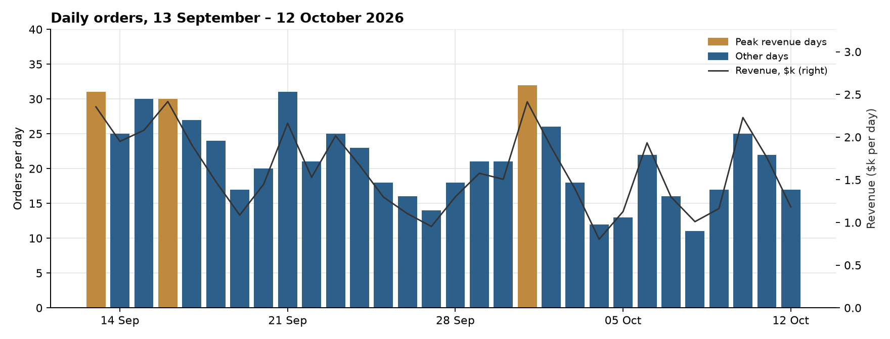
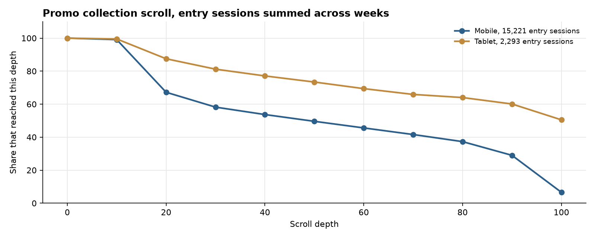
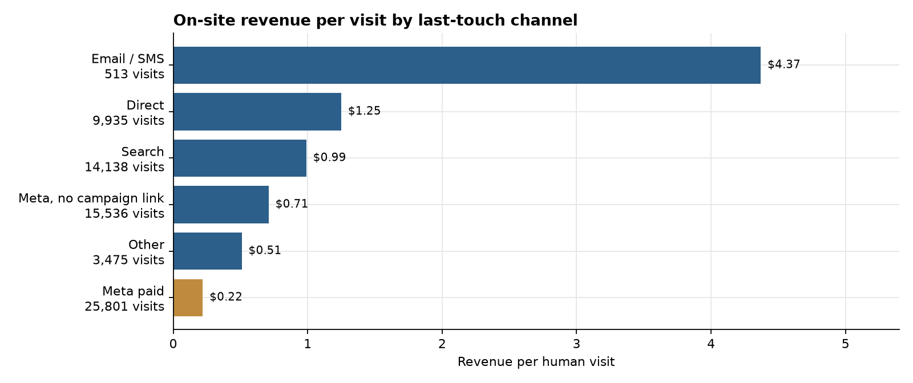
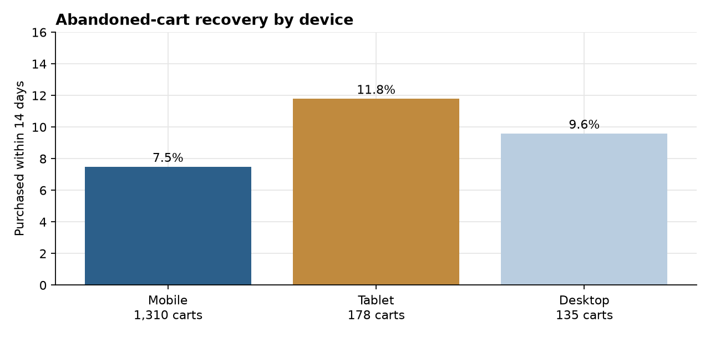
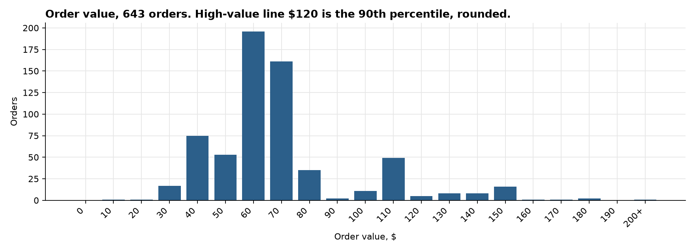
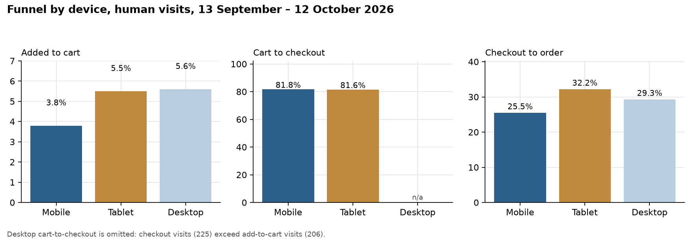

**HEATMAP**

**Jormands**

**Site Opportunity Report**

jormands.com.co | 13 September – 12 October 2026 | Prepared 13 October 2026

This report re-analyses orders, traffic, campaigns, products, and the click and scroll record for jormands.com.co. The window holds 643 orders, $48,038.72 revenue, and 69,398 human visits. The page the engine analysed is the promo collection (`/collections/promo`). Dead sessions are 58,044, 45.5% of raw traffic, and they are out of the visit rates below.

# Contents

The biggest wins, first · At a glance · The month in numbers · Opportunity 1 — Take paid social off the cabin-luggage collection · Opportunity 2 — Social on the promo collection leaves; search on the same page buys · Opportunity 3 — Move spend off yeison_oct and rebajas_jormands · Opportunity 4 — Finish the Meta checkouts that already start · Opportunity 5 — Bring back the mobile carts · Opportunity 6 — Put a second bag in the cart · Opportunity 7 — Mobile adds to cart less often than tablet · Opportunity 8 — Tag Meta, and keep dead sessions out of the rates · Worth watching · What's working · Suggested next 30 days · Method and caveats

# The biggest wins, first

These six cover most of the month: two change where paid social lands, one moves campaign budget, one finishes checkouts that already start, one brings carts back, and one raises the value of the order.

**1. Take paid social off `/collections/equipaje-de-mano`.**

Social sent 9,467 entry sessions there. Two ordered, for $143.57, $0.02 a session, and 95% left on one page. The same social source on the homepage earned $0.82 on 6,710 sessions and 75 orders. (Opportunity 1)

**2. Stop using the promo collection as the social landing.**

Social sent 10,032 entry sessions to `/collections/promo` and earned $0.12, with 66% leaving on one page. Search on that same URL earned $0.92 on 7,182 sessions and 86 orders. (Opportunity 2)

**3. Move budget off `yeison_oct` and `rebajas_jormands`.**

`yeison_oct` took 4,194 visits, 91 add-to-cart visits and 50 checkouts, and earned $0.09 on 5 orders. `rebajas_jormands` took 3,223 visits and earned $0.10 on 6 orders. `new_in` earned $0.40 on 1,977 visits. `instagram_bio` earned $0.94 on 6,519 visits and 81 orders. (Opportunity 3)

**4. Finish the Meta checkouts that already start.**

Tagged Meta paid took 25,801 human visits and 485 checkouts, and 82 of those checkouts ordered (16.9%). Direct finished 34.6% of 456 checkouts. (Opportunity 4)

**5. Run cart recovery on the mobile carts the site already created.**

1,310 mobile abandoned-cart chains had a closed 14-day window. 98 bought, 7.5%, for $6,577. Tablet bought 11.8% of 178 chains. (Opportunity 5)

**6. Offer a second bag beside the one already in the cart.**

357 of 643 orders sit between $60 and $80. 599 orders paid below the lead item price. The median paid-to-item ratio is 0.87, and the median order is $69.47. (Opportunity 6)

Two further moves sit behind these. Mobile adds to cart at 3.8% against 5.5% on tablet (Opportunity 7). Untagged Meta is 15,536 visits at $0.71, ahead of tagged Meta paid at $0.22, so the job is tagging, and dead sessions are 45.5% of raw traffic (Opportunity 8).

# At a glance

| **#** | **Finding** | **Recommended action** | **Priority** |
|----|----|----|----|
| 1 | Social on `/collections/equipaje-de-mano`: 9,467 entry sessions, 2 orders, $0.02, 95% one page. Social on the homepage: 6,710 sessions, 75 orders, $0.82. | Point that ad set at the homepage. | High |
| 2 | Social on `/collections/promo`: 10,032 sessions, 13 orders, $0.12, 66% one page. Search on the same URL: 7,182 sessions, 86 orders, $0.92. | Take social off the promo URL. Keep search there. | High |
| 3 | `yeison_oct`: 4,194 visits, 5 orders, $0.09. `rebajas_jormands`: 3,223 visits, 6 orders, $0.10. `new_in` earns $0.40. `instagram_bio` earns $0.94. | Shift budget from the two weak campaigns to `new_in` and `instagram_bio`. | High |
| 4 | Meta paid: 485 checkouts, 82 orders (16.9%). Direct: 456 checkouts, 158 orders (34.6%). | Walk the mobile checkout on a Meta landing and remove the step where those checkouts die. | High |
| 5 | 1,310 closed mobile carts; 7.5% bought within 14 days ($6,577). Tablet recovery is 11.8%. | A two-week cart recovery flow, mobile first. | High |
| 6 | 357 orders are $60–$80. 599 of 643 paid below the lead item. Median order $69.47. | A second-bag offer in the cart, next to the bag already chosen. | High |
| 7 | Mobile is 59,693 of 69,398 human visits and adds to cart at 3.8%. Tablet adds at 5.5% on 6,056 visits. | Put the add control in the first mobile screen of the collection and the product. | Medium |
| 8 | Dead sessions: 58,044, 45.5% of raw traffic. Untagged Meta: 15,536 visits at $0.71, against tagged Meta paid at $0.22. | Filter dead sessions in every report. Tag every Meta ad before reading campaign quality. | Medium |
| 9 | Email / SMS: 513 visits, 35 orders, $4.37 a visit, the highest revenue per visit of any channel. | Grow the flows. | Medium |
| 10 | Peak revenue days are 16 September ($2,417), 1 October ($2,414) and 13 September ($2,354). No promotion calendar is in the bundle. | Check those three days in the ad account before calling them a site change. | Watch |

# The month in numbers

| | |
| --- | --- |
| Orders | 643 |
| Revenue | $48,038.72 |
| Average order | $74.71 |
| Median order | $69.47 |
| Human visits | 69,398 |
| Dead sessions | 58,044 (45.5% of raw traffic) |
| Orders per day | 21.4 across 30 days |
| Revenue per human visit | $0.69 |
| Visit-matched orders | 632 of 643 |
| Visit-matched revenue | $47,235.55 ($0.68 a visit) |

The device and channel tables below use human visits. The other 11 orders are in the order file and not in that visit split.

| Week starting | Days with rows | Orders | Revenue |
| --- | ---: | ---: | ---: |
| 7 September (13th only) | 1 | 31 | $2,354 |
| 14 September | 7 | 173 | $12,373 |
| 21 September | 7 | 148 | $10,731 |
| 28 September | 7 | 148 | $10,874 |
| 5 October | 7 | 126 | $10,523 |
| 12 October (12th only) | 1 | 17 | $1,183 |

The first and last weeks are partial. The four full weeks move from 173 orders to 148, hold at 148, then fall to 126. Revenue stays near $10,500–$12,400. Average order in the week of 5 October is $83.52, up from about $72 in the three full weeks before it.

The three peak days are 16 September (30 orders, $2,416.90), 1 October (32 orders, $2,414.29) and 13 September (31 orders, $2,354.30). They sit inside ordinary weeks. There is no promotion calendar in the bundle, so the chart does not explain them.

Two contexts matter for reading the month.

Visit rows start on 30 August, so the comparison before the window is six days, 30 August–12 September, not a full fortnight. Those six days did 23.3 orders and $1,609 a day on 1,890 human visits a day, at $0.83 a visit. The window did 21.4 orders and $1,601 a day on 2,313 visits a day, at $0.68 a visit. Revenue per day held. The extra visits earned less.

Demand concentrates in Meta and in a handful of collection URLs. The week of 28 September took 19,777 human visits, the most of any full week, and earned $0.54 a visit, the lowest full week. Human-visit revenue per visit by week was $1.07 (13 September only), $0.88, $0.72, $0.54, $0.64, and $0.38 (12 October only).

# Opportunity 1 — Take paid social off the cabin-luggage collection

## What we saw

Entry sessions, whole window, from the entry-page table. These counts are entry sessions, not the human-visit totals above.

| Landing | Source | Entry sessions | Orders | Revenue | Revenue per session | Left on one page |
| --- | --- | ---: | ---: | ---: | ---: | ---: |
| `/collections/equipaje-de-mano` | Social | 9,467 | 2 | $143.57 | $0.02 | 95% |
| `/collections/backpacks` | Social | 6,413 | 11 | $836.71 | $0.13 | 71% |
| `/collections/shoulder-bag` | Social | 3,333 | 2 | $158.04 | $0.05 | 75% |
| Homepage | Social | 6,710 | 75 | $5,521.18 | $0.82 | 22% |

- Cabin luggage is the clearest miss: two orders on 9,467 social sessions.
- Backpacks and shoulder bags repeat the shape at a smaller scale: social arrives, three in four leave on the first page, and the order count stays in single digits or just above.
- The homepage, on the same social source, keeps 78% of sessions past the first page and earns $0.82.

## Why it matters

If the 9,467 social sessions on cabin luggage had earned the homepage's social rate of $0.82, the gap is about $7,600 for the month. That is an upper bound. It assumes re-pointed traffic converts like social traffic that already lands on the homepage. The backpack and shoulder URLs are the same pattern and are not added on top of that figure.

## Recommended actions

- In Ads Manager, change the destination of every ad that lands on `/collections/equipaje-de-mano` to `https://jormands.com.co/`.
- Do the same for `/collections/backpacks` and `/collections/shoulder-bag` where the ad is social.
- Leave search traffic on the pages it already finds.
- Track social entry sessions and orders on the homepage. Today that cell is 6,710 sessions, 75 orders, $0.82.

# Opportunity 2 — Social on the promo collection leaves; search on the same page buys

## What we saw

The analysed page is `https://jormands.com.co/collections/promo`. Entry sessions, whole window.

| Source on `/collections/promo` | Entry sessions | Orders | Revenue | Revenue per session | Left on one page |
| --- | ---: | ---: | ---: | ---: | ---: |
| Social | 10,032 | 13 | $1,231.48 | $0.12 | 66% |
| Search | 7,182 | 86 | $6,629.43 | $0.92 | 33% |
| Direct | 1,317 | 10 | $846.30 | $0.64 | 63% |

Mobile scroll on this page, entry sessions summed across weeks (15,221 mobile sessions):

| Depth | Mobile reached | Tablet reached (2,293 sessions) |
| --- | ---: | ---: |
| 10% | 99% | 99% |
| 20% | 67% | 88% |
| 50% | 50% | 73% |
| 100% | 6.6% | 51% |

- Search is the working source on this URL. Social is the volume source, and two-thirds of it ends on the first page.
- On mobile, almost everyone passes 10% depth and a third never reach 20%. The first screen is where social dies.
- Desktop entry sessions on this page are 1,039, and 98% reach the bottom. The page is short on a desktop screen. The leak is mobile.

## Why it matters

If the 10,032 social sessions had earned the $0.92 that search already earns on this URL, the gap is about $8,000 for the month. That is an upper bound. It assumes social traffic can behave like search traffic on the same page. Shoppers who arrive from an ad are partly different people. Do not add this figure to Opportunity 1.

## Recommended actions

- Point social ads that use `/collections/promo` at the homepage, or at a product that already sells from a visit (Black M30 Backpack is the lead product: 98 orders, $7,226).
- Keep the promo URL for search.
- On the mobile promo page, put a selling product and its add control above the point where scroll falls from 99% to 67%.
- Track social revenue per entry session on the promo URL. Today it is $0.12 on 10,032 sessions.

# Opportunity 3 — Move spend off yeison_oct and rebajas_jormands

## What we saw

Tagged Meta campaigns, human visits, whole window. Last touch: the visit is credited to the link it arrived on. Ad spend is not in the bundle, so these are on-site values.

| Campaign | Visits | Add to cart | Checkouts | Orders | Revenue | Revenue per visit |
| --- | ---: | ---: | ---: | ---: | ---: | ---: |
| always_on | 12,434 | 364 | 288 | 37 | $2,669.71 | $0.21 |
| instagram_bio | 6,519 | 342 | 308 | 81 | $6,102.98 | $0.94 |
| addi_sale | 4,960 | 156 | 108 | 20 | $1,337.72 | $0.27 |
| yeison_oct | 4,194 | 91 | 50 | 5 | $383.66 | $0.09 |
| barranquilla | 4,006 | 111 | 84 | 12 | $829.72 | $0.21 |
| rebajas_jormands | 3,223 | 54 | 33 | 6 | $325.02 | $0.10 |
| new_in | 1,977 | 47 | 34 | 12 | $784.95 | $0.40 |

- `yeison_oct` reaches checkout 50 times and orders 5. The visits are real. The orders are not.
- `rebajas_jormands` is the same shape on 3,223 visits.
- `instagram_bio` is the campaign that already earns. `new_in` is the nearer paid peer at $0.40, on enough visits to read.
- `always_on` is the largest set, at $0.21. It is the volume campaign. It is not the one to cut first.

## Why it matters

If `yeison_oct` and `rebajas_jormands` had earned the $0.40 a visit that `new_in` earns, the gap is about $1,300 on `yeison_oct` and about $950 on `rebajas_jormands`, about $2,200 together. That is an upper bound. It assumes the shifted budget converts like `new_in`. One order moves Meta paid revenue per visit by a fraction of a cent on 25,801 visits, so give any change a week before reading it.

## Recommended actions

- Cut budget on `yeison_oct` and `rebajas_jormands` and move it to `new_in` and `instagram_bio`.
- Leave `always_on` running while those two are the test.
- Check the destination URL of `yeison_oct` against Opportunity 1 and Opportunity 2 before relaunching it.
- Track orders and revenue per visit on the two cut campaigns and on `new_in`. Today `yeison_oct` is 5 orders and $0.09; `new_in` is 12 orders and $0.40.

# Opportunity 4 — Finish the Meta checkouts that already start

## What we saw

Human visits, whole window. Channel is last touch.

| Channel | Visits | Add to cart | Cart to checkout | Checkouts | Checkout to order | Orders | Revenue per visit |
| --- | ---: | ---: | ---: | ---: | ---: | ---: | ---: |
| Meta paid | 25,801 | 2.7% | 68.5% | 485 | 16.9% | 82 | $0.22 |
| Search | 14,138 | 4.9% | 97.6% | 679 | 27.7% | 188 | $0.99 |
| Direct | 9,935 | 5.1% | 90.1% | 456 | 34.6% | 158 | $1.25 |
| Meta, no campaign link | 15,536 | 4.7% | 79.6% | 577 | 25.1% | 145 | $0.71 |

- The gap sits between checkout and order. Meta paid starts 485 checkouts and finishes 82. Direct finishes a third of a smaller checkout count.
- A second gap sits between cart and checkout. Search takes 97.6% of its carts into checkout. Meta paid takes 68.5%.
- Meta paid also adds to cart less often (2.7% against 4.9% on search). The checkout leak is the one with people already in the flow.

## Why it matters

If those 485 Meta checkouts had finished at direct's 34.6%, that is about 86 more orders. At Meta paid's own average order of $69.40, the gap is about $6,000 for the month. That is an upper bound. It assumes a Meta checkout can finish like a direct checkout. The two traffics are partly different people. Do not add this figure to the campaign gap in Opportunity 3: the same visits sit in both.

## Recommended actions

- Place a Meta-paid order on a phone, from the ad through payment, and write down the step where the checkout stops.
- Compare that path with a search visit, which already takes 97.6% of carts into checkout.
- Track Meta paid checkout-to-order. Today it is 16.9% on 485 checkouts, against 34.6% on direct.

# Opportunity 5 — Bring back the mobile carts

## What we saw

Abandoned-cart chains with `final = 1`. The cohort is the early part of the window, followed for 14 days, so the rate is closed.

| Device | Chains | Returned | Purchased | Purchase rate | Revenue |
| --- | ---: | ---: | ---: | ---: | ---: |
| Mobile | 1,310 | 807 | 98 | 7.5% | $6,577 |
| Tablet | 178 | 107 | 21 | 11.8% | $1,844 |
| Desktop | 135 | 69 | 13 | 9.6% | $1,283 |

- Mobile is the book of carts. 503 of the 1,310 never came back.
- Tablet, on 178 chains, buys half again as often.
- Recovered mobile revenue is $6,577 on 98 purchases, about $67 an order, close to the site median of $69.47.

## Why it matters

If mobile had purchased at the tablet rate of 11.8%, that is about 57 more orders. At the $67 those mobile recoveries already produce, the gap is about $3,800 for the closed cohort. That is an upper bound. It assumes a mobile abandoner can return like a tablet abandoner. Each extra point on the 1,310 chains is about 13 orders.

## Recommended actions

- Send a two-message cart recovery to mobile abandoners over 14 days.
- Put the bag image and the price in the first line.
- Track the mobile purchase rate on closed chains. Today it is 7.5% on 1,310 chains, against 11.8% on tablet.

# Opportunity 6 — Put a second bag in the cart

## What we saw

Order file, 643 orders in the window. The $120 line is the 90th percentile of order revenue, rounded to the nearest 10. It is not a shipping threshold. No shipping or gift line is in the bundle or on the captured announcement bar.

| Order value | Orders |
| --- | ---: |
| $40–$50 | 75 |
| $50–$60 | 53 |
| $60–$70 | 196 |
| $70–$80 | 161 |
| $80–$90 | 35 |
| $110–$120 | 49 |
| $120 and above | 42 |

- 357 orders, more than half, sit in the $60–$80 band.
- 599 of 643 orders paid below the lead item price. The median paid-to-item ratio is 0.87. The order is about one bag with a discount already applied.
- Seven orders paid within 10% of the lead item price. A second full-price bag is rare in this file.
- High-value orders are 42, and they produced $6,447.76. They are the tail, not the centre of the business.

Lead products by revenue, from the highest-priced line on each order:

| Product | Orders as lead line | Revenue on those orders |
| --- | ---: | ---: |
| Black M30 Backpack | 98 | $7,226 |
| Black Mini Duffel Bag | 38 | $2,647 |
| Black Shoulder Bag | 36 | $2,634 |
| M30 Backpack | 30 | $2,367 |
| Black Purse Bag | 41 | $1,882 |

## Why it matters

If one order in ten had added a second product at the median of $69.47, that is about 64 orders and about $4,500 for the month. That is an upper bound. It assumes the add is a full second product at the median, and that one in ten carts takes it. The current discount on the lead item is already in the $0.87 ratio.

## Recommended actions

- In the cart, offer one second bag next to the bag already chosen. Black Mini Duffel and Black Shoulder Bag are the products that already rank behind Black M30.
- Keep the offer on the cart the shopper is already in.
- Track the share of orders with paid-to-item above 1.2. Today 7 of 643 orders pay within 10% of the lead item, and the median ratio is 0.87.

# Opportunity 7 — Mobile adds to cart less often than tablet

## What we saw

Human visits, whole window.

| Device | Visits | Add to cart | Cart to checkout | Checkout to order | Orders | Revenue per visit |
| --- | ---: | ---: | ---: | ---: | ---: | ---: |
| Mobile | 59,693 | 3.8% | 81.8% | 25.5% | 479 | $0.59 |
| Tablet | 6,056 | 5.5% | 81.6% | 32.2% | 87 | $1.14 |
| Desktop | 3,649 | 5.6% | — | 29.3% | 66 | $1.34 |

- Mobile is 86% of human visits and $0.59 a visit. Tablet is $1.14 on 6,056 visits, enough to read.
- Cart to checkout is the same on mobile and tablet, about 82%. The break on mobile is the add, and then checkout-to-order (25.5% against 32.2% on tablet).
- Desktop checkout visits are 225 against 206 add-to-cart visits, so a cart-to-checkout rate is not readable there. Desktop is 3,649 visits.

## Why it matters

If mobile had added to cart at the tablet rate of 5.5%, that is about 960 more carts. Following the mobile path after that (82% of carts to checkout, 25.5% of checkouts to an order) is about 200 orders. At mobile's average of $74, the gap is about $15,000 for the month. That is an upper bound, and it overlaps Opportunities 1 and 2: the social sessions that leave on the first page are inside this mobile visit count. Do not add the figures.

## Recommended actions

- On mobile, put the add control on the first screen of the promo collection and of Black M30.
- Use the scroll curve in Opportunity 2 as the check: 67% of mobile promo entrants reach 20% depth.
- Track mobile add-to-cart. Today it is 3.8% on 59,693 visits, against 5.5% on tablet.

# Opportunity 8 — Tag Meta, and keep dead sessions out of the rates

## What we saw

| | |
| --- | --- |
| Raw sessions | 127,442 |
| Dead sessions | 58,044 (45.5%) |
| Human visits | 69,398 |
| Untagged Meta visits | 15,536 |
| Tagged Meta paid visits | 25,801 |
| Untagged share of Meta, whole window | 37.6% |
| Untagged share, week of 28 September | 59.0% (7,731 of 13,114) |
| Untagged revenue per visit | $0.71 |
| Tagged Meta paid revenue per visit | $0.22 |

Untagged share of Meta by week: 25% (13 September only), 30%, 28%, 59%, 27%, 24% (12 October only). The spike is one week, and that week is also the lowest full-week revenue per visit on the site ($0.54).

- Untagged Meta earns more per visit than tagged Meta paid. Pausing the untagged traffic would cut the better of the two cells.
- The 30-day history flag `bought_before` covers 2,306 visits and 623 of 632 buyers. The visit's own order is inside the flag, so it cannot measure repeat rate. Returning visits, the `ret` flag, are 13,343 (19.2% of human visits) at $1.03, against $0.60 on 56,055 new visits.
- Journey classes for homepage, product, and collection are zero on every human visit. Page-type paths cannot be read from that table. Entry pages in Opportunities 1 and 2 are the record that can.

## Why it matters

The cost of reading the wrong rate is a wrong cut. Untagged Meta produced $11,041.30 on 15,536 visits. A report that treats those visits as wasted, because the campaign name is blank, would be arguing with the orders. The dollar figure here is not a gain from a site change. It is the revenue already attached to traffic that is not named.

## Recommended actions

- Add campaign parameters to every Meta ad before the next read of campaign quality.
- Exclude dead sessions in every internal report. State the count: 58,044 of 127,442 in this window.
- Use the returning flag, not `bought_before`, when the question is repeat shopping.
- Track the untagged share of Meta visits. Today it is 37.6% for the window and 59% in the week of 28 September.

# Worth watching

**The six days before the window.** 30 August–12 September: 140 orders, $9,651.38, $0.83 a human visit, add-to-cart 4.4%, cart-to-checkout 99%. The window is $0.68, add-to-cart 4.1%, cart-to-checkout 84%. Revenue per day is almost the same ($1,609 against $1,601). The visit file does not contain a full prior fortnight.

**`addi_sale`.** 4,960 visits, 20 orders, $0.27. It sits between `new_in` and the two campaigns in Opportunity 3. Leave it until those two have moved.

**`JRMNDS - ventas test 25 sept`.** 2,345 visits, 4 orders, $0.13. A second name, `JRMNDS+-+ventas+test+25+sept`, has 469 visits and no orders. One of these is the campaign with the name still encoded.

**Countries.** Colombia is 63,987 of 69,398 human visits and earns $0.69, in line with the site. The United States is 1,061 visits and 12 orders, directional. Albania is 597 visits, no add to cart, and no order.

**Email.** 513 human visits, 35 orders, $2,242.77, $4.37 a visit. The rate is the highest channel in the file. The count is large enough to keep, and small enough that one week can move it.

**Page-type journey tags.** `saw_home`, `saw_product`, `saw_collection`, and product-page counts are zero on every human visit. Paths in the journey table are only `other` and `cart`. A visit that reaches cart earns $7–$11; a visit that stays in `other` earns $0.29 on 65,692 visits. That split describes the cart, and it does not describe collection or product.

# What's working

**Search on the promo collection.** 7,182 entry sessions, 86 orders, $0.92, and 33% leave on one page. The URL can sell.

**Social on the homepage.** 6,710 entry sessions, 75 orders, $0.82, and 22% leave on one page.

**`instagram_bio`.** 6,519 visits, 81 orders, $6,102.98, $0.94 a visit. It is the Meta campaign to feed.

**Cart to checkout on search.** 97.6% of search carts reach checkout. The site-wide rate is 83.7% (2,374 checkouts from 2,835 add-to-cart visits). The break is not "carts never start checkout" for search.

**Black M30 Backpack.** 98 orders carry it as the lead line, for $7,226. It is the product the second-bag offer and the social landing can point at.

**Colombia.** 92% of human visits, and the revenue per visit matches the site.

# Suggested next 30 days

| Week | Action | Owner |
| --- | --- | --- |
| 13 October | Re-point social off `/collections/equipaje-de-mano`, `/collections/backpacks`, `/collections/shoulder-bag`, and `/collections/promo`. Send it to the homepage. | Paid media |
| 20 October | Move budget from `yeison_oct` and `rebajas_jormands` to `new_in` and `instagram_bio`. Confirm the old destinations are not the URLs above. | Paid media |
| 27 October | Place one Meta order on a phone and fix the checkout step that stops. Start the 14-day mobile cart recovery. | Site, then lifecycle |
| 3 November | Add the second-bag offer in the cart. Tag the Meta ads that still arrive with no campaign name. | Site, then paid media |

Read the week of 19 October before judging the landing change. One order moves Meta paid revenue per visit by a fraction of a cent.

# Method and caveats

The window is 13 September–12 October 2026. Human-visit rates exclude dead sessions: one page or none, no click, no scroll, no order. Dead sessions are 58,044 of 127,442 raw sessions (45.5%). The page tables in Opportunities 1 and 2 count entry sessions, including sessions the visit rates exclude. Those two denominators are not mixed in one sentence.

Channel is last touch, the link the visit arrived on. Revenue per visit is on-site value. Ad spend is not in the bundle.

Dollar sizes are upper bounds from this window's volumes. Each one states the behaviour it assumes. They overlap, because the same social and Meta visits sit in more than one opportunity. They are not a sum.

The prior comparison is 30 August–12 September, six days. Visit rows start on 30 August. There is no full fortnight before the window in this file.

The high-value line of $120 is the in-window 90th percentile of order revenue, rounded to the nearest 10. No shipping or gift threshold was on the captured announcement bar. The histogram does not invent one.

`bought_before` contains 623 of 632 buying visits. Repeat rate in this report uses the returning flag.

Homepage, product, and collection flags are zero on every human visit, and so are product-page counts. Journey paths are `other` and `cart` only. Entry-page rows are the source for landing-page claims.

Desktop cart-to-checkout is omitted because checkout visits exceed add-to-cart visits on that device. The click flag for add-to-cart undercounts the add event; funnel rates use the add-to-cart event.

The analysed page for scroll, rage, and pipeline tables is `/collections/promo` (idsitehsr 64389009). Scroll entry sessions on that page sum to 18,553 across devices, matching the page's entry-session count in the stored analysis. Peak days have no promotion calendar beside them.
