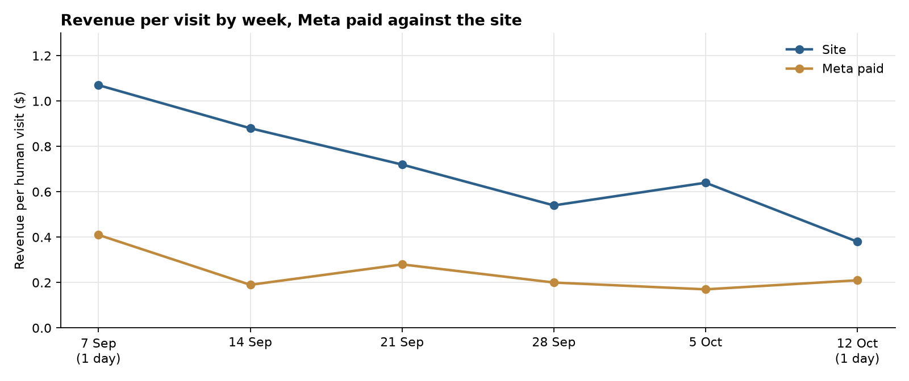

**HEATMAP · Today's Plan: Move Spend to instagram_bio, and Name the Untagged Ads**

Jormands · jormands.com.co
Prepared 13 October 2026 | Data through 12 October 2026
A one-hour ad-account intervention · three switches that change tomorrow's numbers

---

**Jormands**

**Today's Plan: Move Spend to instagram_bio, and Name the Untagged Ads**

PREPARED 13 OCTOBER 2026 · DATA THROUGH 12 OCTOBER 2026

The full analysis found the leaks. This document is today's fix. Two budget switches and one tagging switch in Meta Ads Manager, about an hour in total, each in effect the day it is made. The last full week (starting 5 October) still shows them: `always_on` took 3,276 visits and earned $0.14; `rebajas_jormands` took 469 visits and earned $0.11; and 2,461 Meta visits arrived with no campaign name and earned $0.89. `instagram_bio` earned $0.78 on 1,217 visits and 12 orders. 12 October is one day of a new week, and it does not close the week of 5 October. Nothing here needs new creative, new code, or a meeting.

> **Why these three and not the bigger ideas.** Cart recovery, a second bag, and the collection landings are worth more across the month, and the landing split is not available by week. The three moves below are the ones where tomorrow's Meta budget is committed tonight. Everything else stays queued for the week (section 06).

# Contents

| 01 The Situation This Morning | 02 Action 1 — Move budget off always_on |
|----|----|
| 03 Action 2 — Turn off rebajas_jormands | 04 Action 3 — Tag the unnamed Meta ads |
| 05 How to Read Tomorrow | 06 The Rest of the Week |
| A Data and Method |  |

# 01 The Situation This Morning

The order file shows 126 orders and $10,523.31 in the week of 5 October, about 18 orders a day on an $83.52 average. On human visits that same week the site earned $0.64 a visit (15,964 visits). Search earned $0.92 on 3,152 visits, and direct earned $1.22 on 2,555. Meta paid earned $0.17 on 6,693 visits.

| **Leak** | **Latest reading (week starting 5 October)** | **What it is worth** |
|----|----|----|
| `always_on` | 3,276 visits, 100 cart-add visits, 65 checkouts, 7 orders, $470.82, $0.14 a visit. `instagram_bio` the same week: 1,217 visits, 12 orders, $0.78. | About $2,100 for a week like this one |
| `rebajas_jormands` | 469 visits, 7 cart-add visits, 4 checkouts, 1 order, $50.76, $0.11 a visit. | About $320 for a week like this one |
| Meta visits with no campaign name | 2,461 of 9,154 Meta visits (27%) had no campaign name and earned $0.89. Tagged Meta paid earned $0.17. | The $2,189 is already there. It cannot be read as a campaign until it is named. |

Table 1 — The three live leaks, week of 5 October. The two budget sizes assume those visits earn what `instagram_bio` earned that week. They are upper bounds, and they are not added together.

*Figure 1 — Revenue per human visit by week. Meta paid sat at $0.17–$0.28 through the full weeks. The site was $0.54–$0.88. 7 September and 12 October are one day each.*

Each fix is a setting. None of them changes the site, the cart, or the email programme.

# 02 Action 1 — Move budget off always_on

Owner: paid media. Time: about 20 minutes. `always_on` is the largest tagged campaign in the week, and it earned $0.14 against $0.78 on `instagram_bio`.

In Meta Ads Manager, this morning:

- Cut the daily budget on `always_on`.
- Raise the daily budget on `instagram_bio` by the same amount.
- Leave the `instagram_bio` destination as it is. That campaign is the one that ordered.
- Do not pause `always_on` outright if it is the only always-on prospecting set. A cut that moves the budget is the switch. A pause with nowhere to send the money is not.

Expected result: up to about $2,100 in a week like the week of 5 October, if the shifted visits earn the $0.78 `instagram_bio` earned. That is an upper bound. The two audiences are partly different people.

# 03 Action 2 — Turn off rebajas_jormands

Owner: paid media. Time: about 10 minutes. The week of 5 October still has the campaign on: 469 visits, one order, $0.11.

In Meta Ads Manager, this morning:

- Pause `rebajas_jormands`.
- Do not point the leftover budget at `new_in`. That campaign earned $0.12 on 681 visits and one order in the same week.
- Send any budget you still want to spend to `instagram_bio`.

Expected result: up to about $320 in a week like this one, if those 469 visits earn the `instagram_bio` rate. The count is small next to `always_on`. The rate is the same shape, and the campaign is still spending.

# 04 Action 3 — Tag the unnamed Meta ads

Owner: paid media. Time: about 30 minutes. Untagged Meta earned $0.89 on 2,461 visits. Tagged Meta paid earned $0.17 on 6,693. Pausing the untagged ads would cut the better cell.

In Meta Ads Manager, this morning:

- Open every active ad whose visits arrive with a blank campaign name.
- Set a real campaign name on each one. Nine visits in the week arrived as the literal `__CAMPAIGN_NAME__`. Replace that token.
- Do not pause those ads, and do not change their destination URLs in this pass.

Expected result: the next week's Meta visits can be read as campaigns. The $2,189 already earned by the untagged visits stays. The gain is a name on the traffic, not a new order.

# 05 How to Read Tomorrow

| **Metric** | **Current value (week of 5 October)** | **Target** |
|----|----|----|
| `always_on` revenue per visit | $0.14 on 3,276 visits | Moves toward `instagram_bio` at $0.78, after the budget has shifted |
| `rebajas_jormands` visits | 469, 1 order | Falls to none |
| Untagged share of Meta visits | 27% (2,461 of 9,154) | Falls as names are applied |
| `instagram_bio` revenue per visit | $0.78 on 1,217 visits, 12 orders | Holds while it takes the extra budget |

One order of about $84 moves Meta paid revenue per visit by about one cent on 6,693 visits. Direction in a few days. Size after a week. A promotion landing inside the reading window moves orders on its own, and this bundle has no promotion calendar.

# 06 The Rest of the Week

These are the larger plays from the Site Opportunity Report. They are not this morning's work.

| **When** | **Action** | **Size, as an upper bound** |
|----|----|----|
| This week | Point social off `/collections/equipaje-de-mano`. Across the month, social sent 9,467 entry sessions there, 2 orders, $0.02. Homepage social earned $0.82. The split is for the whole window, not the week of 5 October. | About $7,600 for the month |
| This week | Point social off `/collections/promo`. Search on that URL earned $0.92. Social earned $0.12 on 10,032 entry sessions. | About $8,000 for the month |
| This week | Do not restart `yeison_oct`. It ran in the week of 28 September only (4,194 visits, $0.09) and it is absent from the week of 5 October. | Already stopped |
| Next | A 14-day mobile cart recovery. 1,310 closed mobile carts bought at 7.5%, against 11.8% on tablet. | About $3,800 on the closed cohort |
| Next | A second-bag offer in the cart. 599 of 643 orders paid below the lead item. | About $4,500 for the month |
| Next | Walk a Meta checkout on a phone. 485 Meta checkouts ordered at 16.9%, against 34.6% on direct. | About $6,000 for the month |

# A Data and Method

The window is 13 September–12 October 2026. The latest week is Monday 5 October through Sunday 11 October. 12 October is one day and is not used as the reading week. Human-visit rates exclude dead sessions. Channel is last touch. Revenue per visit is on-site value. Ad spend is not in the bundle.

The two dollar sizes assume shifted visits earn what `instagram_bio` earned in the week of 5 October. They overlap if the same budget is counted twice, so they are not a sum. The collection-URL sizes in section 06 use the whole window, because the entry-page table is not split by week.
