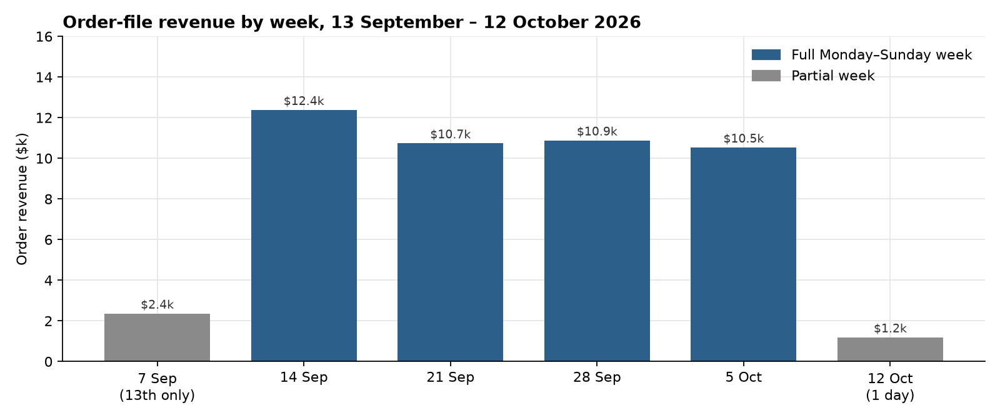
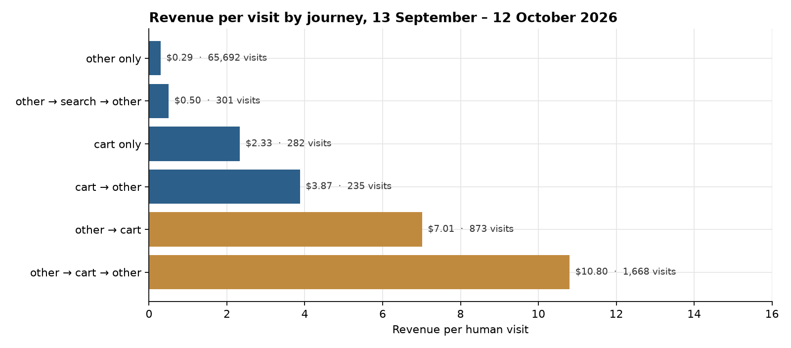
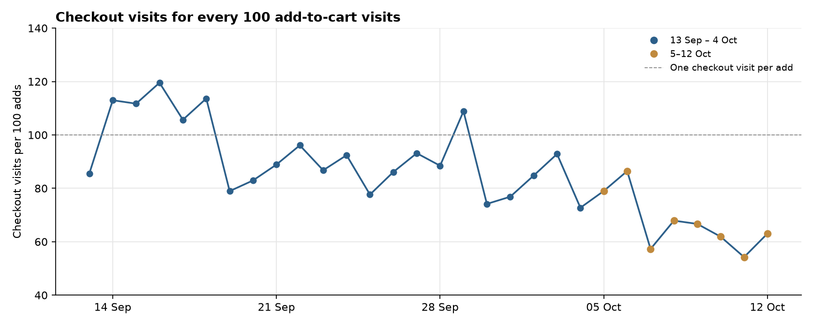

**HEATMAP · User Journey Opportunity Analysis**

Jormands · jormands.com.co
Prepared 13 October 2026 | Data window 13 September – 12 October 2026
Site behaviour, funnel and shopper-journey analysis · 30 days of tracked visits

---

**Jormands**

**User Journey Opportunity Analysis**

PREPARED OCTOBER 13, 2026 · DATA THROUGH OCTOBER 12, 2026

This report follows how shoppers move through jormands.com.co: the paths the tracker recorded, where a visit that stays on one page class earns $0.29, and where a visit that reaches the cart and comes back earns $10.80. Figures are human visits and the orders matched to them, 13 September through 12 October 2026. The order file has 643 orders and $48,038.72. 632 of those orders match a human visit, and those visits carry $47,235.55. Dead sessions are 58,044 of 127,442 raw visits (45.5%) and they are out of the rates below.

> **How to read a journey.** A journey is the sequence of page classes in a visit. Consecutive repeats of a class count once. On this site the stored classes with any volume are `other` and `cart`. Homepage, collection, and product URLs were not tagged as their own class: `saw_home`, `saw_product`, `saw_collection`, and `n_prod` are zero on every human visit. `other` holds those pages, including the promo collection and the paid landings. Entry URLs still name the pages, and this report uses them for where a visit lands. A quick-add can place an order from one tracked page, so one class is not "no order".

# Contents

01 The Month in Journeys
02 The Journeys That Make Money
03 Where the Journeys Leak
04 How the Second Half Reshaped the Funnel
05 Returning Visitors
06 Behaviour Signals Worth Watching
07 Where the Journey Data Points
A Data and Method

# 01 The Month in Journeys

The order file is 643 orders and $48,038.72, average $74.71, median $69.47. On the 69,398 human visits the matched picture is 632 orders and $47,235.55, $0.68 a visit. The journey string cannot say how often a visit saw a product. It can say what happened once the visit reached the cart.

| **Measure** | **Value** | **Reading** |
|----|----|----|
| Orders / revenue | 643 / $48,038.72 in the order file · 632 / $47,235.55 on human visits | 11 orders, $803.17, are not in the visit split |
| Where entry sessions land | Promo collection 18,553 · homepage 12,247 · cabin luggage 9,658 | Entry sessions, a different count from the 69,398 human visits |
| Most common journey | `other` only | 65,692 visits (95% of human visits), 0.40% ordered, $0.29 each |
| Best common journey | `other → cart → other` | 1,668 visits, 13.85% ordered, $10.80 each |
| Cart inside a visit | Any journey that includes cart and another class | The round trip is the one that earns |
| Homepage effect | Not in the class flags | Read from the entry URL: homepage $1.02 a session, promo collection $0.48 |
| Second product | Not measured | `n_prod` is 0 on every visit |
| Peak days | 13 September, 16 September, 1 October | $1.07, $1.08, and $0.41 a visit. 1 October is a traffic day |

Table 1 — The month, from human visits unless the row says entry sessions or the order file. The journey table lists 69,294 of the 69,398 human visits. 104 visits sit on paths too thin to list.

*Figure 1 — Order-file revenue by week, 13 September – 12 October 2026. Grey weeks are partial: 7 September is the 13th only ($2,354, 31 orders), and 12 October is one day ($1,183, 17 orders).*

The full weeks hold between $10,523 and $12,373. The three peak-revenue days are inside that range, and they are not the same kind of day. 13 September is 2,145 human visits, 30 orders, $2,286, $1.07 a visit. 16 September is 2,241 visits, 30 orders, $2,417, $1.08. 1 October is 5,956 visits, 32 orders, $2,414, $0.41. The revenue matches the earlier peaks. The visits are nearly three times a normal day, and each visit earns about a third as much. There is no promotion calendar in the bundle to name the cause.

# 02 The Journeys That Make Money

The classifier recorded eight journeys. Six of them have at least 200 visits. The one that earns is the visit that leaves `other`, opens the cart, and comes back.

| **Journey** | **Visits** | **Orders** | **Order rate** | **Revenue per visit** |
|----|---:|---:|---:|---:|
| other only | 65,692 | 261 | 0.40% | $0.29 |
| other → cart → other | 1,668 | 231 | 13.85% | $10.80 |
| other → cart | 873 | 88 | 10.08% | $7.01 |
| other → search → other | 301 | 2 | 0.66% | $0.50 |
| cart only | 282 | 10 | 3.55% | $2.33 |
| cart → other | 235 | 13 | 5.53% | $3.87 |
| cart → other → cart | 127 | 24 | 18.9% | $15.50 |
| other → search | 116 | 0 | 0% | $0.00 |

Table 2 — Human visits, 13 September – 12 October 2026. `cart → other → cart` is 127 visits. `other → search` is 116 visits and no orders. Cart as the whole visit is 10 orders, on the line where a rate is directional.

*Figure 2 — Revenue per human visit for journeys with at least 200 visits. Gold marks the two paths that reach the cart from `other`. `other` only is $0.29. The cart round trip is $10.80.*

- `other` only is 65,692 human visits and $0.29. It holds the homepage, the collections, and the products, because those URLs were not given their own class.

- Reaching the cart and stopping (`other → cart`) is 873 visits at $7.01. Coming back (`other → cart → other`) is 1,668 visits at $10.80, on a count large enough to read. A visit that saw the cart at all, whatever the path, is 3,214 visits at $8.65, against $0.29 on the 66,184 visits that never did.

- Search is a thin path. `other → search` is 116 visits and no orders. `other → search → other` is 301 visits, 2 orders, $0.50. The entry class `search` is 76 human visits and no orders.

- A visit that starts on the cart is a smaller set: 282 visits at $2.33 when the cart is the whole visit, 235 at $3.87 when it leaves, and 127 at $15.50 when it leaves and returns. The direction is the same as the large paths. The counts are the small ones.

> **So what.** The second-product count is zero on every human visit, so this extract cannot judge merchandising by a second product view. The path it can rank is the return from the cart. If the 873 visits that reach the cart and stop had earned the $10.80 of the round trip, the gap is about $3,300 in this window. That is an upper bound. Shoppers who already come back are partly different people. The larger leaks are the landings in the next section.

# 03 Where the Journeys Leak

Entry sessions, from `entry-by-channel`. These counts are not the human-visit totals above. A null URL is left out of the homepage row.

| **Entry** | **Sessions** | **Orders** | **Revenue per session** | **Single-page share** |
|----|---:|---:|---:|---:|
| Promo, social | 10,032 | 13 | $0.12 | 66.5% |
| Promo, search | 7,182 | 86 | $0.92 | 32.6% |
| Homepage, social | 6,710 | 75 | $0.82 | 21.8% |
| Homepage, search | 2,650 | 36 | $1.00 | 18.9% |
| Homepage, direct | 2,617 | 49 | $1.28 | 42.4% |
| Cabin luggage, social | 9,467 | 2 | $0.02 | 94.9% |
| Backpacks, social | 6,413 | 11 | $0.13 | 71.2% |
| Shoulder bag, social | 3,333 | 2 | $0.05 | 75.3% |

Table 3 — Entry sessions on the landing URLs. Cabin luggage is `/collections/equipaje-de-mano`. Shoulder bag is `/collections/shoulder-bag`. The homepage row is `https://jormands.com.co` only.

Social on the cabin-luggage collection is 9,467 sessions, two orders, $143.57. The same social source on the homepage is 6,710 sessions, 75 orders, $5,521.18. That is Opportunity 1 in the Site Opportunity Report, read as a journey: the visit lands, and 95% of the sessions end on that one page.

Social on the promo collection is 10,032 sessions, 13 orders, $1,231.48, and 66% leave on one page. Search on that same URL is 7,182 sessions, 86 orders, $6,629.43, and 33% leave on one page. That is Opportunity 2. The page beside the paid landing is the same URL with a different source, and it already earns $0.92.

Backpacks and the shoulder-bag collection are the same shape at a smaller size. Social sent 6,413 sessions to `/collections/backpacks` ($0.13, 71% one page) and 3,333 to `/collections/shoulder-bag` ($0.05, two orders, 75% one page). The page beside both is the homepage social landing, at $0.82.

> **So what.** If the 9,467 social sessions on cabin luggage had earned the $0.82 that social already earns on the homepage, the gap is about $7,600 in this window. If the 10,032 social sessions on the promo collection had earned the $0.92 that search already earns on that URL, the gap is about $8,000. Both figures assume the re-pointed visit converts like the destination's existing traffic. Shoppers who arrive from an ad are partly different people. The two gaps sit on different URLs. They are still separate upper bounds, and they are not a forecast of what both changes earn together. Backpacks and the shoulder bag are the same pattern, about $4,400 and about $2,600 against homepage social, and they belong with Opportunity 1.

# 04 How the Second Half Reshaped the Funnel

The visit file and the order file both start on 7 September, so the context before the window is six days, not a fortnight. The first half of the window is 13–27 September. The second half is 28 September–12 October. Peak is the three highest-revenue days and overlaps those halves. Orders here are the 632 matched to a human visit.

| **Phase** | **Visits / day** | **Orders / day** | **Add to cart** | **Checkout / cart** | **Order / checkout** | **Revenue per visit** |
|----|---:|---:|---:|---:|---:|---:|
| Before (6 days) | 1,890 | 22.7 | 4.4% | 99% | 28% | $0.83 |
| First (15 days) | 2,062 | 23.3 | 4.1% | 95% | 29% | $0.82 |
| Second (15 days) | 2,565 | 18.8 | 4.1% | 75% | 24% | $0.57 |
| Peak (3 days) | 3,447 | 30.7 | 4.1% | 88% | 25% | $0.69 |
| All human visits | 2,313 | 21.1 | 4.1% | 84% | 27% | $0.68 |

Table 4 — Human visits. Add to cart is an add-to-cart visit divided by human visits. Checkout per cart is a checkout visit divided by an add-to-cart visit.

The second half is more traffic and less money. Visits rise from 2,062 a day to 2,565. Orders fall from 23.3 a day to 18.8. Revenue per visit falls from $0.82 to $0.57. Add to cart holds at 4.1% in both halves. The step that moves is what happens after the add: checkout visits per add fall from 95% to 75%, and orders per checkout fall from 29% to 24%. Orders per add-to-cart visit fall from 28% (350 of 1,260) to 18% (282 of 1,575).

1 October sits inside the second half and does not create the decline on its own. That day is 5,956 of the half's 38,476 visits. Set it aside and the other 14 days are still 2,323 visits a day, 17.9 orders a day, and $0.60 a visit, against $0.82 in the first half.

> **Watch out.** On 14, 15, 16, 17 and 18 September, checkout visits are higher than add-to-cart visits, so a checkout is not a strict next step of the same visit's add. The early 95% is partly that overlap. The week of 5 October is the clean break: checkout visits per 100 adds fall from the 70s into the 50s, and they stay there through 12 October. Read orders per add as the stable comparison. That decline is the journey form of Opportunity 4 in the Site Opportunity Report, where tagged Meta finishes 16.9% of its checkouts and direct finishes 34.6%.

*Figure 3 — Checkout visits for every 100 add-to-cart visits, by day. Gold days are 5–12 October. The dashed line is one checkout visit per add. Days above the line have more checkout visits than adds.*

# 05 Returning Visitors

The returning flag is the measure this extract supports. A returning human visit earned $1.03 against $0.60 for a new visit, on 13,343 returning visits and 56,055 new ones. The order rate is 1.37% against 0.80%.

The week of 7 September in the weekly cube includes 7–12 September, which is before the window, so that week is left out of the table. 13 September is inside the month totals above.

| **Week starting** | **New visits** | **New revenue per visit** | **Returning visits** | **Returning revenue per visit** |
|----|---:|---:|---:|---:|
| 14 September | 11,168 | $0.93 | 2,708 | $0.68 |
| 21 September | 11,827 | $0.59 | 3,074 | $1.23 |
| 28 September | 16,394 | $0.42 | 3,383 | $1.11 |
| 5 October | 12,648 | $0.54 | 3,316 | $1.02 |
| 12 October (1 day) | 2,242 | $0.35 | 493 | $0.56 |

Table 5 — Human visits by the returning flag. Returning is behind in the week of 14 September and ahead in every week after it. 12 October is one day, and the returning row is 5 orders.

`bought_before` is not a repeat rate here. That class is 2,306 visits and 623 of the 632 buying visits. The visit's own order is inside the flag. The 14-day bought flag contains all 632 buying visits. Repeat purchase is read from `ret`.

> **So what.** The month's fall in revenue per visit is in the new visits. They move from $0.93 in the week of 14 September to $0.54 in the week of 5 October. Returning holds near $1.02–$1.23 in the full weeks after 14 September. That is the landing leak in section 03, sitting on the visits that arrived for the first time. The week of 14 September is the exception: returning earned $0.68 against $0.93 for new, on 2,708 returning visits and 28 orders.

# 06 Behaviour Signals Worth Watching

Kept where the rate differs from the rest of the site and the count is large enough. Click flags match selector text. They describe the visit. They do not prove the click caused the order.

| **Signal** | **Visits** | **Revenue per visit** | **The rest of the site** |
|----|---:|---:|---:|
| Clicked the FAQ | 3,747 | $3.40 | $0.53 on 65,651 visits with no FAQ click |
| Clicked a colour swatch | 3,027 | $1.88 | $0.63 on 66,371 visits with no swatch click |
| Clicked the menu | 20,560 | $1.17 | $0.47 on 48,838 visits with no menu click |
| Clicked a popup | 1,371 | $10.41 | $0.48 on 68,027 visits with no popup click |
| Clicked search | 2,129 | $1.59 | $0.65 on 67,269 visits with no search click |

Table 6 — Human visits. A size click is absent from the extract: the size flag is zero on every visit. The swatch is the variant signal that is present.

The FAQ row is the useful one next to the cart. 3,747 visits that open a question earn $3.40, against $0.53. Those shoppers are already in the decision. The popup row is sharper and smaller: 1,371 visits, 185 orders, $10.41. The search click earns $1.59 on 2,129 visits, while a journey that is only `other → search` earns nothing on 116 visits. Search earns inside a longer visit, and that longer visit is uncommon.

Reviews are 75 visits and no orders. That count is too small to rank.

# 07 Where the Journey Data Points

Cross-references name the Site Opportunity Report. This is not a second action list.

| **Move** | **Journey evidence** |
|----|----|
| Take paid social off the cabin-luggage collection (Opportunity 1) | 9,467 social entry sessions, 2 orders, $0.02, 95% one page. Homepage social is $0.82 on 6,710 sessions. |
| Stop using the promo collection as the social landing (Opportunity 2) | 10,032 social sessions at $0.12, 66% one page. Search on the same URL is $0.92 on 7,182 sessions. |
| Read the return from the cart | `other → cart → other` is $10.80 on 1,668 visits. `other` only is $0.29 on 65,692. The second-product count is zero. This is the path behind Opportunity 5 and Opportunity 7. |
| Treat the second half as a conversion decline (Opportunity 4) | Add to cart stays at 4.1%. Orders per add fall from 28% to 18%. 1 October is 5,956 visits at $0.41 and does not create the gap on its own. |

Four numbers to track each week, on the same definitions as this report:

- Social revenue per session on `/collections/equipaje-de-mano`, against $0.02, and on `/collections/promo`, against $0.12.
- Revenue per visit on `other → cart → other`, against $10.80.
- Orders per add-to-cart visit, against 18% in the second half.
- New-visit revenue per visit, against $0.54 in the week of 5 October.

# A Data and Method

- The bundle window is 13 September through 12 October 2026. The order file and the daily visit file both start on 7 September. The six days of 7–12 September are the context. There is no row before 7 September in either file, and there is no prior fortnight.

- Visit rates use human visits. Dead sessions are one page or none, no click, no scroll, and no order: 58,044 of 127,442 raw visits, 45.5%. A visit with an add to cart, a checkout, or an order is never excluded. `entry-by-channel` counts entry sessions and is not mixed with human-visit rates in one sentence. `page_period` includes dead sessions and is not used for the rates above.

- The journey is page classes, with consecutive repeats counted once. The classes with volume are `other` and `cart`. `other` holds homepage, collection, and product URLs. `saw_home`, `saw_product`, `saw_collection`, `coll_to_prod`, and `n_prod` are zero on every human visit, so this report does not estimate a second-product effect. The journey table lists paths present in the cohort extract, 69,294 of 69,398 human visits.

- `bought_before` contains 623 of 632 buying visits. The 14-day bought flag contains all 632. Repeat purchase is read from the returning flag.

- Channel is last touch. Ad spend is not in the bundle. Dollar gaps are upper bounds. The three peak days have no promotion calendar in the bundle. 1 October is named from the visit count, not from a promotion record.

- Checkout visits exceed add-to-cart visits on 14–18 September. Orders per add-to-cart visit is the comparison used for the second-half decline.

- Click flags match selector text. A visit with an FAQ click, a swatch click, or a search click is a visit that clicked, not a count of units added.
