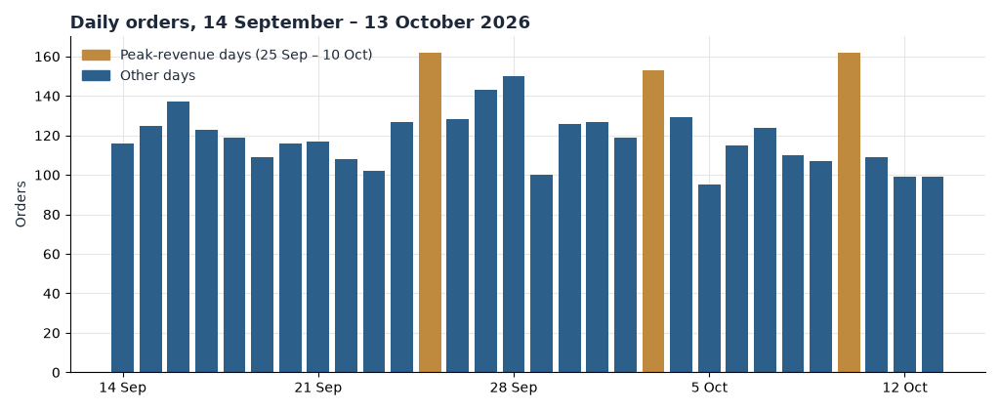
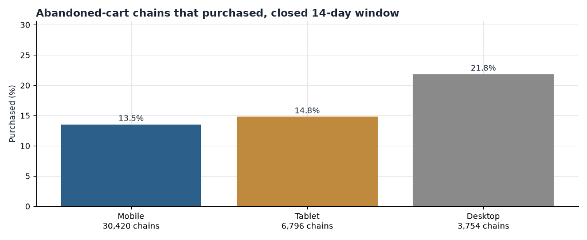
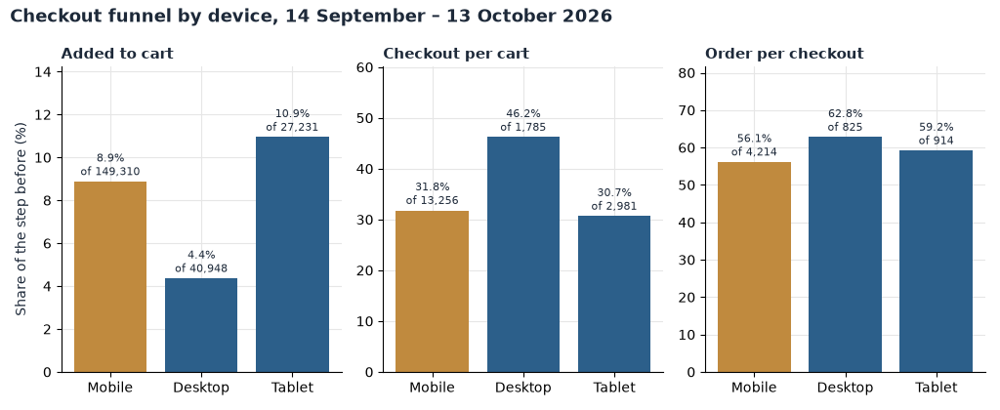
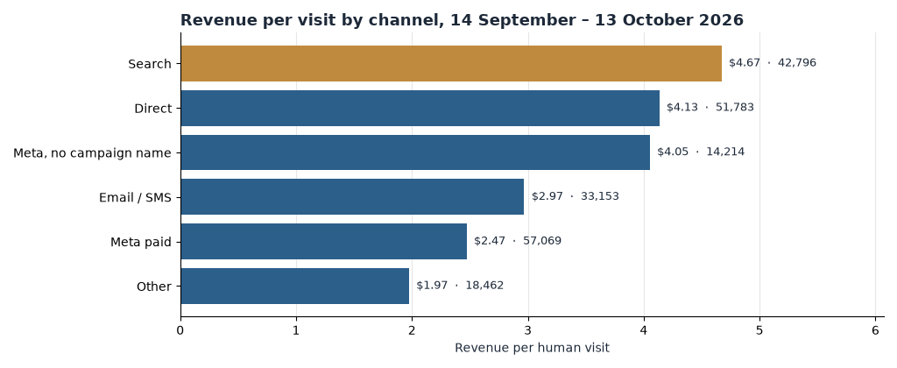
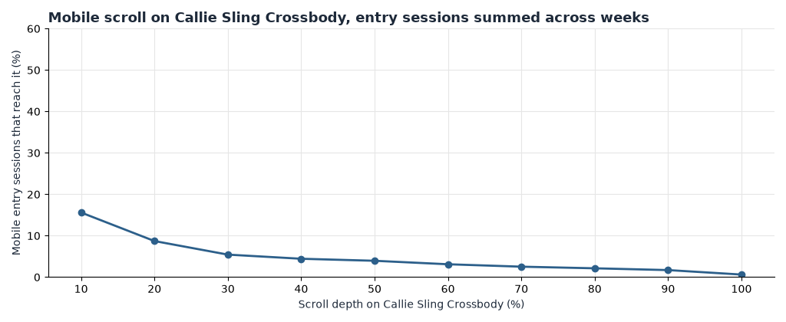

**HEATMAP**

**Latico Leathers**

**Site Opportunity Report**

laticoleathers.com  |  14 September – 13 October 2026, with late August for context  |  Prepared 14 October 2026

This report combines a full re-analysis of the order, traffic, campaign, product, page and behavioural datasets for laticoleathers.com: 3,656 orders worth $787,847, 217,489 human visits and the complete click and scroll record for the Callie Sling Crossbody product page — the page this site's paid and social traffic lands on most.

## Contents

The biggest wins, first  ·  At a glance  ·  The month in numbers  ·  Opportunity 1 — Bring back the shoppers who leave a full bag  ·  Opportunity 2 — Close the mobile bag-to-checkout gap  ·  Opportunity 3 — Make every paid-social dollar accountable  ·  Opportunity 4 — The Callie Sling Crossbody page is a doorway, not a destination  ·  Opportunity 5 — Send less email and earn more from each send  ·  Opportunity 6 — Feed the repeat buyer  ·  Opportunity 7 — Grow the basket without a shipping threshold  ·  Opportunity 8 — Clean the measurement before moving money  ·  Worth watching  ·  What's working  ·  Suggested next 30 days  ·  Method and caveats

## The biggest wins, first

Six moves cover most of the opportunity in this report. Two recover revenue the site has already earned the right to, one closes the largest device gap in the funnel, one makes the largest paid channel accountable, one fixes the page its advertising lands on, and one keeps every number trustworthy while demand is soft. Each is detailed in the section referenced.

1. **Run bag recovery across the full two weeks — and close the mobile recovery gap.**

We followed every bag abandoned between 14 and 29 September — 39,364 abandoned-bag sessions, each followed for 14 days. 14.6% bought within two weeks, tracing $1,630,212. Mobile carries the audience (29,190 of 39,364 bags) and recovers worst: 13.6% against 22.1% on desktop. One bag-holder in three never comes back at all. Every point of recovery on this cohort is roughly 700 orders a month — about $150,000 — and the mobile gap alone is worth eight points.  (Opportunity 1)

2. **Close the mobile bag-to-checkout gap.**

Mobile is 69% of human visits and adds to bag at 8.9%, close to tablet's 10.9% — the intent is there. The break sits between bag and checkout: mobile bags reach checkout 31.8% of the time against 46.2% on desktop. Closing that gap at current traffic is worth about 1,100 orders a month — up to roughly $230,000.  (Opportunity 2)

3. **Hold Meta accountable: cut the sub-$1 tier and scale what earns.**

Meta paid is 26% of all human visits — 57,069 in the window — and earns $2.47 a visit against the site's $3.44, drifting down from $2.75 in the prior fortnight. Inside the account the spread is wide: the axon and AppLovin D7ROAS cluster earned $0.54 across 8,112 visits, while BC_11/12/25_TESTING & WINNERS_CBO earns $4.12 and the best creatives earn $3.76–$4.92. The sub-$1 tier is about 13,000 visits a month; re-pointed at the site average it is worth up to about $35,000 a month, before the creative-level fixes.  (Opportunity 3)

4. **Fix the Callie Sling Crossbody page — the doorway almost nobody walks through.**

The Callie Sling Crossbody is the most-visited product page on the site and its second-biggest entry destination after the homepage — 47,419 visits and 37,328 entries in the window — yet only 1.94% of its visits end in a buyer, against 2.90% for best-sellers and 3.04% for the crossbody collection. On mobile, 78.8% of sessions see only this page and only 15.6% scroll past the first tenth. The page's most-clicked elements are its own navigation menu. One point of buyer rate here is about $100,000 a month.  (Opportunity 4)

5. **Shift email volume from broadcasts into flows.**

Campaign email and SMS broadcasts ran 29,478 visits at $2.09 each in the window — half the site's $4.42 for untagged traffic — while the automated flows earned $10.46 a visit on only 3,486 visits. The welcome series' first email earns $16.07 a visit; the abandoned-bag flow's first email earns $20.39. The flows are the best value per visit on the site and they reach one visitor in sixty. Closing the broadcast gap is worth up to about $65,000 a month.  (Opportunity 5)

6. **Clean the measurement before moving money.**

Seven visits in ten in the window were not shoppers: 516,352 dead sessions, 70.4% of raw traffic, against 34.3% in the prior fortnight, peaking at 51,940 on 20 September. The 30-day repeat-purchase flag contradicts the returning-visitor flag so badly it cannot be read, and 195 of 3,656 orders match no tracked visit. Every channel trend read on raw traffic is wrong by up to two-thirds.  (Opportunity 8)

Two supporting plays sit behind these. One is the repeat buyer: returning visits convert at 1.89% against 1.47% for new, and repeat email clickers buy at 5.3–5.4% against 1.1–1.7% for single clickers — the audience is there, the flows feeding it are not (Opportunity 6). The other is the basket: the modal order sits at $200–$250, shipping is already free with no minimum, so the lever is the attach economy the high-value buyers already over-index on — wallets and straps at 53 times the average visitor (Opportunity 7).

## At a glance

| # | Finding | Recommended action | Priority |
|---|---------|--------------------|----------|
| 1 | 14.6% of abandoned bags become orders within 14 days (5,752 of 39,364 in the measured 14–29 September cohort); mobile is 74% of bags and recovers at 13.6% against 22.1% on desktop; one bag-holder in three never returns. | Build a two-week sequenced bag-recovery flow, mobile-first, SMS where consented, saved-bag greeting on return. | High |
| 2 | Mobile adds to bag at 8.9% but bags reach checkout only 31.8% of the time, against 46.2% on desktop. | Express wallets in the thumb zone, persistent add-to-bag bar, mobile checkout walkthrough on the top phones. | High |
| 3 | Meta paid: 57,069 visits at $2.47 each and falling; the axon/AppLovin D7ROAS cluster earned $0.54 on 8,112 visits while winning campaigns earn $3.20–$4.30. | Pause the sub-$1 tier, scale TESTING & WINNERS and BROAD ABS, judge campaigns on revenue per visit. | High |
| 4 | The Callie Sling Crossbody page: 47,419 visits, 1.94% buyer rate against 2.90–3.04% for the collections; 78.8% of mobile sessions are single-page; top clicks are the nav menu. | Sticky add-to-bag, route to best-sellers and crossbody modules, fix the nav rage, shorten the page. | High |
| 5 | Broadcast email/SMS: 29,478 visits at $2.09 vs $4.42 untagged site average; automated flows earn $10.46 but are 1.6% of visits. | Re-segment broadcasts toward clickers, move volume into flows, grow the list at checkout. | Medium |
| 6 | Returning visits convert at 1.89% vs 1.47% new; repeat email clickers buy at 5.3–5.4%; welcome email #1 earns $16.07 a visit. | Build the post-purchase track, sequence drops, put an offer in transactional sends. | Medium |
| 7 | Modal order is $200–$250 (29.3% of orders); shipping is already free on all US orders, so the basket lever is attach: high-value buyers over-index 53x on wallets and straps. | One-tap wallet and strap add-ons in the bag, attach modules on the Callie page. | Medium |
| 8 | Dead sessions are 70.4% of raw traffic (516,352 in the window, spiking to 51,940 on 20 September); the repeat-purchase flag is unreadable; 5.3% of orders match no visit. | Filter dead sessions in every dashboard, fix the repeat flag with the tracking provider, audit the order-to-visit match. | High |
| 9 | Orders ran 63% below the prior fortnight (122 a day against 327) on a flat average order; conversion halved to 1.59%; every channel cooled at once. | Treat demand, not any single channel, as the constraint; prioritise recovery and retention while volume is expensive. | Watch |
| 10 | Meta creative spread is seven to one: IMAGE_PAYNE_SALE_PAGE_UPTO_75%OFF earns $0.76 on 4,793 visits while VIDEO_DEANA HOFFMAN_CALLIE OAT earns $4.92. | Brief new creative against the Callie partnership and flex-ad angles that already earn $3.76–$4.92. | Watch |

Table 1 — The live findings, with numbers for 14 September – 13 October 2026. Sizes are monthly estimates from current volumes, not forecasts.

## The month in numbers

| | |
|---|---|
| Orders | 3,656 |
| Revenue | $787,847 |
| Average order | $215.49 (median $206.09) |
| Orders by device | Mobile 69% · Tablet 21% · Desktop 10% (order share) |
| Human visits | 217,489 — 69% mobile |
| Dead sessions (excluded) | 516,352 (70.4% of raw traffic, against 34.3% before the window) |
| Visits by channel | Meta paid 26% · Direct 24% · Search 20% · Email/SMS 15% · Meta untagged 7% · Other 8% |
| Returning visitors | 29.4% of visits, converting 1.89% against 1.47% for new |
| High-value orders (≥$320) | 341 orders, $140,165 — 17.8% of revenue |
| Versus the prior fortnight | Orders −63% a day (122 vs 327) · Human visits −32% a day (7,250 vs 10,593) · Conversion 1.59% vs 2.93% · Average order +3% ($215.49 vs $208.93) |

Weekly orders across the period:

| Week starting | Orders | Revenue | Average order |
|---|---|---|---|
| 31 Aug (pre) | 2,648 | $552,118 | $208.50 |
| 7 Sep (pre) | 1,927 | $403,736 | $209.52 |
| 14 Sep | 845 | $186,540 | $220.76 |
| 21 Sep | 887 | $190,077 | $214.29 |
| 28 Sep | 904 | $187,848 | $207.80 |
| 5 Oct | 822 | $180,180 | $219.20 |
| 12 Oct (through 13th) | 198 | $43,202 | $218.19 |

The business ran a steady 27–31 orders a day through the window, with three clear demand spikes — 25 September, 3 October and 10 October, the three highest-revenue days, carrying 13% of the window's revenue in three days. Average order held in a narrow band all month ($207.80–$220.76), so every growth lever in this report works through volume and basket structure, not price.

*Figure 1. Daily orders, 14 September – 13 October 2026, with the pre-window context in grey. Gold days are the three peak-revenue days of the window (25 September, 3 and 10 October).*

Two contexts matter for reading the month. First, the collapse: the fortnight before the window ran at 327 orders and $68,275 a day; the window ran at 122 and $26,262 — a 63% volume decline on a flat average order, with conversion halving from 2.93% to 1.59% and the add-to-bag rate falling from 12.1% to 8.3%. The cooling sits in every channel at once — search, direct, email and Meta all lost roughly half their conversion — so it is a demand event, not a channel failure. Second, the noise floor doubled: raw traffic rose from 16,117 to 24,461 visits a day while the automated share climbed from 34.3% to 70.4%. Any dashboard that does not exclude dead sessions reads a site that is half again busier and far weaker than the one its customers actually used — and the peak days are the only days that look like the old normal.

## Opportunity 1 — Bring back the shoppers who leave a full bag

**What we saw**

We followed every bag abandoned between 14 and 29 September — 39,364 abandoned-bag sessions, each followed for 14 days, counting only sessions whose 14-day window has closed.

| Device | Bags | Bought within 14 days | Rate | Traced revenue |
|---|---|---|---|---|
| All devices | 39,364 | 5,752 | 14.6% | $1,630,212 |
| Mobile | 29,190 (74%) | 3,975 | 13.6% | $984,039 |
| Tablet | 6,570 | 982 | 14.9% | $238,591 |
| Desktop | 3,604 | 795 | 22.1% | $407,582 |

*Figure 2. Share of abandoned-bag chains that purchased within 14 days, 14–29 September cohort, closed windows, by device.*

- Recovery is mobile-sized and mobile-weak: 74% of abandoned bags are on phones, and they recover at 13.6% against 22.1% on desktop. The audience lives where the recovery works least.
- 12,625 bag-holders — one in three — never returned at all (8,810 of them on mobile). Email alone cannot reach them; they need SMS or retargeting.
- Desktop converts recovery into revenue best: $407,582 traced from 3,604 bags, against $984,039 from eight times as many mobile bags.
- The browse pool behind the bags is bigger and colder: 136,543 "showed interest" sessions in the same cohort bought at 8.4% within 14 days — the raw material for a browse-abandonment flow.
- Traced revenue counts every order inside the 14-day window and one order can be credited to more than one session; read the dollars as traced, not incremental.

**Why it matters**

Bag abandoners are the largest warm audience the site has: roughly 74,000 bag-holding sessions a month at current volume. Every point of recovery on this cohort is roughly 700 orders a month — about $150,000 at the $215 average order — and the current 14.6% is earned largely by shoppers coming back on their own. The gap is structural: the money is spread over fourteen days, the dominant device recovers worst, and a third of the audience never hears anything because it never returns.

**Recommended actions**

- Build a sequenced recovery flow that covers the full two weeks: a same-hour reminder, a day-one follow-up, and at least two more touches in week two.
- Design it mobile-first, with SMS where consent exists and a one-tap link back to a saved bag — colour and strap intact, not a generic homepage.
- Split checkout starters into their own, more urgent track — shorter delays, a direct resume-checkout link — and measure their recovery separately.
- Keep the bag between visits and greet a returning bag-holder with their items.
- Add the browse-abandonment pool to the programme once the bag flow is stable.
- Track one number: the share of abandoned bags that become orders within 14 days (14.6% today), reviewed by device every month.

## Opportunity 2 — Close the mobile bag-to-checkout gap

**What we saw**

Human visits, report window, by device:

| Device | Visits | Add-to-bag rate | Bag → checkout | Checkout → order | Visit → order | Revenue per visit |
|---|---|---|---|---|---|---|
| Mobile | 149,310 (69%) | 8.9% | 31.8% | 56.7% | 1.60% | $3.47 |
| Tablet | 27,231 (13%) | 10.9% | 30.7% | 59.6% | 2.00% | $4.16 |
| Desktop | 40,948 (19%) | 4.4% | 46.2% | 63.6% | 1.28% | $2.84 |

*Figure 3. Funnel steps by device, 14 September – 13 October 2026, human visits.*

- The gap sits between bag and checkout. Mobile shoppers add to bag at 8.9% — twice desktop's 4.4% — so the intent is there. One mobile bag in three reaches checkout; on desktop it is one in two.
- Mobile finishes worse too: 56.7% of mobile checkouts become orders against 63.6% on desktop. Two leaks, one device.
- Desktop's weakness is earlier: only 4.4% of desktop visits ever add to bag, which is why desktop converts worst overall (1.28%) despite the best bag-to-checkout step. Desktop is a browse device on this site.
- Mobile is not a traffic-quality story. It is where 69% of visits, 69% of orders and 74% of abandoned bags already live. It is the store.

**Why it matters**

Closing the mobile bag-to-checkout gap to the desktop rate is about 1,900 more checkouts a month; at mobile's 56.7% checkout completion that is roughly 1,100 orders — up to about $230,000 a month at the current average order. No campaign this site can buy delivers that at the same cost. The funnel data says where to look first: the bag page and the first checkout screen, on a phone.

**Recommended actions**

- Put express payment in the thumb zone — Shop Pay, Apple Pay, PayPal and Google Pay as first-class options on the mobile bag and checkout, not behind a form. A 14-point bag-to-checkout gap is the classic signature of typing friction. (Shop Pay and PayPal are already enabled in the checkout.)
- Add a persistent add-to-bag bar on mobile product pages so the buy action is never a scroll away.
- Walk the mobile checkout end to end on the three most common phones: autofill, address entry, discount-field placement, error messages. Log every step where a keyboard covers a button.
- Give mobile recovery the same priority (Opportunity 1): 74% of abandoned bags are on phones.
- Track the pair weekly: mobile bag-to-checkout (31.8% today) and mobile checkout completion (56.7% today).

## Opportunity 3 — Make every paid-social dollar accountable

**What we saw**

*Figure 4. Revenue per human visit by referrer channel, 14 September – 13 October 2026.*

Meta paid is the largest paid channel and the weakest of the big four: 57,069 visits in the window at $2.47 each, converting 1.15% against the site's 1.59% and $3.44 per visit — and it drifted down from $2.75 in the prior fortnight to $1.75 in the week of 28 September. Inside the account (window, from the tagged campaign tables):

| Campaign | Visits | Orders | Revenue / visit |
|---|---|---|---|
| BC_9/25/24_ABO+PROSPECTING_WHITELABEL/PARTNERSHIP | 10,799 | 139 | $3.20 |
| BC_11/12/25_CBO_PROSPECTING | 9,044 | 79 | $1.03 |
| axon — LaticoLeathers_D7ROAS_Discovery | 3,263 | 8 | $0.59 |
| BC_12/6/25_PROSPECTING_MARPIPE_DPA | 2,673 | 16 | $0.97 |
| axon — LaticoLeathers_D7ROAS_Prospecting | 1,795 | 3 | $0.19 |
| BC_12/6/25_MARPIPE+DPA_WHITELABEL | 2,218 | 16 | $1.48 |
| applovin — D7ROAS Testing + Discovery + Prospecting | 3,054 | 9 | $0.70 |
| BC_11/12/25_TESTING+&+WINNERS_CBO | 5,251 | 96 | $4.12 |
| 11/12/25_BROAD+ABS | 1,443 | 27 | $4.30 |
| BC_11/12/25_ABS_BID+CAP | 1,195 | 19 | $4.12 |
| Pinterest — 626757811832 / 626757332266 | 3,058 | 30 | $2.45 |

- The waste is concentrated. The axon and AppLovin D7ROAS cluster — off-Meta programmatic bought on a seven-day-ROAS rule — earned $0.54 across 8,112 visits with 20 orders. BC_11/12/25_CBO_PROSPECTING added 9,044 visits at $1.03.
- The winners are in the same account: TESTING & WINNERS at $4.12, BROAD ABS at $4.30, ABS BID+CAP at $4.12, the GRAVEYARD prospecting set at $3.38 and the long-running whitelabel/partnership set at $3.20 on the biggest volume.
- At creative level the spread is seven to one: IMAGE_PAYNE_SALE_PAGE_UPTO_75%OFF earned $0.76 across 4,793 visits while VIDEO_DEANA HOFFMAN_CALLIE OAT earned $4.92, VIDEO_SUNNY_BIASI_CALLIE_COGNAC $3.76 and MIX_FLEX AD_TEST O1 $3.88. The sale-page creative is the single biggest media line and it is the worst earner.
- These figures credit each visit to the link it arrived on (last touch). A shopper introduced by Meta who returns through search counts as search — read the table as where buying visits arrive. Ad spend is not in this bundle, so revenue per visit is on-site value, not profit.

**Why it matters**

Meta paid touches about 57,000 visits a month — a quarter of the store's traffic. The sub-$1 tier alone is roughly 13,000 visits a month; re-pointed at the site average of $3.44 it is worth up to about $35,000 a month, and that is before scaling the $4 sets or fixing creative. With new volume expensive and demand soft (the month in numbers), the cheapest growth available is the traffic the account already buys.

**Recommended actions**

- Pause the axon and AppLovin D7ROAS cluster and BC_11/12/25_CBO_PROSPECTING; hold the savings until Opportunity 8's filters are live, then redeploy.
- Scale TESTING & WINNERS, BROAD ABS and ABS BID+CAP first — they earn $4.12–$4.30 against the site's $3.44.
- Kill the sale-page creative (IMAGE_PAYNE_SALE_PAGE_UPTO_75%OFF) and brief against the Callie partnership and flex-ad angles that already earn $3.76–$4.92.
- Tag the untagged 14,214 Meta visits (Opportunity 8) — they earn $4.05 and cannot be steered while anonymous.
- Judge each campaign on revenue per visit by week; a channel flat at $2.47 while winners earn $4.12 is an allocation problem, not a creative wobble.

## Opportunity 4 — The Callie Sling Crossbody page is a doorway, not a destination

**What we saw**

The most commercially important page on the site is a product page. The Callie Sling Crossbody (/products/callie-sling-crossbody) is the second-biggest entry destination after the homepage and the landing page for most of the paid and social traffic (window, page-level table — dead sessions included in the denominator, so read it against its peer pages, not the funnel):

| Page | Visits | Buyer rate | Entries | Entry-buyer rate |
|---|---|---|---|---|
| Homepage (/) | 51,507 | 3.42% | 43,885 | 2.24% |
| /products/callie-sling-crossbody | 47,419 | 1.94% | 37,328 | 0.96% |
| /collections/best-sellers | 28,970 | 2.90% | 15,696 | 1.64% |
| /collections/crossbody | 28,131 | 3.04% | 10,388 | 1.34% |
| /collections/new-arrivals | 22,334 | 2.61% | 8,287 | 1.07% |
| /products/lindsey-tote-shoulder-bag | 21,375 | 1.16% | 16,606 | 0.51% |

*Figure 5. Mobile scroll depth on the Callie Sling Crossbody, entry sessions summed across weeks, 14 September – 13 October 2026.*

- Nobody scrolls it. Of 115,604 mobile entry sessions on the page, 78.8% saw only this page, and only 15.6% scrolled past the first tenth, 8.7% reached a fifth, and 4.0% reached halfway. The buy button and the content below the fold are for a single-digit minority.
- The click record says shoppers treat the page as a menu: the most-clicked elements across the window are the navigation — SHOP BEST SELLERS (51 clicks, 15 orders), Shop By Color (40), Shop By Texture (29). Shoppers open the drawer to leave.
- Frustration concentrates in the navigation: nav links carry 6.3% of clicking sessions with rage behaviour (932 of 14,768), the highest of any element class on the page. The announcement bar adds 3.2%.
- Social entries on the page earn $2.67–$2.85 a session with 80% seeing nothing else, while search entries on the same page earn $7.39–$7.61. The page does not kill demand — it wastes cold demand.
- The sister collections convert the traffic the page turns away: best-sellers at 2.90%, crossbody at 3.04% buyer rates.

**Why it matters**

When one page takes 37,328 entries a month, small page improvements compound across the whole account: one point of buyer rate on the page's visits is about 470 orders — on the order of $100,000 a month. The page is the physical equivalent of a shop where four mobile shoppers in five leave through the same door they came in. The fix is layout and routing, not more traffic — Meta is already sending 26% of the site's visits, most of it toward this page.

**Recommended actions**

- Put the buy action in the first screen on mobile: a sticky add-to-bag bar with colour and price visible without scrolling.
- Re-order the page for the 15.6% who scroll: reviews, strap detail and cross-sell belong behind a short first screen, and the best-sellers and crossbody collections belong as modules on the page, not just in the nav.
- Fix the navigation rage at theme level — the sidebar linklist is the page's top frustration surface — and check the announcement bar for tap-target collisions.
- Route, don't trap: a "shop the range" module pointing at best-sellers and crossbody converts the menu-clickers inside the site instead of through it.
- Track three numbers weekly: mobile single-pageview share on the page (78.8% today), mobile scroll past the first tenth (15.6% today), page buyer rate (1.94% today).

## Opportunity 5 — Send less email and earn more from each send

**What we saw**

Owned email is the site's quiet underperformer at broadcast level and its best performer at flow level — the two sit side by side in the same account:

| Channel (campaign-link) | Visits | Orders | Conversion | Revenue / visit |
|---|---|---|---|---|
| Automated flows (welcome, abandoned bag, abandoned browse) | 3,486 | 173 | 4.96% | $10.46 |
| Campaign email/SMS broadcasts | 29,478 | 296 | 1.00% | $2.09 |
| Untagged site traffic (context) | 97,208 | 1,980 | 2.04% | $4.42 |

- Broadcasts run at half the value per visit of untagged traffic. The sends that underperform hardest are the collection roundups — "Milled Collection Full Roundup" earned $0.37 a visit on 729, "The Best Crossbody Bags for Fall" $0.50 on 460 — while the National Handbag Day launch send did $2.18–$3.61.
- The flows are small but exceptional: the welcome series' first email earns $16.07 a visit, the SMS welcome's first message $15.32, and the abandoned-bag flow's first email $20.39.
- The audience signal points the same way: devices that click through three or more email visits in a period buy at 5.3–5.4%, against 1.1–1.7% for single-clickers.
- Broadcasts are eight and a half times the flows' volume. The account is upside-down.

**Why it matters**

Closing the broadcast gap to the untagged site average is worth up to about $65,000 a month at current volume (assuming re-pointed clicks convert like the traffic they join). The structural reason it persists: broadcasts are sent on the merchant's calendar to the whole list, while flows fire on the shopper's behaviour to a narrow audience — and the shopper's clock wins. This is also the cheapest hedge against the demand collapse: owned clicks need no auction.

**Recommended actions**

- Re-segment broadcasts toward proven clickers: suppress chronic non-openers from the weekly roundup and let the engaged segment carry the send.
- Cut or merge the weakest editorial sends; keep the sale-launch format that already earns $2.18–$3.61.
- Grow the flows deliberately: checkout opt-in, browse-abandonment entry points, and the post-purchase track (Opportunity 6). Every flow visit is worth five times a broadcast visit.
- Move the shipment-notification send out of the broadcast bucket and measure it as transactional — it currently reads $0.44 a visit against its true job.
- Track revenue per visit for broadcasts ($2.09 today) and flows ($10.46 today) side by side, monthly.

## Opportunity 6 — Feed the repeat buyer

**What we saw**

| Shopper history | Visits | Buyer rate | Revenue / visit |
|---|---|---|---|
| Returning visits (any prior visit) | 64,038 | 1.89% | $4.06 |
| New visits | 153,451 | 1.47% | $3.18 |

- Returning visits are 29.4% of traffic, convert at 1.89% against 1.47% for new, and earn $4.06 a visit against $3.18. In a month when every channel cooled, the returning audience held its premium.
- The retention surfaces already exist and over-perform: the welcome series earns $16.07 a visit on its first email, and repeat email clickers buy at 5.3–5.4% (Opportunity 5).
- The post-purchase moment is barely worked: no dedicated cross-sell or second-bag flow appears in the flow table beyond the welcome and abandonment programmes.
- Watch the measurement: the 30-day "bought before" flag labels 3,384 of the window's 3,461 matched orders as prior buyers, which contradicts the returning share of 35% of orders. The flag cannot be read as a repeat rate (see Opportunity 8); the table above uses the returning flag.

**Why it matters**

New volume got 63% more expensive in a fortnight, while the installed base still converts at a premium and answers email five times more readily than a stranger. Every improvement to the thirty days after purchase compounds on an audience that has already said yes once — and needs no auction to reach.

**Recommended actions**

- Build a post-purchase track measured on second-bag rate: order confirmation with care content, a day-ten cross-sell (wallet, strap, the small leather goods high-value buyers over-index on — Opportunity 7), and early access to the next drop.
- Put a product module in the transactional sends — they reach every buyer and currently carry no offer.
- Time campaigns to the buyer's clock: the peak days (25 September, 3 and 10 October) show the site can still concentrate demand when there is a reason; give the repeat audience the reason first.
- Track second-purchase rate within 30 days and returning-visit share (29.4% today) monthly; do not report the 30-day bought-before flag until it is fixed.

## Opportunity 7 — Grow the basket without a shipping threshold

**What we saw**

Average order is $215.49 (median $206.09), and the order file shows where baskets sit: 29.3% of orders land at $200–$250, 22.3% at $150–$200 and 18.8% at $250–$300. Only 9.3% of orders reach the $320 high-value line, and those 341 orders carry 17.8% of revenue ($140,165). (The order-value distribution chart was not drawn for this run — no chart file was declared for it — so the table above is computed directly from the order file.)

- There is no shipping line to build against: the live site offers free standard US shipping on all US orders with no minimum (read on laticoleathers.com on 14 October 2026). The usual threshold lever does not exist here.
- The attach economy does. A $5.18 package-protection line rides on 2,752 of 3,656 orders (75%) — the attach habit is already universal at the checkout.
- High-value buyers (≥$320) over-index on exactly the small leather goods: wallets and clutches at 53 times the average visitor (121 high-value visitors), leather straps at 53 times, travel and desk accessories at 85 times and the free-gift page at 89 times (thinner — 5–13 high-value visitors each).
- Cart-level upsell modules already exist on the theme (the analysed page carries a cart_upsell element with no frustration attached).

**Why it matters**

With shipping already free, the only lever left on the basket is what goes in it — and the shoppers who already spend most have named the items: wallets, straps, small goods. Every +$10 of average order at current volume is about $35,000 a month. The assortment the high-value buyer reaches for is cheap to ship with a bag, already stocked, and already bought by the site's best customers.

**Recommended actions**

- Put one-tap add-ons in the bag: a wallet or strap matched to the bag in the cart, priced to lift a $200–$250 basket toward $300.
- Add the same attach modules to the Callie page, where the traffic is (Opportunity 4).
- Use the package-protection mechanic as the template — 75% attach proves the shopper accepts add-ons at checkout; extend the placement to leather goods.
- Merchandise the small-goods collections to big-basket buyers: the wallets-clutches and leather-straps collections are where high-value buyers already browse (53 times over-indexed).
- Track average order ($215.49 today) and attach rate on protection (75% today) weekly; a threshold test is not available — shipping is already free.

## Opportunity 8 — Clean the measurement before moving money

**What we saw**

- Seven visits in ten were not shoppers. Dead sessions — one page or none, no click, no scroll, no order — numbered 516,352 in the window, 70.4% of raw traffic, against 34.3% in the prior fortnight. They spiked to 51,940 on 20 September and ran above 40,000 on four more days. They are excluded from every figure in this report; any dashboard that does not exclude them reads a busier, weaker site than the real one.
- The 30-day repeat-purchase flag is broken. It labels 3,384 of 3,461 matched orders (98%) as coming from devices that bought in the prior 30 days, while the returning-visitor flag puts returning devices at 35% of orders. Both cannot be true; the bought-before flag counts something else. Until the tracking provider explains it, no repeat-rate number should be quoted.
- 195 of 3,656 orders (5.3%) match no tracked visit. On a soft month that gap hides real demand from every channel and page table.
- Meta's untagged traffic is large and valuable and unreadable: 14,214 visits at $4.05 a visit — better than tagged Meta paid's $2.47 — with no medium or campaign attached.
- The experimentation programme leaves trace-level data: one running rollout (Info Cards on product-listing pages, 52 active days) plus a dozen single-digit-visit tests that cannot be analysed from off-surface data.
- One thing did not break: the funnel ratios are stable week to week all window (bag-to-checkout 0.31–0.35, checkout-to-order 0.53–0.63), so the funnel reads in this report are trustworthy.

**Why it matters**

Every channel, page and funnel trend read on raw traffic is wrong by up to two-thirds — and on the spike days, worse. Beyond reporting, the money is live: retargeting audiences built on all visitors are mostly bots, the broken repeat flag sits under every retention dashboard, and 14,214 visits a month of $4.05 paid-social traffic cannot be steered because it carries no tag. Opportunity 3's reallocation should be held until the filters are in.

**Recommended actions**

- Make the dead-session filter permanent in every dashboard, with a visible "automated share" line — when it moves from 34% to 70% in a fortnight, every other number is suspect.
- Ask the tracking provider to audit the 30-day bought-before flag; until then, report the returning flag (1.89% vs 1.47%).
- Audit the 195-order match gap: check the pixel or server-side tagging on the busiest bot days.
- Tag the untagged Meta placements (UTM medium and campaign) so the $4.05 traffic can be steered.
- Read every experiment from its own platform's data; stop tests that leave no analysable trace.

## Worth watching

**The volume line.** Orders ran 63% below the prior fortnight on a flat average order, and every channel cooled at once. One window is not a trend — but if late October confirms it, the conversation is demand: promotion cadence, seasonality and the mailing list, not any single channel. The peak days prove the site can still concentrate 13% of a month's revenue into three days when there is a reason.

**Meta in the final fortnight.** Meta paid fell to $1.99 a visit on tagged creative in the second half ($2.45 in the first) and $1.75 in the week of 28 September. If the reallocation of Opportunity 3 lands, this line should break upward within a fortnight.

**The 20 September dead-session spike.** 51,940 dead sessions in a day against a window median near 17,000. Whether it repeats decides how urgent storefront-level bot rules are.

**Tablet.** Tablet visits convert best (2.00%) and add to bag most (10.9%), on 13% of traffic. Too small for its own programme, but its checkout completion (59.6%) shows the mobile template could perform.

**The sale-page creative.** IMAGE_PAYNE_SALE_PAGE_UPTO_75%OFF is the window's biggest single creative at 4,793 visits and earns $0.76. The 75%-off sale page it lands on is worth a look before the next sale send — whether the destination or the audience is the problem, the data cannot say.

## What's working

We checked these areas closely. Each is healthy and needs no change today.

**Search and direct.** The two biggest non-paid channels earn $4.67 and $4.13 a visit, converting 2.17% and 1.87% — the most reliable traffic on the site. They cooled with everything else, but their premium held.

**The automated flows.** $10.46 a visit and 4.96% conversion on the welcome, abandoned-bag and abandoned-browse programmes — the best value per visit the site owns. The problem is reach (Opportunity 5), not performance.

**The checkout mechanics.** Funnel ratios are stable week to week (checkout per bag 0.31–0.35, order per checkout 0.53–0.63) and the express wallets (Shop Pay, PayPal, Apple Pay, Google Pay) are all enabled. The funnel machinery works; the demand entering it is what shrank.

**Price discipline.** Average order moved in a $13 band all window and across both halves ($215.85 first half, $215.12 second) despite a third of first-half orders being flagged marked-down. The 30%-off bar on the site today is not buying volume with margin.

**The attach habit.** Package protection rides on 75% of orders — the shopper already says yes to add-ons at checkout, which is exactly the behaviour Opportunity 7 builds on.

**The peak-day engine.** Three days — 25 September, 3 and 10 October — carried 13% of revenue with lift across every channel at once: a promotion or code signature, not a channel story. The cadence works; it just needs more of them.

## Suggested next 30 days

| Week | Action | Owner |
|---|---|---|
| 1 | Add the dead-session filter and automated-share line to every dashboard; ask the tracking provider to audit the bought-before flag; audit the 195-order match gap. | E-commerce / Dev |
| 1 | Pause the axon and AppLovin D7ROAS cluster and BC_11/12/25_CBO_PROSPECTING; kill the sale-page creative; scale TESTING & WINNERS, BROAD ABS and ABS BID+CAP. | Paid media |
| 1 | Re-point nothing yet on broadcast email; pull the worst-performing roundup sends and hold volume for re-segmentation. | CRM |
| 2 | Launch the two-week sequenced bag-recovery flow, mobile-first, with a checkout-starter track (SMS where consented). | CRM |
| 2 | Mobile checkout walkthrough on the three most common phones; express wallets in the thumb zone; persistent add-to-bag bar on mobile product pages. | E-commerce |
| 3–4 | Callie page fixes: sticky add-to-bag, re-order for the 16% who scroll, best-sellers and crossbody modules on the page, nav rage fix at theme level. | E-commerce / Dev |
| 3–4 | Bag-level attach: one-tap wallet and strap add-ons matched to the bag in the cart; measure average order against the $215.49 baseline. | Merchandising |
| 4 | Review scoreboard: bag-to-order rate by device, mobile bag-to-checkout, Meta revenue per visit, broadcast and flow revenue per visit, automated traffic share, returning-visit share. | E-commerce |

## Method and caveats

Figures are order totals as recorded on laticoleathers.com for 14 September – 13 October 2026, with 31 August – 13 September for context; the last week runs through 13 October only. Money is USD. Amounts are the revenue stored on the order.

Traffic, funnel and per-visit figures use human visits only. A dead session — one page or none, no click, no scroll, no order — is excluded and reported separately (516,352 in the window, 70.4% of raw traffic). A visit with an add to bag, a checkout or an order is never excluded. The share was 34.3% before the window, so raw-traffic comparisons across the boundary are not meaningful.

Channel and campaign values credit the visit to the link it arrived on (last touch). Assisted value — Meta introducing a shopper who returns through search — is not visible. Ad spend is not in this bundle, so revenue per visit is on-site value, not profit.

Recovery figures follow bags abandoned 14–29 September 2026, each followed 14 days, closed windows only, at session level. Traced revenue counts every order inside the 14-day window and one order can be credited to more than one session; it is reported as traced, not incremental.

The analysed page in the click, scroll and pipeline tables is the Callie Sling Crossbody product page, not the homepage. The page-level page table includes dead sessions, so page buyer rates are read against peer pages in the same table, never against the funnel. Entry-session tables for the analysed page use entry sessions as their denominator.

Order-line analysis uses the highest-priced line per order; multi-item baskets are not itemised. The $5.18 package-protection line appears as the title line on 75% of orders, which is why product-by-revenue tables are not quoted in this report. Buyers are counted by device, not by named account.

The 30-day bought-before flag contradicts the returning-visitor flag (98% of matched orders against a 35% returning order share) and is not quoted as a repeat rate; the returning flag is used instead. The funnel step ratios are stable across the window, so no event-definition break is reported.

There is no confirmed promotion calendar in this data. Markdown flags use the first half of the window as a price baseline (32% of first-half orders flagged, 11% of second-half), not a verified sale record. The free-shipping line was read from the live site on 14 October 2026: free standard US shipping on all US orders, no minimum.

All sizes in this report are monthly estimates from the window's volumes, stated as upper bounds with the assumed behaviour named; they are not forecasts.
