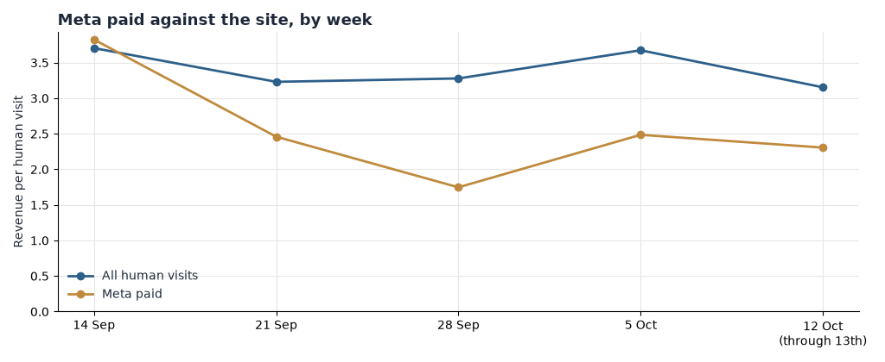

**HEATMAP — Today's Plan: Stop Buying Visits That Earn 83 Cents**

**Latico Leathers — laticoleathers.com**

A one-hour ad-account intervention · three switches that change tomorrow's numbers

PREPARED OCTOBER 14, 2026 · DATA THROUGH OCTOBER 13, 2026

The full Site Opportunity Report found the leaks; this document is today's fix. Three switches, each live the morning it is made, no new creative and no code. The latest full week of tracked data — Monday 5 October through Sunday 11 October — still shows all three: a cluster of Meta and programmatic ad sets paying for visits that earn $0.83 each against the site's $3.67, two editorial email roundups whose clicks convert at $0.61 a visit, and about a sixth of Meta's traffic arriving with no campaign tag at all, earning $3.60 a visit that the ad account cannot see or steer. Together they are an hour in Ads Manager and the email platform.

> **Why these three and not the bigger ideas.** The larger plays in the Site Opportunity Report — the two-week bag-recovery flow, the mobile checkout, the Callie Sling Crossbody page rebuild — are worth more and take longer. Tomorrow's ad spend is committed tonight, so the money leaks close first.

## Contents

01 The Situation This Morning · 02 Action 1 — Pause the 83-cent ad sets · 03 Action 2 — Hold this week's roundup sends · 04 Action 3 — Tag the untagged Meta traffic · 05 How to Read Tomorrow · 06 The Rest of the Week · A Data and Method

## 01  The Situation This Morning

The store ran 822 orders worth $180,180 in the week of 5 October — a steady 117 orders a day on an average order of $219. The reliable demand is still the demand that arrives on its own: search earned $5.11 a human visit and direct $4.58, against $3.67 for the site. The leaks are not in the demand; they are in the buying of it.

| Leak | Latest reading (week of 5 Oct) | What it is worth |
|---|---|---|
| Eight losing Meta/programmatic ad sets | 4,246 visits at $0.83 a visit, against the site's $3.67 | Up to about $50,000 a month |
| Two editorial roundup sends | 1,460 clicks at $0.61 a visit, against $3.67 | Up to about $19,000 a month |
| Untagged Meta traffic | 3,442 visits at $3.60 a visit, invisible to the ad account | Up to about $9,000 a month |

Table 1 — The three live leaks, with the numbers from the week of 5 October 2026 (Monday–Sunday). Sizes are monthly estimates from current volumes, not forecasts.

*Figure 1 — Revenue per human visit by week, Meta paid against the whole site, 31 August – 13 October 2026. Meta paid ran $2.49 a visit against the site's $3.67 in the week of 5 October, after touching $1.75 in the week of 28 September; the gap is the leaking channel.*

## 02  Action 1 — Pause the 83-cent ad sets

Owner: paid media. Time: about 25 minutes.

This one is first because tomorrow's spend is committed tonight: every day the losers run, the account buys another roughly 600 visits that return cents. In the week of 5 October the eight ad sets below took 4,246 visits and returned $3,520 — $0.83 a visit against the site's $3.67. The same week's winners earn three to five times that.

- In Ads Manager, pause: `axon — LaticoLeathers_D7ROAS_Discovery` (484 visits, $0.86) and `axon — LaticoLeathers_D7ROAS_Prospecting` (143 visits, $0.00); `applovin — D7ROAS Discovery` (376, $0.98), `applovin — D7ROAS Prospecting` (291, $0.00) and `applovin — D7ROAS Testing` (261, $0.00); `BC_11/12/25_CBO_PROSPECTING` (1,165, $1.04); `BC_12/6/25_PROSPECTING_MARPIPE_DPA` (756, $0.77); `BC_12/6/25_MARPIPE+DPA_WHITELABEL` (770, $1.22).
- Re-point the freed budget into the sets already earning it: `BC_11/12/25_TESTING+&+WINNERS_CBO` ($4.36 a visit in the latest week), `BC_11/12/25_ABS_BID+CAP` ($4.90), `11/12/25_BROAD+ABS` ($4.16), `BC_08/04/26_PROSPECTING_GRAVEYARD` ($3.31).
- Do not pause the whitelabel/partnership sets — `BC_9/25/24_ABO+PROSPECTING_WHITELABEL/PARTNERSHIP` earned $2.95 on the biggest volume and its ABO twin $4.04. Do not touch `PN_Prospecting_Creative+Testing_NYNOW_ABO_10/02/26` ($1.41); it is a week old and is a watch item, not a loser.
- Re-point, don't just pause: the point is to move the money behind the $4 sets today, not to bank the savings.

Expected result: up to about $50,000 a month. That is the latest week's losing traffic — about 18,200 visits a month — re-pointed at the site's $3.67 a visit instead of $0.83, which assumes re-pointed traffic converts like the destination's existing traffic. It is an upper bound, and it is before any creative-level work.

## 03  Action 2 — Hold this week's roundup sends

Owner: CRM. Time: about 15 minutes.

The two editorial roundups on this week's calendar are the weakest clicks the email file produces. In the week of 5 October the `Milled+Collection+Full+Roundup` send took 1,049 visits and returned $789 — $0.75 a visit — and the `Stevie+Roundup+Email` took 411 visits and returned $112.50 — $0.27 a visit. Broadcast clicks overall ran at $2.50 against the site's $3.67, so the roundups are not the channel's normal; they are its floor.

- Pull both roundup sends from this week's calendar in the email platform. Hold the volume; do not delete the lists.
- Re-point the slot at the engaged-clicker segments (clicked 90 days, email engaged 30/120 days) or hold it for the launch format: the National Handbag Day Sale launch send earned $2.87 a visit on 1,413 visits in the same week.
- Do not touch the automated flows or the order-confirmation sends. The welcome series' first email earned $14.10 a visit and the abandoned-bag flow's first email $18.84 in the latest week; the flows are the best value per visit the site owns.
- If the roundups must run, re-point their links at `/collections/best-sellers` (2.90% buyer rate in the window) rather than at the collection index pages.

Expected result: up to about $19,000 a month — the roughly 6,300 roundup clicks a month, re-pointed at the site's $3.67 a visit instead of $0.61, assuming re-pointed clicks convert like the traffic they join. An upper bound, not a forecast.

## 04  Action 3 — Tag the untagged Meta traffic

Owner: paid media. Time: about 20 minutes.

About one Meta visit in six arrives with no medium or campaign, and it is good traffic: 3,442 visits at $3.60 a visit in the week of 5 October, and $4.10 across the full window — better than the tagged Meta paid average. It converts well and it cannot be steered, scaled, or defended in a budget review because the ad account cannot see which placement or creative it is.

- In Ads Manager, apply a UTM template to every ad link: `utm_medium=paid`, `utm_source=facebook` or `instagram`, and the campaign name. Cover the dark posts and the boost-button placements, which is where untagged traffic usually comes from.
- Make it a template, not a one-off edit, so every new ad inherits the tags.
- Do not change bids, audiences, or creative as part of this action — tagging first, steering after it has a week of clean data.

Expected result: up to about $9,000 a month — the roughly 14,800 untagged visits a month (about $53,000 of on-site revenue at its current $3.60) becoming attributable, with the upside assuming the re-tagged placements can be shifted toward the winners' $4-plus rate. The $53,000 already arrives; the gain is the steering, not the traffic.

## 05  How to Read Tomorrow

Direction should be visible within a day or two; this is a large read — 46,733 human visits in the latest week — so size needs three or four days, not a week. One order moves the site's visit-to-order rate by 0.002 of a point, so read the scoreboard in dollars and visits, not in fractions of a rate.

| Watch | Now | Target |
|---|---|---|
| Meta paid revenue per visit, weekly | $2.49 (week of 5 Oct) | At or above the site's $3.67 |
| Visits on the paused sets | 4,246 a week | Zero within 48 hours |
| Roundup-send revenue per visit | $0.61 a visit | Held, or at the launch-send floor of $2.87 |
| Share of Meta visits carrying a campaign tag | About 84% (3,442 of 20,920 untagged) | 100% |

Table 2 — The scoreboard for the three switches, baseline from the week of 5 October 2026.

One caution: a promotion landing inside the reading window moves orders on its own. The National Handbag Day Sale is live in this window — 10 October was a peak-revenue day — so if a send or a sale lands while the scoreboard is being read, note it beside the numbers before judging the switches.

## 06  The Rest of the Week

These are deliberately not today's work. They are the larger plays from the Site Opportunity Report, queued once the three switches are on.

| When | Action | Size |
|---|---|---|
| Thu 15 Oct | Log the paused sets as zero in Ads Manager; confirm the re-pointed budget is behind TESTING & WINNERS, ABS BID+CAP, BROAD ABS and GRAVEYARD. | Guards the ~$50,000 a month from Action 1 |
| Fri 16 Oct | Write the UTM template QA: spot-check five live ad links for the tag before any new creative ships. | Guards the steering from Action 3 |
| Mon 19 Oct | Scope the two-week sequenced bag-recovery flow, mobile-first, with a checkout-starter track — CRM build starting this week. | Every recovery point ≈ 700 orders a month, about $150,000 |
| Tue 20 Oct | Walk the mobile checkout on the three most common phones; brief the Callie Sling Crossbody page fixes (sticky add-to-bag, routing modules, nav rage). | Up to about $230,000 a month (checkout) · one page buyer-rate point ≈ $100,000 |

Table 3 — The week's queue, in order. Bag attach and the measurement cleanup (dead-session filter, repeat-flag audit, order-match gap) follow in weeks two and three of the 30-day plan in the Site Opportunity Report.

## A  Data and Method

Figures are order totals as recorded on laticoleathers.com for 14 September – 13 October 2026, with 31 August – 13 September as context; the last day of the report window is 13 October 2026. Money is USD. "Latest week" is the Monday–Sunday week of 5 – 11 October 2026; the week of 12 October is excluded because it holds only two days (12–13 October). Money amounts are the revenue stored on the order.

Traffic and per-visit figures use human visits only. A dead session — one page or none, no click, no scroll, no order — is excluded and counted separately: 516,352 in the window (70.4% of raw traffic) and 44,361 in the week of 5 October (48.7%). A visit with an add to bag, a checkout or an order is never excluded. Channel and campaign figures credit the visit to the link it arrived on (last touch). Ad spend is not in this bundle, so revenue per visit is on-site value, not profit; read profit against Ads Manager spend.

Campaign reads come from the weekly campaign-link table (5+ visits in the week) and newsletter reads from the same table by campaign name. Sizes are monthly estimates: the latest week's visits scaled by 30/7, valued as upper bounds at either the site's $3.67 a visit (re-pointed traffic assumed to convert like the destination's existing traffic) or the winners' rate where stated. They are not forecasts. Buyers are counted by device, not by named account.

The 30-day bought-before flag is broken on this extract (it labels 98% of matched orders as prior buyers) and is not quoted; the returning-visitor flag is used where repeat behaviour matters. Funnel step ratios were stable across the window, so no event-definition break is reported. The chart for this stage, Meta paid against the site by week, was drawn and is Figure 1 above; no declared chart for this run was skipped.
