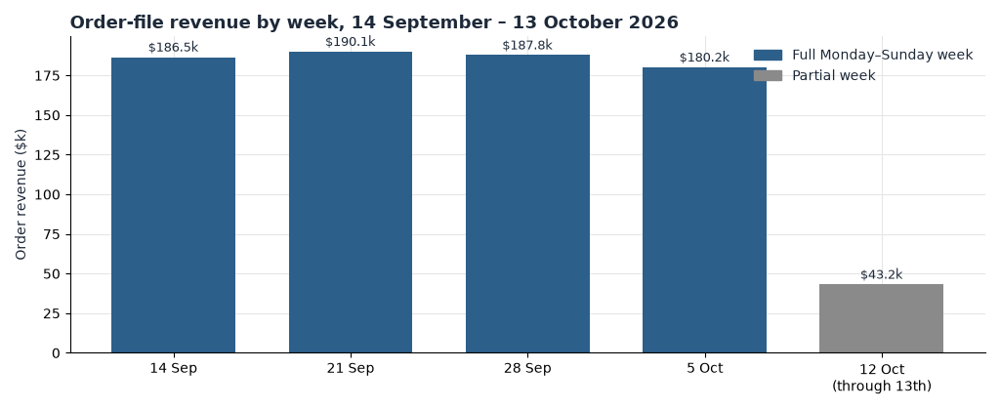
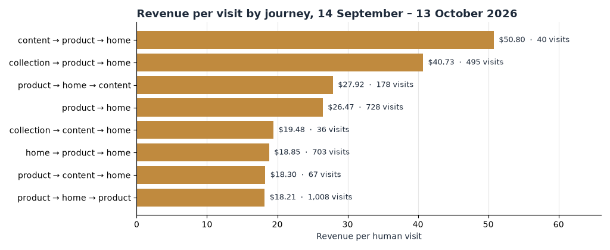

# HEATMAP

**Latico Leathers**

**User Journey Opportunity Analysis**

laticoleathers.com  |  September 14 – October 13, 2026  |  Prepared October 14, 2026

PREPARED OCTOBER 14, 2026 · DATA THROUGH OCTOBER 13, 2026

We traced every human visit in the report window — 217,489 of them, after removing 593,693 dead sessions that showed no click, no scroll and no order — and rebuilt each one as a journey of page classes: home, product, collection, content, search, bag. The order file anchors the month: 3,656 orders worth $787,847 between September 14 and October 13, 2026. The question this document answers is how those shoppers moved, and where the movement stopped.

> **How to read a journey.** A journey is the sequence of page classes a visit touched, with consecutive repeats counted once — five product pages in a row read as one product step. A visit that stayed inside a single class is a one-page journey, and a one-page journey is not a failed one: quick-add means a buying visit can be exactly one tracked page, and product-only visits still produced 612 buyers and $133,086 this window. On this bundle the `other` class — which often hides product URLs stored with a full domain, including paid landing pages — is tiny: 107 visits all window, so the story below is told with the five real classes. Dead sessions (one page or none, no click, no scroll, no order) are excluded everywhere except where stated; that is 61.9% of the raw traffic.

## Contents

01 · The Month in Journeys
02 · The Journeys That Make Money
03 · Where the Journeys Leak
04 · How the Window Reshaped the Funnel
05 · Returning Visitors Carried the Month
06 · Behaviour Signals Worth Watching
07 · Where the Journey Data Points
A · Data and Method

## 01 The Month in Journeys

The headline is not a single broken page. It is that 63% of human visits — 137,949 of 217,489 — never changed page class, and those visits bought at 0.64% against 3.19% for visits that took a second step. The window also ran far softer than the two prior weeks: conversion nearly halved from 2.93% to 1.59%, on a third less daily traffic.

| Measure | This window | Anchor |
| --- | --- | --- |
| Orders in window | 3,656 | $787,847 revenue |
| Human visits | 217,489 | 593,693 dead sessions removed (61.9% of raw) |
| Where visits land | Product 55.9% · Collection 24.2% · Home 14.8% · Content 5.0% | entry class, first page of the visit |
| Most common journey | One product page and out: 94,294 visits (43%), 0.65% buyer rate, $1.41 per visit | vs $7.08 for any multi-class journey |
| Best common journey | Home → collection → product: 8,566 visits, 4.09% buyer rate, $9.20 per visit | strongest journey with 5,000+ visits |
| Homepage effect | Visits that touched the homepage: 4.43% buyer rate, $9.99 per visit | 0.94% and $1.97 for visits that never did |
| Second-product effect | One product page: 1.13% buyer rate | Two: 2.86% · 3–4: 3.49% · 5–8: 4.89% · 9+: 6.35% |
| Peak days (Sep 25, Oct 3, Oct 10) | 1.79% buyer rate on 8,542 visits a day | window average 1.59% on 7,250 visits a day |

Table 1 — The month in journeys. Buyer rate is buyer visits divided by human visits, September 14 – October 13, 2026. Pipeline tables for this run describe the Callie Sling Crossbody page, not the homepage; the tables here are site-wide.

*Figure 1 — Order-file revenue by Monday week, September 14 – October 13, 2026. Full weeks held between $180,180 and $190,077; the week of October 12 is partial, containing October 12–13 only ($43,202).*

The weekly bars say the second half of the window was not a collapse — full weeks sat inside a $10,000 band. What changed against the pre-window fortnight is how much traffic arrived and how often it bought, and that is the subject of section 04.

## 02 The Journeys That Make Money

Revenue per visit sorts the journeys fast. One-page product visits are the volume; the money is in visits that loop back — a second product, a collection detour, the homepage.

*Figure 2 — Revenue per human visit by journey and behaviour, September 14 – October 13, 2026. Gold marks the high-value journeys: any visit that touched the homepage, went collection → product, or used search or FAQ. Grey-context rows are the one-page journeys.*

| Journey or signal | Visits | Buyer rate | Revenue per visit |
| --- | --- | --- | --- |
| One page class, any | 137,949 | 0.64% | $1.33 |
| — product only | 94,294 | 0.65% | $1.41 |
| — collection only | 27,398 | 0.16% | $0.33 |
| — home only | 8,244 | 2.60% | $4.74 |
| — content only | 7,895 | 0.20% | $0.32 |
| Any multi-class journey | 79,118 | 3.19% | $7.08 |
| Collection → product (within the visit) | 53,703 | 3.73% | $8.31 |
| Reached the homepage (any point) | 39,798 | 4.43% | $9.99 |
| Used search | 14,038 | 4.27% | $10.22 |
| Clicked FAQ or an accordion | 16,524 | 4.20% | $9.56 |
| Clicked reviews | 12,744 | 3.45% | $7.67 |
| Product → collection → product | 14,536 | 3.91% | $8.88 |
| Home → collection → product | 8,566 | 4.09% | $9.20 |

Table 2 — Journeys and journey signals by revenue per human visit, September 14 – October 13, 2026. Behaviours such as search and FAQ clicks can happen inside any journey; the journey rows are sequences of page classes.

Three readings:

- **The second product page is the whole game.** One product page converts at 1.13%; the second takes it to 2.86%; by five or more the rate is 4.89% and revenue per visit is $11.82 against $2.38 for a single product page. Every additional product view is worth more than the last.
- **The homepage is a mid-visit tool, not just a front door.** Only 14.8% of visits entered on it, but 18.3% touched it somewhere, and a visit that did bought at 4.43% against 0.94% for one that never saw it. Small loops that return to home — product → home (728 visits at $26.47 per visit), home → product → home (703 at $18.85) — are the richest shapes in the data. The counts are small enough to read as directional, but they point the same way as the big table: a visit that orients before it commits is worth several that do not.
- **Quick-add keeps the one-page journey honest.** Product-only visits still produced 612 buyers and $133,086. The goal is not to abolish the one-page visit; it is to raise the share that takes a second step from one in three to something better. This is the journey behind the Site Opportunity Report's finding that the Callie Sling Crossbody page is a doorway, not a destination (Opportunity 4 — The Callie Sling Crossbody page is a doorway, not a destination).

> **So what:** judge merchandising by the second product view it creates, not by the first. A collection that sends half its traffic to a product page (54.7% of collection-reaching visits went on to a product) is doing its job; one that stalls at 0.16% on its own page class is a wall. The upside of moving one-page product visits into multi-class behaviour is sized in section 03.

## 03 Where the Journeys Leak

The leaks concentrate at the front door. Visits arrive on a product page more than half the time, and paid traffic arrives there hardest:

| Referrer channel (last touch) | Visits | Buyer rate | Revenue per visit | Share entering on a product page |
| --- | --- | --- | --- | --- |
| Meta paid | 117,005 | 1.24% | $2.61 | 74.8% |
| Direct | 82,228 | 3.10% | $6.81 | 58.5% |
| Search | 67,346 | 2.66% | $5.71 | 38.0% |
| Email / SMS | 48,392 | 1.81% | $3.71 | 40.1% |
| Meta untagged | 26,014 | 2.93% | $6.40 | 59.9% |
| Other | 24,760 | 1.14% | $2.39 | 55.7% |

Table 3 — Human visits by last-touch referrer channel, September 14 – October 13, 2026. Channel is the link the visit arrived on; revenue per visit is on-site value only — the bundle has no ad spend, so this is not a return on spend. Pre-window context: direct converted at 5.23% and search at 3.57%, so the whole table is softer than the site was two weeks earlier — but meta paid was already the weakest channel then ($2.75 per visit vs $11.36 direct) and it still is. The paid-social leak is specified in the Site Opportunity Report as Opportunity 3 — Make every paid-social dollar accountable; the action list stays there.

The pipeline entry view — entry sessions across tracked pages, confirmed bots excluded — shows the same shape from a different denominator:

| Entry source | Entry sessions | Single-page share | Orders | Revenue per session |
| --- | --- | --- | --- | --- |
| Direct | 602,934 | 82.0% | 4,825 | $1.77 |
| Social | 517,437 | 71.7% | 4,785 | $2.01 |
| Campaign | 321,061 | 63.0% | 2,709 | $1.78 |
| Search | 236,517 | 47.2% | 4,567 | $4.16 |
| Website (internal) | 5,460 | 33.3% | 170 | $5.51 |

Table 4 — Entry sessions by source, pipeline view. Entry sessions keep some automated traffic the human-visit rule removes, so these denominators are larger than Table 3 and the two tables must not be mixed; compare rows within each. Inside this table, four sessions in five from direct land on one page and stay there, and social is close behind — while search sessions, the least single-page, earn twice the revenue per session.

Then there are the landing pages themselves. Twenty-six product pages each took 4,000+ entries and converted under 0.2% of them — together 153,186 entries and 154 entry buyers, one buyer per thousand visits. Beside each, a peer page with comparable volume does four to nine times better:

| Leaking page | Entries | Entry buyers | Rate | The page next door | Entries | Entry buyers | Rate |
| --- | --- | --- | --- | --- | --- | --- | --- |
| /products/nash-tote-crossbody | 11,801 | 15 | 0.13% | /products/crosby-sling-crossbody | 14,046 | 106 | 0.75% |
| /products/jackson | 10,266 | 17 | 0.17% | /products/callie-sling-crossbody | 37,328 | 357 | 0.96% |
| /products/terry | 9,446 | 10 | 0.11% | /products/lindsey-tote-shoulder-bag | 16,606 | 85 | 0.51% |
| /products/peck-crossbody | 9,725 | 4 | 0.04% | /products/darby-leather-crossbody | 8,988 | 60 | 0.67% |
| /products/harley-wallet | 4,721 | 0 | 0.00% | /products/dos-wallet | 5,779 | 3 | 0.05% |

Table 5 — Product landing pages with 4,000+ entries and under 0.2% entry-buyer rate, September 14 – October 13, 2026, each beside a higher-converting peer of similar volume. Entry-buyer rate is buyer visits that entered on that page divided by entries; page_period keeps dead sessions, so the absolute rates run below the human-visit tables. The full leak group adds a further 21 pages — wallets and small leather goods are over-represented — including /products/patch-wallet (5,278 entries, 1 buyer), /products/dalton (6,369 entries, 2) and /products/lucy-crossbody (5,786 entries, 4).

These are pages that take the click and end the visit. Stock, price, image and review coverage on the dead pages against their live peers is the first check — a near-zero entry rate on a page its neighbours convert on is usually a page problem, not a traffic problem.

> **So what:** the upper bound if the leak group converted at the Lindsey tote's 0.51% is about 610 more orders a month, on the order of $130,000 — and higher still at the Callie rate. That assumes re-pointed and repaired pages convert like their live peers, and shoppers who bounce on a broken page are partly different people from those who would have browsed on, so treat it as a ceiling, not a forecast. The single largest cheap move is the same as section 02's: give the one-page product visit somewhere to go.

## 04 How the Window Reshaped the Funnel

The pre-window fortnight (August 31 – September 13) is the comparison that matters:

| Phase | Days | Visits / day | Orders / day (all) | Add-to-cart / day | Checkout / day | Conversion | Revenue / visit | Checkout per add-to-cart |
| --- | --- | --- | --- | --- | --- | --- | --- | --- |
| Pre (Aug 31 – Sep 13) | 14 | 10,593 | 327 | 1,276 | 520 | 2.93% | $6.13 | 39% |
| Window (Sep 14 – Oct 13) | 30 | 7,250 | 122 | 601 | 198 | 1.59% | $3.44 | 33% |
| Peak days (Sep 25, Oct 3, Oct 10) | 3 | 8,542 | 159 | 758 | 261 | 1.79% | $3.82 | 34% |

Table 6 — Funnel by phase, daily_site. Orders / day counts every order; conversion and revenue per visit use orders matched to non-dead visits.

The change is both traffic and conversion. Daily traffic fell 32% against the pre-window fortnight; daily orders fell 63%; and conversion fell from 2.93% to 1.59% — add-to-cart per visit fell from 12.0% to 8.3%, so the softening runs through intent, not just volume. There is no tagging break to blame: checkout per add-to-cart slid gradually from about 42% in early September to about 31–37% by the window, with no single-day jump, so the cart → order read is stable enough to trust. The daily series inside the window holds 27–37% throughout.

The three peak days were a broad, shallow lift, not one channel spiking: visits ran 18% above the window average, orders 33% above, and the channel mix of peak-day orders sits close to the window mix (search 24.7% of peak orders against 26.8% for the window; email 17.6% against 13.6%). Average order value was flat — $212.49 against $215.49 — and only 0.6% of peak-day orders carried a markdown flag against 0.2% for the window, so there is no discount signature in the order file. A promotion or code would look exactly like this; the bundle has no promotion calendar to confirm it, so we name the days and not the cause.

## 05 Returning Visitors Carried the Month

The 30-day bought-before flag cannot measure repeat purchase on this extract: 3,348 of the window's 3,425 buyer visits flag `bought_before`, because a visit's own order counts. So this section reads the device returning flag (`ret`) instead.

| Week (Monday) | New visits | New buyer rate | Returning visits | Returning buyer rate | Returning RPV | Returning share of visits |
| --- | --- | --- | --- | --- | --- | --- |
| Aug 31 (from 31st) | 63,354 | 3.19% | 15,209 | 3.15% | $6.63 | 19.4% |
| Sep 7 | 48,627 | 2.36% | 21,113 | 3.05% | $6.33 | 30.3% |
| Sep 14 | 33,185 | 1.60% | 14,535 | 1.80% | $4.11 | 30.5% |
| Sep 21 | 40,711 | 1.33% | 15,346 | 1.87% | $3.98 | 27.4% |
| Sep 28 | 38,234 | 1.43% | 16,251 | 1.89% | $3.91 | 29.8% |
| Oct 5 | 32,832 | 1.50% | 13,901 | 1.98% | $4.32 | 29.8% |
| Oct 12 (through 13th) | 8,489 | 1.32% | 4,005 | 1.70% | $3.83 | 32.1% |

Table 7 — New against returning human visits by week, weekly_entry_cube. The first and last weeks are partial.

For the fortnight before the window, new and returning visitors converted alike — 3.19% against 3.15%. From September 14 the two lines separated and stayed separated for all five window weeks: returning visitors bought at 1.70–1.98% against 1.32–1.60% for first-timers, and returned $3.83–$4.32 per visit against $2.83–$3.53. Returning visitors were 29.4% of window traffic and 34.7% of window revenue.

> **So what:** in a month where first-time intent halved, the returning visitor is the segment that held. Feeding that loop — the subject of Opportunity 6 in the Site Opportunity Report (Feed the repeat buyer) — is the most resilient journey investment available this month, and it compounds: every buying visit manufactures a returning visitor.

## 06 Behaviour Signals Worth Watching

Five signals where the rate differs from the site and the count is large enough to act on. Site buyer rate for the window is 1.57%.

- **Under a minute on a product page.** 74,582 visits — 34% of the window — spent less than sixty seconds on the product page they saw, and they bought at 0.7%. Visits giving a product three to ten minutes bought at 3.0%; ten minutes or more, 4.6%. The first minute is where the loss sits. Watch the share of product visits under 60 seconds; test what a arriving shopper sees in that minute — images, price, shipping line — against the pages that hold attention.
- **Zero-click visits.** 61,241 visits (28%) recorded no click at all and converted at 0.44%, against 4.75% for visits with 26 or more. A visit that never touches the page is a visit that never had a chance to buy. This overlaps the dwell signal but reads separately: some of these land on pages with nothing clickable above the fold worth clicking.
- **Search is a buying behaviour, not a navigation one.** 14,038 visits used search and bought at 4.27% — nearly three times the site rate of 1.57% — returning $10.22 per visit against $3.44. Make search easier to reach from product and collection pages, and check what the zero-result queries are.
- **FAQ clickers convert.** 16,524 visits opened an accordion or FAQ and bought at 4.20% against 1.36% for those who did not. Shoppers who seek detail are close to decision; the signal is that detail must stay findable on the page, not buried.
- **Singapore and Ireland traffic buys nothing.** 14,586 visits — 6.7% of the window — came from SG (11,350) and IE (3,236) and produced one order worth $64. Almost all of the Singapore surge sat in the first half of the window (11,237 of 11,350 visits), which smells like a campaign or placement sending non-buying traffic. The bundle does not record which channel sent it; before any more spend goes out, find the source and switch it off. The paid-social accountability work in Opportunity 3 of the Site Opportunity Report is where this lands.

Rage clicks on the analysed Callie Sling Crossbody page — 3,824 rage sessions in the window weeks, concentrated on nav links — were checked and are a page-level matter for that page's pipeline work, not a journey signal.

## 07 Where the Journey Data Points

Ranked by journey evidence, not traffic volume — a quiet high-value path outranks a large cheap landing.

| # | Move | Journey evidence |
| --- | --- | --- |
| 1 | Give every product entry a second step: cross-sell rows, collection links and search on the PDP, aimed first at the 94,294 one-page product visits | $1.41 per visit against $7.08 for multi-class journeys; second product page doubles buyer rate (Opportunity 4, Site Opportunity Report) |
| 2 | Fix or re-point the 26 zero-converting product pages — start with nash-tote-crossbody, jackson, terry, peck-crossbody and the wallet cluster | 153,186 entries, 154 entry buyers (0.10%); peers convert at 0.51–0.96%; up to about $130,000 a month at peer rates |
| 3 | Make paid social land on a journey, not a page — send it to collections and bestsellers, and find the source of the SG/IE traffic | Meta paid $2.61 per visit vs direct $6.81; 74.8% of meta visits enter on a product page; social entry sessions 71.7% single-page (Opportunity 3, Site Opportunity Report) |
| 4 | Protect the returning loop — email and flows aimed at recent buyers, since they held their rate through the window | Returning buyer rate 1.89% vs 1.45% new; $4.06 vs $3.18 per visit, all five window weeks (Opportunity 6, Site Opportunity Report) |
| 5 | Promote search and keep FAQ detail on the page | Search 4.27% buyer rate at $10.22 per visit; FAQ clickers 4.20% |

Table 8 — The five journey moves, ranked by evidence, September 14 – October 13, 2026. Dollar sizes are monthly upper bounds from this window's volumes, assuming re-pointed traffic converts like the destination's existing traffic; shoppers who browse further are partly different people, so treat them as ceilings.

Four numbers to track weekly, direction visible by the following Monday on this volume:

| Watch | Now | Reading |
| --- | --- | --- |
| Buyer rate on one-page product visits | 0.65% (94,294 visits) | The share of entries that take a second step |
| Entry-buyer rate on the five biggest leaking PDPs | 0.13% / 0.17% / 0.11% / 0.04% / 0.00% (nash, jackson, terry, peck, harley-wallet) | Whether page fixes or re-points work |
| Meta paid revenue per visit | $2.61 vs direct $6.81 | Whether paid-social traffic is being re-pointed, not just reduced |
| Checkout per add-to-cart | 33% (window), 27–37% daily | A move outside 27–37% flags an event change, not a behaviour change |

A note beside any reading: a promotion, drop, restock or major send inside the week moves orders on its own. The week of October 12 contains only two days; compare it against the same two days of the prior week, not against the full weeks.

## A Data and Method

**Window and context.** Report window September 14 – October 13, 2026, with August 31 – September 13 as pre-window context and August 15 onward for orders. The peak days — September 25, October 3 and October 10 — are the three highest-revenue days inside the window and overlap the calendar halves; they are a subset, not a fourth period. The bundle was generated October 14, 2026.

**Sources.** The analyst bundle at ~/work/analysis/laticoleathers: orders (3,656 rows in the window, $787,847.37 revenue, matching 00_site_profile.json anchors), daily_site, daily_channel_device, weekly_entry_cube, page_period, visit_cohorts, shopper_history_30d, and the pipeline tables for the analysed page /products/callie-sling-crossbody (files 07–09). Journey tables are computed site-wide from visit_cohorts and weekly_entry_cube; the pipeline entry and click tables describe the Callie Sling Crossbody page only and are labelled where used.

**Human visits and dead sessions.** A dead session — one pageview or none, no click, no scroll, no order — is excluded from all visit-level analyst tables. 593,693 of 959,485 raw visits (61.9%) were removed this way; they remain inside page_period, which is why landing-page rates in Table 5 run below the human-visit tables. A visit with an add to cart, a checkout or an order is never excluded, even with no page trail.

**Journey construction.** A journey is the sequence of page classes in a visit (home, product, collection, content, search, bag, account, other), consecutive repeats counted once. Single-class visits are the one-page journeys; `other` held 107 window visits, so full-domain product URLs were not a material class this window and are not combined with `/products/` entries.

**Attribution and denominators.** Channel is last touch — the link the visit arrived on. Table 3 and Table 7 use human visits; Table 4 uses pipeline entry sessions, which exclude confirmed bots but keep other automated traffic, and must not be mixed with human-visit counts. Orders are matched to non-dead tracked visits where possible (3,461 of 3,656 window orders matched); unmatched orders are still counted in orders-per-day and all revenue anchors.

**Repeat-purchase caveat.** The hist30 `bought_before` flag counts a visit's own order, so 3,348 of 3,425 window buyer visits flag it; it cannot measure repeat rate on this extract. Returning-visitor statements use the device returning flag instead. Buyers are counted by device.

**Sizes and breaks.** All monthly dollar figures are upper bounds from this window's volumes, not forecasts; the assumption behind each is stated beside it (re-pointed traffic converting like the destination's existing traffic; page-repair gains at peer-page rates). Average order value in the window was $215.49. No event-definition break was found: checkout per add-to-cart slid gradually from about 42% in early September to 33% across the window with no single-day jump, so cart → order is read as measured. The line-item extract for the analysed page is partial and is not used here. There is no confirmed promotion calendar in the bundle; markdown flags use the first half of the window as a price baseline and are not a promotion record.
