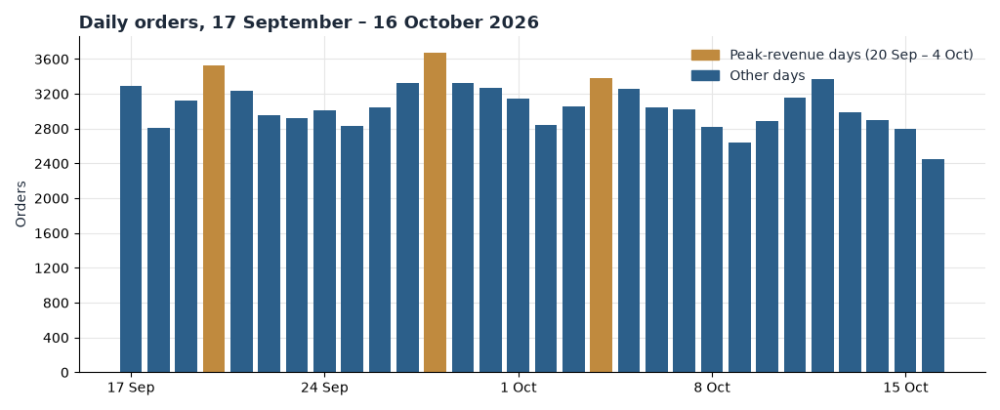
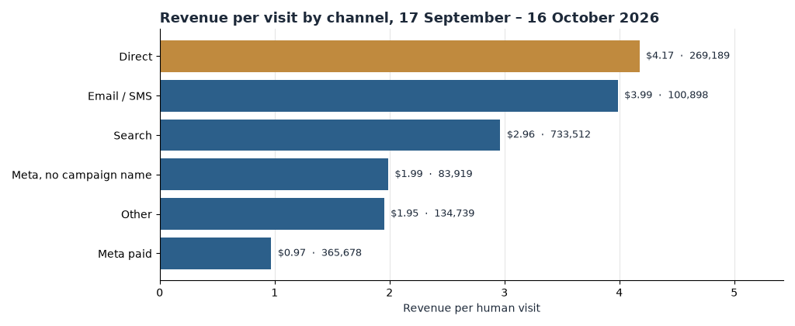
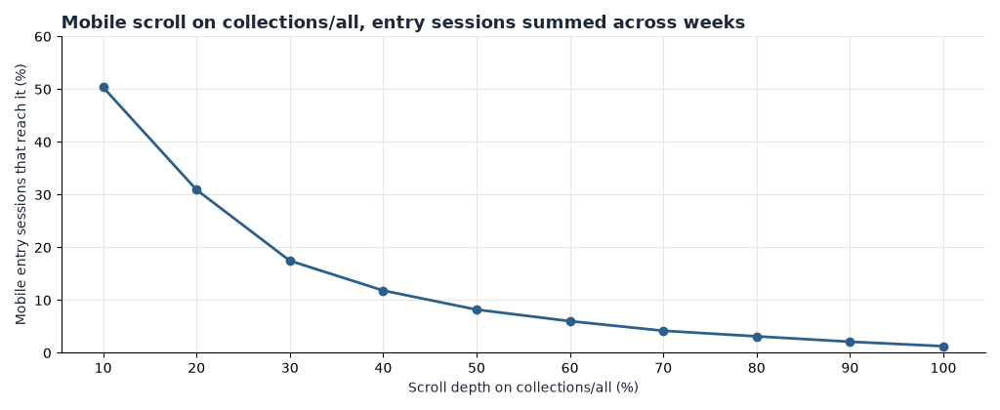
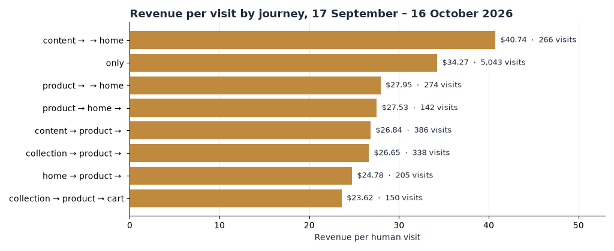
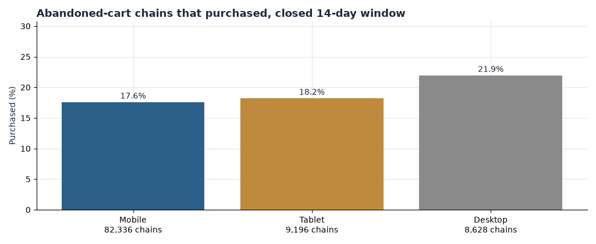
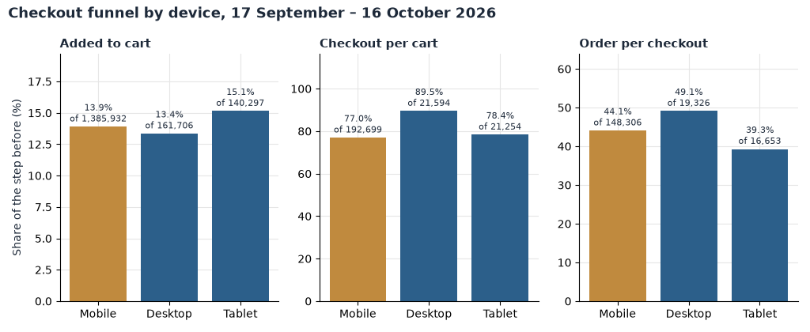

# Loop Earplugs

**Site Opportunity Report**

loopearplugs.com · Shopify · USD
Report window 17 September 2026 to 16 October 2026
Prepared 17 October 2026

The order file records 92,076 orders and $5,038,424.93 in this window. After dead sessions are removed, the visit tables hold 1,687,935 human visits. The page re-analysed for clicks, scroll, and pipeline is `/collections/all` (idsitehsr 50202778), the Google ads landing the qualifier selected.

# Contents

The biggest wins, first · At a glance · The month in numbers · Opportunity 1 — Hold Meta paid to the site's own revenue per visit · Opportunity 2 — Stop the Eclipse ad sets from landing on a 1.5% page · Opportunity 3 — The collection page dies in the first screen · Opportunity 4 — A second product view is where the money is · Opportunity 5 — Cart recovery is already good, and still uneven · Opportunity 6 — Quiet the zero-order geo sets · Opportunity 7 — Desktop is the efficient device, mobile is the store · Opportunity 8 — Read checkout with the event change in mind · Worth watching · What's working · Suggested next 30 days · Method and caveats

# The biggest wins, first

1. Meta paid took 365,678 visits and returned $0.97 each, against $2.66 for the site. Pausing or re-pointing the weak sets is the largest switch that does not need a new page. (Opportunity 1)
2. `/products/eclipse` takes 114,258 entries and converts 1.5% of them, while the homepage landing page converts 5.9% on a similar entry count. The Eclipse campaign is still buying that page. (Opportunity 2)
3. On the analysed collection page, half of mobile entrants never pass the first tenth of the page, and only 8% reach halfway. The first screen has to carry the product choice. (Opportunity 3)
4. A visit that sees two products earns $4.22; a visit that sees one earns $1.68. Merchandising should be judged by the second product it creates. (Opportunity 4)
5. Of 100,160 closed abandoned-cart chains, 18.0% bought. Mobile, which is most of them, buys at 17.6% against 21.9% on desktop. (Opportunity 5)
6. Three Meta campaigns took 500 or more visits in the window and recorded no orders, and two of that shape were still spending in the week of 12 October. (Opportunity 6)

# At a glance

| Finding | Recommended action | Priority |
| --- | --- | --- |
| Meta paid earns $0.97 a visit against $2.66 for the site | Cut or re-point sets below the site, starting with zero-order geos | High |
| Eclipse product page converts 1.5% of 114,258 entries | Move Eclipse ads off `/products/eclipse` | High |
| Mobile collection scroll: 31% reach 20% depth | Put the product choice in the first screen of `/collections/all` | High |
| Two product views earn $4.22 versus $1.68 for one | Add a second-product step on the collection and on product pages | High |
| Closed cart chains purchase at 18.0%, mobile at 17.6% | Match the mobile recovery path to the desktop one | Medium |
| CA, USA, and AUS festival or BOF sets have visits and no orders | Pause those three campaigns | High |
| Desktop converts at 5.9% on 10% of visits; mobile at 4.7% on 82% | Fix mobile collection and cart before buying more mobile reach | Medium |
| Checkout per add-to-cart jumped from 63% to 78% versus the prior fortnight | Do not move budget on the checkout rate until the event is confirmed | Watch |

# The month in numbers

The order file is the anchor. Visit rates below use the visit tables, which drop dead sessions and do not include every order.

| Measure | Order file | Visit tables, 17 September to 16 October |
| --- | --- | --- |
| Orders | 92,076 | 81,790 linked to a kept visit |
| Revenue | $5,038,424.93 | $4,485,927.95 |
| Average order | $54.72 | $54.85 |
| Median order | $46.98 | — |
| High value, order at or above $90 | 7,291 orders, $886,559.37 | — |
| Human visits | — | 1,687,935 |
| Dead sessions removed | — | 448,336 |
| Revenue per human visit | — | $2.66 |
| Conversion of human visits | — | 4.85% |
| Add to cart | — | 14.0% of visits |
| Mobile share of human visits | — | 82% |

Against the prior fortnight (3 to 16 September), human visits per day fell from 62,352 to 56,264, and visit-linked revenue per day fell from $157,064 to $149,531. Conversion edged up, from 4.61% to 4.85%. The month is a little quieter than the fortnight before it, not a collapse.

Weekly visit-linked orders and revenue:

| Week of | Orders | Revenue | Visits | Revenue per visit |
| --- | --- | --- | --- | --- |
| 14 September (partial, from the 17th) | 11,116 | $617,846 | 238,554 | $2.59 |
| 21 September | 18,847 | $1,031,962 | 400,768 | $2.57 |
| 28 September | 20,619 | $1,125,005 | 397,936 | $2.83 |
| 5 October | 18,630 | $1,022,160 | 395,432 | $2.58 |
| 12 October (through the 16th) | 12,578 | $688,955 | 255,245 | $2.70 |

The bundle's three peak revenue days are 20 September, 28 September, and 4 October.

Two readings should sit next to every later number. Demand per day is below the prior fortnight, so a flat rate is not a win by itself. And paid social is a large, cheap slice of the visits: it does not earn like search or direct, so a site average hides where the month's waste sits.

# Opportunity 1 — Hold Meta paid to the site's own revenue per visit

## What we saw

| Channel | Visits | Orders | Revenue | Conversion | Revenue per visit |
| --- | --- | --- | --- | --- | --- |
| Search | 733,512 | 40,437 | $2,174,478 | 5.51% | $2.96 |
| Direct | 269,189 | 19,786 | $1,123,812 | 7.35% | $4.17 |
| Email / SMS | 100,898 | 7,361 | $402,281 | 7.30% | $3.99 |
| Meta paid | 365,678 | 6,256 | $355,213 | 1.71% | $0.97 |
| Other | 134,739 | 4,953 | $263,216 | 3.68% | $1.95 |
| Meta, no campaign name | 83,919 | 2,997 | $166,928 | 3.57% | $1.99 |

Inside campaign links, Google ads (medium cpc) took 510,938 visits at $2.92 each and a 5.44% conversion. The Meta link channel took 469,921 visits at $0.95 and 1.68%. Meta paid is not a small test. It is the second-largest referrer channel and the one that earns about a third of the site's revenue per visit.

The week of 12 October, which runs only through 16 October, still shows it: Meta paid took 56,376 visits, 978 orders, and $57,365, or $1.02 a visit, against $2.70 for the site that week.

## Why it matters

If those 365,678 Meta paid visits had earned the site's own $2.66, the gap is about $617,000. That is an upper bound. Paid social shoppers are not search shoppers, and closing the whole gap would mean the traffic itself changed, not only the ads. It is still the right size to use when deciding what to pause.

## Recommended actions

- Keep any Meta set that earns near the site, and pause sets that earn well under $1 a visit or that record no orders. The named sets are in Opportunity 6.
- Do not judge Meta by its add-to-cart rate alone. It carts at 9.7% of visits, against 15.6% for search, and then converts at 1.71%.
- Leave Google ads alone while this is cleaned up. That link channel already earns $2.92.

# Opportunity 2 — Stop the Eclipse ad sets from landing on a 1.5% page

## What we saw

Entry pages in the two halves of the window, entries and the share of those entries that bought:

| Page | Entries | Entry buyers | Entry-buyer rate |
| --- | --- | --- | --- |
| /pages/lp-homepage-lp2 | 195,317 | 11,445 | 5.86% |
| /collections/all (analysed ads URL) | 194,732 | 9,366 | 4.81% |
| /products/switch | 170,504 | 5,070 | 2.97% |
| /products/dream | 154,381 | 5,033 | 3.26% |
| /products/eclipse | 114,258 | 1,754 | 1.54% |
| /products/quiet | 99,409 | 3,700 | 3.72% |
| /products/engage | 63,493 | 2,668 | 4.20% |

The Eclipse consolidated campaign (`EU_EN_TOF_Purchase_EXP-ConsolidatedEclipseCampaign_CBO-NoScale-Rules_Mix-None-None_Eclipse`) took 24,493 Meta visits and 255 orders, about $0.73 a visit. In the week of 12 October it was still on: 3,514 visits, 43 orders, $3,088.

## Why it matters

Eclipse's entry-buyer rate is about a quarter of the homepage landing page's, on more than a hundred thousand entries. Moving that entry volume to a page that already converts like Engage or the homepage LP is the bound, not a promise. The gap between 1.54% and 4.20% on 114,258 entries is about 3,000 entry buyers. Many of those entries are not from this one campaign, so the campaign-sized bound is the 24,493 visits, not the whole product page.

## Recommended actions

- Change the Eclipse campaign's destination URL off `/products/eclipse`. Point it at `/products/engage` or `/pages/lp-homepage-lp2`, both of which already convert entries.
- Do not rebuild the Eclipse page before the destination change. The page can be fixed later. The spend is happening now.
- Read the result on entry-buyer rate for the new URL, not on Meta's reported purchases alone.

# Opportunity 3 — The collection page dies in the first screen

## What we saw

The analysed page is `/collections/all`. Mobile entry sessions summed across the weeks in the scroll table: 164,860.

| Depth | Share of mobile entrants who reached it |
| --- | --- |
| 10% | 50.4% |
| 20% | 30.9% |
| 50% | 8.2% |
| 100% | 1.3% |

Half the mobile entrants never get past the first tenth. This is the page the Google ads URL lands on, and that URL took 194,732 entries at a 4.81% entry-buyer rate. The homepage landing page, with almost the same entry count, does better, and it is a different template.

## Why it matters

The collection is a choosing page. If the choice sits below the first screen, most mobile entrants never see it. A first-screen edit does not create the second-product visits in Opportunity 4 by itself, but it is the only place those visits can start for this landing.

## Recommended actions

- Put two or three products, with price and a clear next step, in the first mobile screen of `/collections/all`.
- Keep the Google ads destination on this URL until that screen is in place, then compare its entry-buyer rate with the homepage LP.
- Do not add a long story above the products. The scroll curve says the story will not be seen.

# Opportunity 4 — A second product view is where the money is

## What we saw

Journey class sequences, visits that stayed in the visit tables:

| Journey | Visits | Orders | Revenue per visit | Conversion |
| --- | --- | --- | --- | --- |
| Product only | 675,113 | 14,081 | $1.15 | 2.09% |
| Collection only | 118,832 | 1,569 | $0.68 | 1.32% |
| Collection, then product | 55,924 | 3,641 | $3.44 | 6.51% |
| Home | 57,898 | 4,241 | $4.08 | 7.33% |
| Home, then product | 32,554 | 2,434 | $3.94 | 7.48% |

Product views in the same visits:

| Product pages seen | Visits | Revenue per visit | Conversion |
| --- | --- | --- | --- |
| 0 | 475,404 | $1.44 | 2.77% |
| 1 | 795,157 | $1.68 | 3.26% |
| 2 | 199,088 | $4.22 | 7.90% |
| 3–4 | 152,920 | $6.19 | 10.77% |

Zero product pages still produce orders. A buying visit can be one tracked page when the shopper adds quickly, so "one page class" is not "no order".

## Why it matters

The step from one product to two is the steep one: $1.68 to $4.22. People who view a second product are partly different people, so this is an upper bound, not a forecast that every one-product visit can be moved. It is still the merchandising test: did the page create a second product view.

Collection-only visits earn $0.68. The same visits that continue to a product earn $3.44. That is the collection page's job.

## Recommended actions

- On `/collections/all` and on the product pages that take the most entries (Switch, Dream, Quiet, Engage), offer one next product in the first screen, not in a grid below the fold.
- Judge the change by the share of visits with two product views, and by revenue per visit, not by time on page.
- Leave the homepage LP's structure alone until that test is read. Home already earns $4.08 a visit.

# Opportunity 5 — Cart recovery is already good, and still uneven

## What we saw

Abandoned-cart chains with `final = 1`. The dates run 17 September through 2 October, the part of the window that has had 14 days to close.

| Device | Chains | Returned | Purchased | Purchase rate | Revenue |
| --- | --- | --- | --- | --- | --- |
| Mobile | 82,336 | 47,505 | 14,474 | 17.6% | $832,744 |
| Desktop | 8,628 | 5,098 | 1,893 | 21.9% | $125,069 |
| Tablet | 9,196 | 5,039 | 1,675 | 18.2% | $100,482 |
| All | 100,160 | 57,642 | 18,042 | 18.0% | $1,058,295 |

More than half come back. Just under one in five buys. Recovered orders average about $59, close to the site's $54.72 average, so recovery is not only small baskets.

## Why it matters

One extra point of purchase rate on this closed cohort is about 1,000 orders and about $59,000. That is an upper bound: it assumes the extra buyers look like the ones who already purchased. Mobile is 82,336 of the chains and four points behind desktop. Closing that device gap, and only that gap, is the practical bound.

## Recommended actions

- Compare the mobile recovery message with the desktop one. Same delay, same offer, unless the mobile message is the one that is late or thin.
- Do not build a new flow this week. The chains already return. The leak is the purchase, and it is larger on mobile.
- Keep the 14-day close in the reading. A chain opened on 16 October has not finished.

# Opportunity 6 — Quiet the zero-order geo sets

## What we saw

Meta campaigns in the weeks of 14 September through 12 October with at least 500 visits and no orders:

| Campaign | Visits | Orders | Add to cart | Checkout |
| --- | --- | --- | --- | --- |
| CA_EN_TOF_Purchase_CAM-TML26-Mix-Festivals&Nightlife-None_CBO-NoScale-NoRules_Mix-None-None_Earplugs | 1,064 | 0 | 19 | 23 |
| USA_EN_TOF_Purchase_CAM-TML26-Mix-Festivals&Nightlife-None_CBO-NoScale-NoRules_Mix-None-None_Earplugs | 562 | 0 | 46 | 23 |
| AUS_EN_BOF_Purchase_BAU-Mix-All-TopPerformers_ABO_Earplugs | 531 | 0 | 1 | 0 |

In the week of 12 October, these were still at zero orders: `UK_EN_TOF_Purchase_BAU-NoiseSensitive-All-Quiet/Engage_CBO_Earplugs` (279 visits), `EU_EN_TOF_Purchase_BAU-Festivals&Nightlife-All-Experience_CBO_Earplugs` (258 visits), and the Canada festivals set again (138 visits).

The largest Meta campaign in the window, `EU_EN_TOF_Purchase_EXP-ConsolidatedGAINCampaign_CBO-NoScale-Rules_Mix-None-None_Earplugs`, took 72,839 visits and 1,489 orders, about $1.17 a visit. It is the one to keep while the zero-order sets stop.

## Why it matters

The three zero-order campaigns are small next to GAIN. They are also pure waste: visits, a few carts, no orders. Pausing them does not require a new creative.

## Recommended actions

- Pause the three campaigns in the table, and the two week-of-12-October sets that are still at zero orders.
- Do not pause GAIN, the GAIN bottom-of-funnel set (24,139 visits, 558 orders), or linkinbio until their destinations are checked. Linkinbio took 55,177 visits and 904 orders, about $0.89 a visit, and it is a destination problem more than a zero-order problem.
- Move the paused budget to GAIN only if GAIN's revenue per visit holds near $1.17 after the move. If it falls, stop the move.

# Opportunity 7 — Desktop is the efficient device, mobile is the store

## What we saw

| Device | Visits | Orders | Conversion | Add to cart | Checkout per add to cart | Revenue per visit |
| --- | --- | --- | --- | --- | --- | --- |
| Mobile | 1,385,932 | 65,636 | 4.74% | 13.9% | 77.0% | $2.55 |
| Desktop | 161,706 | 9,568 | 5.92% | 13.4% | 89.5% | $3.64 |
| Tablet | 140,297 | 6,586 | 4.69% | 15.1% | 78.4% | $2.60 |

Mobile is 82% of human visits. Desktop carts at the same rate and then reaches checkout more often. The collection scroll curve and the cart-recovery gap are both mobile problems. Buying more mobile reach before those two are tighter spends the inefficient device.

## Why it matters

The desktop premium is about $1.09 per visit. Applied to mobile's 1,385,932 visits it is a very large upper bound, and it is not available: mobile shoppers are not desktop shoppers. The actionable slice is the checkout gap (77% versus 89% of carts) and the collection's first screen.

## Recommended actions

- Do not shift budget toward desktop as a growth plan. There are not enough desktop visits to move the month.
- Spend the next build on the mobile collection screen and the mobile cart message.
- Re-read this table after those two changes. If mobile checkout per add-to-cart moves toward desktop, the device gap was the page. If it does not, the device gap is the shopper.

# Opportunity 8 — Read checkout with the event change in mind

## What we saw

| | Prior fortnight, per day | Report window, per day |
| --- | --- | --- |
| Human visits | 62,352 | 56,264 |
| Visit-linked orders | 2,877 | 2,726 |
| Add to cart, share of visits | 13.9% | 14.0% |
| Checkout, share of add-to-cart visits | 62.6% | 78.2% |
| Conversion | 4.61% | 4.85% |

Add to cart did not move. Checkout per cart jumped by about 15 points, while orders per day fell slightly with traffic. That shape is what an event definition change looks like: more visits get marked as checkout, and orders do not follow.

## Why it matters

A decision that "checkout improved" would aim the next month at the wrong step. Cart to order is the rate to trust until someone confirms the checkout event did not change on or just before 17 September.

## Recommended actions

- Ask whoever owns the tag whether the checkout event changed in early September. Until that answer is in, do not celebrate the 78% checkout rate and do not cut work because of it.
- Keep using orders, revenue, and add to cart. Those did not jump.
- If the event did change, rewrite the funnel charts from cart to order only, and say so in the next report.

# Worth watching

**Untagged Meta.** 83,919 visits, $1.99 each, better than Meta paid. Some of that is organic. Some is paid with no medium. It is large enough that a UTM miss moves the paid number. It is not yet a campaign to pause, because the rows are not named.

**Switch and Dream.** Together they take about 325,000 entries at roughly 3% entry-buyer rate. They are not as weak as Eclipse, and they are too large to ignore next month. They are not today's pause.

**Quiz.** `/pages/quiz` took 48,153 entries at a 2.90% entry-buyer rate. Worth a look after the collection screen, not before.

**High value.** 7,291 orders at or above $90 account for $886,559.37, about 18% of order-file revenue from 8% of orders. The median order is $46.98. A free-shipping or gift line, if one exists on the site, should be read against that median next time. This bundle does not name the threshold.

# What's working

**Search and Google ads.** Search earns $2.96 a visit on 733,512 visits. The cpc link channel earns $2.92 on 510,938 visits. Neither needs a new landing this month.

**Direct and email.** Direct earns $4.17 and email $3.99, on conversion above 7%. The recovery and the landing-page work should not be allowed to interrupt those two.

**GAIN.** The consolidated GAIN campaign is the Meta set that actually sells: 72,839 visits, 1,489 orders. It is the place paused budget can go, and only while its revenue per visit holds.

**The homepage landing page.** `/pages/lp-homepage-lp2` is the largest entry URL and converts 5.86% of entries. It was not the page this run re-analysed. It does not need a redesign to beat Eclipse.

**Cart return.** 57.6% of closed abandoned-cart chains come back. The leak is the purchase on mobile, not a missing reminder.

# Suggested next 30 days

| Week | Action | Owner |
| --- | --- | --- |
| This week | Pause the three zero-order Meta campaigns and the two week-of-12-October sets still at zero orders | Media |
| This week | Change the Eclipse campaign destination off `/products/eclipse` | Media |
| Next week | Put a product choice in the first mobile screen of `/collections/all` | Site |
| Next week | Confirm whether the checkout event changed before 17 September | Analytics |
| The week after | Add one next-product prompt on Switch, Dream, Quiet, and Engage, and read two-product visits | Site |
| The week after | Align the mobile cart message with the desktop one | Lifecycle |

# Method and caveats

The order anchors are the order file, filtered to 17 September 2026 through 16 October 2026. They hold exactly: 92,076 orders, $5,038,424.93 revenue, median $46.98, 7,291 orders at or above $90, and $886,559.37 of high-value revenue. Visit rates use `daily_site`, `daily_channel_device`, `visit_cohorts`, `page_period`, `scroll-decile`, and `trigger-chains` after dead sessions are removed. Dead sessions stay in the bot count (448,336 in the window) and are not in the human-visit rates. That is why visit-linked orders (81,790) are below the order file.

`pre` is 3 September through 16 September. `first` and `second` split the window at 1 October. There is no confirmed promotion calendar. Peak days are 20 September, 28 September, and 4 October, the three highest-revenue days in the bundle.

Pipeline tables (clicks, scroll, exposure) describe `/collections/all` only, not the homepage. Scroll shares sum mobile entry sessions across weeks and sources in `scroll-decile`. Cart chains with `final = 1` close on 2 October, not on 16 October. Campaign names are the `camp` values in `weekly_source_campaign` for `link_ch = meta`. Dollar gaps versus the site average are upper bounds: the shoppers are not interchangeable.

The full bundle is `~/work/analysis/loop-earplugs` (about 57 MB). The trimmed copy is `~/work/analysis/loop-earplugs-4mb`. Its orders are rolled up to 5,060 rows, and the folder is about 6.1 MB because the click and page tables stay large. This report was written from the full bundle.

Amounts are the revenue stored on the order, in USD.
