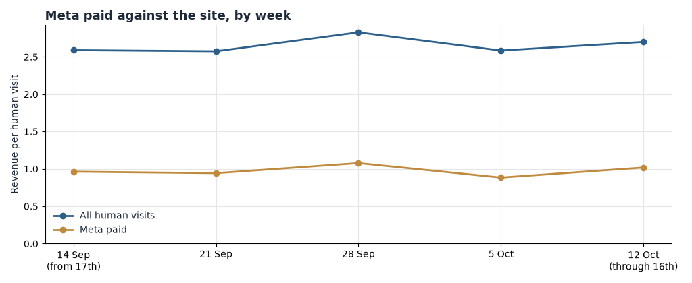

# Loop Earplugs

**Today Opportunities**

Today's Plan: pause the Meta sets that still spend with no orders, and move Eclipse off a page that converts 1.5% of entries.

loopearplugs.com · window through 16 October 2026 · prepared 17 October 2026

Three switches, all in the ad account, none of them a new page or a new flow. The week of 12 October runs only through the 16th, and it still shows the same leaks as the month. No new creative and no code.

These three, and not the collection redesign or the cart flow, because tomorrow's Meta spend is committed tonight. The larger plays are in section 06.

# Contents

The Situation This Morning · Action 1 · Action 2 · Action 3 · How to Read Tomorrow · The Rest of the Week · A Data and Method

# 01 The Situation This Morning

The week of 12 October is five days. Visit-linked orders were 12,578 and revenue was $688,955, or $2.70 a visit, in line with the month's $2.66. Search and direct did not break. Meta paid took 56,376 of those visits and returned $1.02 each.

| Leak | Latest reading, week of 12 October | What it is worth, as an upper bound |
| --- | --- | --- |
| Zero-order Meta sets still spending | UK Quiet/Engage 279 visits and 0 orders; EU Festivals Experience 258 visits and 0 orders; Canada festivals 138 visits and 0 orders | The visits themselves. There is no revenue to protect |
| Eclipse campaign still on `/products/eclipse` | 3,514 visits, 43 orders, $3,088 ($0.88 a visit) | The month's Eclipse set was 24,493 visits at $0.73 |
| Link in bio | 5,707 visits, 113 orders, $6,406 ($1.12 a visit) | Month: 55,177 visits at $0.89, against a site at $2.66 |

# 02 Action 1 — Pause the zero-order campaigns

**Owner:** whoever can edit the Meta account. **Time:** under half an hour.

Pause these campaigns. The names are the `camp` values in the bundle.

- `CA_EN_TOF_Purchase_CAM-TML26-Mix-Festivals&Nightlife-None_CBO-NoScale-NoRules_Mix-None-None_Earplugs` — 1,064 visits in the window, 0 orders, and 138 of those visits fell in the week of 12 October.
- `USA_EN_TOF_Purchase_CAM-TML26-Mix-Festivals&Nightlife-None_CBO-NoScale-NoRules_Mix-None-None_Earplugs` — 562 visits, 0 orders.
- `AUS_EN_BOF_Purchase_BAU-Mix-All-TopPerformers_ABO_Earplugs` — 531 visits, 0 orders.
- `UK_EN_TOF_Purchase_BAU-NoiseSensitive-All-Quiet/Engage_CBO_Earplugs` — 279 visits and 0 orders in the week of 12 October.
- `EU_EN_TOF_Purchase_BAU-Festivals&Nightlife-All-Experience_CBO_Earplugs` — 258 visits and 0 orders in that same week.

Do not pause `EU_EN_TOF_Purchase_EXP-ConsolidatedGAINCampaign_CBO-NoScale-Rules_Mix-None-None_Earplugs`. That set took 72,839 visits and 1,489 orders in the window, about $1.17 a visit, and it is the one to leave running.

**Expected result:** those visits stop. There is no order revenue on them to lose. Do not expect the site's revenue per visit to jump. The sets are small next to GAIN.

# 03 Action 2 — Re-point Eclipse off the Eclipse product page

**Owner:** the same ad account. **Time:** the destination URL on one campaign.

Campaign: `EU_EN_TOF_Purchase_EXP-ConsolidatedEclipseCampaign_CBO-NoScale-Rules_Mix-None-None_Eclipse`.

Change the destination from `/products/eclipse` to `/pages/lp-homepage-lp2`. Eclipse the product page took 114,258 entries in the window and 1.54% of them bought. The homepage landing page took 195,317 entries and 5.86% bought. The Eclipse campaign itself took 24,493 Meta visits and 255 orders.

Do not edit the Eclipse product page today. Do not turn the campaign off if the new URL can go live in the same edit. Pausing is the fallback only if the destination cannot be changed before the next spend.

**Expected result:** an upper bound, not a forecast. The campaign's 24,493 visits at the homepage LP's entry-buyer rate instead of Eclipse's would be a different entry mix. Read it as a direction: entry-buyer rate on the new URL should beat 1.54%. Size it after a week.

# 04 Action 3 — Re-point the link in bio

**Owner:** whoever owns the Instagram profile link. **Time:** one URL.

`linkinbio` took 55,177 Meta visits in the window and 904 orders, about $0.89 a visit. In the week of 12 October it took 5,707 visits, 113 orders, and $6,406, or $1.12 a visit. It is still well under the site's $2.70 that week.

Set the profile link to `/pages/lp-homepage-lp2`, the same destination as Action 2. Do not send it to `/products/eclipse` or to a single product URL whose entry-buyer rate is under 3% (Switch is 2.97% on 170,504 entries).

Do not rebuild the bio page. The link is the setting.

**Expected result:** the upper bound is the gap between $0.89 and the site's $2.66 on 55,177 visits, about $98,000 if those visits earned the site average. They will not, in full, in a week. Tomorrow's reading is whether revenue per visit on this campaign moves up from $1.12.

# 05 How to Read Tomorrow

| Metric | Current, week of 12 October | Target over the next few days |
| --- | --- | --- |
| Meta paid revenue per visit | $1.02 | Up from $1.02, toward the month's site $2.66. A move, not the whole gap |
| Eclipse campaign orders per 1,000 visits | 12 (43 orders on 3,514 visits) | Above 12 once the new URL is in |
| Linkinbio revenue per visit | $1.12 | Above $1.12 |
| Zero-order sets from Action 1 | Visits with 0 orders | Visits fall to about none |

Loop is large. Three or four days is enough to see direction. One order moves a small campaign a lot and moves Meta paid, at 56,376 visits in five days, very little. Do not call a winner off a single day.

The three peak days in this window were 20 September, 28 September, and 4 October. A promotion landing inside the next reading window will move orders on its own. If one is scheduled, say so before reading the scoreboard.

# 06 The Rest of the Week

These are real, and they are not today's switches. They need a page or a flow, not an ad-account edit.

| When | Action | Size, as an upper bound |
| --- | --- | --- |
| Next build | First screen of `/collections/all`: half of mobile entrants never pass 10% depth | The analysed page's 194,732 entries |
| Next build | A second product on Switch, Dream, Quiet, and Engage | Two product views earn $4.22 against $1.68 for one |
| After the tag check | Confirm the checkout event. Checkout per add-to-cart jumped from 63% to 78% versus the prior fortnight while orders per day fell | Do not spend against the 78% until it is confirmed |
| Lifecycle, not today | Mobile cart purchase is 17.6% against 21.9% on desktop, on a closed cohort of 100,160 chains | About $59,000 per extra point of purchase rate |

# A Data and Method

Figures are from `~/work/analysis/loop-earplugs`, window 17 September 2026 to 16 October 2026. The order file anchors, quoted so this note sits on the same bundle, are 92,076 orders and $5,038,424.93. Campaign rows are `weekly_source_campaign` where `link_ch` is `meta`. The week of 12 October includes 12 through 16 October only. Channel revenue per visit is `daily_channel_device`. Entry-buyer rates are `page_period` summed across `first` and `second`.

Dollar gaps are upper bounds. Pausing a zero-order set cannot raise revenue by the site average, because those visits produced no orders to reassign. Re-pointing can, only to the extent the new page converts the same people.

The chart is Meta paid revenue per visit by week against the site.
