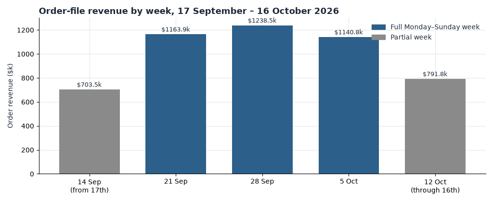

# Loop Earplugs

**User Journey Opportunity Analysis**

loopearplugs.com · 17 September 2026 to 16 October 2026 · prepared 17 October 2026

**How to read a journey.** A journey here is the sequence of page classes in a visit: home, product, collection, content, and other. Consecutive repeats of a class count once. On this bundle, a visit can order from a single tracked page, because a shopper can add without a second page view. "One class" is not "no order". `other` can hold product URLs stored with a full domain. Where this note says product-style entries, it uses the `/products/` paths in `page_period` as well as the product class. People who browse further are partly different people. Every dollar size below is an upper bound.

# Contents

01 The Month in Journeys · 02 The Journeys That Make Money · 03 Where the Journeys Leak · 04 How the period reshaped the funnel · 05 Recent buyers, or returning visitors · 06 Behaviour signals worth watching · 07 Where the journey data points · A Data and Method

# 01 The Month in Journeys

The order file records 92,076 orders and $5,038,424.93 from 17 September through 16 October 2026. The journey tables below are the 1,687,935 human visits left after 448,336 dead sessions were removed. They link to 81,790 orders.

| Measure | What the visits show |
| --- | --- |
| Orders in the order file | 92,076, revenue $5,038,424.93, median $46.98 |
| Where visits land | Product-only is the mass journey: 675,113 visits. Home is smaller and richer: 57,898 visits |
| Most common journey | Product only, 2.09% conversion, $1.15 a visit |
| Best common journey | Home, 7.33% conversion, $4.08 a visit. Collection then product is the useful middle: 55,924 visits, $3.44 |
| Homepage effect | Home earns about three and a half times the product-only visit |
| Second-product effect | Two product views earn $4.22 against $1.68 for one |
| Peak days | 20 September, 28 September, and 4 October |

The week of 28 September is the high one in the visit tables: 20,619 orders and $1,125,005. The week of 12 October is five days and should not be read as a slump against a seven-day week.

# 02 The Journeys That Make Money

| Journey | Visits | Orders | Conversion | Revenue per visit |
| --- | --- | --- | --- | --- |
| Product only | 675,113 | 14,081 | 2.09% | $1.15 |
| Content only | 238,314 | 1,516 | 0.64% | $0.32 |
| Collection only | 118,832 | 1,569 | 1.32% | $0.68 |
| Content, then product | 83,539 | 4,263 | 5.10% | $2.62 |
| Home | 57,898 | 4,241 | 7.33% | $4.08 |
| Collection, then product | 55,924 | 3,641 | 6.51% | $3.44 |
| Home, then product | 32,554 | 2,434 | 7.48% | $3.94 |

Product views inside those visits:

| Product pages | Visits | Conversion | Revenue per visit |
| --- | --- | --- | --- |
| 0 | 475,404 | 2.77% | $1.44 |
| 1 | 795,157 | 3.26% | $1.68 |
| 2 | 199,088 | 7.90% | $4.22 |
| 3–4 | 152,920 | 10.77% | $6.19 |
| 5–8 | 57,255 | 15.49% | $9.82 |

Zero product pages still hold 13,164 orders. That is the quick add: the order does not require a second class. Collection to product, as a flag rather than a full path, is 241,645 visits at $7.06 and 12.2% conversion, against $1.92 and 3.61% when that step does not happen.

**So what.** Judge a collection or a product page by whether it creates a second product view. The step from one product to two is $1.68 to $4.22. Moving every one-product visit is not available. The people who already view two products are partly a different group. The test is narrower: of the visits that start on `/collections/all` or on Switch, Dream, Quiet, or Engage, what share reaches a second product.

# 03 Where the Journeys Leak

Entry pages, both halves of the window. Entry-buyer rate is entry buyers divided by entries.

| Page | Entries | Entry-buyer rate | What sits next to it |
| --- | --- | --- | --- |
| /pages/lp-homepage-lp2 | 195,317 | 5.86% | The strong landing. Not the page this run re-analysed |
| /collections/all, the ads URL | 194,732 | 4.81% | Analysed page. Half of mobile entrants never pass 10% scroll |
| /products/switch | 170,504 | 2.97% | Large, and well under the homepage LP |
| /products/dream | 154,381 | 3.26% | Same shape as Switch |
| /products/eclipse | 114,258 | 1.54% | The leak. Engage, smaller, converts at 4.20% |
| /products/quiet | 99,409 | 3.72% | Better than Eclipse, still under the LP |
| /products/engage | 63,493 | 4.20% | The product page to point a weak ad at |

By referrer channel, the leak is not the single-page share of search. It is Meta paid: 365,678 visits, 1.71% conversion, $0.97 a visit, against search at $2.96 and direct at $4.17. Collection-only journeys, 118,832 visits at $0.68, are the on-site version of the same leak. The visit arrived and did not change class.

**So what.** The upper bound on Eclipse's entries, if they converted at Engage's 4.20% instead of 1.54%, is about 3,000 entry buyers. That bound mixes every source that lands on Eclipse, not only the Eclipse campaign's 24,493 visits. Use the campaign number when the action is an ad destination, and the entry number when the action is the page. Do not add them.

# 04 How the period reshaped the funnel

| | Prior fortnight, per day | Report window, per day | Peak days, the three together |
| --- | --- | --- | --- |
| Human visits per day | 62,352 | 56,264 | 20 September 58,991; 28 September 66,199; 4 October 58,773 |
| Visit-linked orders per day | 2,877 | 2,726 | 3,077; 3,362; 3,099 |
| Add to cart, share of visits | 13.9% | 14.0% | — |
| Checkout, share of add-to-cart | 62.6% | 78.2% | — |
| Conversion | 4.61% | 4.85% | — |
| Revenue per visit | $2.52 | $2.66 | — |

The change from the prior fortnight to the window is mostly traffic. Visits per day fell about 10%, and orders per day fell with them. Conversion rose slightly. The checkout rate did not follow orders: it jumped about 15 points while add to cart stayed at 14%. Treat that jump as a possible event-definition change until the tag is confirmed. Until then, read the funnel as visits to add-to-cart to order, and do not use checkout as evidence that the path improved.

The peak days are busy, not a different machine. 28 September is the largest of the three in the visit table, at 3,362 orders and 66,199 visits. They do not explain Meta's $0.97. That rate holds across the weeks, including the week of 12 October at $1.02.

# 05 Recent buyers, or returning visitors

`ret = 1` is 336,704 visits, 20% of human visits. They convert at 5.17% and earn $2.83, against 4.77% and $2.61 for `ret = 0`. Returning matters, and it is not a second business. The gap is about $0.22 a visit.

`hist30 = bought_before` shows a 40% conversion and $22 a visit. Do not read that as the repeat-purchase rate. The flag marks a visit once an earlier visit on the device purchased, and the in-window order can sit on the same flag. Almost all visit-linked orders land on that flag (79,481 of them). It is not evidence that four in five orders are replenishment.

| | Visits | Orders | Conversion | Revenue per visit |
| --- | --- | --- | --- | --- |
| ret = 0 | 1,351,231 | 64,397 | 4.77% | $2.61 |
| ret = 1 | 336,704 | 17,393 | 5.17% | $2.83 |

**So what.** A retention program is not the first journey fix. The first fix is getting a one-product visit to a second product, and getting a Meta landing off Eclipse. Returning visitors already convert a little better. They are not the leak.

# 06 Behaviour signals worth watching

Five signals, each large enough to mention, each different from the visit next to it.

1. **Collection scroll.** On `/collections/all`, 164,860 mobile entry sessions. 50% reach 10% depth, 31% reach 20%, 8% reach halfway. The first screen is the page.
2. **FAQ clicks.** Visits with an FAQ click: 133,071, conversion 10.5%, $5.72 a visit. Visits without: 4.36% and $2.40. The clickers are partly shoppers who already meant to buy. Still, the FAQ is not a dead control.
3. **Review clicks.** 76,703 visits, 9.8% conversion, $5.42 a visit, against 4.61% and $2.53 without the click. Same caution: intent sits in the click.
4. **Search clicks.** Only 4,033 visits, and the conversion matches the rest of the site (4.96% versus 4.85%). Search on the page is not a journey of its own at this volume.
5. **Cart chains.** Closed abandoned carts purchase at 18.0% overall and 17.6% on mobile, 21.9% on desktop. The return rate is already 57.6%. The behaviour to watch is the mobile purchase, not a missing reminder.

# 07 Where the journey data points

Ranked by the journey evidence, not by which page has the most visits.

1. **Second product view.** The steepest earned step in the tables. One product is $1.68, two are $4.22, on 199,088 visits that already do it. Build the prompt on the collection and on the big product pages. Read the share of visits with two product views.
2. **Collection that never becomes a product.** 118,832 collection-only visits at $0.68, against 55,924 that continue and earn $3.44. The analysed page's scroll curve says most mobile entrants never see a second row of products.
3. **Eclipse as a landing.** 1.54% of entries buy, next to Engage at 4.20% and the homepage LP at 5.86%. This is a destination change, already in today's plan, and it is also a journey fact: the visit starts on a page that does not hand off.
4. **Home.** 57,898 visits, $4.08. The homepage class is the rich path and it is not where the volume is. Do not redesign it to chase the product-only mass.
5. **Mobile cart purchase.** Four points behind desktop on 82,336 closed chains. Worth doing after the landing and the second product, because the chains already come back.

# A Data and Method

Window 17 September 2026 to 16 October 2026. Order-file anchors, which this note quotes, are 92,076 orders and $5,038,424.93, median $46.98. Journey rows are `visit_cohorts` for `first` and `second` combined. Entry rows are `page_period` for the same two periods. Funnel rates are `daily_site`, human visits only. Cart rows are `trigger-chains` with `trigger_key = abandoned_cart`, `level = session`, and `final = 1`, dated through 2 October. Scroll is `scroll-decile` for the analysed page `/collections/all`, mobile, sessions summed across weeks.

Dead sessions are out of the journey tables and in `daily_site.bot_visits`. A visit with an order and no page trail stays. That is why some orders have no journey class, and why the order file is larger than the visit-linked orders.

`bought_before` is not a repeat rate. `ret` is the returning flag used here. Revenue per visit gaps assume the extra visits would behave like the richer path. They are upper bounds, and the shoppers who already take the richer path are partly different people.

Charts: weekly revenue from the order file, and revenue per visit by journey.
