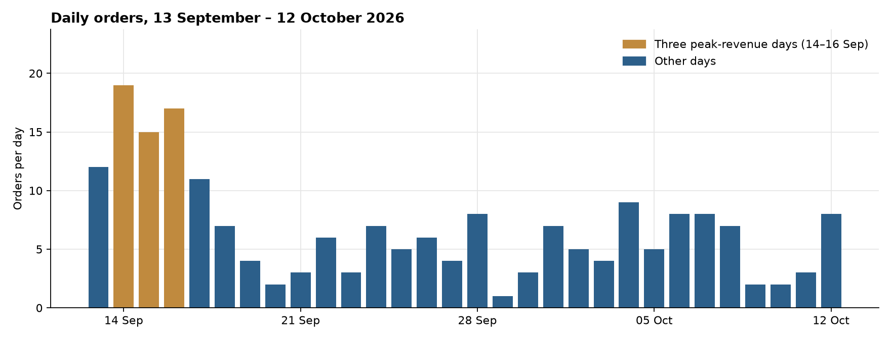
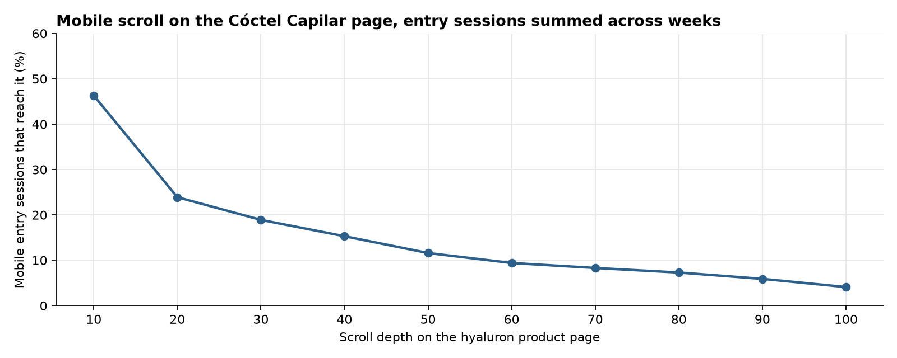
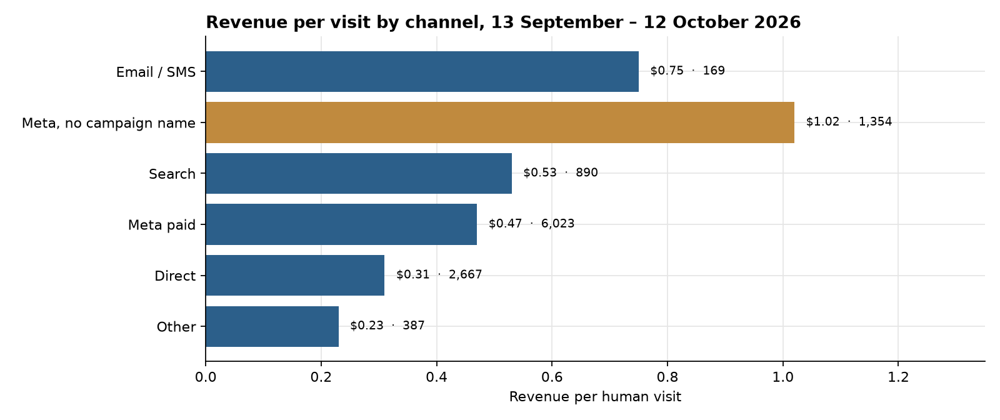
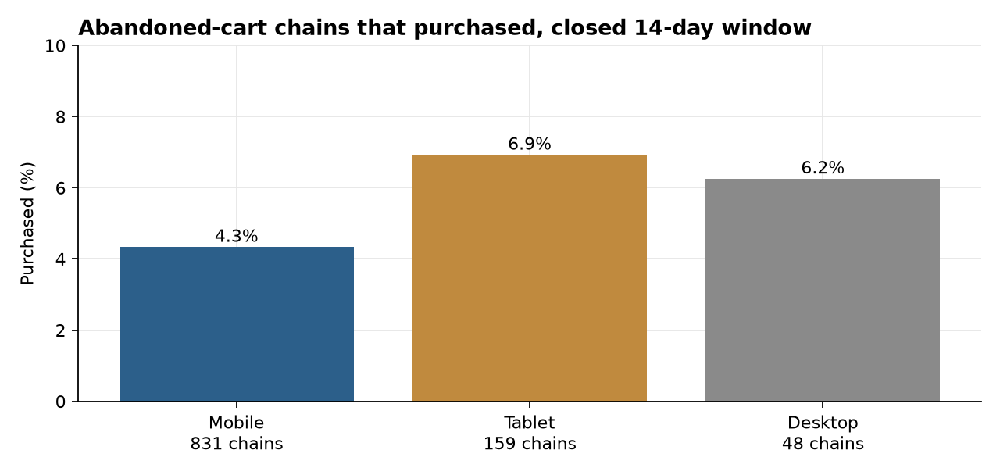
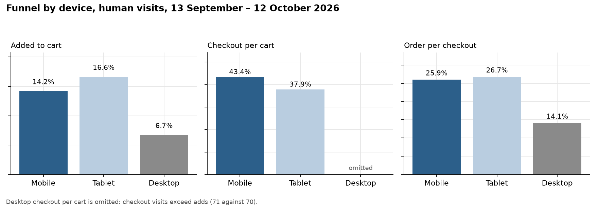

**HEATMAP**

**Sayii**

**Site Opportunity Report**

sayiioficial.com | 13 September – 12 October 2026 | Prepared 13 October 2026

This report re-analyses orders, traffic, campaigns, products, and the click and scroll record for sayiioficial.com. The window holds 201 orders, $6,404.73 revenue, and 11,490 human visits. The page the engine analysed is the hyaluron product (`/products/coctel-capilar-complex-hyaluron-en-frio`). Dead sessions are 9,130, 44.3% of raw traffic, and they are out of the visit rates below.

# Contents

The biggest wins, first · At a glance · The month in numbers · Opportunity 1 — Social lands on the hyaluron product and leaves before 10% depth · Opportunity 2 — Three more social landings sell almost nothing · Opportunity 3 — Move budget off ad 120244737977210566 · Opportunity 4 — Name the Meta visits that have no campaign · Opportunity 5 — Bring back the mobile carts · Opportunity 6 — Direct adds to cart at half the Meta rate · Worth watching · What's working · Suggested next 30 days · Method and caveats

# The biggest wins, first

These six cover the month: two change where paid social lands, one moves a named ad, one makes the untagged Meta visits readable, one brings carts back, and one raises the add-to-cart rate on direct.

**1. Point social off the hyaluron product page.**

Social sent 4,992 entry sessions to `/products/coctel-capilar-complex-hyaluron-en-frio` and earned $0.35, with 84% leaving on one page. On mobile, 46% of entry sessions reach 10% scroll depth. The same social source on `/collections/kits` earned $1.15 on 382 sessions and 14 orders. (Opportunity 1)

**2. Take social off the three other URLs that do not sell.**

Social sent 989 sessions to the Super Liso sachet ($0.12, 4 orders), 808 to the Crecepel kit ($0.22, 5 orders), and 841 to the frizz collection ($0.05, 1 order). Kits social is the page beside them. (Opportunity 2)

**3. Move budget off ad `120244737977210566`.**

From the week of 14 September, that ad took 798 visits, 77 adds, 37 checkouts, and 5 orders, at $0.25 a visit. Ad `120244737977220566` took 2,328 visits and earned $0.59 on 42 orders. In the week of 5 October the weaker ad is 513 visits at $0.07. (Opportunity 3)

**4. Name the Meta visits that have no campaign.**

Untagged Meta is 1,354 human visits, 45 orders, $1.02 a visit. Tagged Meta paid is 6,023 visits at $0.47. The untagged visits earn more. The job is a name, so the tagged ads can be judged on their own. (Opportunity 4)

**5. Run cart recovery on the mobile carts the site already created.**

831 mobile abandoned-cart chains had a closed 14-day window. 36 bought, 4.3%, for $1,200. Tablet bought 6.9% of 159 chains. (Opportunity 5)

**6. Raise the direct add-to-cart rate.**

Direct is 2,667 human visits and adds to cart on 7.2% of them. Meta paid adds on 16.2%. Checkout then finishes at 24% for direct and 23% for Meta paid. The gap sits on the add. (Opportunity 6)

# At a glance

| **#** | **Finding** | **Recommended action** | **Priority** |
|----|----|----|----|
| 1 | Social on the hyaluron product: 4,992 entry sessions, 57 orders, $0.35, 84% one page. Mobile scroll: 46% reach 10% depth. Kits social: 382 sessions, 14 orders, $1.15. | Point that social at `/collections/kits`, and put the add on the first screen of the product page. | High |
| 2 | Social on Super Liso (989 sessions, $0.12), Crecepel (808, $0.22), and the frizz collection (841, $0.05). | Point those ads at `/collections/kits`. | High |
| 3 | Ad `120244737977210566`: 798 visits, $0.25, 5 orders. Ad `120244737977220566`: 2,328 visits, $0.59, 42 orders. | Move budget from the first ad to the second. | High |
| 4 | Untagged Meta: 1,354 visits, $1.02, 45 orders. Tagged Meta paid: 6,023 visits, $0.47. | Tag the unnamed ads. Do not pause them. | High |
| 5 | Mobile abandoned carts: 831 chains, 4.3% bought. Tablet: 159 chains, 6.9% bought. | Recover the 407 mobile carts that never returned. | Medium |
| 6 | Direct add-to-cart 7.2% on 2,667 visits. Meta paid 16.2% on 6,023. Checkout completion is 24% and 23%. | Treat the direct landing the way Opportunity 1 treats the product page: the add has to be on the first screen. | Medium |
| 7 | Desktop: 1,042 visits, 10 orders, add-to-cart 6.7%. Checkout visits exceed adds. | Watch. The order count is too small to size. | Watch |
| 8 | Ireland 228 visits and Albania 252 visits, no orders. Dead sessions are 44.3% of raw traffic, against 37.9% in the prior 14 days. | Keep both out of the rates used to judge ads. | Watch |

Table 1 — The month, 13 September – 12 October 2026. Dollar sizes in the opportunities are upper bounds from this window's volumes.

# The month in numbers

- **Orders:** 201 in the order file, $6,404.73, average $31.86, median $33.14. 178 of those orders match a human visit and carry $5,749.52, $0.50 a visit.
- **Visits:** 11,490 human visits, 383 a day. Dead sessions are 9,130 of 20,620 raw visits (44.3%).
- **Returning:** 2,233 human visits, 19.4%. A returning visit earned $0.79 against $0.43 for a new visit.
- **Devices, order file:** mobile 156 orders, $4,944. Tablet 40 orders, $1,315. Desktop 5 orders, $145. The funnel below uses the visit's device, which is 145, 23, and 10 matched orders.
- **High value:** 16 orders at or above $50, $931.40. That line is the window's 90th percentile rounded to the nearest 10. It is not a shipping threshold. The bundle has no shipping or gift line.

| **Week starting** | **Days** | **Orders** | **Revenue** | **Human visits** |
|----|---:|---:|---:|---:|
| 7 September (13th only) | 1 | 12 | $333.32 | 796 |
| 14 September | 7 | 75 | $2,299.42 | 4,034 |
| 21 September | 7 | 34 | $1,178.08 | 1,802 |
| 28 September | 7 | 37 | $1,243.22 | 1,808 |
| 5 October | 7 | 35 | $1,090.01 | 2,744 |
| 12 October (1 day) | 1 | 8 | $260.68 | 306 |

Table 2 — Order-file orders and revenue. Human visits are the same weeks.

*Figure 1. Daily orders, 13 September – 12 October 2026. Gold days are the three peak-revenue days: 14, 15, and 16 September.*

The three peak days are 14 September (19 orders, $615, 644 human visits), 15 September (15 orders, $478, 742 visits), and 16 September (17 orders, $482, 818 visits). There is no promotion calendar in the bundle. The week that contains them, 14 September, is also the only full week above 4,000 human visits.

Two contexts matter for reading the month.

The prior 14 days with visit rows, 30 August–12 September, ran 12.8 orders a day and $385 a day, on 711 human visits a day. This window is 6.7 orders a day and $213 a day, on 383 human visits a day. Revenue per visit held: $0.48 then, $0.50 now. Add-to-cart eased from 15.9% to 13.8%. Matched conversion held at 1.56% then and 1.55% now. The month is a traffic drop. It is not a conversion collapse.

The traffic that left is Meta. Meta paid ran 475 human visits a day in those 14 days and earned $0.30. In this window it runs 201 visits a day and earns $0.47. The visits fell by more than half. The visits that remained are worth more. Untagged Meta fell from 91 visits a day at $1.38 to 45 a day at $1.02.

# Opportunity 1 — Social lands on the hyaluron product and leaves before 10% depth

The analysed page is `/products/coctel-capilar-complex-hyaluron-en-frio`. Entry sessions below are not the human-visit totals in the month section.

**What we saw.**

| **Entry** | **Sessions** | **Orders** | **Revenue per session** | **Single-page share** |
|----|---:|---:|---:|---:|
| Hyaluron product, social | 4,992 | 57 | $0.35 | 84.0% |
| Hyaluron product, direct | 425 | 4 | $0.28 | 86.8% |
| Hyaluron product, all sources | 5,554 | 61 | $0.34 | 84.2% |
| `/collections/kits`, social | 382 | 14 | $1.15 | 49.2% |

Table 3 — Entry sessions. Kits social is the page beside the product URL.

*Figure 2. Share of mobile entry sessions on the hyaluron product that reach each depth. 4,715 mobile entry sessions, summed across weeks. 46% reach 10% depth. 24% reach 20%. 4% reach the bottom.*

- Social is 4,992 of the 5,554 entry sessions on this URL. 84% end on that one page.
- Of 4,715 mobile entry sessions, 2,532 never reach 10% of the page. The add control on the harvested page is "Añadir Al Carrito". Most of these visits do not travel far enough to meet it.
- Kits social is 382 sessions, 14 orders, $438.54, and 49% leave on one page. That count is large enough to read. It is still a much smaller crowd than the product URL.

**Why it matters.** If the 4,992 social sessions on the hyaluron product had earned the $1.15 that social already earns on `/collections/kits`, the gap is about $4,000 in this window. That is an upper bound. It assumes a paid visit to the product URL can behave like the social visit that already lands on the kits collection. Those shoppers are partly different people.

**Recommended actions.**

- Point the social ads that currently open the hyaluron product URL at `/collections/kits`.
- On the product page itself, put the kit price and "Añadir Al Carrito" in the first screen. The scroll curve is the check: 46% of mobile entrants reach 10% depth today.
- Track social revenue per session on the hyaluron URL against $0.35, and on `/collections/kits` against $1.15.

# Opportunity 2 — Three more social landings sell almost nothing

**What we saw.**

| **Social entry** | **Sessions** | **Orders** | **Revenue** | **Revenue per session** | **Single-page share** |
|----|---:|---:|---:|---:|---:|
| Super Liso sachet | 989 | 4 | $114.80 | $0.12 | 85.7% |
| Crecepel kit | 808 | 5 | $174.97 | $0.22 | 80.0% |
| Frizz collection | 841 | 1 | $45.55 | $0.05 | 71.1% |
| Kits collection | 382 | 14 | $438.54 | $1.15 | 49.2% |

Table 4 — Entry sessions from social. Super Liso is `/products/kit-super-liso-aminoacidos-x-60ml-sachet`. Crecepel is `/products/kit-crecepel-tratamiento-anticaida-crecimiento-capilar`. Frizz is `/collections/con-frizz-intenso-cabello-procesado-y-textura-rebelde`.

- Each of the three weak URLs is mostly a one-page visit. The frizz collection has one order on 841 social sessions.
- The page beside all three is the same kits collection as Opportunity 1.
- A fourth URL, the alisador sachet, is 127 social sessions and no orders. That count is too small to size, and it is the same pattern.

**Why it matters.** Set against kits social at $1.15, each URL is on the order of $800 to $1,000 in this window: about $1,000 on Super Liso, about $750 on Crecepel, about $900 on the frizz collection. Each figure assumes that social traffic can behave like the social traffic already on kits. Do not add these to each other, and do not add them to the $4,000 in Opportunity 1. The same destination is the assumption in every row.

**Recommended actions.**

- Point social off those three URLs and at `/collections/kits`.
- Leave search and direct on the product URLs until their own rates say otherwise. Direct on Crecepel is 204 sessions and one order, which is too thin to re-point on its own.
- Track social orders on each of the three URLs. Today they are 4, 5, and 1.

# Opportunity 3 — Move budget off ad 120244737977210566

Campaign rows are the weekly cube from the week of 14 September through 12 October. That misses 13 September, which sits in the prior week. Human-visit channel rates in the other sections are the full 30 days.

**What we saw.**

| **Ad** | **Visits** | **Add to cart** | **Checkout** | **Orders** | **Revenue per visit** |
|----|---:|---:|---:|---:|---:|
| `120244737977220566` | 2,328 | 462 | 169 | 42 | $0.59 |
| `120244737977210566` | 798 | 77 | 37 | 5 | $0.25 |
| `120246416456550566` | 494 | 74 | 32 | 8 | $0.58 |
| `120250622781520566` | 443 | 60 | 17 | 3 | $0.30 |
| `120251196937700566` | 284 | 24 | 6 | 1 | $0.13 |

Table 5 — Meta campaign-link visits, weeks of 14 September through 12 October. Ads under about 200 visits are left out of the table.

In the week of 5 October the split is sharper. `120244737977210566` is 513 visits, 45 adds, 20 checkouts, 1 order, $0.07. `120244737977220566` is 372 visits, 6 orders, $0.48. One $33 order moves the weaker ad's revenue per visit by about six cents on 513 visits, so the $0.07 is a one-order week. The month row is the one to act on: 798 visits and 5 orders, against 2,328 visits and 42.

**Why it matters.** If the 798 visits on `120244737977210566` had earned the $0.59 of `120244737977220566`, the gap is about $280 in this stretch. That is an upper bound. It assumes the weaker ad's visits can behave like the stronger ad's. The week of 5 October is where that ad became the largest named Meta line, at $0.07.

**Recommended actions.**

- Cut budget on `120244737977210566` and raise `120244737977220566`.
- Do not send the leftover to `120251196937700566`. That ad is 284 visits, 1 order, $0.13.
- Check the destination URL of `120244737977210566` against Opportunity 1 and Opportunity 2 before any relaunch.
- Track revenue per visit on `120244737977210566` against $0.25, and on `120244737977220566` against $0.59.

# Opportunity 4 — Name the Meta visits that have no campaign

**What we saw.**

| **Channel** | **Human visits** | **Add to cart** | **Checkout** | **Orders** | **Revenue per visit** |
|----|---:|---:|---:|---:|---:|
| Meta paid | 6,023 | 16.2% | 38.1% of carts | 86 | $0.47 |
| Meta, no campaign name | 1,354 | 17.9% | 61.3% of carts | 45 | $1.02 |
| Search | 890 | 10.1% | 60.0% of carts | 15 | $0.53 |
| Direct | 2,667 | 7.2% | 52.6% of carts | 24 | $0.31 |

Table 6 — Human visits, 13 September – 12 October 2026. Channel is last touch. Email is 169 visits and 6 orders, so its $0.75 is directional and is left out of the table.

*Figure 3. Revenue per human visit. Gold is Meta with no campaign name. The label is revenue per visit and the visit count.*

- Untagged Meta adds to cart at 17.9% and finishes 30% of its checkouts (45 of 149). Tagged Meta paid finishes 23% of its checkouts (86 of 371).
- In the week of 5 October the gap is wider. Untagged Meta is 315 visits, 11 orders, $1.15. Meta paid is 1,128 visits, 8 orders, $0.22.
- A blank campaign name inside the Meta link, from the week of 14 September on, is 1,409 visits, 49 orders, $1.09. That is the same visits described a second way. Do not add it to the 1,354.

**Why it matters.** The untagged visits are the better on-site value, and they cannot be managed while they have no name. Pausing them would cut the channel that earns $1.02. The size of this opportunity is the judgment it makes possible on Opportunity 3, not a second pile of revenue.

**Recommended actions.**

- Put a campaign name on every Meta ad that arrives with none.
- Do not pause the untagged ads.
- Do not change their destination URLs until the name shows which creative is which.
- Track the untagged share of Meta visits. This window it is 1,354 of 7,377, 18%. In the week of 5 October it is 315 of 1,443, 22%.

# Opportunity 5 — Bring back the mobile carts

The cohort is abandoned-cart chains with a closed 14-day window. The dates on those closed chains run 13–28 September.

**What we saw.**

| **Device** | **Chains** | **Returned** | **Purchased** | **Purchase rate** | **Revenue** |
|----|---:|---:|---:|---:|---:|
| Mobile | 831 | 424 (51%) | 36 | 4.3% | $1,199.70 |
| Tablet | 159 | 75 (47%) | 11 | 6.9% | $341.96 |
| Desktop | 48 | 31 (65%) | 3 | 6.3% | $110.93 |

Table 7 — Abandoned-cart chains, `final = 1`. Desktop is 3 purchases. The rate is directional.

*Figure 4. Share of closed abandoned-cart chains that purchased. Desktop is 48 chains.*

- Return rates are close: 51% on mobile, 47% on tablet. The gap is the purchase, 4.3% against 6.9%.
- 407 mobile chains never returned.
- The recovered mobile order is about $33, in line with the site median of $33.14.

**Why it matters.** If the 831 mobile chains had purchased at the tablet rate of 6.9%, that is about 22 more orders. At the recovered mobile average of $33, the gap is about $700 in this cohort. That is an upper bound. It assumes a mobile cart can finish like a tablet cart. The two devices are partly different people.

**Recommended actions.**

- Send the recovery to the 407 mobile carts that never came back.
- Track the purchase rate on closed mobile chains against 4.3%, with tablet's 6.9% as the comparison.
- Do not read desktop's 6.3% as a target. It is 3 orders.

# Opportunity 6 — Direct adds to cart at half the Meta rate

**What we saw.**

| **Device** | **Human visits** | **Add to cart** | **Checkout per cart** | **Order per checkout** | **Revenue per visit** |
|----|---:|---:|---:|---:|---:|
| Mobile | 9,081 | 14.2% | 43.4% | 25.9% | $0.52 |
| Tablet | 1,367 | 16.6% | 37.9% | 26.7% | $0.53 |
| Desktop | 1,042 | 6.7% | — | 14.1% | $0.31 |
| Direct, all devices | 2,667 | 7.2% | 52.6% | 23.8% | $0.31 |
| Meta paid, all devices | 6,023 | 16.2% | 38.1% | 23.2% | $0.47 |

Table 8 — Human visits. Desktop checkout per cart is omitted: 71 checkout visits against 70 adds.

*Figure 5. Human-visit funnel by device. Desktop checkout per cart is omitted because checkout visits exceed adds.*

- Direct and Meta paid finish a checkout at almost the same rate, 24% and 23%. Direct's shortfall is the add: 7.2% against 16.2%.
- Mobile and tablet match each other, at $0.52 and $0.53. Desktop is 1,042 visits and 10 orders. The 6.7% add rate is real on the visit count. The 10 orders are too few to turn into a dollar size.
- Direct on the hyaluron product is 425 of the 2,667 direct visits. The rest of direct is a different landing, including 899 entry sessions on the homepage at $0.35 and 8 orders. Part of this gap is Opportunity 1. The dollars below are not added to that $4,000.

**Why it matters.** If direct had added to cart at Meta paid's 16.2%, and those extra carts had then finished at direct's own checkout path, the gap is about 30 orders and about $1,000 in this window. That is an upper bound. It assumes a direct visit can add the way a Meta visit adds. The two traffics are partly different people.

**Recommended actions.**

- On the homepage and the product URLs that direct actually opens, put the add in the first screen. That is the same build as Opportunity 1.
- Leave desktop as a watch until it has more than 10 orders in a month.
- Track direct add-to-cart against 7.2%, with Meta paid's 16.2% as the comparison.

# Worth watching

**The two named campaigns with no orders.** In the week of 5 October, `Ventas+|+Complex+|+web+` is 60 visits, 9 adds, no checkout, no order. `Presentacion+|+Abierto+|+ventas+|+CBA` is 57 visits, 7 adds, no order. Both counts are under 100 visits. Leave them until the week repeats.

**Ireland and Albania.** Ireland is 228 human visits, no add to cart, no order. Albania is 252 visits, 12 adds, no order. Together they are 480 visits. They are large enough to keep out of a country average, and too clean of orders to be a storefront problem.

**Dead sessions.** 9,130 of 20,620 raw visits, 44.3%, against 6,066 of 16,019 (37.9%) in the prior 14 days. A visit with an add, a checkout, or an order is never in that count. The rise is worth a filter check. It is not a conversion rate.

**Email.** 169 human visits, 6 orders, $126.33, $0.75 a visit. The rate is the second highest channel. The order count is too small to plan a send around.

# What's working

We checked these areas closely. Each is healthy and needs no change today.

**Conversion held while traffic halved.** Matched conversion is 1.55% in the window and 1.56% in the prior 14 days. Revenue per visit is $0.50 against $0.48. The loss is visits per day, 383 against 711.

**Mobile and tablet agree.** $0.52 and $0.53 a visit, add-to-cart 14.2% and 16.6%, order per checkout 26% and 27%.

**Checkout completion is steady.** Meta paid finishes 23% of checkouts. Direct finishes 24%. The first half of the window finishes 24% and the second half finishes 26%. The step that is weak is the add on direct, and the landing on the product URLs, not the last step of checkout.

**The order is a kit at the kit price.** The median order is $33.14. The median paid-to-item ratio is 1.04, and 39% of orders pay below the lead item. The lead line is the hyaluron kit, 86 of 201 orders, $2,379. There is no shipping or gift line in the bundle to merchandize against.

**Rage is rare.** The analysed page's rage totals are a handful of sessions in a week, against thousands of clicks. There is no rage target to redesign.

# Suggested next 30 days

| **Week** | **Action** | **Owner** |
|----|----|----|
| 1 | Point social off the hyaluron product, Super Liso, Crecepel, and the frizz collection, and at `/collections/kits`. Cut budget on `120244737977210566` in favour of `120244737977220566`. | Paid media |
| 1 | Name every Meta ad that arrives with no campaign. Do not pause those ads, and do not change their URLs yet. | Paid media |
| 2 | Put the kit price and "Añadir Al Carrito" on the first screen of the hyaluron product, and on the homepage direct opens. | E-commerce |
| 2 | Recover the 407 mobile carts that never returned. | CRM |
| 3–4 | Read social revenue per session on the hyaluron URL and on `/collections/kits`, and direct add-to-cart against 7.2%. | E-commerce / Paid media |
| 4 | Revisit desktop and the two zero-order campaign names only if the counts have grown. | Paid media |

# Method and caveats

- The window is 13 September through 12 October 2026. Visit rows start 30 August, so the comparison period is 14 days, 30 August–12 September, not a full prior fortnight of the same length. The order file starts 14 August. Orders before 30 August have no visit row beside them and are not used in the rates.
- Visit rates use human visits. Dead sessions are one page or none, no click, no scroll, and no order: 9,130 of 20,620 raw visits, 44.3%. A visit with an add to cart, a checkout, or an order is never excluded. `entry-by-channel` counts entry sessions and is not mixed with human-visit rates in one sentence. `page_period` includes dead sessions and is not used for the rates above.
- Channel is last touch. Ad spend is not in the bundle, so revenue per visit is on-site value only. Dollar gaps are upper bounds. They assume re-pointed traffic converts like the destination's existing traffic, or that one device's carts finish like another's. Shoppers who already take the better path are partly different people. The landing gaps share one destination, `/collections/kits`, and are not added together.
- The campaign table starts with the week of 14 September because the week of 7 September mixes six days from before the window. Human-visit channel rates cover the full 30 days.
- High value is order revenue at or above $50, the window's 90th percentile rounded to the nearest 10. No shipping or gift line was found in the bundle. The announcement bar was not used as a threshold.
- `saw_home`, `saw_product`, `saw_collection`, and `n_prod` are zero on every human visit. Landing claims use entry URLs. `bought_before` contains all 178 buying visits, so repeat purchase is read from the returning flag.
- The three peak days have no promotion calendar in the bundle. Desktop checkout visits exceed adds, so that step is omitted. Click and scroll records are for the hyaluron product page, not the homepage.
- One order moves a rate on this site. A $33 order is about half a cent of revenue per visit on 6,023 Meta paid visits, and about six cents on a 513-visit ad.
