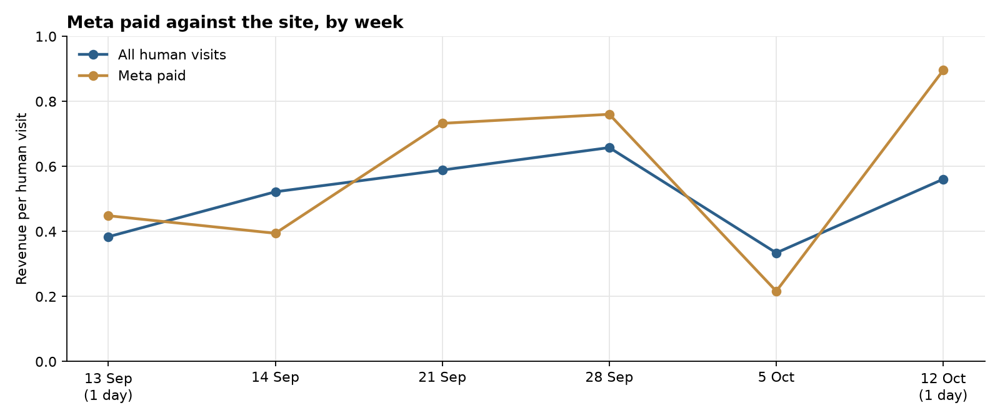

**HEATMAP · Today's Plan: Move the Weak Ad, and Name the Untagged Visits**

Sayii · sayiioficial.com
Prepared 13 October 2026 | Data through 12 October 2026
A one-hour ad-account intervention · three switches that change tomorrow's numbers

---

**Sayii**

**Today's Plan: Move the Weak Ad, and Name the Untagged Visits**

PREPARED 13 OCTOBER 2026 · DATA THROUGH 12 OCTOBER 2026

The full analysis found the leaks. This document is today's fix. One budget switch, one pause, and one tagging switch in Meta Ads Manager, about an hour in total, each in effect the day it is made. The last full week (starting 5 October) still shows them: ad `120244737977210566` took 513 visits and earned $0.07; two named campaigns took 60 and 57 visits and ordered nothing; and 315 Meta visits arrived with no campaign name and earned $1.15. Ad `120244737977220566` earned $0.48 on 372 visits and 6 orders. 12 October is one day of a new week, and it does not close the week of 5 October. Nothing here needs new creative, new code, or a meeting.

> **Why these three and not the bigger ideas.** Pointing social at `/collections/kits`, the first screen of the hyaluron product, and mobile cart recovery are worth more across the month. The landing split is not available by week, and a cart flow is not a setting that changes tonight. The three moves below are the ones where tomorrow's Meta budget is committed tonight. Everything else stays queued for the week (section 06).

# Contents

01 The Situation This Morning
02 Action 1 — Move budget off ad 120244737977210566
03 Action 2 — Pause the two named campaigns with no orders
04 Action 3 — Tag the unnamed Meta ads
05 How to Read Tomorrow
06 The Rest of the Week
A Data and Method

# 01 The Situation This Morning

The order file shows 35 orders and $1,090.01 in the week of 5 October, five orders a day on a $31.14 average. On human visits that same week the site earned $0.33 a visit (2,744 visits). Direct earned $0.23 on 872 visits. Meta paid earned $0.22 on 1,128 visits. The two full weeks before that, Meta paid earned $0.73 and $0.76.

| **Leak** | **Latest reading (week starting 5 October)** | **What it is worth** |
|----|----|----|
| `120244737977210566` | 513 visits, 45 cart-add visits, 20 checkouts, 1 order, $34.38, $0.07 a visit. `120244737977220566` the same week: 372 visits, 6 orders, $0.48. | About $210 for a week like this one |
| Ventas + Complex + web, and Presentacion + Abierto + ventas + CBA | 60 visits and 57 visits, 9 and 7 cart-add visits, no orders. Both counts are under 100. The stored names use plus signs and pipes. | About $60 for a week like this one, and the count is directional |
| Meta visits with no campaign name | 315 of 1,443 Meta visits (22%) had no campaign name and earned $1.15 on 11 orders. Tagged Meta paid earned $0.22. | The $361 is already there. It cannot be read as a campaign until it is named. |

Table 1 — The three live leaks, week of 5 October. The two budget sizes assume those visits earn what `120244737977220566` earned that week. They are upper bounds, and they are not added together.

*Figure 1 — Revenue per human visit by week. Meta paid was $0.39–$0.76 through the earlier full weeks, then $0.22 in the week of 5 October. The site was $0.33 that week. 13 September and 12 October are one day each.*

Each fix is a setting. None of them changes the site, the cart, or the email programme.

# 02 Action 1 — Move budget off ad 120244737977210566

Owner: paid media. Time: about 20 minutes. This ad is the largest named Meta line in the week, and it earned $0.07 against $0.48 on `120244737977220566`. One $31 order moves the weaker ad by about six cents on 513 visits, so the month row is the company for this week: 798 visits and 5 orders from 14 September on, against 2,328 visits and 42 orders.

In Meta Ads Manager, this morning:

- Cut the daily budget on `120244737977210566`.
- Raise the daily budget on `120244737977220566` by the same amount.
- Leave the destination on `120244737977220566` as it is. That ad is the one that ordered.
- Do not send the leftover to `120246416456550566` (154 visits, 1 order, $0.20 the same week) or to `120251196937700566` (284 visits and 1 order across the weeks since 14 September, $0.13).

Expected result: up to about $210 in a week like the week of 5 October, if the shifted visits earn the $0.48 `120244737977220566` earned. That is an upper bound. The two audiences are partly different people.

# 03 Action 2 — Pause the two named campaigns with no orders

Owner: paid media. Time: about 10 minutes. Both were still on in the week of 5 October. Each is under 100 visits, so the rate is directional. Neither ordered.

In Meta Ads Manager, this morning:

- Pause `Ventas+|+Complex+|+web+`.
- Pause `Presentacion+|+Abierto+|+ventas+|+CBA`.
- Send any budget you still want to spend to `120244737977220566`.
- Do not relaunch either name onto the hyaluron product URL. That landing is Opportunity 1 in the Site Opportunity Report, and it is queued in section 06.

Expected result: up to about $60 in a week like this one, if those 117 visits earn the $0.48 of `120244737977220566`. The count is thin. The reading that is solid is the zero: another week of these two names is another week with no order on them.

# 04 Action 3 — Tag the unnamed Meta ads

Owner: paid media. Time: about 30 minutes. Untagged Meta earned $1.15 on 315 visits and 11 orders. Tagged Meta paid earned $0.22 on 1,128 visits and 8 orders. Pausing the untagged ads would cut the better cell.

In Meta Ads Manager, this morning:

- Open every active ad whose visits arrive with a blank campaign name.
- Set a real campaign name on each one.
- Do not pause those ads, and do not change their destination URLs in this pass.

Expected result: the next week's Meta visits can be read as campaigns. The $361 already earned by the untagged visits stays. The gain is a name on the traffic, not a new order.

# 05 How to Read Tomorrow

Direction on these three should be visible in a few days. The size needs about a week. This is a small site: one $31 order moves Meta paid revenue per visit by about three cents on the 1,128 visits of the week of 5 October.

| **Watch** | **Now** | **Target** |
|----|----|----|
| Revenue per visit on `120244737977210566` | $0.07 in the week of 5 October | The budget has moved, and what remains is not the largest named line |
| Revenue per visit on `120244737977220566` | $0.48 on 372 visits, 6 orders | Holds while it receives the budget |
| Untagged share of Meta visits | 315 of 1,443 (22%) | Falls as names land, without a drop in Meta orders |

A promotion, a send, or a new ad inside the reading window moves orders on its own. Note it beside the numbers.

# 06 The Rest of the Week

These are the larger plays from the Site Opportunity Report. They are the week's work, once the three switches are on.

| **When** | **Action** | **Size** |
|----|----|----|
| Tue | Point social off the hyaluron product URL and at `/collections/kits`. | About $4,000 in a month like this one, upper bound |
| Wed | Point social off the Super Liso sachet, the Crecepel kit, and the frizz collection, at the same kits URL. | About $800–$1,000 on each URL. Do not add them to Tuesday. |
| Thu | Put the kit price and "Añadir Al Carrito" on the first screen of the hyaluron product. Mobile: 46% of entry sessions reach 10% depth. | The check on Tuesday's landing, not a second dollar |
| Fri | Recover the 407 mobile abandoned carts that never returned. Tablet bought 6.9% of 159 chains; mobile bought 4.3% of 831. | About $700 on that cohort, upper bound |

# A Data and Method

- The latest full week is Monday 5 October through Sunday 11 October 2026. 12 October is one day of the next week and is not in the action numbers. 13 September is one day of the week of 7 September.
- Visit rates use human visits. Dead sessions are 9,130 of 20,620 raw visits in the full window (44.3%) and are out of these rates. A visit with an add, a checkout, or an order is never excluded.
- Channel is last touch. Ad spend is not in the bundle. Dollar gaps are upper bounds and assume the shifted visits earn what `120244737977220566` earned in the week of 5 October. The two budget gaps are not added together.
- Campaign rows for the week come from `weekly_source_campaign`. The two paused names are stored with plus signs in place of spaces. Counts under about 100 visits are directional.
- The landing URLs in section 06 are entry sessions for the whole window. That split is not in the weekly cube, which is why those moves are queued rather than switched this morning.
