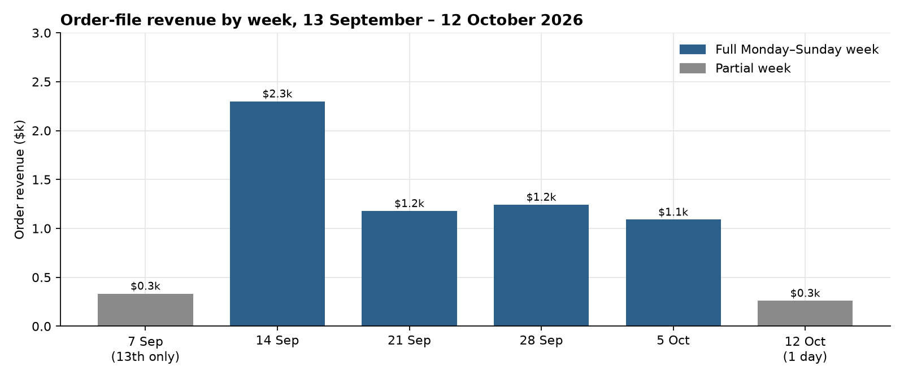
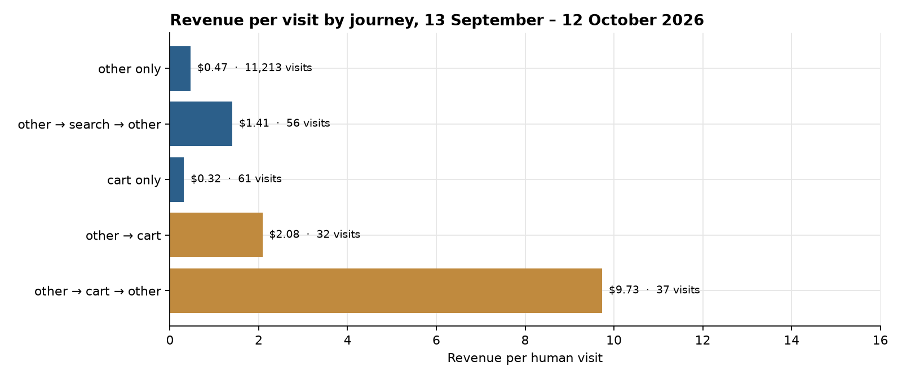

**HEATMAP · User Journey Opportunity Analysis**

Sayii · sayiioficial.com
Prepared 13 October 2026 | Data window 13 September – 12 October 2026
Site behaviour, funnel and shopper-journey analysis · 30 days of tracked visits

---

**Sayii**

**User Journey Opportunity Analysis**

PREPARED 13 OCTOBER 2026 · DATA THROUGH 12 OCTOBER 2026

This report follows how shoppers move through sayiioficial.com: the paths the tracker recorded, where almost every visit stays in one class and earns $0.47, and where the entry URL decides whether that visit is worth $0.35 or $1.15. Figures are human visits and the orders matched to them, 13 September through 12 October 2026. The order file has 201 orders and $6,404.73. 178 of those orders match a human visit, and those visits carry $5,749.52. Dead sessions are 9,130 of 20,620 raw visits (44.3%) and they are out of the rates below.

> **How to read a journey.** A journey is the sequence of page classes in a visit. Consecutive repeats of a class count once. On this site the stored class with any volume is `other`. Homepage, collection, and product URLs were not tagged as their own class: `saw_home`, `saw_product`, `saw_collection`, and `n_prod` are zero on every human visit. `other` holds those pages, including the hyaluron product and the kits collection. Entry URLs still name the pages, and this report uses them for where a visit lands. A quick-add can place an order from one tracked page, so one class is not "no order".

# Contents

01 The Month in Journeys
02 The Journeys That Make Money
03 Where the Journeys Leak
04 How the Period Reshaped the Funnel
05 Returning Visitors
06 Behaviour Signals Worth Watching
07 Where the Journey Data Points
A Data and Method

# 01 The Month in Journeys

The order file is 201 orders and $6,404.73, average $31.86, median $33.14. On the 11,490 human visits the matched picture is 178 orders and $5,749.52, $0.50 a visit. The journey string cannot say how often a visit saw a product. It can say that almost every visit never changes class.

| **Measure** | **Value** | **Reading** |
|----|----|----|
| Orders / revenue | 201 / $6,404.73 in the order file · 178 / $5,749.52 on human visits | 23 orders are not in the visit split |
| Where entry sessions land | Hyaluron product 5,554 · blank URL 3,033 · Super Liso sachet 1,192 | Entry sessions, a different count from the 11,490 human visits |
| Most common journey | `other` only | 11,213 visits (98% of human visits), 1.44% ordered, $0.47 each |
| Best common journey | Not readable as a class | Every path that leaves `other` is under 100 visits |
| Cart inside a visit | `other → cart → other` | 37 visits, 10 orders, $9.73. Directional |
| Homepage effect | Not in the class flags | Read from the entry URL. Kits social is $1.15. Hyaluron social is $0.35 |
| Second product | Not measured | `n_prod` is 0 on every visit |
| Peak days | 14, 15, and 16 September | $0.67 a visit on those three days, against $0.50 for all human visits |

Table 1 — The month, from human visits unless the row says entry sessions or the order file.

*Figure 1 — Order-file revenue by week, 13 September – 12 October 2026. Grey weeks are partial: 7 September is the 13th only ($333, 12 orders), and 12 October is one day ($261, 8 orders).*

The week of 14 September is the month: 75 orders and $2,299, on 4,034 human visits. The three peak days sit inside it. 14 September is 19 orders and $615. 15 September is 15 orders and $478. 16 September is 17 orders and $482. There is no promotion calendar in the bundle. After that week, full weeks hold 34 to 37 orders.

# 02 The Journeys That Make Money

The classifier recorded five journeys. One of them has more than 100 visits. The other four are the cart and a thin search path, and each is under 100 visits.

| **Journey** | **Visits** | **Orders** | **Order rate** | **Revenue per visit** |
|----|---:|---:|---:|---:|
| other only | 11,213 | 162 | 1.44% | $0.47 |
| cart only | 61 | 1 | 1.6% | $0.32 |
| other → search → other | 56 | 3 | 5.4% | $1.41 |
| other → cart → other | 37 | 10 | 27% | $9.73 |
| other → cart | 32 | 2 | 6% | $2.08 |

Table 2 — Human visits, 13 September – 12 October 2026. Every row except `other` only is under 100 visits. Those rates are directional.

*Figure 2 — Revenue per human visit. Gold marks the two paths that reach the cart from `other`. Both are under 40 visits. `other` only is $0.47 on 11,213 visits.*

- `other` only is 11,213 of 11,490 human visits and $0.47. It holds the homepage, the collections, and the products, because those URLs were not given their own class. 162 of the 178 matched orders are on this one-class visit.

- A visit that saw the cart at all is 164 human visits, 13 orders, $2.72. The round trip `other → cart → other` is 37 of those visits, 10 orders, $9.73. The direction matches a cart that earns. The count is too small to size a programme on.

- Search as a class is the same shape. `other → search → other` is 56 visits and 3 orders. The entry class `search` is 35 human visits and no orders.

> **So what.** The second-product count is zero on every human visit, so this extract cannot judge merchandising by a second product view. The class string also cannot separate the hyaluron product from the kits collection: both sit in `other`. The path this extract can rank is the entry URL, in the next section. The cart round trip is 37 visits. It is the same shopper as Opportunity 5 in the Site Opportunity Report, and it is not a second dollar.

# 03 Where the Journeys Leak

Entry sessions, from `entry-by-channel`. These counts are not the human-visit totals above.

| **Entry** | **Sessions** | **Orders** | **Revenue per session** | **Single-page share** |
|----|---:|---:|---:|---:|
| Hyaluron product, social | 4,992 | 57 | $0.35 | 84.0% |
| Kits collection, social | 382 | 14 | $1.15 | 49.2% |
| Super Liso sachet, social | 989 | 4 | $0.12 | 85.7% |
| Crecepel kit, social | 808 | 5 | $0.22 | 80.0% |
| Frizz collection, social | 841 | 1 | $0.05 | 71.1% |

Table 3 — Entry sessions from social. The hyaluron product is the analysed page. Kits is `/collections/kits`.

Social on the hyaluron product is 4,992 sessions, 57 orders, $1,751.61, and 84% leave on one page. On mobile, 46% of the 4,715 entry sessions on that page reach 10% scroll depth. The same social source on the kits collection is 382 sessions, 14 orders, $438.54, and 49% leave on one page. That is Opportunity 1 in the Site Opportunity Report, read as a journey: the visit lands, and it ends on the URL it opened.

Super Liso, Crecepel, and the frizz collection are the same shape. One order on the frizz collection across 841 social sessions. That is Opportunity 2.

> **So what.** If the 4,992 social sessions on the hyaluron product had earned the $1.15 that social already earns on kits, the gap is about $4,000 in this window. Set against the same kits rate, Super Liso is about $1,000, Crecepel about $750, and the frizz collection about $900. Each figure assumes a social visit to the weak URL can behave like the social visit already on kits. Those shoppers are partly different people. The four gaps share one destination. They are not added together.

# 04 How the Period Reshaped the Funnel

Visit rows start 30 August, so the context before the window is 14 days. The first half of the window is 13–27 September. The second half is 28 September–12 October. Peak is the three highest-revenue days and overlaps the first half. Orders here are the 178 matched to a human visit.

| **Phase** | **Visits / day** | **Orders / day** | **Add to cart** | **Checkout / cart** | **Order / checkout** | **Revenue per visit** |
|----|---:|---:|---:|---:|---:|---:|
| Before (14 days) | 711 | 11.1 | 15.9% | 41% | 24% | $0.48 |
| First (15 days) | 442 | 7.2 | 14.6% | 46% | 24% | $0.52 |
| Second (15 days) | 324 | 4.7 | 12.7% | 43% | 26% | $0.47 |
| Peak (3 days) | 735 | 15.7 | 15.1% | 44% | 32% | $0.67 |
| All human visits | 383 | 5.9 | 13.8% | 45% | 25% | $0.50 |

Table 4 — Human visits. Checkout per cart did not jump while orders stayed flat, so this is not an event-definition break.

The second half is less traffic and slightly less money per visit. Visits fall from 442 a day to 324. Orders fall from 7.2 a day to 4.7. Revenue per visit eases from $0.52 to $0.47. Add to cart eases from 14.6% to 12.7%. Order per checkout holds, 24% then 26%. The prior 14 days were 711 visits a day at $0.48, the same revenue per visit as this window's $0.50. The journey change is how many visits arrive, which is the Meta volume in the Site Opportunity Report, not a new break between cart and order.

The peak days lift orders per day to 15.7 and revenue per visit to $0.67, with no promotion calendar in the bundle to name the cause.

# 05 Returning Visitors

The returning flag is the measure this extract supports. A returning human visit earned $0.79 against $0.43 for a new visit, on 2,233 returning visits and 9,257 new ones. The order rate is 2.55% against 1.31%.

The week of 7 September in the weekly cube includes days before the window, so that week is left out. 13 September is inside the month totals above.

| **Week starting** | **New visits** | **New revenue per visit** | **Returning visits** | **Returning revenue per visit** |
|----|---:|---:|---:|---:|
| 14 September | 3,201 | $0.52 | 833 | $0.54 |
| 21 September | 1,410 | $0.54 | 392 | $0.76 |
| 28 September | 1,399 | $0.50 | 409 | $1.20 |
| 5 October | 2,325 | $0.26 | 419 | $0.74 |
| 12 October (1 day) | 255 | $0.45 | 51 | $1.13 |

Table 5 — Human visits by the returning flag. The week of 21 September is 9 returning orders, and 12 October is 2. Those two rows are directional. Returning is level with new in the week of 14 September and ahead after it.

`bought_before` is not a repeat rate here. That class is 435 visits and all 178 buying visits. The visit's own order is inside the flag. Repeat purchase is read from `ret`.

> **So what.** The week of 5 October is where new visits fell, to $0.26 on 2,325 visits, while returning held at $0.74 on 419 visits and 10 orders. That is the Meta paid week in Today's plan, read on the new-visit flag: tagged Meta paid earned $0.22 that week. A plan aimed at the 2,233 returning visits is working a smaller base than the new visits that arrived and earned $0.26.

# 06 Behaviour Signals Worth Watching

Kept where the rate differs from the rest of the site and the count is large enough. Click flags match selector text. They describe the visit. They do not prove the click caused the order.

| **Signal** | **Visits** | **Revenue per visit** | **The rest of the site** |
|----|---:|---:|---:|
| Clicked the menu | 1,406 | $1.72 | $0.33 on 10,084 visits with no menu click |
| 26 or more clicks | 291 | $3.91 | $0.06 on 5,778 visits with no click |
| Clicked search | 259 | $0.95 | $0.49 on 11,231 visits with no search click |

Table 6 — Human visits. The search row is 8 orders, so the rate is directional. FAQ is 37 visits. Reviews and popup clicks do not appear. A size click is zero on every visit.

The menu row is the one that can be read. 1,406 visits that open the menu earn $1.72, against $0.33, and they carry 70 orders. Those shoppers left the landing page. The one-class journey in section 02 is the visit that did not.

# 07 Where the Journey Data Points

Cross-references name the Site Opportunity Report. This is not a second action list.

| **Move** | **Journey evidence** |
|----|----|
| Point social off the hyaluron product (Opportunity 1) | 4,992 social entry sessions, 57 orders, $0.35, 84% one page. Kits social is $1.15 on 382 sessions. The class string cannot see this, because both URLs are `other`. |
| Take social off Super Liso, Crecepel, and the frizz collection (Opportunity 2) | 989, 808, and 841 social sessions, at $0.12, $0.22, and $0.05. |
| Read the cart on the 164 visits that reach it (Opportunity 5) | `other → cart → other` is $9.73 on 37 visits. The count is directional. Mobile cart recovery is the sized version of the same shopper. |
| The second half is fewer visits, at the same revenue per visit | 324 visits a day at $0.47, against 442 at $0.52. Order per checkout stays at 24% then 26%. |

Four numbers to track each week, on the same definitions as this report:

- Social revenue per session on the hyaluron product, against $0.35, and on `/collections/kits`, against $1.15.
- The share of human visits whose journey is `other` only, against 98%.
- New-visit revenue per visit, against $0.26 in the week of 5 October.
- Returning revenue per visit, against $0.74 in that same week.

# A Data and Method

- The bundle window is 13 September through 12 October 2026. Visit rows start 30 August, so the context is 14 days, not a matched prior fortnight. The order file starts 14 August. Orders before 30 August have no visit row beside them.

- Visit rates use human visits. Dead sessions are one page or none, no click, no scroll, and no order: 9,130 of 20,620 raw visits, 44.3%. A visit with an add to cart, a checkout, or an order is never excluded. `entry-by-channel` counts entry sessions and is not mixed with human-visit rates in one sentence. `page_period` includes dead sessions and is not used for the rates above.

- The journey is page classes, with consecutive repeats counted once. The class with volume is `other`. `other` holds homepage, collection, and product URLs. `saw_home`, `saw_product`, `saw_collection`, `coll_to_prod`, and `n_prod` are zero on every human visit, so this report does not estimate a second-product effect. Paths other than `other` only are under 100 visits and are marked directional.

- `bought_before` contains all 178 buying visits. Repeat purchase is read from the returning flag.

- Channel is last touch. Ad spend is not in the bundle. Dollar gaps are upper bounds. The landing gaps share `/collections/kits` as the destination and are not added together. The three peak days have no promotion calendar in the bundle.

- Checkout per cart stays between 41% and 46% across the prior 14 days and the two halves. It is not treated as an event-definition break.

- Click flags match selector text. A visit with a menu click is a visit that clicked, not a count of units added.
