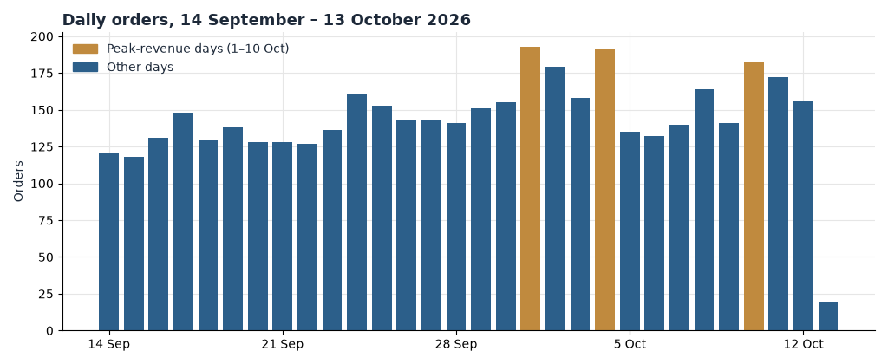
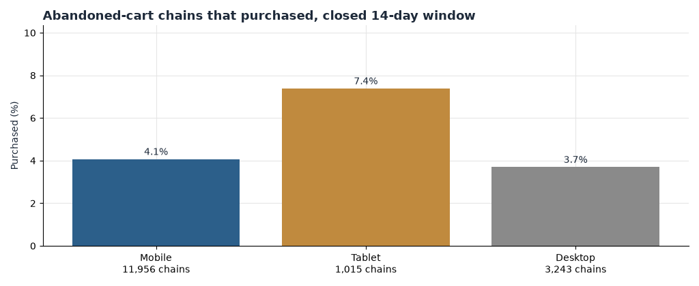
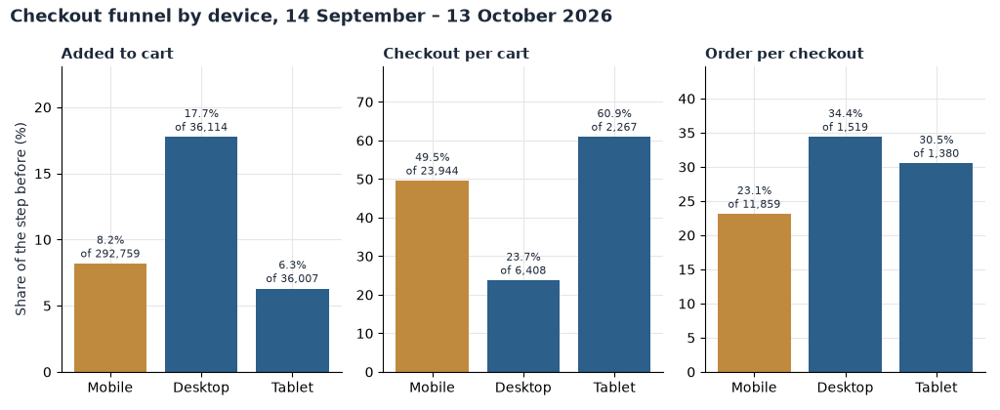
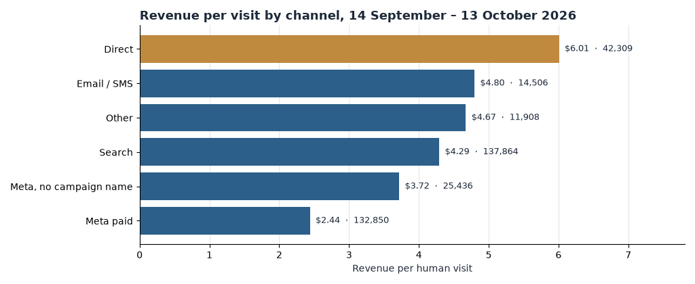
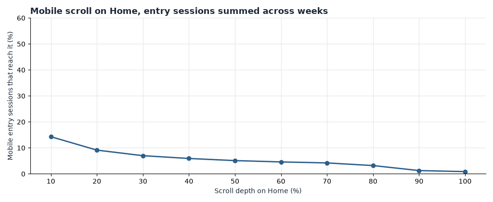

**HEATMAP**

**Seat Cover Solutions**

**Site Opportunity Report**

seatcoversolutions.com | 14 September – 13 October 2026, with 31 August – 13 September for context | Prepared 14 October 2026

We re-analysed 4,314 orders worth $1,619,734.15 and 364,880 human visits for this window, together with the channel, campaign, funnel, cohort and page-behaviour datasets. The click and scroll record in this report is for one page: Home (`/`), which is also the page the on-page pipeline describes.

## Contents

The biggest wins · At a glance · The month in numbers · Opportunity 1 — Recover the mobile browsers, not just the carts · Opportunity 2 — Close the mobile add-to-cart gap · Opportunity 3 — Make every Meta dollar accountable · Opportunity 4 — Turn the Love Your Ride deal page from a dead end into a doorway · Opportunity 5 — Get mobile past the first screen of Home · Opportunity 6 — Lift orders past the $500 line · Opportunity 7 — Build the repeat-buyer programme the data cannot yet measure · Opportunity 8 — Fix the tagging before the bot wave hides the numbers · Worth watching · What's working · Suggested next 30 days · Method and caveats

## The biggest wins

Six moves cover most of the opportunity in this window. Two repair the mobile funnel, two hold paid traffic to account, one fixes the site's biggest landing page, and one protects the measurement everything else depends on.

1. **Fix the mobile add-to-cart path.** Mobile is 80.2% of human visits but adds to cart at 8.2% against desktop's 17.7%; closing even a quarter of that gap is worth up to about $300,000 a month. (Opportunity 2)
2. **Pause or re-point the Meta campaigns that cannot convert.** The weakest tagged Meta line spent 5,364 visits to produce one order — $0.08 of on-site revenue per visit against a $4.89 site average — and two more lines have volume with zero orders. (Opportunity 3)
3. **Rebuild the Love Your Ride deal page as a doorway, not a wall.** It took 119,222 entry visits and converted 0.74% of them, with roughly 85% of entry sessions leaving after one page. (Opportunity 4)
4. **Extend the recovery programme to mobile browsers.** Desktop browse-abandoners buy back at 5.2%; mobile browse-abandoners at 1.7%. The carts are already well recovered. (Opportunity 1)
5. **Tighten Home for mobile.** Only 14.3% of mobile entry sessions scroll past the first screen and 36.9% leave after one page, on the page that takes 176,994 entry visits and $879,198 of revenue. (Opportunity 5)
6. **Tag the recovery flows and watch the bot wave.** Abandoned-cart chains number 16,214 but the automated-flow link channel tracked 2 visits; meanwhile dead sessions rose from 16.1% of raw traffic before the window to 21.4% in it, and above 33% on five of the last six days. (Opportunity 8)

Supporting plays that did not make the six: attach accessories to lift orders past the $500 line (Opportunity 6), and stand up a measurable repeat-buyer programme (Opportunity 7).

## At a glance

| # | Finding | Recommended action | Priority |
| --- | --- | --- | --- |
| 1 | Mobile adds to cart at 8.2% vs desktop 17.7%; mobile conversion 0.94% vs desktop 1.45% | Fix the mobile product-page and add-to-cart path | High |
| 2 | Meta campaign link visits 145,258 at $2.39 revenue per visit vs $4.89 untagged average; one line at $0.08 | Audit campaign-level spend, pause or re-point the losers | High |
| 3 | `/pages/love-your-ride-deal` took 119,222 entries, 0.74% entry-buyer rate, ~85% single-page | Rebuild the page or re-point its traffic to converting pages | High |
| 4 | Browse-recovery buy-back on mobile 1.7% vs desktop 5.2% | Extend browse-abandonment flows to mobile with mobile-priced offers | High |
| 5 | Recovery-flow traffic is untagged: 2 tracked flow visits against 16,214 abandoned-cart chains | Add UTM tagging to all flow links | High |
| 6 | Mobile Home: 14.3% scroll past the first screen, 36.9% single-page | Tighten the mobile Home layout above the fold | Medium |
| 7 | Only 1.2% of orders reach $500; median order $413.61 | Add an attach offer or bundle past the $500 line | Medium |
| 8 | 31.1% of matched order visits are returning, but the 30-day history table cannot measure repeat rate | Build a measurable post-purchase and replenishment flow | Medium |
| 9 | Dead sessions 21.4% of raw traffic, above 33% on five of the last six days | Investigate the bot wave before reading October week-on-week | Watch |
| 10 | Three peak days (1, 4, 10 October) carried 13.1% of revenue with no markdown signal | Keep a promotion calendar so peak days can be explained | Watch |

Table 1 — The ten findings of the window, with the window of 14 September – 13 October 2026. Priorities are High (change this week), Medium (change this month), Watch (monitor). Sizes behind the findings are in the opportunities below; monthly sizes are upper bounds from current volumes, not forecasts.

## The month in numbers

| Measure | Definition |
| --- | --- |
| Orders | 4,314 orders in the report window, all revenue counted |
| Revenue | $1,619,734.15 stored order revenue |
| Average order | $375.46 revenue per order |
| Median order | $413.61 |
| Human visits | 364,880 tracked visits after dead sessions removed |
| Dead sessions | 99,212 visits with one page or none, no click, no scroll, no order — 21.4% of raw traffic |
| Add-to-cart visits | 32,619 · Checkout-started visits 14,758 · Buyer visits 3,681 |
| Returning share | 19.6% of human visits |
| High-value orders | 413 orders at or above $430 (90th percentile line), $194,281.86 |
| Device share of orders | Mobile 75.4% · Tablet 13.7% · Desktop 10.9% |

Table 2 — Window definitions and headline counts, 14 September – 13 October 2026. Visit-level figures exclude dead sessions; orders are counted in full.

Weekly orders and revenue:

| Week (Monday) | Orders | Revenue |
| --- | --- | --- |
| 7 Sep (pre, from 31st) | context only | context only |
| 14 Sep | 914 | $342,856 |
| 21 Sep | 991 | $376,349 |
| 28 Sep | 1,168 | $436,069 |
| 5 Oct | 1,066 | $400,554 |
| 12 Oct (through 13th, 2 days) | 175 | $63,906 |

Table 3 — Weekly orders and revenue from the order file. The pre-window weeks are context in the comparison below; the last row is a two-day partial week.

*Figure 1. Daily orders, 14 September – 13 October 2026, with the pre-window context greyed. Gold days are the three peak-revenue days — 1 October (193 orders, $70,718), 4 October (191 orders, $73,288) and 10 October (182 orders, $67,740); together they carried 566 orders and $211,747, 13.1% of window revenue.*

Two contexts matter for reading the month. First, volume: against the prior fortnight (31 August – 13 September) the site grew but did not convert better — orders per day rose 8.2% (132.9 to 143.8), revenue per day rose 9.3% ($49,406 to $53,991) and visits per day rose 7.2% (11,346 to 12,163), while conversion held at about 1.0% (1.02% pre, 1.01% window) and add-to-cart per day rose only 6.0% (1,026 to 1,087). The growth bought traffic, not conversion. Second, where demand concentrates: three peak days — 1, 4 and 10 October — produced 13.1% of window revenue, and the lift on those days appears in every channel at once (search 202 orders, Meta paid 106, direct 83, Meta untagged 46, email/SMS 34) with only 2 of 566 orders marked down. A lift across every channel at once is a promotion or a code, not a retention story; the bundle contains no promotion calendar, so the cause cannot be confirmed.

## Opportunity 1 — Recover the mobile browsers, not just the carts

**What we saw.** The recovery programme is real and it pays: 37,315 trigger chains fired in the window's first half and were followed for 14 closed days.

| Trigger | Chains | Returned | Return rate | Purchased | Buy-back rate | Revenue |
| --- | --- | --- | --- | --- | --- | --- |
| abandoned_cart | 16,214 | 5,570 | 34.4% | 682 | 4.2% | $321,678 |
| showed_interest | 17,359 | 6,046 | 34.8% | 378 | 2.2% | $246,255 |
| super_shopper | 3,742 | 2,222 | 59.4% | 187 | 5.0% | $125,056 |

Table 4 — Trigger chains from the first part of the window, each followed 14 days; only chains whose 14-day window had closed are counted. The cohort is the first half of the report window.

The break sits between devices, not between carts. Cart abandonment is recovered at 4.1% on mobile and 3.7% on desktop — mobile is fine. The browse triggers are not: `showed_interest` buys back desktop chains at 5.2% and mobile chains at 1.7%, and `super_shopper` buys back desktop at 10.4% and mobile at 3.7%. Mobile holds 11,560 of the 17,359 `showed_interest` chains and 2,648 of the 3,742 `super_shopper` chains, so the weakest recovery rate sits on the biggest device.

*Figure 2. Abandoned-cart chains that purchased within the closed 14-day follow-up, by device. Cart recovery itself is healthy on every device; the mobile deficit is in the browse triggers, not the cart.*

**Why it matters.** If mobile browse-abandonment buy-back reached the desktop rate, the 11,560 mobile `showed_interest` chains alone would produce roughly 400 more recovered orders a month. At the $401 average order those chains recover at today, that is up to about $100,000 a month — an upper bound that assumes the desktop rate is reachable on mobile and the trigger audiences do not overlap. The structural reason the gap persists: the flows that recover carts already reach mobile shoppers; the browse triggers either do not fire for them or fire with offers that do not land on a small screen.

**Recommended actions.**

- Pull the browse-abandonment flow creative on a phone and fix whatever breaks first: image weight, offer layout, or the CTA sitting below the fold.
- Give the mobile browse flow its own offer line, priced for mobile's recovered order size, rather than reusing the cart flow's creative.
- Check Klaviyo segmenting so `showed_interest` and `super_shopper` on mobile enter the same flows as desktop.
- Track mobile `showed_interest` buy-back, now 1.7%, with a first target of 3.0%.

## Opportunity 2 — Close the mobile add-to-cart gap

**What we saw.**

| Device | Visits | Add-to-cart | Cart to checkout | Checkout to order | Conversion | Revenue per visit |
| --- | --- | --- | --- | --- | --- | --- |
| Mobile | 292,759 | 8.2% | 49.5% | 23.1% | 0.94% | $3.55 |
| Desktop | 36,114 | 17.7% | 23.7% | 34.5% | 1.45% | $5.33 |
| Tablet | 36,007 | 6.3% | 60.9% | 30.7% | 1.18% | $4.36 |

Table 5 — Device funnel for the report window. Conversion is orders per human visit; revenue per visit is on-site value, last touch.

The gap sits between visit and cart. Mobile adds to cart at 8.2% against desktop's 17.7%, and tablet is lower still at 6.3%. Once a shopper has a cart, mobile out-performs desktop getting to checkout (49.5% against 23.7%); the checkout-to-order step is where mobile gives some back (23.1% against 34.5%). In the merchant's terms: mobile shoppers are ready buyers fidgeting at the moment of commitment, and the biggest leak is earlier, at the add-to-cart decision itself.

*Figure 3. The window funnel by device: add-to-cart share of visits, cart-to-checkout share of add-to-carts, and checkout-to-order share of checkouts. Mobile's deficit is at the add-to-cart step.*

**Why it matters.** Mobile is 80.2% of human visits, so every point of mobile add-to-cart rate is about 2,930 add-to-carts a month; the window converts add-to-carts to orders at 11.3%. Closing even a quarter of the 9.5-point gap to desktop is roughly 1,570 extra orders a month — up to about $300,000 at the window's average order, an upper bound that assumes re-pointed mobile sessions convert like today's mobile carts do.

**Recommended actions.**

- Test a sticky add-to-cart on mobile product pages; make the button visible without scrolling on the most-entered product templates.
- Cut the steps between the fitment selectors (see Opportunity 5) and the add-to-cart button on mobile; the make/model/year picker is the heaviest-used element on Home.
- Review tablet separately — its 6.3% add-to-cart is the lowest of the three — before assuming one mobile fix covers both.
- Track mobile add-to-cart rate, now 8.2%, with a first target of 11%.

## Opportunity 3 — Make every Meta dollar accountable

**What we saw.** Meta is the second-largest traffic source and the weakest large one. Last touch: these visits are credited to the link they arrived on, and revenue per visit is on-site value only — ad spend is not in the bundle.

| Channel (referrer) | Visits | Conversion | Revenue per visit |
| --- | --- | --- | --- |
| direct | 42,309 | 1.60% | $6.01 |
| search | 137,864 | 1.15% | $4.29 |
| email_sms | 14,506 | 1.28% | $4.80 |
| other | 11,908 | 1.22% | $4.67 |
| meta_untagged | 25,436 | 0.97% | $3.72 |
| meta_paid | 132,850 | 0.64% | $2.44 |
| affiliate | 7 | 0.00% | $0.00 |

Table 6 — Referrer channels for the window. By campaign-link attribution, `meta` holds 145,258 visits at $2.39 per visit and 0.63% conversion, against $4.89 per visit for untagged traffic.

Inside the paid Meta line:

| Campaign | Visits | Orders | Revenue per visit |
| --- | --- | --- | --- |
| facebook / paid / 23859504817890615 | 76,022 | 492 | $2.43 |
| facebook / paid / 120253644899970616 | 21,371 | 145 | $2.62 |
| facebook / paid / 120254067922820616 | 10,321 | 100 | $3.78 |
| facebook / paid / 120242677435990616 | 10,676 | 84 | $2.96 |
| fb / paid / 120223108743890616 | 5,364 | 1 | $0.08 |
| instagram / paid_social / Main+Campaign^ | 910 | 0 | $0.00 |
| tiktok / paid / CapTech | 1,182 | 7 | $2.17 |
| snapchat / paid / 34e354a2-… | 747 | 4 | $2.09 |

Table 7 — Campaign-link Meta traffic with volume, window totals. Search for contrast: `AY - US - Brand - Search` converts 1,137 visits into 58 orders at $18.76 per visit; the non-brand search and shopping lines sit at $2.68–$2.76.

Two further reads sit underneath. First, 25,436 Meta visits (16% of all Meta traffic) arrived with no paid medium (`meta_untagged`), converting at 0.97% — spend that cannot be tied to a campaign. Second, the largest creative (`120253974710140616`, mobile) slipped between halves: 58 orders from 8,113 visits in the first half, 31 from 6,608 in the second.

*Figure 4. On-site revenue per human visit by referrer channel, window totals. Meta paid is the weakest large channel at $2.44 against $6.01 for direct.*

**Why it matters.** Re-pointing or pausing the three clear losers — the $0.08 line (5,364 visits), the zero-order Instagram line (910) and the zero-order TikTok/Snapchat tail — moves roughly 8,000 visits a month toward pages and campaigns that convert at $2.40–$4.90; that alone is up to about $30,000 a month. Pulling the whole Meta programme from $2.39 up to the untagged average of $4.89 would be worth on the order of $300,000 a month, but that assumes every Meta visit can perform like organic traffic and is an upper bound, not a forecast. The check to run in Ads Manager is cost per order by campaign, which this data cannot see.

**Recommended actions.**

- Pause or rebuild creative for campaign `120223108743890616`; one order in 5,364 visits is a creative-destination mismatch, not an audience problem.
- Add medium tags to every Meta link so the 25,436 untagged visits become accountable.
- Review the second-half slide on creative `120253974710140616` against frequency and audience fatigue.
- Keep `AY - US - Brand - Search` funded; at $18.76 per visit it is the best-value line in the account.
- Track Meta link-channel revenue per visit, now $2.39, and per-campaign orders for the four large campaigns.

## Opportunity 4 — Turn the Love Your Ride deal page from a dead end into a doorway

**What we saw.**

| Page | Visits | Entries | Entry buyers | Entry-buyer rate |
| --- | --- | --- | --- | --- |
| `/pages/love-your-ride-deal` | 259,035 | 119,222 | 883 | 0.74% |
| `/products/custom-luxury-seat-covers` | 12,447 | 2,312 | 14 | 0.61% |
| `/products/steering-wheel-cover` | 4,264 | 1,729 | 19 | 1.10% |
| `/pages/august-offer-2026` | 1,494 | 1,415 | 17 | 1.20% |
| `/pages/2026-ford-f150-luxury-seat-covers` | 782 | 688 | 8 | 1.16% |

Table 8 — Entry pages of the window (page-period table, which still contains dead sessions; compare rows inside the table). Every comparable landing page converts entry visits at 0.9–1.2%; the deal page converts 0.74% on a far larger base.

The deal page is the site's single biggest destination — 119,222 entry visits, more than double Home's — and roughly 85% of its entry sessions (about 89,000 in the window's entry-by-channel rows) leave after one page. It takes traffic and does not convert, while smaller vehicle-specific pages like `/pages/2026-ford-f150-luxury-seat-covers` convert at 1.16% on a fraction of the visits.

**Why it matters.** If the deal page's entry-buyer rate reached the 1.2% the site's other landing pages manage, that is about 550 more orders a month — up to about $200,000 at the window average order, an upper bound that assumes re-pointed visitors behave like the converting pages' existing traffic. The structural reason it persists: the page was built as a destination for an offer, and an offer page that ends the visit instead of routing it into the fitment finder is a wall where the site needs a door.

**Recommended actions.**

- Put the vehicle fitment selectors (make, model, year) on the deal page above the offer copy, or link every offer block straight into the finder.
- Test routing half the paid and social traffic now landing on the deal page to `/` or the best-converting vehicle pages.
- Cut page weight on mobile; 85% of entries never see a second page, so first-screen speed is the whole game.
- Track deal-page entry-buyer rate, now 0.74%, with a first target of 1.0%.

## Opportunity 5 — Get mobile past the first screen of Home

**What we saw.** Home (`/`) took 176,994 entry visits in the window and produced 2,337 orders and $879,198 — a strong $4.97 per entry visit. The page earns its traffic. The mobile experience does not: only 14.3% of mobile entry sessions reach the 10% depth mark, 5.1% reach halfway, and 36.9% of mobile sessions on the page are single-page. Desktop reaches 95.3% at the same first mark.

*Figure 5. Mobile entry sessions on Home by scroll-depth decile, summed across weeks. Only 14.3% of mobile entry sessions scroll past the first screen.*

What mobile shoppers do click is the fitment finder: `select#model-input` drew 194,945 clicks and `select#make-input` 152,374 across the window — the two heaviest elements on the page by an order of magnitude — and the vehicle submit button was clicked in 16,528 sessions, 234 of which ordered. Rage clicks are negligible (the worst element, the mobile nav toggle, had 4 rage sessions all window), so this is layout and priority, not breakage. Median engaged time on mobile is 14–25 seconds.

**Why it matters.** Moving mobile single-page share from 36.9% to 30% on about 195,900 mobile sessions frees roughly 13,500 engaged sessions a month; at the window's mobile conversion of 0.94% that is up to about $50,000 a month, an upper bound that assumes continued sessions convert like today's engaged mobile sessions. The structural reason: everything above the mobile fold competes with the one tool — the fitment finder — that actually starts a purchase.

**Recommended actions.**

- Make the fitment finder the first visible element on mobile Home; demote or lazy-load everything above it.
- Test a single-screen mobile layout: finder, one social-proof line, one offer.
- Keep the gallery and carousel content for desktop, where 95.3% of sessions see the first screen and scroll is not the constraint.
- Track mobile single-page share on Home, now 36.9%, and scroll-past-first-screen, now 14.3%.

## Opportunity 6 — Lift orders past the $500 line

**What we saw.** The order distribution is unusually tight: the 25th percentile of window orders is $306.54, the median $413.61, the 75th percentile $422.29. 84.8% of orders are at or above $300 and 58.7% at or above $400, but only 53 orders — 1.2% — reach $500, and the 413 orders at or above the $430 high-value line carried $194,281.86. The catalogue already holds the attach products to lift a basket: Luxury Phone Gap Fillers at $20, a Magnetic Stone Air Freshener at $20, Luxury Steering Wheel Covers at $39. The bundle contains no live shipping threshold or gift line from the storefront, so no threshold is claimed here.

**Why it matters.** Attaching one $30 accessory to one order in eight is roughly 540 orders a month — up to about $15,000 a month, an upper bound that assumes the attach does not displace the base purchase. The structural reason the line persists: the site sells a considered, configured product at about $400–$450, and nothing in the cart or checkout asks the buyer to add the small things that sit naturally beside it.

**Recommended actions.**

- Add a one-tick attach step in the cart for the gap fillers and air freshener at $20–$39.
- Test a post-add-to-cart upsell for the steering wheel cover on vehicle pages where the cover is not already in the basket.
- Do not invent a free-shipping threshold to chase; confirm the live store's shipping terms before promising one in copy.
- Track share of orders at $500 or more, now 1.2%, with a first target of 2%.

## Opportunity 7 — Build the repeat-buyer programme the data cannot yet measure

**What we saw.** Repeat business is clearly present: 19.6% of human visits are returning, and 31.1% of matched order visits carry the returning flag — about one order in three comes from a device that has been here before. The 30-day shopper-history table, however, cannot measure repeat rate: its orders column populates only for `bought_before` visits (11,186 visits, 3,638 buyer visits, $1,375,228 revenue), and shows zero orders for the 307,783 `browsed_before` and 45,814 `left_bag` visits, which is an extraction gap rather than a true zero. The 32.6% conversion on `bought_before` visits should not be read as a repeat-purchase rate. Email shows modest but real repeat behaviour: in the second half, 698 devices made three or more email/SMS visits and 33 of them bought.

**Why it matters.** If a post-purchase sequence converted 5% of the roughly 3,100 devices that bought and came back within 30 days, that is about 150 extra orders a month — up to about $60,000 at the window average order, an upper bound that assumes buyers respond to a prompt they are not getting today.

**Recommended actions.**

- Stand up a post-purchase flow at 30 and 60 days: care content first, accessories and the protection products second.
- Repair the shopper-history extraction so repeat rate becomes measurable before spend scales on retention.
- Segment the flow by first product line; truck and SUV buyers replace and accessorise on different clocks.
- Track returning share of matched order visits, now 31.1%, and post-purchase flow orders, now untracked.

## Opportunity 8 — Fix the tagging before the bot wave hides the numbers

**What we saw.** Three measurement problems stack up. First, dead sessions (one page or none, no click, no scroll, no order) were 21.4% of raw traffic in the window against 16.1% before it, and on five of the last six days — 8 through 13 October — they ran at 33–36% of raw traffic. Second, the recovery programme is effectively invisible in channel data: 16,214 abandoned-cart chains fired, but the `automated_email_flow` campaign-link channel tracked 2 visits in the whole window, so flow revenue lands in `direct` and `email_sms` and cannot be credited. Third, 14.4% of window orders (622 of 4,314) matched no tracked visit, and stored line prices do not reconcile with order revenue for configured products (the median order is 4.2 times the stored top line's price times quantity), so basket analysis has to use order revenue.

**Why it matters.** This opportunity sizes no revenue; it protects every other number in this report. A bot wave of a third of traffic can mimic a conversion collapse, and untagged flows make the best-performing retention asset look like direct traffic to anyone reading the ad account.

**Recommended actions.**

- Add UTM parameters to every Klaviyo flow link before the next send.
- Ask the tracking provider to review the October bot wave; re-check every week-on-week read until dead share returns near 16%.
- Treat line-item pricing as order-revenue-only until the configured-product price storage is fixed.
- Track campaign-link coverage for flows (now 2 visits) and daily dead-session share (now 21.4%).

## Worth watching

**The peak-day cluster.** 1, 4 and 10 October carried 13.1% of window revenue with the lift spread across every channel and almost no markdown. That shape says a code or a promotion the bundle cannot see. If the Love Your Ride deal is the vehicle, its 0.74% entry-buyer rate is leaving most of that money behind. A dated promotion calendar would turn this from a mystery into a repeatable play.

**The bot wave in the final week.** Dead sessions ran at 33–36% of raw traffic from 8 October onward. If it continues, week-on-week conversion in late October will read artificially low. Watch the daily dead-session share before diagnosing any funnel slide.

**Creative fatigue on the largest Meta ad.** Creative `120253974710140616` fell from 58 orders on 8,113 first-half visits to 31 on 6,608 second-half visits. Not yet an opportunity — the campaign-level numbers held up — but the direction is wrong.

## What's working

We checked these areas closely. Each is healthy and needs no change today.

- **Cart recovery on mobile.** Abandoned-cart chains buy back at 4.1% on mobile against 3.7% on desktop, with $321,678 recovered in closed windows. The programme works; the gap is elsewhere (Opportunity 1).
- **Direct and search channels.** Direct converts at 1.60% with $6.01 per visit; search at 1.15% with $4.29 and $591,685 of window revenue. Brand search in the paid account is the single best line at $18.76 per visit.
- **The fitment finder.** The make/model/year selectors are the most-used elements on Home by an order of magnitude; shoppers who engage with them order. The tool is not the problem — its placement on mobile is (Opportunity 5).
- **Warranty and protection attach.** A 3-Year Warranty line rides on 2,654 window orders (62%) and SCS Package Protection on 1,534 (36%); protection revenue is a structural part of the business and needs no intervention.
- **Rage behaviour.** The worst element all window is the mobile nav toggle with 4 rage sessions. Nothing on Home is broken enough to be the leak.
- **The US market.** 3,370 of 4,314 window orders (78%) ship to the US; the store's focus and its traffic agree, and no second market is close.

## Suggested next 30 days

| Week | Action | Owner |
| --- | --- | --- |
| 1 | Add UTM tagging to all Klaviyo flow links; confirm flow revenue is visible by campaign link | CRM |
| 1 | Pause or rebuild Meta campaign `120223108743890616`; tag the untagged Meta links | Paid media |
| 2 | Ship the sticky mobile add-to-cart test on the top product templates | E-commerce / Dev |
| 2 | Put the fitment finder first on mobile Home; cut above-the-fold weight | E-commerce / Dev |
| 3–4 | Rebuild the Love Your Ride deal page with the finder embedded; re-point half its paid traffic | E-commerce |
| 3–4 | Add the cart attach step for gap fillers and air fresheners; stand up the 30/60-day post-purchase flow | Merchandising / CRM |
| 4 | Review October bot wave with the tracking provider; repair the shopper-history extraction | E-commerce / Dev |

Table 9 — The 30-day plan. Week 1 protects the measurement; weeks 2–4 work the funnel in order of size.

## Method and caveats

**Window.** Orders 14 September – 13 October 2026 (4,314 orders, $1,619,734.15), with 31 August – 13 September as the pre-window comparison for visit and funnel rates; order history reaches back to 15 August for shopper history and forward-looking recovery chains. Weeks start Monday; the week of 12 October contains two days (12–13 October). The last day of the report window is 13 October 2026.

**Dead sessions.** A visit with one pageview or none, no click, no scroll and no order is excluded from visit-level analyst tables and counted as a dead session: 99,212 in the window, 21.4% of raw traffic. A visit with an add to cart, a checkout start or an order is never excluded; 622 window orders (14.4%) matched no tracked visit and carry no channel or page context. The on-page pipeline tables use the dataset's bot filter (`exclude_confirmed`), which differs from the dead-session rule, so page and visit tables do not reconcile exactly.

**Attribution.** Channel is last touch: the link the visit arrived on. Ad spend is not in the bundle, so revenue per visit is on-site value only and no profit claim is made; cost-per-order checks belong in Ads Manager. Buyers are counted by device.

**Sizes.** Every monthly dollar figure is an upper bound estimated from this window's volumes, not a forecast; each opportunity states the behaviour the estimate assumes. Rates built on small volumes are flagged as directional in the text; the deal-page, campaign and creative rows here are large enough to act on.

**Data gaps.** There is no confirmed promotion calendar, so peak days cannot be tied to an offer. Stored line prices do not reconcile with order revenue for configured products (median order revenue is 4.2 times the stored top line's price times quantity), so basket analysis uses order revenue; the `line-items` extract is partial. The shopper-history table's orders column populates only for `bought_before`, so repeat rate is read from the returning flag, not from the 30-day history. The order-value chart for this run was not drawn because the pipeline histogram arrives aggregated without a daily series; the window percentiles are quoted from the table instead.
