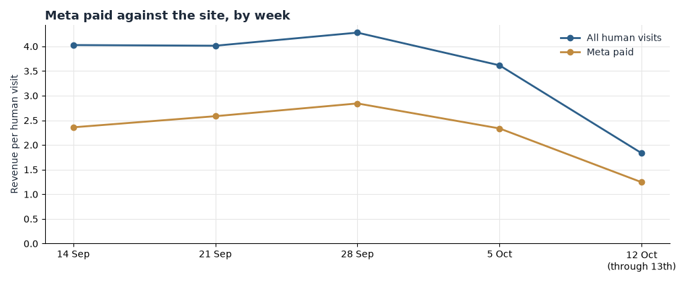

**HEATMAP**

**Today's Plan: Stop Paying for Visits That End on the Deal Page**

**Seat Cover Solutions**

*A one-hour ad-account intervention · three switches that change tomorrow's numbers*

seatcoversolutions.com · October 14, 2026

PREPARED OCTOBER 14, 2026 · DATA THROUGH OCTOBER 13, 2026

The full analysis of 14 September – 13 October found the leaks; this document is today's fix. Three switches in the ad account — one destination-URL change, one pause, one creative swap — about an hour in total. The latest week of data still shows all three leaks open, and none of them requires new creative, a rebuild, or a developer. The Site Opportunity Report carries the larger plays; nothing here duplicates that work.

> **Why these three and not the bigger ideas.** The mobile add-to-cart fix and the deal-page rebuild are worth more and take longer — they are the week's work, queued in section 06. These three come first because tomorrow's spend is committed tonight, and each of these settings stops a leak the day it is changed.

## Contents

01 The Situation This Morning · 02 Action 1 — Re-point the deal-page ads to Home · 03 Action 2 — Pause the Meta campaigns that cannot convert · 04 Action 3 — Swap the tired creative on the largest Meta ad · 05 How to Read Tomorrow · 06 The Rest of the Week · A Data and Method

## 01 The Situation This Morning

The latest week — Monday 12 October through Tuesday 13 October, the window's last two days — still shows the site buying traffic faster than it converts it. Orders for those two days ran at 175 for $63,906, and the steady channel is unchanged: Home (`/`) begins 86 of 145 entry-attributed orders while the paid channels run well below the site's value per visit. Meta paid delivered $1.25 per visit in the latest week against $1.83 for the site overall, and that site figure is itself depressed by the bot wave running at 31–36% of raw traffic since 8 October.

Three leaks are open right now:

| Leak | Latest reading | What it is worth |
| --- | --- | --- |
| Paid ads land on `/pages/love-your-ride-deal`, the weakest large page | 45 of 145 latest-week orders began there; the page converts entries at 0.74% against Home's 1.32% | Up to about $130,000 a month re-pointed |
| Two Meta campaign groups spend with no return | `fb / paid / 120223108743890616`: 340 visits, 0 orders in the latest week, one order in 5,364 all window; `Main+Campaign^`: 261 visits, 0 orders in the latest week | Up to about $30,000 a month |
| The largest Meta creative is fatiguing | `120253974710140616` fell from 63 orders on 8,610 first-half visits to 34 on 7,042 second-half | Up to about $20,000 a month |

Table 1 — The three live leaks, with the numbers as of the most recent week of tracked data. Sizes are monthly estimates from current volumes, not forecasts.

*Figure 1 — On-site revenue per human visit by week, Meta paid against the site, 31 August – 13 October 2026. Meta paid ran $1.25 against the site's $1.83 in the two-day week of 12–13 October, and has stayed below the site line every week of the window.*

## 02 Action 1 — Re-point the deal-page ads to Home

Owner: paid media. Time: about 20 minutes.

This one is first because it is the largest leak and it is purely a destination problem. Every day it waits, paid visits keep landing on a page that ends their session.

In Meta Ads Manager, find the active ads and campaigns whose landing page is `/pages/love-your-ride-deal` and change the destination URL to `/`. Do not pause the campaigns — the audiences are fine; the page is the leak. Leave the organic and email links untouched; they are not the waste. Half the change is the read: once the URLs are flipped, the deal page's paid traffic lands on Home, which converts entries at 1.32% against the deal page's 0.74%.

Expected result: if paid and social links account for half the deal page's entries — roughly 60,000 visits a month — and re-pointed visits convert like Home's existing traffic, the gap between 0.74% and 1.32% is up to about $130,000 a month. That is an upper bound, not a forecast; it assumes re-pointed visitors behave like Home's current visitors and the page rebuild in section 06 is still needed.

## 03 Action 2 — Pause the Meta campaigns that cannot convert

Owner: paid media. Time: about 15 minutes.

The campaign `fb / paid / 120223108743890616` spent 5,364 visits across the window to produce one order — $0.08 of on-site revenue per visit. It is still spending: 340 visits and zero orders in the two days of 12–13 October. Beside it, every `Main+Campaign^` variant (facebook, instagram, audience network, paid and paid_social) has run at zero orders for two consecutive weeks — 1,068 visits in the week of 5 October and 261 more in the latest week, none of them converting.

Pause both: campaign `120223108743890616`, and every ad set carrying the `Main+Campaign^` name. Do not re-point them; two weeks of zero orders on combined audiences says the creative-destination pair is wrong, not the audience, so re-pointing spends the same money to learn the same lesson. If budget must stay in-market, move it onto campaign `120254067922820616`, the strongest large line at $3.78 per visit all window.

Expected result: the two groups cost roughly 8,000 visits a month that today produce on the order of $0.08–$0.80 per visit. Moved to pages and campaigns converting at $2.40–$4.90, that is up to about $30,000 a month, an upper bound that assumes the reallocated spend performs like the destination lines' existing traffic. The cost-per-order check sits in Ads Manager; ad spend is not in this data.

## 04 Action 3 — Swap the tired creative on the largest Meta ad

Owner: paid media. Time: about 20 minutes.

The largest creative in the account, `120253974710140616`, is sliding: 63 orders from 8,610 visits in the first half of the window, 34 from 7,042 in the second half — conversion of 0.73% down to 0.48%. Campaign-level numbers held, so this is fatigue on one ad, not a broken campaign, which makes it a swap, not a rebuild.

In Ads Manager, replace creative `120253974710140616` in campaign `120253644899970616` with a refreshed version — new first frame, rotated image — or swap in the best-performing creative already running in that campaign. Do not touch the campaign's audiences, budget, or destination; the slide is the creative's, and changing three things at once makes tomorrow's read worthless.

Expected result: restoring the first-half rate of 0.73% on the creative's current ~7,000 visits a half-month is about 29 more orders a month — up to about $20,000 a month at the window's average order, an upper bound that assumes the refreshed creative performs like this same creative did in September rather than like a genuinely new ad.

## 05 How to Read Tomorrow

Direction should be visible the day after each switch: paused campaigns stop spending immediately, and the re-pointed ads report against Home from their first click. Size needs three or four days on a site this large — about 12,000 human visits a day — because one order still moves these rates:

- One order on the deal page's ~4,000 daily entries moves its entry-buyer rate by about 0.025 points.
- One order on the swapped creative's ~470 weekly visits moves its conversion by about 0.2 points.
- One $420 order on the ~10,700 weekly Meta link visits moves Meta's revenue per visit by about $0.04.

| Watch | Now | Target |
| --- | --- | --- |
| Deal-page entry-buyer rate | 0.74% of window entries | 1.0% first, then 1.2% |
| Meta link-channel revenue per visit | $2.39 window · $1.24 latest week | Hold at or above $2.40 |
| Visits to the paused campaigns | 340 + 261 in the latest week | Zero from tomorrow |
| Creative `120253974710140616` conversion | 0.48% (second half) | Back to 0.7% or better |

Two cautions sit beside these numbers. A promotion, drop, or restock landing inside the reading window moves orders on its own — 1, 4 and 10 October each carried a cross-channel lift the bundle cannot attribute to a named offer — so note any send or code beside the daily figures before crediting the switches. And the bot wave makes the latest week's reads soft: dead sessions ran at 31–36% of raw traffic from 8 October onward, so treat the 12–13 October revenue-per-visit figures as directional until the dead share returns near 16%.

## 06 The Rest of the Week

These are deliberately not today's work. They are the larger plays from the Site Opportunity Report, queued once the three switches are on.

| When | Action | Size |
| --- | --- | --- |
| Tue | Add UTM tags to the untagged Meta links (25,436 window visits arrive with no medium or campaign) and to every Klaviyo flow link | Protects the reading of every action above |
| Wed | Ship the sticky add-to-cart on mobile product templates; close the 8.2% against 17.7% add-to-cart gap | Up to about $300,000 a month |
| Thu | Put the fitment finder first on mobile Home; cut what competes with it above the fold | Up to about $50,000 a month |
| Fri | Rebuild `/pages/love-your-ride-deal` with the finder embedded; extend browse-recovery flows to mobile | Up to about $200,000 · $100,000 a month |

Cart recovery, the attach step past $500, and the repeat-buyer programme stay in the Site Opportunity Report's 30-day plan; none of them is a same-day switch.

## A Data and Method

**Window.** Orders and visits 14 September – 13 October 2026; the last day of the report window is 13 October 2026, with 31 August – 13 September as pre-window context. Weeks start Monday. "Latest week" is the two-day week of Monday 12 October through Tuesday 13 October; its order count (175, $63,906) is two days against five in full weeks, and 13 October itself shows 19 orders against 156 on 12 October, so week-on-week comparisons against it are directional.

**Dead sessions.** A visit with one pageview or none, no click, no scroll and no order is excluded from visit tables and counted as a dead session: 99,212 in the window, 21.4% of raw traffic, rising to 31–36% of raw traffic on 8–13 October. A visit with an add to cart, a checkout start or an order is never excluded. The bot wave inflates visit denominators in the final week and depresses every rate built on them.

**Attribution and sizes.** Channel is last touch: the link the visit arrived on. Ad spend is not in the bundle, so revenue per visit is on-site value only and no profit claim is made. Buyers are counted by device. Every monthly dollar figure here is an upper bound estimated from this window's volumes, not a forecast; each action states the behaviour its bound assumes.

**Data gaps.** 622 window orders (14.4%) matched no tracked visit and carry no channel or entry context. There is no confirmed promotion calendar, so the 1, 4 and 10 October peaks cannot be tied to a named offer. Campaign and creative rows carry their names as they appear in the bundle. The weekly Meta chart (Figure 1) was drawn from the visit-level tables; no other chart was scheduled for this document.
