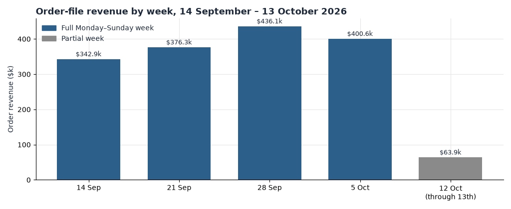
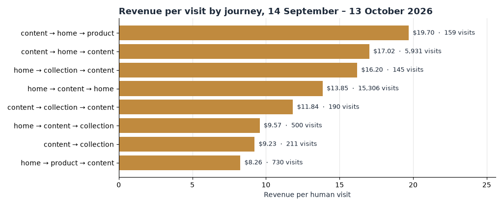

**HEATMAP**

**Seat Cover Solutions**

**User Journey Opportunity Analysis**

seatcoversolutions.com

PREPARED OCTOBER 14, 2026 · DATA THROUGH OCTOBER 13, 2026

We followed how shoppers moved through seatcoversolutions.com between 14 September and 13 October 2026: 4,314 orders worth $1,619,734.15 against 364,880 human visits, read as journeys from the visit cohorts, the weekly entry cube and the daily funnel. This document is the path — how shoppers move from landing page to product, cart and order, and where that path leaks. The Site Opportunity Report holds the action list; where a leak below is already specified there, we name the opportunity and leave its actions alone.

> **How to read a journey.** A journey is the sequence of page classes a visit touched: home, product, collection, content, other. Consecutive repeats of a class count once, so `content>home>content` is a three-stop path, not five. On this bundle `other` mostly holds product URLs stored with a full domain, including paid landing pages — read it together with `/products/` when we talk about product-style entries. And quick-add means a buying visit can be a single tracked page: a one-page journey is not a visit that failed to order.

## Contents

01 The Month in Journeys · 02 The Journeys That Make Money · 03 Where the Journeys Leak · 04 How the Growth and the Peak Days Reshaped the Funnel · 05 Recent Buyers, or Returning Visitors · 06 Behaviour Signals Worth Watching · 07 Where the Journey Data Points · A Data and Method

## 01 The Month in Journeys

The month in one table. Conversion is buyer visits per human visit; revenue per visit is on-site value only.

| Measure | Window value | Anchor |
| --- | --- | --- |
| Orders / revenue | 4,314 orders · $1,619,734.15 | The whole analysis rests on these |
| Where visits land | content 181,849 (49.8%) · home 176,918 (48.5%) · product-style (product + other) 5,520 (1.5%) | Content entries convert 0.70% at $2.69 per visit; home entries 1.31% at $4.96 |
| Most common journey | `content` alone — 157,796 visits, 0.54% conversion, $2.07 per visit | One visit in three of all human traffic (43.2%) never changes page class |
| Best common journey | `content>home>content` — 5,931 visits, 4.47% conversion, $17.02 per visit | `home>content>home` is close behind: 15,306 visits, 3.61%, $13.85 |
| Homepage effect | Visits that saw home: 1.38% conversion, $5.24 per visit; visits that did not: 0.57%, $2.14 | Seeing the homepage more than doubles a visit's value |
| Second-product effect | One product page: 1.19% · two: 2.78% · three or four: 3.77% (revenue per visit $4.30 → $6.02 → $11.90) | Zero product pages: 345,036 visits at 0.99% and $3.77 |
| One class vs several | One page class: 205,385 visits, 0.52%, $1.96 · multi-class: 157,342 visits, 1.61%, $6.12 | A visit that changes class is worth three times one that does not |
| Collection → product | 710 visits, 4.51% conversion, $11.02 per visit | Against 1.00% for the site as a whole — the strongest quiet path, but tiny volume |
| Peak days | 1, 4 and 10 October: 566 orders, $211,747, 13.1% of window revenue at 1.18% conversion | The lift appears in every channel at once with 2 of 566 orders marked down; the bundle holds no promotion calendar, so the cause cannot be confirmed |

Table 1 — The month in journeys, 14 September – 13 October 2026. Dead sessions (99,212 visits, 21.4% of raw traffic) are removed from every visit figure in this document; a visit with an order is never removed.

Two reads matter before the sections. First, the dominant journey is a dead end: `content` alone took 43.2% of human visits and returned $2.07 each, while the average journey that changes class at least once returns three times that. Second, the money sits in the short loops — `home>content` and its three-step variants carried $867,177 between them, more than half of all journey-attributed revenue, because the homepage is where the fitment finder lives and the fitment finder is where a purchase starts.

*Figure 1 — Weekly revenue from the order file, weeks starting Monday, 14 September – 13 October 2026. The week of 12 October contains two days (12–13 October) and is not comparable to the full weeks.*

## 02 The Journeys That Make Money

Ranked by journey evidence, not traffic volume. The quiet high-value loops sit above the big cheap landings.

*Figure 2 — On-site revenue per human visit by journey, 14 September – 13 October 2026. Gold marks the high-value loops (`content>home>content`, `home>content>home`); grey marks the volume journeys that mostly never change class.*

| Journey | Visits | Conversion | Revenue per visit | Revenue |
| --- | --- | --- | --- | --- |
| `home>content` | 108,440 | 1.34% | $5.11 | $554,263 |
| `content` | 157,796 | 0.54% | $2.07 | $327,300 |
| `home>content>home` | 15,306 | 3.61% | $13.85 | $211,973 |
| `content>home>content` | 5,931 | 4.47% | $17.02 | $100,941 |
| `home` | 44,089 | 0.42% | $1.55 | $68,372 |
| `content>home` | 11,831 | 0.60% | $2.42 | $28,635 |
| `content>product` | 3,425 | 0.50% | $1.66 | $5,699 |
| `product` | 3,339 | 0.69% | $1.61 | $5,377 |

Table 2 — The eight largest journeys of the window from the visit cohorts (journeys under 200 visits are not kept in the table). Compare rows inside this table only.

- The workhorse is `home>content`: 108,440 visits at $5.11 each. These are shoppers who land on Home, use the page — most likely the make/model/year fitment finder — and step into an offer page. It is the only large journey that earns above the site average of $3.81 per visit.
- The two three-step loops, `home>content>home` and `content>home>content`, convert at 3.61% and 4.47% — three to four times the site rate. Shoppers who return to Home after an offer page are re-running the finder with more intent, and they order.
- The product-class journeys are thin and, on the surface, weak: `product` alone converts 0.69%. But remember the `other` bucket holds product URLs stored with a full domain; even combined, product-style entries are only 5,520 visits — 1.5% of traffic. On this site the product decision happens inside the fitment flow on Home and the offer pages, not on a classic product page. Quick-add does the rest: 1,068 orders came from single-class visits, so a one-page journey is often a completed purchase, not a bounce.
- The second-product effect is the strongest gradient in the cohorts: 18,836 visits saw exactly one product page (1.19%), 827 saw two (2.78%), 159 saw three or four (3.77%, $11.90 per visit). Browsers who reach a second product page are more than twice as likely to order.

> **So what:** judge merchandising by the second product view it creates. The site already proves the gradient — every additional product page reached multiplies conversion — yet 99.7% of visits stop at zero or one. The journeys pay for routing shoppers one step deeper, not for more traffic at the top.

## 03 Where the Journeys Leak

The leaks sit where volume lands and never moves. These are Home entry sessions by source channel from the pipeline's entry-by-channel table — a different denominator from human visits, so compare rows inside the table.

| Entry channel (Home) | Entry sessions | Single-page share | Conversion | Revenue per session |
| --- | --- | --- | --- | --- |
| social | 152,158 | 41.2% | 0.57% | $2.19 |
| search | 63,817 | 22.8% | 1.64% | $6.15 |
| direct | 12,141 | 37.0% | 2.66% | $9.73 |
| campaign | 3,882 | 51.6% | 2.06% | $7.64 |
| website | 511 | 43.4% | 2.93% | $10.95 |

Table 3 — Home entry sessions by source channel, window totals, pipeline bot filter. Channel is last touch: the link the visit arrived on. Revenue per session is on-site value; ad spend is not in the bundle.

Social is the leak at scale: 152,158 entry sessions, 41.2% leaving after one page, $2.19 per session against $9.73 for direct. That is a last-touch read of paid social's weakest shape, and it matches the Meta campaign story in the Site Opportunity Report (Opportunity 3 — Make every Meta dollar accountable). Search entries, by contrast, behave: 22.8% single-page and $6.15 per session.

The landing pages behind those numbers, from the page-period table (which still contains dead sessions — compare rows inside the table):

| Landing page | Entries | Entry buyers | Entry-buyer rate | The page next door |
| --- | --- | --- | --- | --- |
| `/pages/love-your-ride-deal` | 119,222 | 883 | 0.74% | `/pages/august-offer-2026` converts 1.20% on 1,415 entries |
| Vehicle pages (`/pages/…-luxury-seat-covers`, 728 URLs) | 27,883 | 168 | 0.60% | `/products/steering-wheel-cover` converts 1.10% · `/products/petsuite-hard-bottom-dog-seat-protector-no-fur` 1.05% |
| `/pages/new-installation-videos` | 4,421 | 4 | 0.09% | `/pages/reviews` converts search entries at 7.78% ($27.70 per session) |
| `/products/custom-luxury-seat-covers` | 2,312 | 14 | 0.61% | `/pages/2026-ford-f150-luxury-seat-covers` converts 1.16% on 688 entries |

Table 4 — The window's leaky landings against the closest converting neighbour, page-period table (first + second halves of the window). Every row is large enough to act on except where noted.

The Love Your Ride deal page is the site's biggest destination — more than double Home's entries — and roughly 85% of its tracked entry sessions (about 89,000 of them) leave after one page. Its 0.74% stands against 1.16–1.20% for the vehicle-specific offer pages that do what the deal page does not: hand the shopper straight to a fitment path. The 728 vehicle landing pages convert 0.60% as a group — thousands of near-identical doors, each converting at half the rate of a product page.

> **So what:** the upper bound on fixing the landings is on the order of $250,000 a month. Bringing the deal page's 119,222 entries to the 1.20% its sibling offer page manages is about 550 more orders a month — up to about $200,000; bringing the 27,883 vehicle-page entries to the 1.1% the product pages reach is about 140 more — up to about $50,000. Both numbers assume re-pointed traffic converts like the destination's existing traffic, and shoppers who browse further are partly different people, so treat these as ceilings, not forecasts. The specified play is already Opportunity 4 in the Site Opportunity Report — Turn the Love Your Ride deal page from a dead end into a doorway; this data says the same shape repeats across 728 vehicle URLs.

## 04 How the Growth and the Peak Days Reshaped the Funnel

The window grew against the prior fortnight, and the growth was traffic, not conversion.

| Phase | Days | Visits/day | Orders/day | Revenue/day | Add-to-cart | Checkout per add-to-cart | Orders per checkout | Conversion | Revenue per visit |
| --- | --- | --- | --- | --- | --- | --- | --- | --- | --- |
| pre (31 Aug – 13 Sep) | 14 | 11,346 | 115.3 | $42,972 | 9.0% | 50.3% | 22.3% | 1.01% | $3.79 |
| window | 30 | 12,163 | 123.1 | $46,321 | 8.9% | 45.2% | 25.0% | 1.01% | $3.81 |
| peak days (1, 4, 10 Oct) | 3 | 13,676 | 162.3 | $60,656 | 8.7% | 46.6% | 29.4% | 1.18% | $4.44 |

Table 5 — The funnel by phase from daily_site. Dead sessions excluded; orders counted when matched to a non-dead visit.

Between pre and window, visits per day rose 7.2% and orders per day rose 6.8%, while conversion held at 1.01%. Nothing in the window's funnel converted better than the fortnight before it; the site bought growth in traffic.

One internal shift is worth flagging as a measurement caution rather than a leak: checkout-started per add-to-cart fell from 50.3% to 45.2% while orders per checkout rose from 22.3% to 25.0%. The two moved in opposite directions by nearly the same amount, leaving the combined cart-to-order rate flat (11.2% pre, 11.3% window). When the middle step slides and the last step compensates exactly, suspect the event timing moved, not the shoppers. We read the funnel at cart-to-order until that event is verified.

The peak days were different in kind. Visits per day ran only 12.4% above the window, but conversion reached 1.18% and revenue per visit $4.44, with orders per checkout at 29.4% — the best checkout close of any phase. The lift arrived in every channel at once (search 202 orders, Meta paid 106, direct 83, Meta untagged 46, email/SMS 34) and only 2 of the 566 peak orders were marked down. A lift across every channel at once is a promotion or a code, not a retention story; the bundle contains no confirmed promotion calendar, so the cause stays unconfirmed. If the Love Your Ride page was the vehicle, its 0.74% entry-buyer rate says most of that peak traffic left without the site ever learning what they came for.

## 05 Recent Buyers, or Returning Visitors

The honest answer first: the 30-day shopper-history flag cannot measure repeat rate on this extract. Its orders column populates only for `bought_before` visits — 11,186 visits carrying 3,649 orders — and shows zero orders for every other history class, which is an extraction gap rather than a true zero. The bought-before check fails, so this section reads the returning flag (`ret`) instead.

| Week (Monday) | Visits | Returning share | Returning conversion | New conversion | Returning revenue per visit |
| --- | --- | --- | --- | --- | --- |
| 14 Sep | 74,070 | 20.9% | 1.58% | 0.93% | $5.94 |
| 21 Sep | 83,405 | 19.8% | 1.67% | 0.90% | $6.40 |
| 28 Sep | 86,947 | 19.7% | 1.79% | 0.99% | $6.76 |
| 5 Oct | 91,854 | 18.3% | 1.64% | 0.80% | $6.19 |
| 12 Oct (through 13th, 2 days) | 28,604 | 19.6% | 0.82% | 0.43% | $3.13 |

Table 6 — New versus returning visits by week from the weekly entry cube. The last row is a two-day partial week and overlaps the October bot wave (33–36% dead sessions from 8 October); read it as directional only.

Returning visits are 19.6% of human traffic and worth twice a new visit: 1.60% conversion and $6.08 per visit against 0.87% and $3.25. On the order file, 31.1% of matched order visits carry the returning flag — about one order in three comes from a device that has been here before. That is the shape of a considered, configured purchase: buyers leave, and they come back on the same device to finish.

> **So what:** the returning visitor is already the site's best journey — no leak to fix in the path itself. The opportunity is that this repeat behaviour is only partially cultivated and not yet measurable: the Site Opportunity Report carries it as Opportunity 7 — Build the repeat-buyer programme the data cannot yet measure. Until the history extraction is repaired, track the returning share and its revenue per visit, not any 30-day repeat rate.

## 06 Behaviour Signals Worth Watching

Five signals from the visit cohorts where the rate differs from the site and the count is large enough to matter. Each says what to do with it.

- **Swatch and colour choosers convert at 2.03% against 0.49% for everyone else** — 122,464 visits. Configuring a cover — picking a colour, seeing it on the product — is the strongest single buying signal on the site. Keep the swatch step fast on mobile and never let it sit below the fold on the offer pages.
- **Menu and navigation clickers convert at 1.96% against 0.92%** — 32,145 visits. Shoppers who open the menu are looking for somewhere to go, and they find it. The navigation is working; the leak is the pages it leads to (Table 4), so fix destinations before restructuring the menu.
- **Review readers convert at 1.77% against 0.94%** — 28,576 visits. Social proof is part of the decision for this considered purchase. Keep reviews one tap from the fitment flow, not buried at the foot of the page.
- **FAQ and accordion clickers convert at 2.62% against 0.97%** — 8,092 visits. Objection-handling works: shoppers who open the answers order. Put the three questions that matter — fit, airbags, heated seats — beside the add-to-cart step, not on a separate page.
- **Site search users convert at 6.53%, worth $24.75 per visit** — only 873 visits, so directional, but the direction is extreme. These are ready buyers naming what they want. Keep search prominent on mobile and watch its volume as an intent gauge.

## 07 Where the Journey Data Points

Ranked by journey evidence. Dollar sizes are monthly upper bounds from this window's volumes, assuming re-pointed traffic converts like the destination's existing traffic and that shoppers who browse further are only partly the same people.

| # | Move | Journey evidence |
| --- | --- | --- |
| 1 | Rebuild the deal page and the vehicle landings as doorways into the fitment flow (Site Opportunity Report, Opportunity 4) | 147,105 entries across the deal page and vehicle pages at 0.60–0.74% entry-buyer rate against 1.10–1.20% next door; ~85% single-page on the deal page. Up to about $250,000 a month |
| 2 | Merchandise for the second product page | 18,836 one-product visits at 1.19% vs 2.78% at two and 3.77% at three or four; 99.7% of visits never get past one. Up to about $100,000 a month, and that ceiling assumes the deeper browsers were reachable all along |
| 3 | Hold paid social to the standard search already sets | Social entries to Home: 152,158 sessions, 41.2% single-page, $2.19 per session vs $6.15 for search; last touch, on-site value only (Site Opportunity Report, Opportunity 3) |
| 4 | Build the returning-visitor programme and repair the repeat measurement | Returning visits: 19.6% of traffic at 1.60% conversion and $6.08 per visit; 31.1% of matched order visits return (Site Opportunity Report, Opportunity 7) |

Table 7 — Where the journey data points, window of 14 September – 13 October 2026. Sizes are upper bounds, not forecasts.

Four numbers to track weekly:

| Watch | Now | Direction that matters |
| --- | --- | --- |
| Deal-page entry-buyer rate | 0.74% | Toward 1.0%, the sibling offer pages' neighbourhood |
| Share of visits reaching a second product page | 0.3% (1,008 of 364,880 visits saw two or more) | Up — this is the steepest gradient in the cohorts |
| Returning share of visits / returning revenue per visit | 19.6% · $6.08 | Share holding while new-visit value rises is the healthy shape |
| Multi-class journey share | 43.4% of journey-table visits change page class at least once | Up — every step deeper is worth roughly three times a one-class visit |

Table 8 — The weekly watchlist. Note any promotion, drop or send beside the numbers inside the reading window, since any of them moves orders on its own; the bundle contains no confirmed promotion calendar for the October peaks.

## A Data and Method

**Window.** Report window 14 September – 13 October 2026; the last day of the window is 13 October 2026. Pre-window context is 31 August – 13 September. Weeks start Monday; the week of 12 October contains two days (12–13 October). Orders reach back to 15 August for shopper history.

**Sources.** Full analyst bundle at `/Users/kennpalm/work/analysis/seatcoversolutions`: orders (`01_orders.csv`), daily site (`daily_site`), weekly entry cube, page-period, visit cohorts and the pipeline's entry-by-channel, read with the loader in the bundle's data guide. Anchor check against the order file: 4,314 orders and $1,619,734.15 in the window, matching `00_site_profile.json`.

**Journeys.** A journey is the sequence of page classes in a visit — home, product, collection, content, other — with consecutive repeats counted once. `other` holds product URLs stored with a full domain, including paid landing pages, so product-style reads combine `product` with `other`. Journey tables keep paths with 200+ visits. Quick-add means a one-page visit can still order; 1,068 orders came from single-class visits.

**Dead sessions and rates.** A visit with one pageview or none, no click, no scroll and no order is excluded from visit-level tables: 99,212 in the window, 21.4% of raw traffic (464,092 raw visits), against 16.1% before the window. From 8 October the dead share ran at 33–36% of raw traffic on five of the last six days — a bot wave that makes the partial final week read artificially weak. All rates use human visits. A visit with an add to cart, a checkout start or an order is never excluded. The page-period and pipeline entry tables keep their own filters (the pipeline uses the dataset's `exclude_confirmed` bot filter), so their denominators differ from human-visit tables; we never mix them in one sentence.

**Attribution.** Channel is last touch: the link the visit arrived on. Ad spend is not in the bundle, so revenue per visit is on-site value only; no profit claim is made. Buyers are counted by device.

**Sizes.** Every monthly dollar figure is an upper bound estimated from this window's volumes, not a forecast, and each states the behaviour it assumes. Rates built on fewer than about 100 visits or 10 orders are flagged as directional in the text (site search, the partial final week, the smallest journeys).

**Data gaps.** No confirmed promotion calendar exists, so the peak days of 1, 4 and 10 October cannot be tied to an offer. The 30-day shopper-history extraction populates orders only for `bought_before`, so repeat rate is read from the returning flag, not from hist30. 622 window orders (14.4%) matched no tracked visit and carry no journey. Stored line prices do not reconcile with order revenue for configured products, so all money figures use order revenue. The checkout-started event's timing appears to have shifted mid-window (checkout-per-add-to-cart down, orders-per-checkout up, cart-to-order flat); the funnel is read at cart-to-order until that event is verified.
