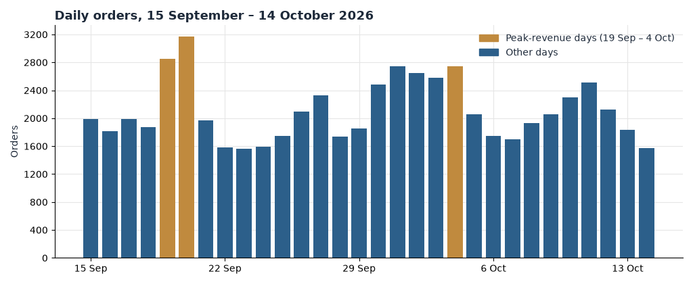
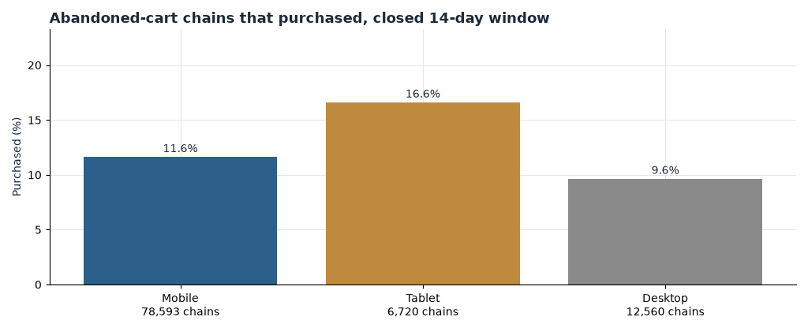
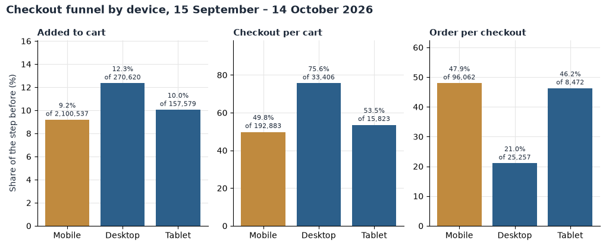
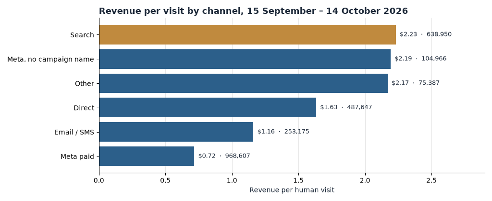
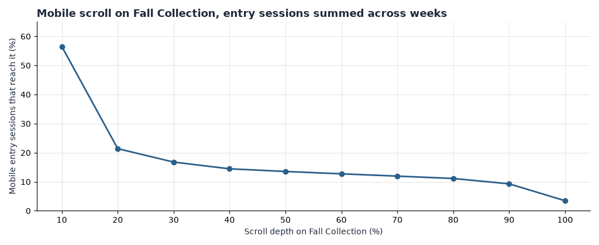

**HEATMAP**

**'47**

**Site Opportunity Report**

47brand.com | 15 September – 14 October 2026, with 1–14 September for context | Prepared 15 October 2026

We re-analysed 63,170 orders worth $4,000,227.39, 2,528,736 human visits, and the full click, scroll and recovery record, including the pipeline datasets for the analysed page, Fall Collection (`/collections/fall-collection`).

# Contents

The biggest wins · At a glance · The month in numbers · Opportunity 1 — Bring back the carts, then fix browse abandonment · Opportunity 2 — Close the gap between mobile cart and checkout · Opportunity 3 — Lift the $48 median basket toward the $110 line · Opportunity 4 — Make every Meta dollar accountable · Opportunity 5 — Stop paying to land shoppers on Fall Collection · Opportunity 6 — Open the dead ends: search and low-converting pages · Opportunity 7 — Turn one-time buyers into a replenishment habit · Opportunity 8 — Clean the traffic and order record before scaling spend · Worth watching · What's working · Suggested next 30 days · Method and caveats

# The biggest wins

Six moves cover most of the opportunity in this window: two fix where paid traffic lands, one raises the value of every order, two recover demand that already exists, and one turns this month's first-time buyers into next month's revenue.

1. **Pause the team-specific postseason Meta creatives and re-point that spend.** The five MLB postseason creatives named for the Dodgers, Yankees, Brewers, White Sox and Guardians produced 42 orders from 57,305 visits — $0.04 of on-site revenue per visit against a site average of $1.43. Move that budget to the proven broad carousels, which convert at 1.5–1.8%. (Opportunity 4)
2. **Fix the mobile cart before spending another dollar on traffic.** Mobile adds to cart at 9.2% but only half of those carts reach checkout (49.8%), against 75.6% on desktop. Half that gap is worth up to about $740,000 a month. (Opportunity 2)
3. **Stop sending paid social to Fall Collection.** The page took 236,635 visits in the window and converted 0.17% of them; 89% of social entries leave without a second pageview. Re-point those ads to collections that buy, like Sale (6.25% buyer rate) and Men's Franchise (5.26%). (Opportunity 5)
4. **Lift the median basket.** Half of all orders are under $48.29, and only 9.5% of orders clear the $110 high-value line — yet those hold 24.3% of revenue. Bundles that pair a cap with a tee move the median, not the discount. (Opportunity 3)
5. **Rebuild recovery for the phone.** Abandoned-cart chains already return $897,461 a month at an 11.7% purchase rate, but mobile chains buy back at 5.7% against 7.7% on desktop. Closing that gap is worth on the order of $200,000 a month. (Opportunity 1)
6. **Switch on a replenishment flow for the 39,768 first-buyer devices.** Returning devices already drive 28.6% of matched orders and $1,029,660 of window revenue; a post-purchase flow at a conservative 5% response is worth up to about $125,000 a month. (Opportunity 7)

Supporting plays that did not make the six: open up site search, where 73.7% of visits end on the results page (Opportunity 6); and reconcile the tracking record — 11.8% of orders matched no visit and 42.5% of raw traffic is dead sessions (Opportunity 8).

# At a glance

| # | Finding | Recommended action | Priority |
| --- | --- | --- | --- |
| 1 | Meta paid delivers $0.72 per visit against $1.43 site-wide; five postseason creatives deliver $0.04 | Pause the five team creatives; re-point budget to broad carousels | High |
| 2 | Mobile cart reaches checkout 49.8% of the time vs 75.6% on desktop | Fix the mobile cart drawer: persistent cart, early shipping cost, express checkout | High |
| 3 | Cart recovery buys back 5.7% of mobile chains vs 7.7% desktop | Refresh the mobile recovery email/SMS sequence | High |
| 4 | Fall Collection converts 0.17% of 236,635 visits; 89% of social entries are single-page | Re-point paid social to converting collections | High |
| 5 | Browse-abandonment chains buy at 4.2% vs 11.7% for cart chains | Add a browse-abandonment flow built like the cart flow | Medium |
| 6 | Median order $48.29, below the pre-period $50.00; 9.5% of orders are $110+ | Test cap-plus-tee bundles and a shipping threshold once confirmed | Medium |
| 7 | 73.7% of 253,203 search visits end on the results page | Fix zero-result and low-click searches | Medium |
| 8 | 39,768 window orders came from devices with no prior purchase | Build a replenishment/post-purchase flow | Medium |
| 9 | Desktop completes checkout-to-order at 21.3% vs 48.3% on mobile | Verify desktop checkout instrumentation before acting | Watch |
| 10 | 42.5% of raw visits are dead sessions; 7,445 orders match no visit | Bot/consent audit and order-match reconciliation | Watch |

Table 1 — The ten headline lines of the window, with the numbers as of 14 October 2026. Sizes are monthly estimates from current volumes, not forecasts.

# The month in numbers

| Definition | Value |
| --- | --- |
| Report window | 15 September – 14 October 2026 (30 days) |
| Orders | 63,170 |
| Revenue | $4,000,227.39 |
| Average order / median order | $63.32 / $48.29 |
| Human visits (dead sessions removed) | 2,528,736 (84,291 per day) |
| Dead sessions removed | 1,868,538 (42.5% of 4,397,274 raw visits) |
| Conversion (buyer visits / visits) | 2.19% |
| Add-to-cart rate | 9.57% of visits |
| Returning share of visits | 23.6% |
| High-value line | $110 (90th percentile of order revenue) |
| Orders at or above $110 | 6,020 (9.5% of orders, 24.3% of revenue) |
| Peak days | 19 September, 20 September, 4 October |

Table 2 — Window definitions. Orders and revenue are from the order file; visit rates use human visits only.

Weekly orders, Monday weeks, from the order file:

| Week | Orders | Revenue |
| --- | --- | --- |
| 14 Sep (from 15th) | 13,685 | $872,840 |
| 21 Sep | 12,867 | $831,168 |
| 28 Sep | 16,785 | $1,072,050 |
| 5 Oct | 14,296 | $882,804 |
| 12 Oct (through 14th) | 5,537 | $341,365 |

Table 3 — Weekly orders and revenue. The first and last weeks are partial; the 28 Sep week contains the 4 October peak.

*Figure 1. Daily orders, 15 September – 14 October 2026, with pre-window context from 1 September. Gold days are the three peak-revenue days — 19 September, 20 September and 4 October — which together held 8,768 orders and $553,948, 13.8% of window revenue. Grey days are the prior fortnight.*

Two contexts matter for reading the month. First, volume against the prior fortnight: orders ran 2,106 a day against 2,195 in the pre-period, and revenue ran $133,341 a day against $141,775 — a softer September that accelerated inside the window, from 30,142 orders in the first half to 33,028 in the second. Visits were flat at roughly 84,000 a day, so the softness is conversion and add-to-cart, not traffic. Second, where demand concentrates: the three peak days lift every channel at once — search, direct and paid social together — with a marked-down share of 1.5% against 3.5% for the window. That is game-calendar demand, not a code. The campaign file itself names the moment: NFL season launches and new evergreen sends around 20 September, and MLB Wild Card and Division Series sends around 4 October. Peaks like these are earned by the sports calendar; the rest of the month is what the site controls.

# Opportunity 1 — Bring back the carts, then fix browse abandonment

**What we saw.** We followed every recovery chain triggered between 15 and 30 September for the full 14 days each chain is observed.

| Trigger | Chains | Returned | Purchased | Purchase rate | Recovered revenue |
| --- | --- | --- | --- | --- | --- |
| Abandoned cart | 97,873 | 52,272 | 11,466 | 11.7% | $897,461 |
| Showed interest (browse) | 336,438 | 147,466 | 14,038 | 4.2% | $1,127,698 |
| Super shopper | 140,303 | 88,973 | 9,244 | 6.6% | $717,911 |

Table 4 — Trigger chains with a closed 14-day follow-up window, 15–30 September cohort. Recovered revenue is revenue attributed to the chain.

By device, the purchase rate on those same chains is 5.7% on mobile, 7.5% on tablet and 7.7% on desktop — and mobile carries 82% of all chains.

*Figure 2. Abandoned-cart and browse chains that purchased within the closed 14-day window, by device. Mobile holds 470,712 of 574,614 chains but buys back at 5.7% against 7.7% on desktop.*

- The cart programme works: one chain in eight returns to buy, and it is already returning close to $0.9 million a month.
- The phone is where the programme underperforms: four chains in five are mobile, and mobile buys back two points below desktop.
- Browse abandonment is the bigger, weaker file: 3.4 times the cart volume buying at a third of the rate.

**Why it matters.** Every purchase-rate point on the cart file is roughly 980 orders, about $62,000 a month. Closing the mobile recovery gap alone is worth up to about $200,000 a month, assuming mobile chains respond to the same treatment desktop already gets and buy at the window average order of $63.32. The structural reason the gap persists: the recovery journey ends back on a mobile cart that itself leaks (Opportunity 2), so the two fixes compound.

**Recommended actions.**

- Rewrite the mobile recovery sequence as a three-touch SMS-first flow with the abandoned product and a one-tap cart link; keep email as the second touch.
- Put the order total and the shipping cost in the first message so the return visit has no surprise at checkout.
- Deep-link recovered sessions to a pre-filled express checkout (Shop Pay / wallet), not to the cart page.
- Build the browse-abandonment flow on the cart flow's template: same cadence, product shown, no incentive until the third touch.
- Track: mobile chain purchase rate, now 5.7%; target 7.5%, the tablet rate, within 30 days.

# Opportunity 2 — Close the gap between mobile cart and checkout

**What we saw.** The funnel by device for the window:

| Device | Visits | Add-to-cart | Cart→checkout | Conversion | Revenue per visit |
| --- | --- | --- | --- | --- | --- |
| Mobile | 2,100,537 | 9.2% | 49.8% | 2.19% | $1.39 |
| Desktop | 270,620 | 12.3% | 75.6% | 1.96% | $1.48 |
| Tablet | 157,579 | 10.0% | 53.5% | 2.49% | $1.74 |

Table 5 — Device funnel, human visits, 15 September – 14 October 2026. Conversion is buyer visits per visit; revenue per visit is on-site value.

*Figure 3. The checkout funnel by device: visits, add-to-cart, checkout and order, 15 September – 14 October 2026. The break sits between cart and checkout on mobile — 49.8% against 75.6% on desktop — while mobile completes checkout-to-order at 48.3%, better than desktop's 21.3%.*

- The break sits between cart and checkout: mobile adds to cart at 9.2%, desktop at 12.3%, but only half of mobile carts reach checkout against three-quarters of desktop carts.
- Past the break, mobile is fine: 48.3% of mobile checkout sessions end in an order, better than desktop.
- Mobile is the business: 83% of visits and 84% of orders, at a $61.81 average order.

**Why it matters.** These are ready buyers fidgeting at the moment of commitment — the cart holds, the checkout never starts. If mobile carts reached checkout at the desktop rate, the extra checkouts would convert at today's mobile checkout-to-order rate of 48.3% and the mobile average order of $61.81; even half the gap is worth up to about $740,000 a month. That assumes no change in checkout behaviour, which is why it is an upper bound.

**Recommended actions.**

- Show the shipping cost and delivery date inside the cart drawer, before checkout, on mobile.
- Make the cart persistent across sessions on mobile; a bag rebuilt from memory reads as lost.
- Put express checkout (Shop Pay, Apple Pay, Google Pay) at the top of the drawer, above the cart line items.
- Cut the drawer to one screen: line items, total, delivery promise, one checkout button.
- Track: mobile cart→checkout, now 49.8%; target 60% in four weeks.

# Opportunity 3 — Lift the $48 median basket toward the $110 line

**What we saw.** The window order-value profile:

| Measure | Value |
| --- | --- |
| Median order / average order | $48.29 / $63.32 |
| Pre-period median / average | $50.00 / $64.58 |
| 75th percentile | $77.75 |
| 90th percentile (high-value line) | $110 |
| Orders at or above $110 | 6,020 — 9.5% of orders, 24.3% of revenue |
| Orders above the median, below $110 | 26,410 |
| Multi-item orders (paid_to_item ≥ 1.9) | 19.3% |

Table 6 — Order-value distribution from the order file, 15 September – 14 October 2026.

- Half of all orders sit under $48.29, and the median slipped $1.71 from the pre-period while volume held — the month traded a little value, not demand.
- High-value buyers over-index on team scrum tees and blank basics: the Blank Scrum Tee pages reach high-value devices at 38–48 times the rate of all visitors.
- Meta creative copy advertises free shipping ("Free '47 Family Shipping", read from creative names on 15 October); the bundle records no minimum spend, so no threshold line is drawn here.

**Why it matters.** The 26,410 orders between the median and the $110 line are one add-on away from the high-value tier that already carries a quarter of revenue. Moving the median order from $48.29 to $55 is worth up to about $420,000 a month at current order volume, assuming the gain comes from basket additions, not discounting. The structural reason it persists: the path from one cap to two items is merchandised nowhere — no bundle, no threshold, no "completes the look" module on the pages high-value buyers actually visit.

**Recommended actions.**

- Merchandise a cap-plus-tee bundle at $75–$95 on the top team pages and on Fall Collection rows one and two.
- Add a "complete the look" module to the five scrum-tee pages where high-value devices over-index most.
- Confirm the live free-shipping threshold on the storefront and record it; only then test a threshold nudge.
- Track: median order, now $48.29; multi-item share, now 19.3%.

# Opportunity 4 — Make every Meta dollar accountable

**What we saw.** Channel value per human visit, last touch:

| Channel | Visits | Conversion | Revenue per visit |
| --- | --- | --- | --- |
| Search | 638,950 | 3.26% | $2.23 |
| Direct | 487,647 | 2.29% | $1.63 |
| Meta paid | 968,607 | 1.27% | $0.72 |
| Email/SMS | 253,175 | 1.88% | $1.16 |
| Meta untagged (organic social) | 104,966 | 3.63% | $2.19 |
| Site average | 2,528,736 | 2.19% | $1.43 |

Table 7 — Referrer channels, human visits, 15 September – 14 October 2026. Meta paid is 38% of human visits.

*Figure 4. Revenue per human visit by referrer channel, 15 September – 14 October 2026. Meta paid delivers $0.72 against $2.23 for search and $2.19 for untagged organic social.*

Inside the paid channel, by creative:

| Creative | Visits | Orders | Conversion | Revenue per visit |
| --- | --- | --- | --- | --- |
| ASRT All Leagues, All Teams — Carousel 1 (Free Shipping) | 152,164 | 2,796 | 1.82% | $1.02 |
| ASRT All (Licensed + Classics) — '47 Family copy | 81,007 | 1,587 | 1.93% | $1.00 |
| HW NCAA & NFL headwear DPA Carousel 2 | 37,939 | 923 | 2.40% | $1.44 |
| DPA numeric-ID creatives (three largest) | 60,083 | 418 | 0.70% | $0.23 |
| MLB postseason team creatives (five named teams) | 57,305 | 42 | 0.07% | $0.04 |
| link_in_bio | 10,798 | 290 | 2.68% | $1.74 |

Table 8 — Meta creatives with volume, 15 September – 14 October 2026. The five named-team postseason creatives are the Dodgers (two), Yankees, Brewers, White Sox and Guardians.

- Meta paid takes the most traffic of any channel and returns the least value per visit — half the site average, a third of search.
- The worst spend is specific and nameable: team-postseason creatives at $0.04 a visit, and numeric-ID DPA creatives at $0.23.
- Untagged organic social, the same audiences arriving without a paid link, converts at 3.63% — the audiences are fine; the buys are not.

**Why it matters.** Last touch credits the visit to the link it arrived on; ad spend is not in this bundle, so this is on-site value, and the profit check belongs in Ads Manager. On-site, re-pointing the 57,305 visits the five team creatives bought at the site average of $1.43 is worth up to about $80,000 a month. The structural reason: broad creative outperforms named-team creative by 25 to one, yet the named teams kept spend all month.

**Recommended actions.**

- Pause the five named-team postseason creatives today; do not rebuild them until a team actually advances.
- Re-point that budget to the broad All Leagues carousels and the NCAA & NFL headwear DPA, the strongest paid line at $1.44 a visit.
- Name every creative in words in utm_content; the numeric-ID rows are unauditable as shipped.
- Pull spend beside revenue per visit in Ads Manager weekly; keep any creative under $0.75 a visit on probation.
- Track: Meta paid revenue per visit, now $0.72; target $1.00 in 30 days.

# Opportunity 5 — Stop paying to land shoppers on Fall Collection

**What we saw.** Fall Collection is the analysed page and the window's biggest traffic-taker that does not convert:

| Measure | Value |
| --- | --- |
| Visits (first and second periods) | 236,635 |
| Buyer rate | 0.17% |
| Entry visits / entry buyer rate | 222,088 / 0.10% |
| Meta campaign-link entries | 46,077 at 0.44% conversion, $0.33 per visit |
| Social entries (pipeline) | 212,557 with an 89% single-pageview share |
| Mobile scroll: reached 20% depth | 21.4% of entry sessions |
| Mobile scroll: reached the foot | 3.5% |

Table 9 — Fall Collection traffic and engagement, 15 September – 14 October 2026. Pipeline rows describe this page only.

*Figure 5. Mobile scroll depth on Fall Collection, entry sessions summed across weeks. Only about one session in five reaches the second screen of products; 3.5% reach the foot.*

- The page is a landing page for paid social, and it ends the visit: 89% of social entries never see a second page.
- Mobile shoppers never get far enough to disagree: four in five leave before the second row of products.
- Collections that convert prove the traffic is fine: Sale (6.25% buyer rate), Men's Franchise (5.26%), Headwear (3.77%).

**Why it matters.** Re-pointing the 46,077 Meta visits the page absorbs at the site average of $1.43, instead of its $0.33, is worth up to about $50,000 a month on that segment alone — before counting the browse value of sessions that currently end on the first screen. It assumes re-pointed traffic converts like the destination's existing traffic.

**Recommended actions.**

- Point Meta product ads at the converting collections (Sale, Men's Franchise, Headwear) or at product pages, not at Fall Collection.
- If Fall Collection stays a landing page, put quick-buy and price on the first two product rows and cut the filter wall before the grid.
- Load the first screen with the current-season teams the campaign file is already pushing (NFL launches, MLB postseason).
- Track: Fall Collection entry buyer rate, now 0.10%; social single-page share on the page, now 89%.

# Opportunity 6 — Open the dead ends: search and low-converting pages

**What we saw.** Pages that take traffic and give nothing back:

| Page | Visits | Buyer rate | Single-page share |
| --- | --- | --- | --- |
| /search | 253,203 | 5.03% | 73.7% |
| /pages/nfl | 75,108 | 0.54% | 9.4% |
| /collections/mens-headwear | 76,536 | 4.20% | 76.3% |
| /pages/47-select | 41,464 | 5.15% | 82.1% |
| /collections/mlb-past-champs | 44,276 | 0.82% | 14.9% |
| /collections/from-the-vault | 18,315 | 0.35% | 12.1% |

Table 10 — Site pages with volume, first and second periods. Buyer rate is buyer visits per visit; single-page share is visits that were also the last page.

- Search is the quiet leak: a quarter-million visits, three in four ending on the results page itself. The buyer rate of 5.03% says searchers intend to buy; the single-page share says most leave anyway.
- Content pages that should warm demand — /pages/nfl at 0.54%, From the Vault at 0.35% — take five-figure traffic and hand it nowhere.
- By contrast, collection landings with real assortment convert one to two visits in fifty; the dead pages lack a next step, not an audience.

**Why it matters.** If half of the single-page search visits found one more page and converted at the site rate of 2.19%, that is up to about $180,000 a month — an upper bound that assumes recovered searches behave like ordinary browsing visits. The structural reason: the results page is a cul-de-sac with no merchandising, and the content pages end without a collection link above the fold.

**Recommended actions.**

- Pull the zero-result and no-click search queries for the window; fix the top 50 by synonym and redirect.
- Merchandise the search results page with the current NFL and MLB collections as sponsored rows.
- Put a collection module above the fold on /pages/nfl and From the Vault, tied to the live sports calendar.
- Track: search single-page share, now 73.7%; /pages/nfl buyer rate, now 0.54%.

# Opportunity 7 — Turn one-time buyers into a replenishment habit

**What we saw.** Repeat behaviour from the order and visit files:

| Measure | Value |
| --- | --- |
| Orders from returning devices (ret = 1) | 15,957 of 55,725 matched orders — 28.6% |
| Revenue from returning devices | $1,029,660 — 25.7% of window revenue |
| Returning share of human visits | 23.6%, up from 19.5% in the pre-period |
| First-purchase devices in the window (ret = 0) | 39,768 |
| Welcome flow (Attentive SMS, `2025-x-x-Welcome_1`) | 27.3% conversion, $15.97 per visit, $59,464 |
| Welcome flow (email) | 24.5% conversion, $15.03 per visit, $33,595 |

Table 11 — Repeat and flow performance, 15 September – 14 October 2026.

- The repeat buyer is not a segment of this business; a quarter of revenue already arrives on returning devices, and the returning share of traffic rose four points through the window.
- The welcome flow proves the list responds: one visit in four converts, at 22 times the site rate.
- What does not exist yet is the second act: no replenishment or post-purchase flow appears in the campaign data, and 39,768 devices made their first purchase this window.

**Why it matters.** A replenishment flow touching the window's first-purchase devices at a conservative 5% one-order response is worth up to about $125,000 a month at the window average order, assuming responders buy once at $63.32 and no more. The structural reason: headwear and fan gear are seasonal and team-driven; a buyer in September is a gift and a new-drop buyer by November, but only if the site asks.

**Recommended actions.**

- Build a post-purchase flow: order confirmation cross-sell at day 3, team-news drop at day 14, replenishment at day 30.
- Segment by league at purchase; a Bears buyer gets the NFC North story, not the generic send.
- Reuse the welcome flow's structure — it already converts at 24–27%.
- Track: ret = 1 share of matched orders, now 28.6%; flow-attributed second orders per month.

# Opportunity 8 — Clean the traffic and order record before scaling spend

**What we saw.**

| Measure | Value |
| --- | --- |
| Raw visits / dead sessions | 4,397,274 / 1,868,538 (42.5%; pre-period 38.8%) |
| Orders matched to a tracked visit | 55,725 of 63,170 — 88.2% |
| Orders matched to no visit | 7,445, worth $395,051 |
| Pipeline bot filter | exclude_confirmed (analysed page datasets) |
| High-value page reach base | 5,513 high-value devices of 3,344,348 visitors |

Table 12 — Coverage and match, 15 September – 14 October 2026.

- Two visits in five are dead sessions — one pageview or none, no click, no scroll, no order — and the share rose four points from the pre-period. Human-visit rates in this report are computed after removing them.
- 11.8% of window orders, about $395,000 of revenue, match no tracked visit and sit outside every channel and campaign table above.
- Entry-session counts from the pipeline describe the analysed page and use their own bot filter; they are compared only inside their own tables.

**Why it matters.** The unmatched $395,051 is revenue no channel table can claim; if it follows the matched mix, roughly $87,000 of it belongs to Meta paid and would move that channel's revenue per visit from $0.72 to about $0.79 — before any creative is paused. The structural reason: tracking coverage and bot filtration are drifting while paid spend scales, and decisions this size deserve a stable tape.

**Recommended actions.**

- Audit consent and tag coverage on checkout and post-purchase pages; the unmatched orders are where the match breaks.
- Reconcile the dead-session filter against the pipeline's exclude_confirmed filter and record one definition.
- Standardise utm_content naming (words, not numeric IDs) so every creative is auditable.
- Track: order-match rate, now 88.2%; dead-session share, now 42.5%.

# Worth watching

**Desktop checkout-to-order at 21.3% against 48.3% on mobile.** Desktop reaches checkout far more often (75.6% of carts) but converts from checkout less than half as well as mobile. That inversion usually means an instrumentation break or an account-login step on desktop, not buyer behaviour. Verify the checkout_started event on desktop before touching the desktop funnel.

> **Watch out:** the add-to-cart rate fell from 11.22% in the pre-period to 9.57% in the window while conversion held at 2.19% against 2.24%. A sitewide ATC drop with steady conversion can be an event-definition change rather than a behaviour change; confirm the add_to_cart event before reading the fall as real.

**From the Vault.** 18,315 visits at a 0.35% buyer rate — the weakest collection with volume. If it stays this low after the content-page fix in Opportunity 6, retire it as a landing target.

**One weak Google Ads campaign.** Campaign `21213618445` spent 66,139 visits at $0.33 per visit while the other Google campaigns hold $2 or better. One row in an otherwise healthy channel — fix the query mix, not the channel.

# What's working

We checked these areas closely. Each is healthy and needs no change today.

- **Search as a channel.** 638,950 visits, 3.26% conversion, $2.23 per visit — the site's best engine and the benchmark every paid channel is read against.
- **Google Ads.** $2.16 per visit at 3.2% conversion, accountable campaign by campaign except the one row above.
- **The welcome flows.** 24–27% conversion and $15-plus per visit on both SMS and email; the strongest programme in the bundle.
- **Quick-buy on the first rows.** The first two product-card quick-buy buttons on Fall Collection exposed to 113,850 sessions and returned about $23,665; the pattern deserves the wider use Opportunity 5 asks for.
- **Rage clicks.** Under one rage session per thousand clicking sessions on the analysed page in every week — no frustration signal to fix.
- **Price integrity.** 3.5% of window orders were marked down against the first-half baseline, and the peak days ran below that; the month was not bought with discounts.
- **Returning traffic.** 23.6% of visits and rising, converting the traffic the site already owns into a quarter of revenue.

# Suggested next 30 days

| Week | Action | Owner |
| --- | --- | --- |
| 1 | Pause the five named-team Meta creatives; re-point to the broad carousels and NCAA/NFL headwear DPA | Paid media |
| 1 | Audit the mobile cart drawer against Opportunity 2; ship shipping cost, persistence and express checkout | E-commerce / Dev |
| 2 | Refresh the mobile cart-recovery sequence SMS-first; deep-link to express checkout | CRM |
| 2 | Re-point Meta product ads from Fall Collection to Sale, Men's Franchise and Headwear | Paid media |
| 3–4 | Launch cap-plus-tee bundles on the top team pages; confirm the live shipping threshold first | Merchandising |
| 3–4 | Build the browse-abandonment flow on the cart template | CRM |
| 3–4 | Fix the top 50 zero-result searches; add collection modules to /pages/nfl and From the Vault | E-commerce |
| 4 | Reconcile order matching and the dead-session filter; standardise utm_content naming | E-commerce / Dev |
| 4 | Launch the post-purchase replenishment flow segmented by league | CRM |

Table 13 — The 30-day plan. Each action names its opportunity above.

# Method and caveats

**Window.** Orders 15 September – 14 October 2026 (63,170 orders, $4,000,227.39); context period 1–14 September. Visits cover 1 September – 14 October. Weekly tables start Monday; the first and last weeks are partial and labelled. The last day of the report window is 14 October 2026.

**Traffic rule.** Human visits exclude dead sessions — one pageview or none, no click, no scroll and no order. A visit with an add to cart, a checkout or an order is never excluded. 1,868,538 dead sessions (42.5% of raw visits) were removed from visit-level tables; page tables keep them.

**Orders and channels.** Channel is last touch: the visit is credited to the link it arrived on. 55,725 of 63,170 window orders matched a non-dead tracked visit; 7,445 orders ($395,051) matched none and are excluded from channel tables. Revenue per visit is on-site value; ad spend is not in the bundle, so profitability checks are framed for Ads Manager.

**Devices and identity.** Buyers are counted by device id. The 30-day history flag cannot measure repeat rate here: 54,749 of 55,284 buyer visits read as bought_before, so the returning flag (`ret`) is used instead.

**High value and thresholds.** High value is order revenue at or above $110, the window's 90th percentile rounded to the nearest 10 (6,020 orders, $973,166.69). No shipping or gift threshold appears in the bundle; the free-shipping offer was read from Meta creative copy on 15 October and its minimum, if any, is unconfirmed.

**Datasets.** Files 07–09 describe the analysed page, Fall Collection (`/collections/fall-collection`), under the pipeline bot filter (exclude_confirmed), and their entry-session counts do not reconcile with site-wide human visits; they are compared only within their own tables. The order-value histogram in the pipeline extract is partial (300 orders on the analysed page), so order-value figures come from the order file.

**Peak days.** 19 September, 20 September and 4 October are the three highest-revenue days in the window. No promotion calendar exists in the bundle; marked-down share on the peak days (1.5%) ran below the window (3.5%), so the peaks are read as game-calendar demand.

**Sizes.** Every monthly dollar figure is an estimate from this window's volumes, an upper bound, not a forecast; each states the behaviour it assumes.
