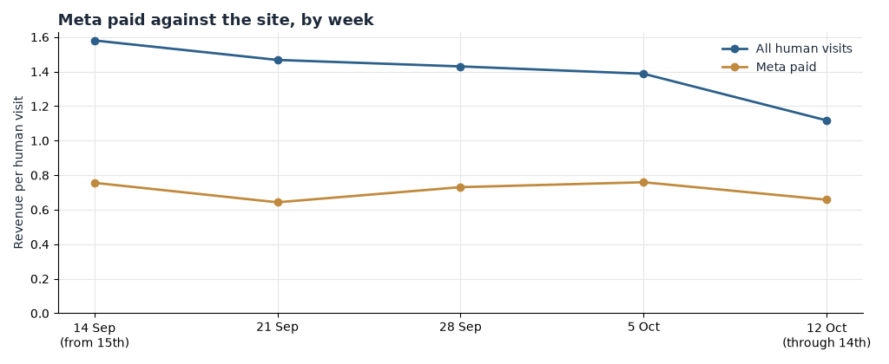

**HEATMAP**

**'47**

**Today's Plan: Stop Paying for Visits That Cannot Convert**

47brand.com

PREPARED OCTOBER 15, 2026 · DATA THROUGH OCTOBER 14, 2026

A one-hour ad-account intervention · three switches that change tomorrow's numbers

The full analysis found the leaks; this document is today's fix. Three switches across the two ad accounts, about an hour of work in total, each one taking effect as soon as it is made. The latest week of data (October 12–14) confirms all three leaks are still open: Google Ads campaign `21213618445` is still buying visits at $0.33 against $2.42 for every other Google campaign, the Meta team-market campaigns are still live at $0.03 a visit, and Meta ads are still landing shoppers on Fall Collection at $0.23 a visit. Nothing in this plan requires new creative, new code, or a meeting — it requires Ads Manager, Google Ads, and an hour.

> **Why these three and not the bigger ideas.** The mobile-cart fix and the cart-recovery rebuild are worth more in total, but they take days to ship and weeks to measure. The three moves below are the findings where the waste is happening today and stops tomorrow — the money for tomorrow's traffic is being committed tonight. Everything else stays queued for the week (section 06).

# Contents

01 · The Situation This Morning
02 · Action 1 — Pause Google Campaign 21213618445
03 · Action 2 — Pause the Meta Team-Market Campaigns
04 · Action 3 — Re-Point the Meta Ads Off Fall Collection
05 · How to Read Tomorrow
06 · The Rest of the Week
A · Data and Method

## 01 The Situation This Morning

The site ran 5,537 orders and $341,365 in the three days from October 12 through October 14 — about 1,846 orders a day, a little under the 2,042 a day of the full week of October 5. Google Ads is holding at $1.81 per visit in the latest week, as it has all month ($1.81–$2.38 every week), and search is steady at $1.90. The engine is fine; the leaks are specific settings inside paid. Three paid-traffic leaks are active in the latest week of data:

| Leak | Latest reading (October 12–14) | What it is worth |
| --- | --- | --- |
| Google Ads campaign `21213618445` | 9,405 visits produced 44 orders and $3,077 — $0.33 a visit, while every other Google campaign holds $2.01–$3.11 (window average $2.42) | Up to about $85,000 a month |
| Meta team-market campaigns ("…Market All Teams") | 10,059 visits produced 6 orders and $322 — $0.03 a visit, still running in Milwaukee, Cleveland, Los Angeles, Tampa Bay and Chicago | Up to about $60,000 a month |
| Meta ads landing on Fall Collection | 4,854 paid entries produced 14 buyers and $1,112 — $0.23 a visit at a 0.29% buyer rate, against collections that buy at 5–6% | Up to about $25,000 a month |

Table 1 — The three live leaks, with the numbers as of the most recent week of tracked data (October 12–14, a partial week). Sizes are monthly estimates from current volumes, not forecasts.

*Figure 1 — Revenue per human visit by week, Meta paid against the site average, 31 August – 14 October 2026. Meta paid has run every week at $0.52–$0.76 while the site held $1.12–$1.58; the latest week is $0.66 against $1.12.*

Each fix is a setting, not a project. None of them touches the storefront, the checkout, or the email programme.

## 02 Action 1 — Pause Google Campaign 21213618445

Owner: paid media. Time: about 20 minutes. This is the largest of the three. Every day it waits, roughly 3,100 paid visitors arrive from one campaign that has not converted above $0.50 a visit in any week of the record.

In Google Ads, this morning:

- Pull the search-terms report for campaign `21213618445`. It carried 9,405 visits in the latest three days at $0.33, 74,386 visits across the window at $0.34 — against $2.01–$3.11 for every other campaign in the same account.
- Pause the campaign, or negate the generic queries that are eating the budget, until the query mix is rebuilt. This campaign ran all month at roughly a seventh of its own account's rate; it is not an experiment finding its feet.
- Do not pause the account. Google Ads as a channel is healthy — $2.42 a visit across the window and $1.81 in the latest week — and it is the site's steadiest paid engine. The problem is one campaign, not the channel.
- While you are there, check why one campaign buys traffic its peers convert seven times better: mismatched landing page, broad match with no negatives, or a geo setting. The bundle records the id, not the query list — the search-terms report is the next click.

Expected result: if the freed budget re-spends at the rate the account's other campaigns already earn ($2.42 a visit), the change is worth up to about $85,000 a month at current volumes. Treat that as an upper bound — reallocated budget rarely converts instantly at the peer rate — but the campaign's $0.33 reads all month, so even a third of it is the cheapest money available today.

## 03 Action 2 — Pause the Meta Team-Market Campaigns

Owner: paid media. Time: about 15 minutes. The postseason team buys kept spend all month and are still live this week, at the worst reading in the account.

In Meta Ads Manager, this morning:

- Find the market campaigns — ad sets named "PR - W - LPV - Standard 7dc1dv - AUTOBID - MF 18+ - [market] - Broad Adv+ - AUTOPL - [market] Market All Teams" — currently running in Milwaukee (3,543 visits, $0.024 a visit in the latest week), Cleveland (2,812, $0.010), Los Angeles (2,493, $0.069), Tampa Bay (1,005, $0.037) and Chicago (84, $0). Together: 10,059 visits, 6 orders, $322 in three days; 66,553 visits and $2,075 across the window.
- Pause them. Do not rebuild them until a team actually advances deep into the postseason — the named-team creative in the window converted 42 orders from 57,305 visits, $0.04 a visit, against 1.5–1.8% for the broad carousels.
- Re-point the budget to the Purchase-objective campaigns already in the same account — "PR - W - PURCHASE - … - All Leagues DPAs" ($0.84–$1.54 in the latest week) and the All-Time Purchasers line ($1.07–$2.29). These are optimisation-objective buys (LPV) sitting next to purchase-objective buys; the budget belongs on the latter.
- Name every ad set in words; the numeric-ID rows in the same account ($0.39–$0.69 a visit) are unauditable as shipped, which is how a tier like this survives.

Expected result: if the re-pointed spend converts like the broad campaigns beside it (say $1.40 a visit against $0.03), the change is worth up to about $60,000 a month at current volumes. That assumes re-pointed traffic performs like the destination line's existing traffic — the upper bound, not a forecast.

## 04 Action 3 — Re-Point the Meta Ads Off Fall Collection

Owner: paid media. Time: about 15 minutes. Fall Collection is still a paid landing page and still ends the visit: 4,854 paid entries in the latest three days produced 14 buyers, $1,112 — $0.23 a visit at a 0.29% buyer rate.

In Meta Ads Manager, this morning:

- Find the ad sets whose destination is `/collections/fall-collection` — 76,300 Meta campaign-link entries landed there across the window at $0.35 a visit. Volume has already fallen week over week (18,111 entries in the week of September 7 to 4,854 last week), but what is left still burns.
- Do not pause the campaigns — change the destination URL to the collections that buy: Sale (6.25% buyer rate), Men's Franchise (5.26%) or Headwear (3.77%) in the same window.
- Check the DPA feeds while you are there: dynamic product ads should land on product pages, not on a collection that four in five social entries leave without a second pageview.
- If Fall Collection has to stay a landing page for a drop, give it a dated campaign with an end date — it should never be the resting destination.

Expected result: if re-pointed traffic converts like the destination's existing traffic at the site average of $1.43 a visit instead of $0.23, the change is worth up to about $25,000 a month at current volumes. Upper bound, because re-pointed bargain traffic rarely converts like organic traffic to the same page — but the gap is seven to one.

## 05 How to Read Tomorrow

Four numbers tell you whether the switches worked. Direction should be visible tomorrow; give it three or four days before judging size — this is a large site, so single orders barely move the rates (one order moves Google campaign `21213618445`'s weekly rate by about $0.007; one buyer moves Fall Collection's entry rate by 0.02 points on roughly 4,900 entries).

| Watch | Now | Target |
| --- | --- | --- |
| Google campaign `21213618445` revenue per visit | $0.33 last week ($0.25–$0.50 every week of the window) | Zero visits, or above $1.50 after the query rebuild |
| Meta team-market campaign visits | ~10,000 a week at $0.03 | Near zero — budget living in the Purchase campaigns |
| Meta paid revenue per visit | $0.66 last week ($0.64–$0.76 in-window) | Above $0.90 within a week |
| Orders vs the same day last week | 2,122 / 1,838 / 1,577 on Oct 12–14, against 2,053 / 1,750 / 1,698 on Oct 5–7 | Hold or rise |

Table 2 — The scoreboard for this plan. Revenue per visit is read on filtered, human-only traffic; channel is last touch.

One caution: if a playoff send, drop or restock lands inside the reading window, note it beside the numbers — the window's peak days (19 September, 20 September, 4 October) were game-calendar demand, and the calendar moves orders on its own.

## 06 The Rest of the Week

These are the larger plays from the Site Opportunity Report. They are deliberately not today's work — queue them once the three switches are on.

| When | Action | Size |
| --- | --- | --- |
| Thu | Ship the mobile cart-drawer fix: shipping cost and delivery date inside the drawer, a persistent cart, and express checkout above the line items. Mobile carts reach checkout 49.8% of the time against 75.6% on desktop. | Half the mobile gap ≈ $740,000 a month, upper bound |
| Thu | Refresh the mobile cart-recovery sequence SMS-first with a one-tap cart link; deep-link to express checkout. Mobile chains buy back at 5.7% against 7.7% on desktop. | Up to about $200,000 a month |
| Fri | Merchandise the cap-plus-tee bundle ($75–$95) on the top team pages; confirm the live free-shipping threshold on the storefront before any threshold nudge. | Up to about $420,000 a month |
| Fri | Verify the desktop checkout instrumentation (checkout-to-order of 21.3% against 48.3% on mobile reads as a break, not behaviour) and reconcile order matching — 7,445 window orders matched no visit. | Every other number depends on it |

Table 3 — The queue behind today's plan, drawn from the Site Opportunity Report's suggested 30 days.

## A Data and Method

Figures come from Heatmap visit, page, event and order records for 47brand.com, September 15 – October 14, 2026, with September 1 – 14 for context. "Last week" is the week starting October 12 (Monday–Wednesday, October 12–14; the partial week is labelled in every table).

Dead sessions — 1,868,538 visits, 42.5% of recorded traffic in the window — are excluded from every visit-based figure. No visit with an add to cart, a checkout or an order is ever excluded.

Channel is the channel of the link the visit arrived on (last touch); revenue per visit is on-site value and excludes ad spend, so the profit check for each action belongs in Ads Manager or Google Ads. Buyers are counted by device id.

55,725 of 63,170 window orders matched a non-dead tracked visit; 7,445 orders ($395,051) matched none and sit outside every channel table. There is no confirmed promotion calendar in the bundle; the peak days are read as game-calendar demand, and the marked-down share on them (1.5%) ran below the window (3.5%).

Every monthly dollar figure is an estimate from this window's volumes and assumes the change described; each is an upper bound, not a forecast. The Action 1 bound assumes freed budget re-spends at the account's peer-campaign rate ($2.42 a visit); Actions 2 and 3 assume re-pointed traffic converts like the destination line's existing traffic.

The last day of the report window is 14 October 2026. Sources: '47 Site Opportunity Report (October 15, 2026); latest-week figures re-run from the full analyst bundle for this site.
