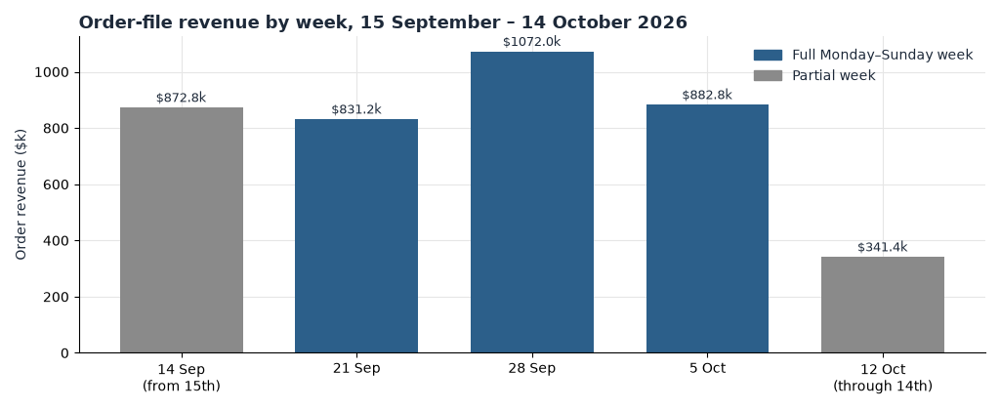
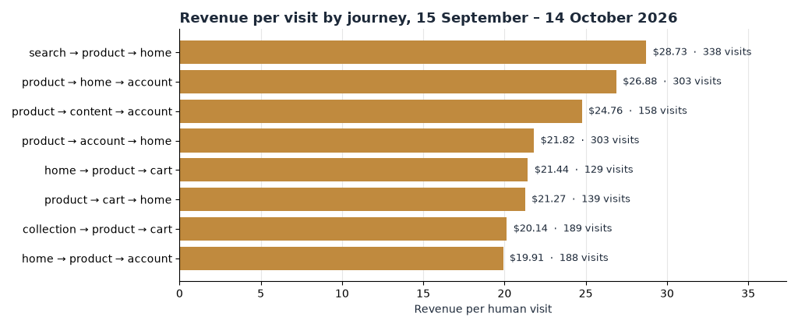

**HEATMAP · User Journey Opportunity Analysis**

**'47**

**User Journey Opportunity Analysis**

PREPARED OCTOBER 15, 2026 · DATA WINDOW SEPTEMBER 15 – OCTOBER 14, 2026

This report follows how shoppers actually move through 47brand.com — the paths they take from landing page to product, cart and order, where those paths leak, and what the journey data says about the month's soft middle. All figures come from tracked visits and matched orders for September 15 – October 14, 2026, with September 1 – 14 for context. About 90% of order revenue (88% of orders) matches a tracked human visit, and 2,606,326 dead sessions (41.4% of recorded traffic) are excluded throughout. The click-and-scroll pipeline record in this bundle is for the Fall Collection page (`/collections/fall-collection`), the site's largest paid landing.

> **How to read a journey.** A journey is the sequence of store pages in a visit, grouped as home (the site root), product (`/products/...`), collection (`/collections/...`), content (`/pages/...`), search, cart, account and other. Repeated views of the same class count once. On this bundle, `other` mostly holds product-style URLs stored with a full domain, including paid landing pages; it is only 0.2% of entries here, so the `/products/` share below is the product-entry story. '47's collections support quick-add, so a buying visit can be a single tracked page — "leaves after one page" means no second store page, not necessarily no order. Cart entries, which convert at 14.1%, are often one page by design.

# Contents

01 The Month in Journeys · 02 The Journeys That Make Money · 03 Where the Journeys Leak: The One-Page Landing · 04 How the NFL Weekends and the Soft Middle Reshaped the Funnel · 05 Returning Visitors, Quietly Carrying the Margin · 06 Behaviour Signals Worth Watching · 07 Where the Journey Data Points · A Data and Method

# 01 The Month in Journeys

Across the report window the store took 63,170 orders worth $4,000,227, at an average order of $63.32 and a median of $48.29. Human traffic ran 83% mobile, 11% desktop and 6% tablet, and arrived 39% from Meta ads, 25% from search, 19% direct and 10% from email and SMS. Beneath those totals, the journey data shows what a channel report cannot: two visits in three never move past one page class — and the ones that do are worth three to eight times as much.

| Measure | Value | Reading |
| --- | --- | --- |
| Orders / revenue | 63,170 / $4,000,227 | Average order $63.32, median $48.29 |
| Where visits land | 53% a `/products/` page · 30% a collection · 12% the homepage | Product and collection pages are the storefront; the homepage is a minority entry |
| Most common journey | One page class, then leaves | 1,706,420 visits (67%), ordering at 1.0%, $0.61 each |
| Best common journey | Product → collection → product | 71,008 visits, 7.0% order rate, $5.14 a visit |
| The homepage effect | Visits reaching the homepage at any point | 383,652 visits; 6.4% ordered, $4.27 each — against 1.4% and $0.92 for visits that never do |
| Second-product effect | Visits viewing 2, 3–4, 5–8, 9+ product pages | 4.2%, 6.3%, 9.3%, 11.7% ordered; $2.69, $4.74, $8.03, $11.84 a visit |
| Peak days | 19–20 September, 4 October | 2,923 orders a day at $1.56 a visit, against 2,106 and $1.43 otherwise |

Table 1 — Journey context for the report window, September 15 – October 14, human visits.

*Figure 1 — Order-file revenue by week, 15 September – 14 October 2026. The week of 14 September contains one pre-window day; the week of 12 October runs three days through 14 October. Full weeks inside the window ran $831,000–$1,072,000 against $1,031,000 in the last full pre-window week — a dip in the week of 21 September, one strong recovery week, then a soft October.*

# 02 The Journeys That Make Money

The default journey is to land on one page and stay there. The money sits in journeys that move: once a shopper crosses a page class — collection to product, product to homepage, anything to a second product — order rate and revenue per visit climb steeply.

*Figure 2 — Revenue per visit by journey pattern, 15 September – 14 October 2026. Gold bars: collection-to-product journeys and the review, search and FAQ readers.*

| Journey anywhere in the visit | Visits | Order rate | Revenue per visit |
| --- | --- | --- | --- |
| One page class only | 1,706,420 | 1.0% | $0.61 |
| Product page only | 1,065,730 | 1.3% | $0.75 |
| Reached a `/products/` page | 1,685,774 | 3.0% | $1.94 |
| Two different product pages | 254,830 | 4.2% | $2.69 |
| Three or four product pages | 144,640 | 6.3% | $4.74 |
| Five or more product pages | 67,056 | 9.8% | $8.81 |
| Collection → product | 341,179 | 6.0% | $4.20 |
| Reached the homepage mid-visit | 383,652 | 6.4% | $4.27 |
| Clicked reviews | 35,989 | 4.1% | $3.12 |
| Clicked search | 298,653 | 5.7% | $4.01 |
| Opened FAQ or accordion | 336,085 | 3.9% | $2.80 |

Table 2 — Journey patterns, 15 September – 14 October, all devices.

- Movement is the buying signature. The product → collection → product path converts at 7.0% ($5.14 a visit), and the smaller collection → product → home path at 24.2% ($14.99). Shoppers who leave a product, browse a collection and come back are comparing — and comparers buy.
- The second product view is the cheapest conversion on the store. Visits with exactly one product page convert at 1.9%; a second page triples order rate to 4.2% and value to $2.69; five or more product pages reach 9.8% and $8.81. Whatever produces the second product view — recommendations, related collections, the range grid — is doing the selling.
- The homepage works as a re-orientation stop, not just an entry. Visits that touch it mid-journey convert at 6.4% against 1.4% for visits that never do. A shopper who backs out to the homepage is re-finding their thread, not leaving.
- Proof-seeking is purchase intent. Review-clickers convert at 4.1% ($3.12 a visit), search-clickers at 5.7% ($4.01) and FAQ-readers at 3.9% — roughly double the site average each.
- Collections are a corridor, and most shoppers never walk it. Collection landings that stay on one class — 527,480 visits — convert at 0.16% and earn $0.11 a visit. The same shopper who takes one step into a product converts at 6.0%. The corridor only pays when it leads somewhere.

> **So what:** judge merchandising by the second product view it creates, not by landing-page traffic. Every element that moves a shopper from one page to the next works on the highest-value step in the journey. Moving two points of the 67% one-page visits into any second page class — about 34,000 visits a month — at the observed gap between $0.61 and $1.94 a visit is worth up to about $45,000 a month. Treat that as an upper bound: shoppers who browse further are partly different people.

# 03 Where the Journeys Leak: The One-Page Landing

Two visits in three see exactly one page class. That is partly by design — quick-add sells from a single collection page — but the leak is real where paid traffic lands on pages with no next step:

| Entry channel | Sessions | See one page only | Revenue per session |
| --- | --- | --- | --- |
| Social (Meta-led) | 1,796,035 | 77% | $0.51 |
| Direct | 879,506 | 72% | $0.87 |
| Campaign (email/ads) | 347,522 | 66% | $1.00 |
| Search (Google-led) | 712,287 | 48% | $1.80 |
| Website (internal) | 3,941 | 46% | $2.87 |

Table 3 — Entry sessions by channel and single-page share, pipeline coverage period. Entry sessions are a different denominator from human visits; compare rows inside this table only. Social combines the largest single-page share with the lowest value — search-led entries earn three and a half times more per session.

| Landing page | Entries | Entry-buyer rate | The page next door |
| --- | --- | --- | --- |
| `/collections/fall-collection` | 222,088 | 0.10% | `/collections/carhartt-camo` — 156,115 entries, 1.13% |
| `/pages/nfl` | 68,034 | 0.45% | `/collections/nfl` — 26,731 entries, 0.88% |
| `/collections/september-exclusive-47-clean-up` | 48,487 | 0.43% | `/collections/sale` — 8,378 entries, 2.0% |
| `/collections/everyday-franchise` | 26,933 | 0.17% | `/collections/headwear` — 20,752 entries, 3.5% |
| `/pages/the-everyday-franchise` | 6,940 | 0.04% | same campaign, content twin — both dead ends |
| `/collections/from-the-vault` | 16,103 | 0.22% | `/collections/mlb-sale` — 12,607 entries, 1.16% |

Table 4 — Landing pages that take volume and convert near zero, report window entries (page table, dead sessions included — compare within this table).

- Paid social lands on Fall Collection and stops. The page took 215,238 pipeline entry sessions; 89% ended without a second pageview and it earned $0.10 a session, with 212,557 of those sessions arriving from social at $0.09. This is the single largest landing target on the store — 5.4% of all window entries — converting at a tenth of a percent. The Site Opportunity Report specifies this leak as Opportunity 5 (stop paying to land shoppers on Fall Collection); the journey data adds that 88.7% of its entries never see a second page, so the page is not leaking at the cart — it is ending the journey at the door.
- The campaign dead ends are the same defect in four places. The Everyday Franchise campaign sends to a collection converting at 0.17% and a content page at 0.04%; From the Vault, a clearance-themed collection, converts at 0.22% next to `/collections/sale` at 2.0%. A destination that gives the visitor nothing to do next. These pages are specified in the Site Opportunity Report as Opportunity 6; the journey contribution is the pattern, not a new action list.
- The NFL content page underperforms its own collection. `/pages/nfl` takes 68,034 entries at 0.45%; the `/collections/nfl` page next door, with the same intent, converts at 0.88%.

> **So what:** the first page is the whole journey for paid traffic, and Fall Collection is the proof. Closing its entry-buyer rate to the Carhartt Camo rate next door — 0.10% to 1.13% — is worth up to about $145,000 a month on its 222,088 monthly entries, at the window's $63.32 average order. That assumes re-pointed or converted visitors buy like the neighbour's existing traffic; it is an upper bound, not a forecast.

# 04 How the NFL Weekends and the Soft Middle Reshaped the Funnel

The window gave up about 6% revenue a day against the pre-window fortnight ($133,341 against $141,775), and it was not a traffic story: human visits per day actually rose 1%. The change sits between the landing page and the cart.

| Funnel step | Pre-window (1–14 Sep) | Report window | Peak days (19–20 Sep, 4 Oct) |
| --- | --- | --- | --- |
| Visits per day | 83,273 | 84,291 | 106,182 |
| Orders per day (order file) | 2,195 | 2,106 | 2,923 |
| Visits adding to cart | 11.2% | 9.6% | 10.2% |
| Cart visits that order | 20.1% | 23.0% | 23.7% |
| Visit → order | 2.26% | 2.20% | 2.41% |
| Revenue per visit | $1.50 | $1.43 | $1.56 |

Table 5 — Funnel by phase, human visits. Peak days are the three highest-revenue days of the window.

- The leak moved upstream. Add-to-cart fell from 11.2% to 9.6% between the pre-window fortnight and the window, while cart-to-order improved from 20.1% to 23.0%. Part of the add-to-cart decline is traffic mix: Meta paid rose from 35.9% to 38.5% of visits and earns $0.72 a visit against $2.23 for search. The funnel itself is not broken; what arrives at it is worth less per visit.
- Whoever reaches the cart now converts better than before. The mid-window dip in the week of 21 September (Figure 1) recovered fully the following week, which argues against a site defect and for demand and mix.
- The peak days prove the drop mechanic. 19–20 September and 4 October — all NFL weekend dates — ran 106,182 visits and 2,923 orders a day, about 39% above a normal day, with conversion up and revenue per visit at $1.56. The lift is broad: direct ran $1.63 to $1.98 a visit, search $2.23 to $2.37, email $1.16 to $1.40, even Meta paid ticked up. A lift across every channel at once is a promotion or a code, not a retention story, and this bundle carries no promotion calendar to confirm it.

> **Watch out:** the checkout-started event is drifting. Checkouts per add-to-cart crept from 0.48 pre-window to 0.54–0.57 by mid-October while orders per checkout fell from about 0.45 to 0.37. There is no single break day, so this reads as a softening event definition rather than a behaviour change. Read the funnel at cart → order, which held between 20% and 24% in every phase.

# 05 Returning Visitors, Quietly Carrying the Margin

The new-versus-returning divide is steady: returning visitors convert about 0.6–0.7 points above new ones in every week of the window, and their revenue per visit runs roughly 30% higher. The base is also getting more loyal — returning visitors were 19.4% of pre-window traffic and 23.6% inside the window.

| All visitors | Week of 14 Sep (from 15th) | Week of 21 Sep | Week of 28 Sep | Week of 5 Oct | Week of 12 Oct (through 14th) |
| --- | --- | --- | --- | --- | --- |
| New: order rate | 2.24% | 2.08% | 2.03% | 2.03% | 1.63% |
| New: revenue per visit | $1.47 | $1.38 | $1.33 | $1.30 | $1.05 |
| Returning: order rate | 2.93% | 2.60% | 2.72% | 2.65% | 2.16% |
| Returning: revenue per visit | $1.95 | $1.76 | $1.76 | $1.67 | $1.31 |

Table 6 — New versus returning visitors by week, human visits. The final week contains three days.

- The premium is stable, not growing. Across the window, returning visits (597,112) earned $1.73 each against $1.38 for new visits. Both slid together in the partial final week, which is the soft October, not a returning-specific problem.
- The 30-day bought-before flag cannot measure repeat rate on this extract. It covers 155,355 visits and 54,749 of the window's 55,716 buying visits — the visit's own order lands inside its own 30-day window. The returning flag is the repeat measure this data supports.
- Email frequency compounds intent. Devices with three or more email/SMS visits in a half bought at 6.0% (first half) and 4.6% (second half), against 2.2% for single-clickers in both halves.

> **So what:** returning visitors are the margin on a store whose new-traffic mix is getting more expensive. The 30 days after purchase are the selling window — which is why the Site Opportunity Report specifies a replenishment flow as Opportunity 7. This report does not repeat that action list; it adds the journey evidence: the returning edge held all window, and the weekly returning-versus-new revenue-per-visit gap is the number to watch for early warning.

# 06 Behaviour Signals Worth Watching

Five smaller journey signals ran through the period. None is an emergency; each points at a merchandising or measurement question worth answering before the next campaign.

- **Review readers buy, and they are cooling.** Visits that clicked reviews converted at 4.1% ($3.12 a visit) — double the site rate — but the rate slid from 5.8% pre-window to 3.5% in the second half. Keep reviews prominent on the product page and check what changed for review readers in October.
- **Internal search is the loudest intent signal on the store.** 298,653 visits clicked search and converted at 5.7% ($4.01); even search-entry visits convert at 3.0%. The Site Opportunity Report owns the fix (Opportunity 6: 73.7% of searches end on the results page); the journey data confirms the demand is there.
- **The bottom of the product page underperforms.** Visits scrolling 91–100% of a product page convert at 2.0%, against 4.2% for the 76–90% band. Whatever sits at the very bottom is not helping; sizes, reviews and the buy button should live above it.
- **Quick product looks still buy.** 368,857 visits spent under 15 seconds on a product page and converted at 1.6%. Quick-add means the decision happened on the collection. Judge product-page changes on the second product views they create, not on dwell time.
- **Desktop slid below mobile in the second half.** Desktop order rate fell from 2.21% to 1.77% and revenue per visit from $1.69 to $1.32 between the first and second halves, while mobile held at 2.2%. Desktop visits added to cart more often (13.7% in the second half) but ordered less — friction at the moment of commitment, worth watching beside the mobile cart work in Opportunity 2.

One absence: the popup interaction flag fired on a handful of visits all window, so email-capture performance is effectively unmeasured. Treat list-growth capture as unknown, not as zero.

# 07 Where the Journey Data Points

Read together, the journey evidence ranks the opportunities differently from traffic volume. The largest leaks sit at the first page: paid shoppers who land, see one screen and leave. Then the campaign dead ends, then the weekend drop calendar.

| Priority | Move | Journey evidence |
| --- | --- | --- |
| 1 · High | Fix the Fall Collection landing or stop paying for it (Opportunity 5) | 222,088 entries at 0.10% against 1.13% next door; 89% see one page; up to about $145,000 a month (upper bound) |
| 2 · High | Give the one-page visit a visible next step: range grids, best sellers, related collections in the first two mobile screens | 67% of visits see one page class at $0.61; any second page triples value; two points moved is up to about $45,000 a month (upper bound) |
| 3 · High | Re-point the campaign dead ends (Opportunity 6) | `/pages/nfl` 0.45%, Everyday Franchise 0.17% and 0.04%, From the Vault 0.22% — 118,010 monthly entries next to collections converting at 1–3.5%; up to about $50,000 a month (upper bound) |
| 4 · Medium | Plan NFL weekends as drops: each game weekend is a revenue instrument | Peak days ran 2,923 orders a day, +39%, with conversion up in every channel |
| 5 · Medium | Fix the measurement record before scaling spend (Opportunity 8) | Checkout-started drifts while cart → order holds; 41.4% of raw traffic is dead sessions; the bought-before flag self-counts |

Table 7 — Opportunity ranking from journey evidence. Dollar figures are monthly estimates from the window's volumes and are upper bounds.

Track weekly:

- Share of visits seeing a second page class: 32% now.
- Fall Collection entry-buyer rate against Carhartt Camo: 0.10% against 1.13%.
- Visits adding to cart: 9.6% now, against 11.2% pre-window.
- Returning-visitor revenue per visit against new: $1.73 against $1.38.

These four numbers catch every leak this analysis found.

# A Data and Method

- Figures are visit- and order-level aggregates from 47brand.com tracking for the stated windows: the report window is September 15 – October 14, 2026 (the last day of the bundle's data is October 14, 2026); September 1 – 14 is pre-window context; the peak days (September 19–20, October 4) are a subset of the window, not a fourth slice. Visits are available from September 1 and orders from August 16.

- Dead sessions (one pageview or none, no click, no scroll, no order) are excluded from visit-level tables; 2,606,326 of them (41.4% of recorded traffic) are counted separately. A visit with an add to cart, a checkout or an order is never excluded. The page table (Table 4) still includes dead sessions, and the entry-channel table (Table 3) counts pipeline entry sessions, a different denominator from human visits — the two are never mixed in one sentence.

- About 88% of orders and 90% of order revenue match a tracked human visit; visit-level revenue understates order totals slightly.

- Journeys use the order of page classes in each visit, with consecutive repeats counted once. Page class `other` holds URLs outside the standard prefixes, including product URLs stored with a full domain; on this bundle it is 0.2% of entries, so the `/products/` share stands as the product-entry story. Because collections support quick-add, a buying visit can be a single tracked page.

- Channel is last touch: the link the visit arrived on. Revenue per visit is on-site value only; ad spend is not in the bundle.

- Shopper history is counted by device, not named account; cross-device shoppers count as two. The 30-day bought-before flag counts a visit's own order inside its own window, so it cannot measure repeat rate on this extract; the returning flag is used instead.

- Sizes in this report are monthly estimates from current volumes and are upper bounds, not forecasts; each states the behaviour it assumes (for example, that re-pointed traffic converts like the destination's existing visitors). Shoppers who browse further are partly different people.

- There is no confirmed promotion calendar in the bundle. The peak-day lift is broad across channels, consistent with a promotion or code; the three peak days are NFL weekend dates. The checkout-started event shows a gradual drift rather than a single break, so funnel comparisons in this report read at cart → order.
