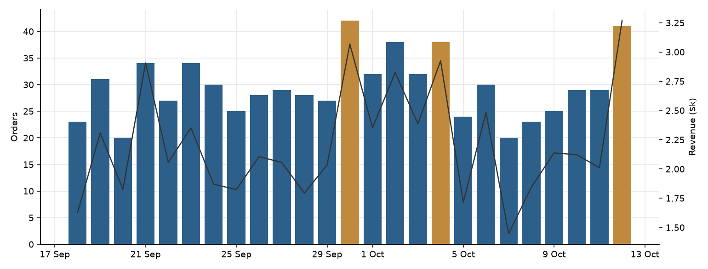
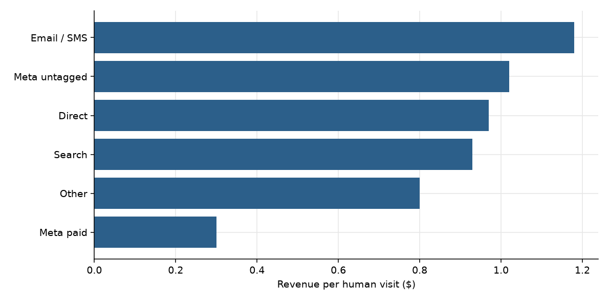
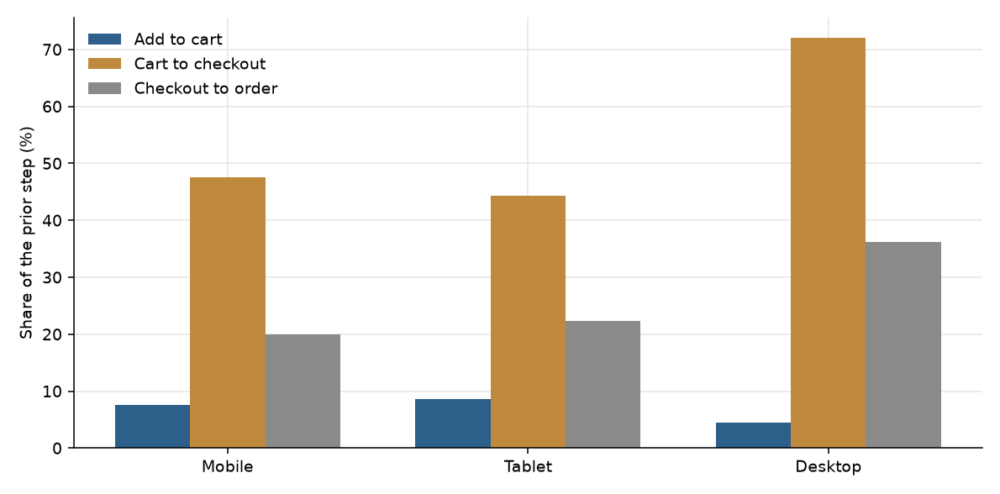
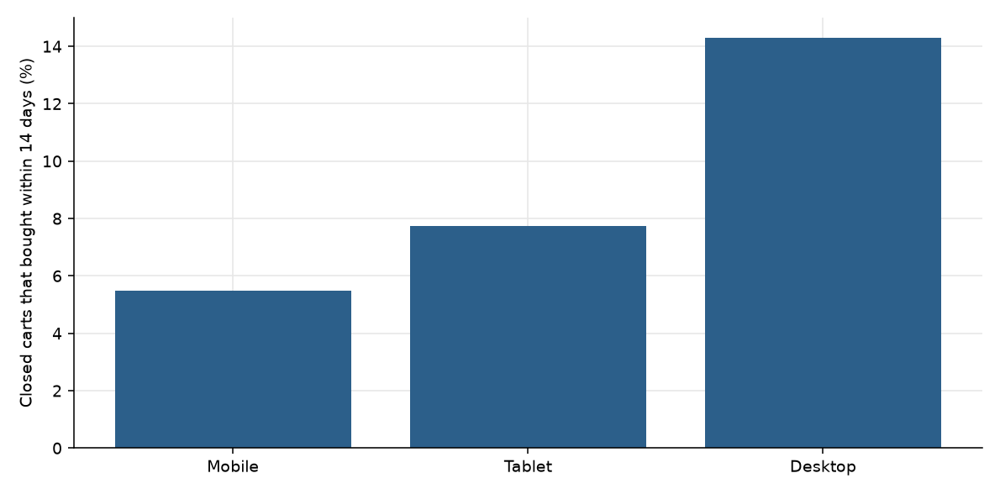
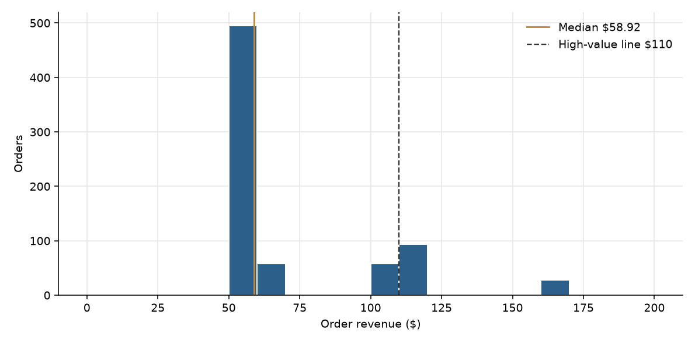
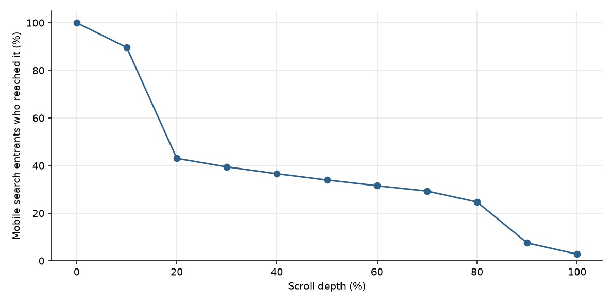

**HEATMAP**

**Tennis Premium**

**Site Opportunity Report**

tennispremium.co | 13 September – 12 October 2026 | Prepared 13 October 2026

This report re-analyses orders, traffic, campaigns, products, and the click and scroll record for tennispremium.co. The stored rows run 18 September through 12 October: 739 orders, $55,342.86 revenue, and 92,400 human visits. The page the engine analysed is search (`/search`). Dead sessions are 63,499, 40.7% of raw traffic, and they are out of the visit rates below.

# Contents

The biggest wins, first · At a glance · The month in numbers · Opportunity 1 — Move Meta budget off the $0.14 campaign · Opportunity 2 — Stop landing paid social on search · Opportunity 3 — Finish more mobile checkouts · Opportunity 4 — Bring back the carts that already exist · Opportunity 5 — Most orders are one pair · Opportunity 6 — The search page loses people at the first scroll · Opportunity 7 — Collection pages that take traffic and do not sell · Opportunity 8 — Dead sessions and untagged Meta · Worth watching · What's working · Suggested next 30 days · Method and caveats

# The biggest wins, first

**1. Shift Meta spend toward the campaigns that already earn more per visit.**

The largest tagged Meta campaign took 12,415 visits and earned $0.28 a visit. Campaign 120247639185240278 took 5,902 visits, 231 add-to-cart visits and 114 checkouts, and earned $0.14 a visit on 10 orders. The New Balance 9060 / 530 campaign earned $0.51 on 3,586 visits. (Opportunity 1)

**2. Land paid social on the homepage, not on search.**

Search took 11,473 entry sessions and 29 orders. Social is 10,121 of those sessions and earned $0.17 each. The same social source on the homepage earned $0.85 on 9,059 sessions and 106 orders. (Opportunity 2)

**3. Fix the mobile checkout, where almost all of the traffic is.**

Mobile is 75,918 of 92,400 human visits. It adds to cart more often than desktop (7.6% against 4.5%) and then completes checkout 20% of the time, against 36% on desktop. (Opportunity 3)

**4. Run a cart recovery flow on the carts the site already created.**

2,874 abandoned-cart chains had a closed 14-day window. 176 bought, 6.1%, for $14,226. Desktop bought 14.3% of the time; mobile bought 5.5%. (Opportunity 4)

**5. Give the one-pair buyer a second add.**

495 of 739 orders sit in the $50–$60 band, and 555 orders paid within 10% of the lead item price. The median order is $58.92. (Opportunity 5)

**6. Put products in the first screen of search, and stop sending paid traffic to empty collection landings.**

On mobile, 43% of search entrants reach 20% scroll depth and 2.8% reach the bottom. The Adidas Samba collection took 2,492 entries and 1 entry buyer. (Opportunities 6 and 7)

# At a glance

| **#** | **Finding** | **Recommended action** | **Priority** |
|----|----|----|----|
| 1 | Meta campaign 120247639185240278: 5,902 visits, 231 cart-adds, 114 checkouts, 10 orders, $0.14 a visit. The NB 9060 / 530 campaign earns $0.51 on 3,586 visits. | Move budget from the $0.14 campaign to the $0.48–$0.51 sets. | High |
| 2 | Search: 11,473 entry sessions, 29 orders, 76% leave on one page. Social on search earns $0.17; social on the homepage earns $0.85. | Point paid social at the homepage and at product pages that already sell. | High |
| 3 | Mobile is 82% of human visits. Checkout completion is 20% on mobile and 36% on desktop. | Walk the mobile checkout on a phone and remove the step where carts die. | High |
| 4 | 2,874 closed abandoned carts; 6.1% bought within 14 days ($14,226). Mobile recovery is 5.5%. | A two-week cart and checkout recovery flow, mobile first. | High |
| 5 | 495 orders (67%) are $50–$60. 555 orders pay about the price of the lead item. Median $58.92, average $74.89. | A second-pair or accessory offer in the cart drawer, next to the pair already chosen. | High |
| 6 | Mobile search: 43% reach 20% depth, 7.5% reach 90%, 2.8% reach the bottom, on 9,560 entry sessions. | Show selling products in the first mobile screen of search. | High |
| 7 | Adidas Samba collection: 2,492 entries, 1 entry buyer. Search itself converts entry sessions at 0.25%. | Stop using those URLs as ad landings. Add a next product step on the collection. | Medium |
| 8 | 63,499 dead sessions, 40.7% of raw traffic. Untagged Meta is 18,286 human visits at $1.02, while tagged Meta paid is 55,069 visits at $0.30. | Filter dead sessions in every report. Tag every Meta ad before reading campaign quality. | Medium |
| 9 | Email / SMS: 963 visits, 17 orders, $1.18 a visit, the highest revenue per visit of any channel. | Grow the flows. The order count is still small, so read the rate as directional. | Medium |
| 10 | Peak revenue days are 30 September ($3,068), 4 October ($2,925) and 12 October ($3,271). No promotion calendar is in the bundle. | Check those three days in the ad account before calling them a site change. | Watch |

# The month in numbers

| | |
| --- | --- |
| Orders | 739 |
| Revenue | $55,342.86 |
| Average order | $74.89 |
| Median order | $58.92 |
| Human visits | 92,400 |
| Dead sessions | 63,499 (40.7% of raw traffic) |
| Orders per day | 29.6 across 25 days with rows |
| Revenue per human visit | $0.60 |
| Visit-matched orders | 708 of 739 |

The device split below uses the 708 orders matched to a human visit. The other 31 orders are in the order file and not in that visit split.

| Week starting | Days with rows | Orders | Revenue |
| --- | ---: | ---: | ---: |
| 14 September | 3 | 74 | $5,759 |
| 21 September | 7 | 207 | $15,168 |
| 28 September | 7 | 237 | $17,386 |
| 5 October | 7 | 180 | $13,759 |
| 12 October | 1 | 41 | $3,271 |

The first and last weeks are partial. The full weeks move from 207 orders to 237 and then 180. Revenue follows the same shape.

There is no prior fortnight in this extract. Orders and visits both start on 18 September, five days after the named window opens. There is no promotion calendar, so the three peak days are a fact about revenue, not yet a cause.

# Opportunity 1 — Move Meta budget off the $0.14 campaign

## What we saw

Tagged Meta paid is 55,069 human visits, 225 orders, 0.41% conversion, $0.30 revenue per visit. Direct is $0.97 on 11,260 visits. Email / SMS is $1.18 on 963 visits.

| Campaign | Visits | Add to cart | Checkouts | Orders | Revenue per visit |
| --- | ---: | ---: | ---: | ---: | ---: |
| 120248675144390278 | 12,415 | 883 | 308 | 50 | $0.28 |
| (no campaign tag) | 12,290 | 993 | 469 | 108 | $0.63 |
| 120238511190660278 | 7,952 | 528 | 194 | 30 | $0.29 |
| 120247639185240278 | 5,902 | 231 | 114 | 10 | $0.14 |
| Adidas Samba / Adizero presentation | 5,720 | 336 | 126 | 21 | $0.26 |
| 120248309718050278 | 3,856 | 290 | 128 | 18 | $0.39 |
| Leonardo catalog | 3,700 | 275 | 117 | 15 | $0.27 |
| NB 9060 / 530 | 3,586 | 249 | 110 | 23 | $0.51 |
| 120243442151930278 | 2,707 | 165 | 84 | 17 | $0.48 |

## Why it matters

If the 5,902 visits on the $0.14 campaign earned the $0.51 of the New Balance campaign, the gap is about $2,200 in this window. That is an upper bound. It assumes those visits would convert like the New Balance campaign's existing traffic, and it ignores ad cost, which is not in the bundle.

## Recommended actions

Pause or cut 120247639185240278. Move that budget to the New Balance 9060 / 530 set and to 120243442151930278. Keep the largest campaign (12,415 visits at $0.28) only if its cost per order still clears; on site value alone it is below the untagged Meta visits.

# Opportunity 2 — Stop landing paid social on search

## What we saw

| Page | Entry sessions | Orders | Revenue per session | Single-page sessions |
| --- | ---: | ---: | ---: | ---: |
| Homepage | 14,037 | 186 | $0.99 | 5,178 |
| Search | 11,473 | 29 | $0.18 | 8,708 |

Social alone:

| Landing | Social sessions | Orders | Revenue | Revenue per session |
| --- | ---: | ---: | ---: | ---: |
| Homepage | 9,059 | 106 | $7,713 | $0.85 |
| Search | 10,121 | 24 | $1,715 | $0.17 |

Search sessions are 88% social (10,121 of 11,473). 8,708 of 11,473 search sessions see one page.

## Why it matters

If search's social sessions earned the homepage's $0.85, the gap is about $6,900 in this window. That is an upper bound. It assumes the same people, sent to the homepage, would buy like the people who already arrive on the homepage from social.

## Recommended actions

Change the Meta landing URL from `/search` to the homepage, or to a product page that already has orders. Do not use search as an ad landing.

# Opportunity 3 — Finish more mobile checkouts

## What we saw

| Device | Human visits | Orders | Conversion | Revenue per visit | Add to cart | Cart to checkout | Checkout to order |
| --- | ---: | ---: | ---: | ---: | ---: | ---: | ---: |
| Mobile | 75,918 | 550 | 0.72% | $0.54 | 7.6% | 47.5% | 20.0% |
| Tablet | 10,800 | 91 | 0.84% | $0.64 | 8.6% | 44.3% | 22.3% |
| Desktop | 5,682 | 67 | 1.18% | $0.98 | 4.5% | 72.0% | 36.2% |

Mobile adds to cart more often than desktop and then loses the checkout. Desktop is 6% of human visits, so it is not where the orders are.

## Why it matters

Mobile checkout produced 550 orders from 2,754 checkout visits. If those checkouts completed at the desktop rate of 36.2%, that is about 446 more orders. At the mobile revenue per order of $74 ($40,781 / 550), the upper bound is about $33,000. That assumes the extra checkouts would close like desktop checkouts, which they may not. Treat the number as a ceiling, and start with the step that drops from cart to checkout (47.5% on mobile, 72% on desktop).

## Recommended actions

Place a phone order on the mobile checkout and record the step that stops. Check shipping cost, payment methods, and the cart drawer against that step. Desktop is the comparison, not the project.

# Opportunity 4 — Bring back the carts that already exist

## What we saw

Closed abandoned-cart chains (`final = 1`), followed 14 days:

| Device | Chains | Returned | Purchased | Purchase rate | Revenue |
| --- | ---: | ---: | ---: | ---: | ---: |
| Mobile | 2,369 | 1,513 | 130 | 5.5% | $10,621 |
| Tablet | 400 | 273 | 31 | 7.8% | $2,475 |
| Desktop | 105 | 75 | 15 | 14.3% | $1,130 |
| All | 2,874 | 1,861 | 176 | 6.1% | $14,226 |

1,013 of the 2,874 did not return (35%). Recovered buyers spent $80.83 on average ($14,226 / 176), above the $74.89 site average.

## Why it matters

Each extra point of purchase rate on these 2,874 chains is about 29 orders. At $80.83, that is about $2,300. An upper bound, and only for the chains whose 14-day window had already closed.

## Recommended actions

Send a two-message recovery flow to cart abandoners, mobile first. Add a separate note for people who reached checkout. Desktop already recovers at 14.3%; copy what that message is doing only after the mobile flow exists.

# Opportunity 5 — Most orders are one pair

## What we saw

| Band | Orders |
| --- | ---: |
| $50–$60 | 495 |
| $60–$70 | 58 |
| $100–$110 | 58 |
| $110–$120 | 93 |
| $160–$170 | 28 |
| Under $110 | 611 of 739 |
| Paid within 10% of the lead item | 555 of 739 |

The high-value line in the bundle is $110, the 90th percentile of order revenue rounded to the nearest 10. It is not a shipping threshold. No shipping or gift line was confirmed on the page.

The lead products by revenue in the window are New Balance 530 ($2,374, 27 orders), On Cloud Runner 2 ($1,649, 22), Adidas Adizero Evo SL beige ($1,295, 15), On Cloud Running black ivory ($1,207, 18), and Asics Gel Kayano 14 ($1,196, 17).

## Why it matters

Every extra $1 on all 739 orders is $739 in the window. A second pair on 10% of the 555 single-item orders, at the median $58.92, is about $3,300. Both figures are upper bounds. The second assumes a second pair at the median price, which the cart does not do today.

## Recommended actions

Put one in-stock second pair, or a low-priced add-on, in the cart drawer next to the pair already chosen. The drawer already carries an "otros clientes también" list with +ADD controls. Measure whether those adds are seen.

# Opportunity 6 — The search page loses people at the first scroll

## What we saw

The analysed page is `https://tennispremium.co/search`. On mobile, 9,560 entry sessions:

| Depth | Share who reached it |
| --- | ---: |
| 10% | 89.6% |
| 20% | 43.0% |
| 50% | 33.9% |
| 90% | 7.5% |
| 100% | 2.8% |

## Why it matters

More than half of mobile search entrants never pass the first fifth of the page. Combined with Opportunity 2, the page is both the wrong landing and a page that hides its products below the fold.

## Recommended actions

If search must stay in the nav, put product results in the first mobile screen, above any empty state or long header. Do not spend to send new visitors there.

# Opportunity 7 — Collection pages that take traffic and do not sell

## What we saw

Entry buyers are visits that entered on the page and bought. Rates under about 10 buyers are directional.

| Page | Entries | Entry buyers | Entry-buyer rate |
| --- | ---: | ---: | ---: |
| Homepage | 13,695 | 197 | 1.44% |
| Search | 10,285 | 10 | 0.10% |
| /collections/all | 6,134 | 28 | 0.46% |
| Adidas performance Evo product | 4,927 | 9 | 0.18% |
| /collections/new-balance-530 | 3,485 | 7 | 0.20% |
| /collections/adidas-samba | 2,492 | 1 | 0.04% |
| /collections/dama | 2,046 | 12 | 0.59% |

These entry counts come from `page_period` and will not match the entry-session counts in Opportunity 2. Compare rows inside this table only.

## Why it matters

The Samba collection takes 2,492 entries and one entry buyer. Using it as a landing spends the visit. A rate on one buyer is directional.

## Recommended actions

Remove `/collections/adidas-samba` and `/search` from ad URLs. On collection pages that keep traffic, put a product with orders in the first row.

# Opportunity 8 — Dead sessions and untagged Meta

## What we saw

Raw traffic is 155,899 visits. 63,499 are dead sessions: one page or none, no click, no scroll, no order. That is 40.7%.

Tagged Meta paid is 55,069 human visits at $0.30. A separate Meta slice with no campaign tag is 18,286 human visits, 251 orders, $1.02 a visit. Until those visits carry a campaign id, the $0.30 figure is not the whole Meta account.

## Why it matters

A channel report that leaves dead sessions in will show a conversion rate about 40% lower than the human-visit rate. A budget move based on tagged campaigns alone ignores 12,290 Meta visits that have no campaign id and earn $0.63.

## Recommended actions

Exclude dead sessions in the ad account's on-site reporting. Require a campaign id on every Meta URL. Re-read Opportunity 1 after the untagged visits have a campaign.

# Worth watching

Email / SMS is the highest revenue per visit ($1.18) on 963 visits and 17 orders. The rate is real enough to grow the flow, and too thin to rank above the Meta and search moves.

Desktop converts at 1.18% and completes 36% of checkouts, on 5,682 visits. It is the benchmark for mobile, not a traffic source to buy.

Peak days are 30 September (42 orders, $3,068), 4 October (38 orders, $2,925) and 12 October (41 orders, $3,271). The bundle has no promotion calendar, so these days are not yet explained.

# What's working

The homepage takes 14,037 entry sessions and 186 orders in the entry-by-channel table, and 13,695 entries with 197 entry buyers in `page_period`. Social on the homepage earns $0.85 a session. That is the landing the paid account should use.

The New Balance 9060 / 530 campaign and campaign 120243442151930278 earn $0.51 and $0.48 a visit, above the other large Meta sets. They are the sets to fund.

Desktop checkout completion, at 36%, shows the checkout can close when the device is not a phone.

# Suggested next 30 days

| Week | Action | Owner |
| --- | --- | --- |
| 1 | Cut campaign 120247639185240278. Move the budget to the $0.48–$0.51 sets. Change Meta landing URLs off `/search` and off the Samba collection. | Media |
| 1 | Place one mobile checkout order and note the step that stops. | Site |
| 2 | Turn on a two-message cart recovery flow for mobile abandoners. | CRM |
| 2 | Put one second-pair offer in the cart drawer and record whether +ADD is tapped. | Site |
| 3 | Put product results in the first screen of search. | Site |
| 4 | Tag every Meta ad. Re-read campaign revenue per visit with dead sessions excluded. | Media |

# Method and caveats

The report window in the bundle is 13 September through 12 October 2026. Every order and visit row falls on 18 September through 12 October, 25 days. There is no prior fortnight to compare.

Visit rates use human visits. Dead sessions are one page or none, no click, no scroll, and no order: 63,499 of 155,899 raw visits. `page_period` still includes them, so entry counts in Opportunity 7 are not the same denominator as the human-visit channel table or the entry-by-channel table. Those tables are not mixed in one sentence.

Channel is last touch. Ad spend is not in the bundle, so revenue per visit is on-site value only. Dollar gaps are upper bounds for this window's volumes.

The analysed page is search, idsitehsr 65706970. Scroll, and the pipeline click tables, describe that page. The homepage comparison uses entry-by-channel.

`orders.item_title` is the highest-priced line. A single-item order here means `paid_to_item` between 0.9 and 1.1. The $110 line is the in-window 90th percentile rounded to the nearest 10, not a shipping threshold. No shipping or gift line was confirmed on the site for this report.

Trigger chains with `final = 1` are the ones whose 14-day follow-up had closed by the analysis run on 13 October. Later hits are still open and are not in Opportunity 4.

The device funnel's 708 orders are the orders matched to a human visit. The order file has 739.
