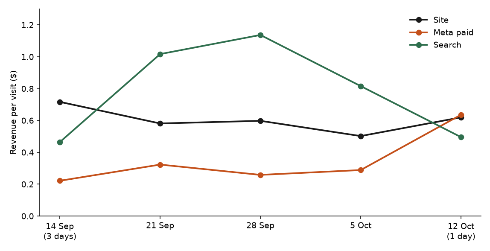

**HEATMAP · Today's Plan: Move the $0.05 Campaign, and Take Paid Meta Off Search**

Tennis Premium · tennispremium.co
Prepared 13 October 2026 | Data through 12 October 2026
A one-hour ad-account intervention · three switches that change tomorrow's numbers

---

**Tennis Premium**

**Today's Plan: Move the $0.05 Campaign, and Take Paid Meta Off Search**

PREPARED 13 OCTOBER 2026 · DATA THROUGH 12 OCTOBER 2026

The full analysis found the leaks. This document is today's fix. Three switches in Meta Ads Manager, about an hour in total, each in effect the day it is made. The last full week (starting 5 October) still shows all three: campaign 120247639185240278 took 2,127 visits and earned $0.05; paid Meta still landed 1,512 visits on search with no orders; and 22% of Meta visits arrived without a campaign id. 12 October is one day of a new week, and it does not close the week of 5 October. Nothing here needs new creative, new code, or a meeting.

> **Why these three and not the bigger ideas.** Mobile checkout and cart recovery are worth more in total, and they take days to build. The three moves below are the ones where tomorrow's Meta budget is committed tonight. Everything else stays queued for the week (section 06).

# Contents

| 01 The Situation This Morning | 02 Action 1 — Pause the $0.05 Campaign |
|----|----|
| 03 Action 2 — Point Paid Meta Off Search | 04 Action 3 — Tag Every Ad |
| 05 How to Read Tomorrow | 06 The Rest of the Week |
| A Data and Method |  |

# 01 The Situation This Morning

The order file shows 180 orders and $13,759 in the week of 5 October, about 26 orders a day on a $76.44 average. On human visits that same week the site earned $0.50 a visit. Search earned $0.82 on 1,539 visits, and direct earned $0.83 on 3,617. Meta paid earned $0.29 on 15,951 visits.

| **Leak** | **Latest reading (week starting 5 October)** | **What it is worth** |
|----|----|----|
| Campaign 120247639185240278 | 2,127 visits, 61 cart-add visits, 29 checkouts, 1 order, $114, $0.05 a visit. Across the window: 5,902 visits, 10 orders, $0.14. | About $1,160 for a week like this one |
| Paid Meta landing on search | 1,512 human visits, 0 orders. The same channel on other pages: 14,434 visits, 61 orders, $0.31 a visit. | About $470 for the week |
| Meta visits with no campaign id | 4,555 of 20,506 Meta visits (22%) had no campaign id and earned $0.86. One ad sent the literal `{{campaign.name}}` (23 visits). | Unknown until the visits are tagged |

Table 1 — The three live leaks, week of 5 October. Sizes are upper bounds from that week's volumes.

*Figure 1 — Revenue per human visit by week. Meta paid sat at $0.22–$0.32 for four weeks, then $0.64 on 12 October, which is one day. Search was the high line in the full weeks ($0.82–$1.14). 14 September is three days.*

Each fix is a setting. None of them changes the site, the checkout, or the email programme.

# 02 Action 1 — Pause the $0.05 Campaign

Owner: paid media. Time: about 15 minutes. The campaign got larger every full week (227 visits, then 1,133, then 2,069, then 2,127) and the week of 5 October was its weakest full week, at $0.05.

In Meta Ads Manager, this morning:

- Pause campaign 120247639185240278. Last week it put 61 visits in the cart and 29 into checkout, and one of them ordered.

- Move that budget to campaign 120248309718050278 ($0.60 on 1,054 visits and 6 orders last week) and to the New Balance 9060 / 530 set ($0.37 on 942 visits and 5 orders last week; $0.51 on 3,586 visits across the window).

- Leave 120243442151930278 running. It earned $0.48 across the window and $0.33 last week on 703 visits. It is a second home for the budget if the $0.60 set cannot take it.

- 12 October, one day, shows 346 visits and 2 orders on 120247639185240278 ($0.50). That day does not replace the week of 2,127 visits and 1 order. Do not rebuild the creative today. The carts are there. The orders are not.

Expected result: if those 2,127 visits had earned the $0.60 that 120248309718050278 earned in the same week, the gap is about $1,160. That assumes the moved visits convert like that campaign's existing traffic. Ad cost is not in the bundle, so this is on-site value only, and an upper bound.

# 03 Action 2 — Point Paid Meta Off Search

Owner: paid media. Time: about 20 minutes. Paid Meta that entered on search took 1,512 human visits last week and no orders. On 12 October it took another 269 visits and no orders.

- Find the ads whose destination is `/search`. Change the destination to the homepage. Do not pause the ads.

- The window's entry-session table, a different count from the human visits above, is why the homepage is the destination: social on the homepage earned $0.85 on 9,059 entry sessions and 106 orders. Social on search earned $0.17 on 10,121 entry sessions and 24 orders.

- Leave product URLs that already sell. The New Balance 9060 / 530 campaign is one of them. The change is the search URL.

Expected result: if the 1,512 search visits had earned the $0.31 that other paid Meta landings earned last week, the gap is about $470 for the week. An upper bound. The homepage's social visitors may differ from the search visitors.

# 04 Action 3 — Tag Every Ad

Owner: paid media. Time: about 15 minutes. Last week 4,555 Meta visits had no campaign id, 22% of Meta visits, and they earned $0.86 against $0.29 for tagged Meta paid. Until they carry an id, the $0.05 campaign cannot be separated from the visits that earn.

- Add a UTM template at the ad-account level: source, medium, campaign id, ad set id, ad id. Include boosted posts and Advantage+ sets.

- One link last week arrived as the literal `{{campaign.name}}` (23 visits, 1 order, $60). That macro did not resolve. Fix it in the same pass.

- While the ad sets are open, check location targeting against the search page. Across the window that page's entry sessions are Colombia 10,393 with 28 orders, and the United States 690 with no orders. Poland, Argentina, Spain, and Ireland are each under 100 sessions and also have no orders on that page. The country split is the whole window, not a weekly series. If the store does not ship to the United States, exclude it. If it does, flag the 690 sessions to e-commerce.

Expected result: from tomorrow, a Meta visit can be credited to a campaign. The untagged visits earned more than the tagged ones last week, so this switch is not a pause. It is what makes Actions 1 and 2 readable.

# 05 How to Read Tomorrow

Five numbers say whether the switches worked. Direction should show in three or four days. Give the size a week. One order moves Meta paid's weekly revenue per visit by about half a cent, on last week's 15,951 visits.

| **Watch** | **Now** | **Target** |
|----|----|----|
| Visits to campaign 120247639185240278 | 2,127 in the week of 5 October | Zero |
| Paid Meta visits that enter on search | 1,512 last week, 0 orders | Zero |
| Share of Meta visits with a campaign id | 78% last week (15,951 of 20,506) | Above 95% |
| Meta paid revenue per visit | $0.29 last week ($0.22–$0.32 the three weeks before) | Above $0.45 |
| Orders | 180 in the week of 5 October | Hold or rise |

Table 2 — The scoreboard. Revenue per visit is on human visits, dead sessions excluded.

One caution: the three highest-revenue days are 30 September, 4 October, and 12 October, and the bundle has no promotion calendar. If a code, a restock, or a launch lands inside the reading window, note it beside the numbers. It will move orders on its own. 12 October already did: 41 orders and $3,271 in one day.

# 06 The Rest of the Week

These are the larger plays from the Site Opportunity Report. They are the week's queue, once the three switches are on.

| **When** | **Action** | **Size** |
|----|----|----|
| Tue | Place one order on the mobile checkout and record the step that stops. Mobile completes 20% of checkouts; desktop completes 36%. | The desktop rate on mobile's checkouts is a ceiling of about $33,000. Start at cart to checkout. |
| Wed | A two-message cart recovery flow, mobile first, plus a note for checkout starters. 6.1% of 2,874 closed carts bought. | Each extra point is about 29 orders, about $2,300 |
| Thu | One second-pair or low-priced add in the cart drawer, next to the pair already chosen. 555 of 739 orders paid within 10% of the lead item. | 10% of those 555 at the $58.92 median is about $3,300 |
| Fri | Selling products in the first screen of search. On mobile, 43% of search entrants reach 20% depth. | The page change. Action 2 already stops paying to land there. |

Table 3 — The queue behind today's plan, from the Site Opportunity Report. Sizes are upper bounds for this window.

# A Data and Method

- Figures come from the Tennis Premium full bundle, 13 September through 12 October 2026. Order and visit rows start 18 September, so there is no prior fortnight. "Last week" is Monday 5 October through Sunday 11 October. 12 October is one day of the next week.

- The 180 orders and $13,759 are the order file. Revenue per visit uses human visits. Dead sessions are one page or none, no click, no scroll, and no order: 63,499 of 155,899 raw visits. The two counts are not mixed in one sentence.

- Channel is last touch. Ad spend is not in the bundle, so revenue per visit is on-site value only. The dollar gaps assume the moved visits earn what the destination already earns. They are upper bounds.

- The search-page country split is entry sessions on the analysed page across the whole window. It is not a weekly series.

- No promotion calendar is in the bundle. The $110 line in the Site Opportunity Report is the 90th percentile of order revenue, not a shipping threshold.
