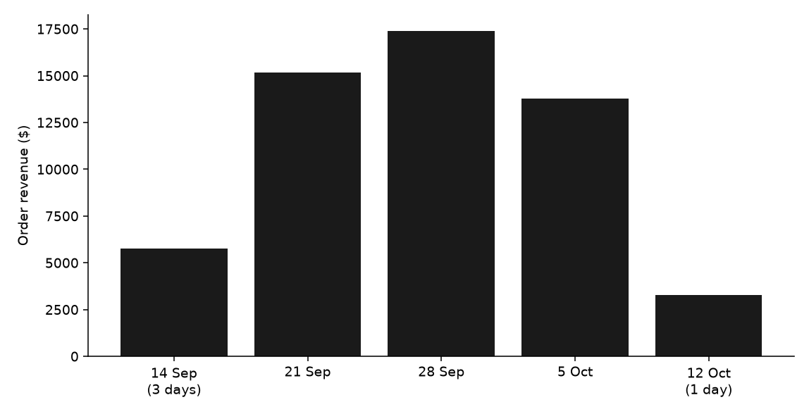
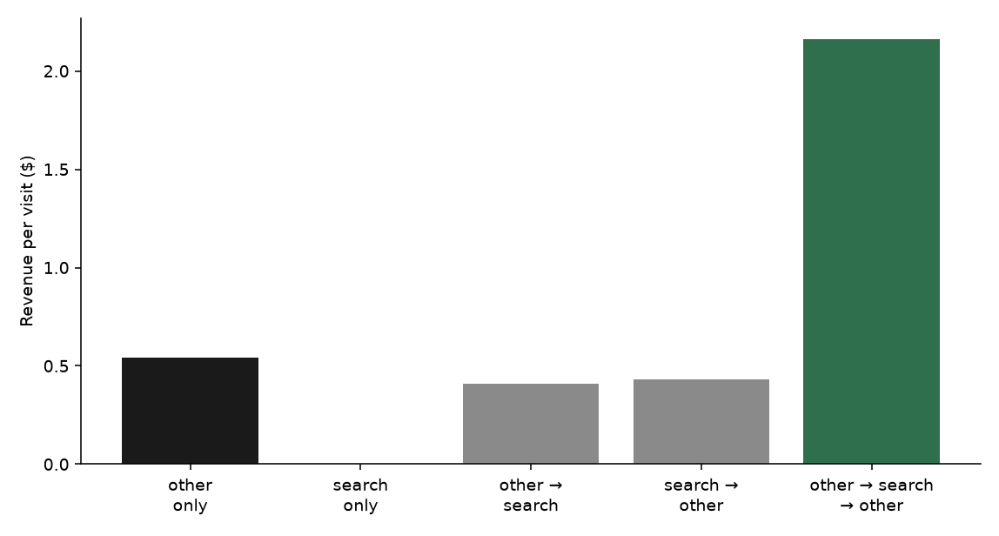

**HEATMAP · User Journey Opportunity Analysis**

Tennis Premium · tennispremium.co
Prepared 13 October 2026 | Data window 13 September – 12 October 2026
Site behaviour, funnel and shopper-journey analysis · 25 days of tracked visits

---

**Tennis Premium**

**User Journey Opportunity Analysis**

PREPARED 13 OCTOBER 2026 · DATA WINDOW 13 SEPTEMBER – 12 OCTOBER 2026

This report follows how shoppers move through tennispremium.co: the paths the tracker recorded, where a visit that only sees search earns nothing, and where a search in the middle of a visit earns $2.16. Figures are human visits and the orders matched to them, 18 September through 12 October 2026. The order file has 739 orders and $55,342.86. 708 of those orders match a human visit, and those visits carry $53,275. Dead sessions are 63,499 of 155,899 raw visits (40.7%) and they are out of the rates below.

> **How to read a journey.** A journey is the sequence of page classes in a visit. Consecutive repeats of a class count once. On this site the stored classes are `other`, `search`, and `cart`. Homepage, collection, and product URLs were not tagged as their own class: `saw_home`, `saw_product`, `saw_collection`, and `n_prod` are zero on every human visit. Entry URLs still name those pages, and this report uses them for where a visit lands. A quick-add can place an order from one tracked page, so one class is not "no order".

# Contents

| 01 The Month in Journeys | 02 The Journeys That Make Money |
|----|----|
| 03 Where the Journeys Leak | 04 How the Period Reshaped the Funnel |
| 05 Returning Visitors | 06 Behaviour Signals Worth Watching |
| 07 Where the Journey Data Points | A Data and Method |

# 01 The Month in Journeys

The order file is 739 orders and $55,342.86, average $74.89, median $58.92. On the 92,400 human visits the matched picture is 708 orders and $53,275, $0.58 a visit. The journey string cannot say how often a visit saw a product. It can say what happened to search.

| **Measure** | **Value** | **Reading** |
|----|----|----|
| Orders / revenue | 739 / $55,343 in the order file · 708 / $53,275 on human visits | 31 orders are not in the visit split |
| Where entry sessions land | Homepage 14,037 · search 11,473 · /collections/all 5,384 | Entry sessions, a different count from the 92,400 human visits |
| Most common journey | `other` only | 81,930 visits (89%), 0.72% ordered, $0.54 each |
| Search as the whole visit | `search` only | 4,895 visits, 0 orders, $0 |
| Best common journey | `other → search → other` | 2,833 visits, 2.68% ordered, $2.16 each |
| Search inside a visit | Any journey that includes search and another class | The round trip is the one that earns |
| Second product | Not measured | `n_prod` is 0 on every visit |
| Peak days | 30 September, 4 October, 12 October | $0.68 a visit on those three days, against $0.58 for all human visits |

Table 1 — The month, from human visits unless the row says entry sessions or the order file.

*Figure 1 — Order-file revenue by week. 14 September is three days. 12 October is one day ($3,271, 41 orders).*

# 02 The Journeys That Make Money

The classifier recorded eight journeys with 50 or more visits. Six of them are large enough to read. The one that earns is the visit that leaves `other`, opens search, and comes back.

| **Journey** | **Visits** | **Orders** | **Order rate** | **Revenue per visit** |
|----|---:|---:|---:|---:|
| other only | 81,930 | 590 | 0.72% | $0.54 |
| search only | 4,895 | 0 | 0% | $0.00 |
| other → search | 1,371 | 8 | 0.58% | $0.41 |
| search → other | 644 | 3 | 0.47% | $0.43 |
| search → other → search | 484 | 7 | 1.45% | $0.84 |
| other → search → other | 2,833 | 76 | 2.68% | $2.16 |
| other → cart → other | 72 | 17 | 23.6% | $18.85 |

Table 2 — Journeys with at least 50 human visits. The cart round trip is under 100 visits, so its rate is directional.

*Figure 2 — Revenue per human visit. Search as the whole visit is $0. The same search between two other pages is $2.16.*

- `other` only is 89% of human visits and $0.54. It holds the homepage, the collections, and the products, because those URLs were not given their own class.

- Search as the whole visit is 4,895 human visits and no orders. Opening search and leaving it (`other → search`, 1,371 visits) earns $0.41, close to the one-class visit.

- Coming back (`other → search → other`) is 2,833 visits at $2.16, four times the one-class visit, on a count large enough to read.

- `other → cart → other` is 72 visits at $18.85. The direction is clear and the count is small.

> **So what.** The second product view is not in this extract, so it cannot be the measure. The measure that is here is whether search sends the shopper back to another page. A search that ends the visit earns nothing. A search in the middle of the visit earns $2.16.

# 03 Where the Journeys Leak

Entry sessions, from `entry-by-channel`. These counts are not the human-visit totals above.

| **Entry** | **Sessions** | **Orders** | **Revenue per session** | **Single-page share** |
|----|---:|---:|---:|---:|
| Homepage | 14,037 | 186 | $0.99 | 37% |
| Search | 11,473 | 29 | $0.18 | 76% |
| /collections/all | 5,384 | 26 | $0.40 | 49% |
| Adidas Samba collection | 2,389 | 3 | $0.07 | 65% |
| New Balance 9060 collection | 685 | 1 | $0.09 | 68% |

Table 3 — Entry sessions. The homepage is the page beside search.

The same pattern shows up on product URLs that take a crowd and do not sell. Each of these had no entry orders: Vans Hylane negra (524 sessions), Adidas Nastase blanco verde (523), New Balance 9060 negro gris (520), Nike Zoom negro beige (451). The page beside them is the homepage, at $0.99 on 14,037 entry sessions.

On human visits the entry class `search` is 6,023 visits, 10 orders, $0.11. The entry class `other` is 86,234 visits, 693 orders, $0.61. That is the same leak as Opportunity 2 in the Site Opportunity Report, read as a journey: the visit that starts on search rarely becomes another class, and when the journey is search alone it places no order.

> **So what.** If the 4,895 search-only human visits had earned the $0.54 of an `other`-only visit, the gap is about $2,600 in this window. That is an upper bound. The shoppers who already take the round trip are partly different people, so the $2.16 rate is not the assumption here.

# 04 How the Period Reshaped the Funnel

Rows start 18 September. The first half of the window is 18–27 September (10 days). The second half is 28 September–12 October (15 days). Peak is the three highest-revenue days and overlaps those halves. Orders here are the 708 matched to a human visit.

| **Phase** | **Visits / day** | **Orders / day** | **Add to cart** | **Checkout / cart** | **Order / checkout** | **Revenue per visit** |
|----|---:|---:|---:|---:|---:|---:|
| First (10 days) | 3,231 | 26.5 | 8.2% | 45% | 22% | $0.61 |
| Second (15 days) | 4,006 | 29.5 | 7.2% | 50% | 21% | $0.56 |
| Peak (3 days) | 4,383 | 38.3 | 7.1% | 49% | 25% | $0.68 |
| All human visits | 3,696 | 28.3 | 7.6% | 48% | 21% | $0.58 |

Table 4 — Human visits. Checkout per cart did not jump while orders stayed flat, so this is not an event-definition break.

The second half is more traffic: 4,006 visits a day against 3,231. Conversion eased from 0.82% to 0.74%, and revenue per visit from $0.61 to $0.56. The step that stays low is order per checkout, 22% then 21%. That is Opportunity 3 in the Site Opportunity Report: mobile completes checkout 20% of the time, desktop 36%. The peak days lift orders per day to 38 and revenue per visit to $0.68, with no promotion calendar in the bundle to name the cause.

# 05 Returning Visitors

The returning flag is the measure this extract supports. A returning human visit earned $0.71 against $0.55 for a new visit, on 16,696 returning visits and 75,704 new ones. The order rate is 0.96% against 0.72%.

| **Week starting** | **New visits** | **New revenue per visit** | **Returning visits** | **Returning revenue per visit** |
|----|---:|---:|---:|---:|
| 14 September (3 days) | 6,745 | $0.68 | 738 | $1.03 |
| 21 September | 20,409 | $0.55 | 4,414 | $0.74 |
| 28 September | 22,569 | $0.57 | 5,942 | $0.72 |
| 5 October | 21,689 | $0.48 | 4,904 | $0.60 |
| 12 October (1 day) | 4,292 | $0.60 | 698 | $0.75 |

Table 5 — Human visits by the returning flag. Returning stays ahead in every week. The gap in the full weeks is $0.15 to $0.19.

`bought_before` is not a repeat rate here. That class is 2,338 visits and 698 of the 708 buying visits. The visit's own order is inside the flag. The standards file says to use `ret` when those two counts meet, and that is what this section uses.

> **So what.** Returning is worth more, and it is not twice as much. A plan that speaks to the 16,696 returning visits is working a $0.16 gap, about $2,700 if they were brought up to nothing beyond what they already earn. The larger journey gap is still the search-only visit.

# 06 Behaviour Signals Worth Watching

Kept where the rate differs from the rest of the site and the count is large enough.

| **Signal** | **Visits** | **Revenue per visit** | **The rest of the site** |
|----|---:|---:|---:|
| Clicked the menu | 22,607 | $1.98 | $0.12 on 69,793 visits with no menu click |
| Clicked add | 6,779 | $6.12 | $0.14 on 85,621 visits with no add click |
| Clicked a size | 3,684 | $3.35 | $0.46 on 88,716 visits with no size click |
| 26 or more clicks | 3,644 | $5.26 | $0.11 on 24,297 visits with no click |
| Used search during the visit | 8,053 | $1.27 | $0.51 on 84,347 visits with no search |

Table 6 — Click flags are keyword matches on the selector. They describe the visit. They do not prove the click caused the order. Shoppers who already intend to buy are the ones who open the menu, pick a size, and add.

The search row is the useful one next to section 02. A visit that uses search earns $1.27. A visit whose journey is search alone earns $0. The search earns when it is not the whole visit.

Reviews (11 visits) and FAQ (157 visits, 2 orders) are too small to rank. A popup click is 188 visits.

# 07 Where the Journey Data Points

Cross-references name the Site Opportunity Report. This is not a second action list.

| **Move** | **Journey evidence** |
|----|----|
| Stop paying to land on search (Opportunity 2) | 4,895 search-only human visits, 0 orders. Entry sessions on search: 11,473, $0.18, 76% one page. Homepage entry sessions: $0.99. |
| Make search a step back to a product, not the end of the visit | `other → search → other` is $2.16 on 2,833 visits. `other → search` with no return is $0.41. |
| Walk the mobile checkout (Opportunity 3) | Order per checkout is 22% then 21% across the two halves. The leak did not move when traffic rose. |
| Read the size click on the product page | 3,684 visits that click a size earn $3.35, against $0.46. The journey class for the product page itself is missing. |

Four numbers to track each week, on human visits:

- Search-only journeys, and whether they stay at zero orders.
- Revenue per visit on `other → search → other`, against the $2.16 in this window.
- Order per checkout, against the 21% in the second half.
- Returning revenue per visit, against the $0.15–$0.19 gap over new visits.

# A Data and Method

- The bundle window is 13 September through 12 October 2026. Order and visit rows start 18 September. There is no prior fortnight.

- Visit rates use human visits. Dead sessions are one page or none, no click, no scroll, and no order. `entry-by-channel` counts entry sessions and is not mixed with human-visit rates in one sentence. `page_period` includes dead sessions and is not used for the rates above.

- The journey class list is `other`, `search`, and `cart`. `saw_home`, `saw_product`, `saw_collection`, `coll_to_prod`, and `n_prod` are zero on every human visit, so this report does not estimate a second-product effect.

- `bought_before` contains 698 of 708 buying visits. Repeat purchase is read from the returning flag.

- Channel is last touch. Ad spend is not in the bundle. Dollar gaps are upper bounds. The three peak days have no promotion calendar in the bundle.

- Click flags match selector text. A visit with an add click is a visit that clicked, not a count of units added.
