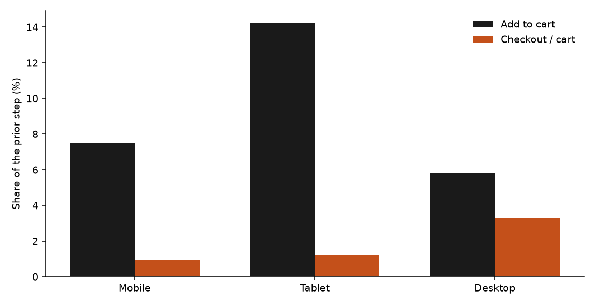
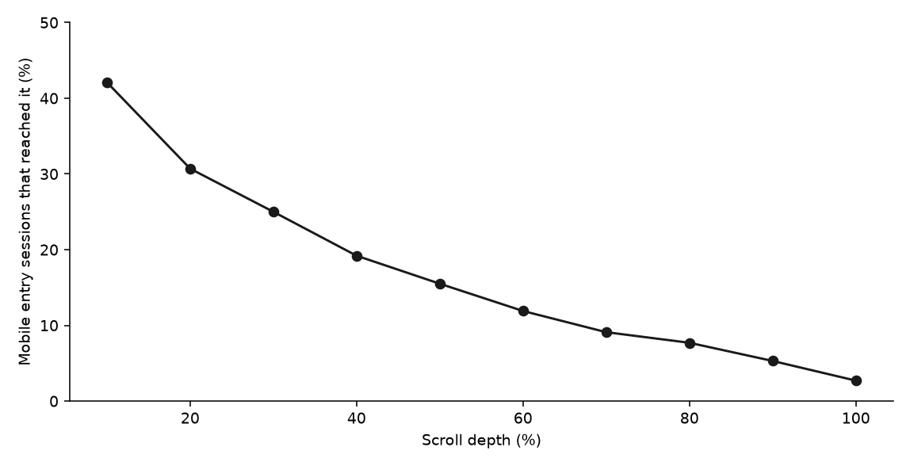

**HEATMAP**

**Vitasei**

**Site Opportunity Report**

vitasei.com.co | 13 September – 12 October 2026 | Prepared 13 October 2026

This report re-analyses traffic, campaigns, and the homepage click and scroll record for vitasei.com.co. The visit rows cover all 30 days. Human visits are 53,286. Dead sessions are 49,875, 48.3% of 103,161 raw visits. The order table has no rows for this site, so revenue, average order, and conversion to purchase are not in this report. The page the engine analysed is the homepage.

# Contents

The biggest wins, first · At a glance · The month in numbers · Opportunity 1 — The order feed is empty · Opportunity 2 — Carts almost never become a checkout · Opportunity 3 — Paid Meta adds to cart and stops · Opportunity 4 — The homepage loses people at the first scroll · Opportunity 5 — Dead sessions are half the raw traffic · Worth watching · What's working · Suggested next 30 days · Method and caveats

# The biggest wins, first

**1. Put Vitasei's orders back into the warehouse before any revenue decision.**

`udp_conversions` has no rows for this site in 2026. The visit file shows 4,207 add-to-cart visits and 47 checkout visits, and zero orders to attach to them. (Opportunity 1)

**2. Walk the step between cart and checkout.**

4,207 human visits added to cart. 47 reached checkout, 1.1%. Mobile is 3,299 of those carts and 30 checkouts. (Opportunity 2)

**3. Read paid Meta on carts, not on orders, until the order feed is back.**

Meta paid is 13,023 human visits and 1,410 cart-adds (10.8%), then 3 checkouts. Search is 18,319 visits, a lower cart rate (3.3%), and 15 of the 47 checkouts. (Opportunity 3)

**4. Put a product in the first screen of the homepage.**

On mobile, 42% of homepage entrants reach 10% scroll depth and 31% reach 20%. (Opportunity 4)

**5. Take dead sessions out of every rate.**

49,875 dead sessions are 48.3% of raw traffic. A rate that includes them is about half the human-visit rate. (Opportunity 5)

# At a glance

| **#** | **Finding** | **Recommended action** | **Priority** |
|----|----|----|----|
| 1 | No orders in `udp_conversions` for idsite 5933 in 2026. 4,207 cart-adds and 47 checkouts have no order to match. | Restore the Shopify order feed, then re-read this window. | High |
| 2 | 4,207 human visits added to cart. 47 reached checkout (1.1%). Mobile: 30 checkouts from 3,299 carts. | Place one order on a phone and record the step after add-to-cart. | High |
| 3 | Meta paid: 13,023 visits, 1,410 cart-adds, 3 checkouts. Search: 18,319 visits, 609 cart-adds, 15 checkouts. | Keep the spend. Judge it on checkout once orders exist. Do not pause from a zero-order table. | High |
| 4 | Homepage, mobile: 42% reach 10% depth, 31% reach 20%, 2.7% reach the bottom, on 4,343 entry sessions. | Move a selling product into the first mobile screen. | High |
| 5 | 49,875 dead sessions, 48.3% of raw traffic. | Exclude them in every report. | Medium |

# The month in numbers

| | |
| --- | --- |
| Orders | 0 in the order table |
| Revenue | $0 |
| Human visits | 53,286 |
| Dead sessions | 49,875 (48.3% of 103,161 raw visits) |
| Add-to-cart visits | 4,207 (7.9% of human visits) |
| Checkout visits | 47 (1.1% of add-to-cart visits) |
| Returning human visits | counted in the visit file; the repeat rate is not used here |
| Days with visit rows | 30 |

There is no weekly order table. The daily-orders chart is omitted because the order file is empty.

The two contexts that change the month: there is no order revenue to compare with a prior fortnight, and the demand the visit file can see stops between cart and checkout.

# Opportunity 1 — The order feed is empty

## What we saw

The order extract for 14 August through 12 October returned no rows. A direct count of `udp_conversions` for this site from 1 January 2026 also returned no rows. The visit file for the report window still records commerce events:

| | Human visits | Add to cart | Checkout |
| --- | ---: | ---: | ---: |
| All devices | 53,286 | 4,207 | 47 |
| Mobile | 43,773 | 3,299 | 30 |
| Tablet | 4,236 | 602 | 7 |
| Desktop | 5,277 | 306 | 10 |

## Why it matters

No revenue figure in this report is a size. An upper bound needs an order. Until the feed is restored, a campaign with carts and a campaign with checkouts cannot be ranked in dollars.

## Recommended actions

Confirm the Shopify order webhook or pixel for vitasei-col.myshopify.com is writing to the warehouse. Re-export this window after the first orders appear. Do not pause ads on the basis of a zero-order table.

# Opportunity 2 — Carts almost never become a checkout

## What we saw

| Device | Human visits | Add to cart | Cart rate | Checkouts | Checkout / cart |
| --- | ---: | ---: | ---: | ---: | ---: |
| Mobile | 43,773 | 3,299 | 7.5% | 30 | 0.9% |
| Tablet | 4,236 | 602 | 14.2% | 7 | 1.2% |
| Desktop | 5,277 | 306 | 5.8% | 10 | 3.3% |
| All | 53,286 | 4,207 | 7.9% | 47 | 1.1% |

Tablet adds to cart at 14.2% against 7.5% on mobile. Desktop then reaches checkout more often (3.3% of its carts, on only 10 checkouts, so that rate is directional). Mobile is where the carts are.

## Why it matters

The drop sits between cart and checkout. 4,160 of the 4,207 cart visits never record a checkout. The dollar size of that drop is unknown until orders are stored. The count is not.

## Recommended actions

Place one order on a phone, from the homepage add-to-cart, and write down the step that stops. Check whether checkout is a domain the tracker does not see. If the tracker is the gap, fix it in the same pass as Opportunity 1.

# Opportunity 3 — Paid Meta adds to cart and stops

## What we saw

| Channel | Human visits | Add to cart | Cart rate | Checkouts |
| --- | ---: | ---: | ---: | ---: |
| Search | 18,319 | 609 | 3.3% | 15 |
| Meta paid | 13,023 | 1,410 | 10.8% | 3 |
| Meta untagged | 8,470 | 893 | 10.5% | 6 |
| Direct | 7,200 | 511 | 7.1% | 13 |
| Other | 4,858 | 512 | 10.5% | 8 |
| Email / SMS | 1,416 | 272 | 19.2% | 2 |

Channel is last touch. Meta paid adds to cart more often than search and then records 3 checkouts. Search records 15 of the 47 checkouts on a lower cart rate. Email / SMS has the highest cart rate, on 1,416 visits and 2 checkouts, so that rate is directional.

## Why it matters

There is no order revenue to turn this into a dollar gap. The on-site reading is that paid Meta creates carts (1,410) and almost none of them reach a tracked checkout (3). Search creates fewer carts and more of the checkouts.

## Recommended actions

Leave the campaigns on until orders are in the warehouse. When they are, rank Meta paid against search on revenue per visit, not on the zero in today's order file. Tag the 8,470 untagged Meta visits in the same pass, so the next read can name a campaign.

# Opportunity 4 — The homepage loses people at the first scroll

## What we saw

The analysed page is the homepage. Mobile entry sessions, summed across the weeks in the scroll table (4,343):

| Depth | Share that reached it |
| --- | ---: |
| 10% | 42% |
| 20% | 31% |
| 50% | 16% |
| 100% | 2.7% |

*Figure 2 — Share of mobile homepage entry sessions that reached each depth. These are entry sessions on the homepage, not the 53,286 site human visits.*

## Why it matters

Most mobile entrants do not pass the first screen. A product below that line is seen by the 31% who reach 20% depth. The revenue of moving it up cannot be priced until orders exist.

## Recommended actions

Put one selling product, with its add-to-cart, in the first mobile screen. The harvest already names 98 `Agregar al carrito` controls on this page. Measure whether the first screen is one of them.

# Opportunity 5 — Dead sessions are half the raw traffic

## What we saw

49,875 dead sessions, one page or none, no click, no scroll, no order. That is 48.3% of 103,161 raw visits in the window. The rates above exclude them.

## Why it matters

A report that uses raw visits will show about half the cart rate of the human-visit table. That changes which channel looks weak.

## Recommended actions

Filter dead sessions out of the ad-account comparison and out of any lookalike seed built from all visits.

# Worth watching

Email / SMS: 1,416 human visits, 19.2% add to cart, 2 checkouts. The cart rate is the highest of the channels. The checkout count is too small to rank it.

Tablet: 14.2% add to cart on 4,236 visits, then 7 checkouts. Same shape as mobile, on a smaller base.

# What's working

Search is the largest human-visit channel (18,319) and it holds 15 of the 47 checkouts. It is the comparison for paid Meta, not a channel to cut.

The homepage harvest is complete: 2,183 names, desktop and mobile renders, and the add-to-cart controls are named.

# Suggested next 30 days

| Week | Action | Owner |
| --- | --- | --- |
| 1 | Restore the order feed for vitasei-col.myshopify.com. Confirm one live order lands in the warehouse. | Data |
| 1 | Place one mobile order and record the step between cart and checkout. | Site |
| 2 | Move one selling product into the first mobile screen of the homepage. | Site |
| 2 | Add a campaign id to every Meta ad, including the untagged 8,470 visits. | Media |
| 3 | Re-export this window once orders exist, and rank Meta paid against search on revenue per visit. | Analysis |

# Method and caveats

The report window is 13 September through 12 October 2026. Visit rows cover all 30 days. There is no prior fortnight of orders, because the order table has none.

Visit rates use human visits. Dead sessions are one page or none, no click, no scroll, and no order. The homepage scroll curve uses entry sessions on the analysed page and is not mixed with the site human-visit totals.

Channel is last touch. Ad spend is not in the bundle. No dollar gap is stated, because `udp_conversions` returned no rows for idsite 5933 from 1 January through 12 October 2026. The high-value line of $10 in the bundle is the export's default when the order percentile is empty. It is not a shipping threshold.

Checkout counts of 47, and any cell under about 10 checkouts, are thin next to the cart counts. The cart-to-checkout rate is the finding. The device split of those 47 is directional on desktop and tablet.

The analysed page is the homepage, idsitehsr 59744352.
