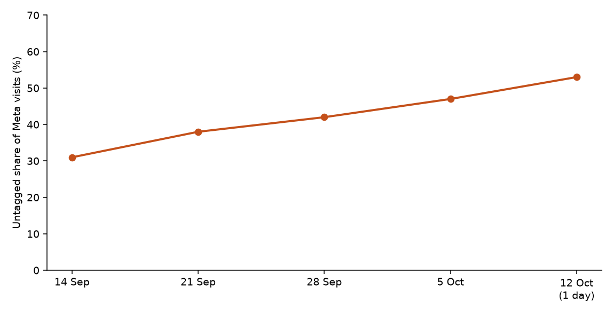

**HEATMAP · Today's Plan: Tag the Meta Visits Before Anyone Pauses Them**

Vitasei · vitasei.com.co
Prepared 13 October 2026 | Data through 12 October 2026
A one-hour ad-account intervention · one switch that qualifies today

---

**Vitasei**

**Today's Plan: Tag the Meta Visits Before Anyone Pauses Them**

PREPARED 13 OCTOBER 2026 · DATA THROUGH 12 OCTOBER 2026

The full analysis found the leaks. This document is today's fix. One switch qualifies. The other two do not, because the order table is empty and a pause or a new landing URL would be a guess. The week of 5 October still shows the switch that does qualify: 2,159 of 4,573 Meta visits (47%) arrived with no campaign id, and that share has risen for four weeks. Nothing here needs new creative or new code.

> **Why this one and not the bigger ideas.** Restoring the order feed and walking the cart-to-checkout step are the work that makes revenue readable. They are not an Ads Manager setting, and they are queued in section 06. Pausing a campaign because it shows zero orders would treat a missing feed as a failed ad.

# Contents

| 01 The Situation This Morning | 02 Action 1 — Tag Every Meta Ad |
|----|----|
| 03 How to Read Tomorrow | 04 The Rest of the Week |
| A Data and Method |  |

# 01 The Situation This Morning

The order file is empty, so this morning has no orders and no revenue to report. On human visits, the week of 5 October still had carts: search 4,192 visits and 129 cart-adds, Meta paid 2,414 visits and 292 cart-adds, untagged Meta 2,159 visits and 221 cart-adds. Checkouts that week were 6 on search, 2 on Meta paid, and 0 on untagged Meta.

| **Leak** | **Latest reading (week starting 5 October)** | **What it is worth** |
|----|----|----|
| Meta visits with no campaign id | 2,159 of 4,573 Meta visits (47%), 221 cart-adds, 0 checkouts. The share was 31% in the week of 14 September. | Unknown until the visits carry an id and the order feed returns |
| A campaign to pause | Not available. Every campaign would show zero orders, because the order table has no rows. | Do not price it |
| A landing URL to change | Not available. Revenue per landing page cannot be read. | Do not price it |

Table 1 — One live settings leak. The other two rows are here so the missing switches are explicit.

*Figure 1 — Untagged Meta visits as a share of Meta paid plus untagged. 31% in the week of 14 September, 47% in the week of 5 October, 53% on 12 October, which is one day.*

# 02 Action 1 — Tag Every Meta Ad

Owner: paid media. Time: about 20 minutes.

In Meta Ads Manager, this morning:

- Add a UTM template at the ad-account level: source, medium, campaign id, ad set id, ad id. Include boosted posts and Advantage+ sets.

- Do not pause a campaign. Meta paid added to cart on 292 visits last week and reached checkout twice. Untagged Meta added to cart on 221 visits. Both can be real demand. The order table cannot say which earned.

- Do not change a destination URL on this pass. The homepage and the product pages have no order revenue attached.

Expected result: from tomorrow, a Meta visit can be credited to a campaign. The dollar result is unknown until orders are stored. The measurable result is the untagged share moving from 47% toward under 5%.

# 03 How to Read Tomorrow

Two numbers say whether the switch worked. Direction on the tag share should show in three or four days. Orders cannot be the scoreboard until the feed is back.

| **Watch** | **Now** | **Target** |
|----|----|----|
| Share of Meta visits with a campaign id | 53% last week (2,414 of 4,573) | Above 95% |
| Untagged Meta visits | 2,159 in the week of 5 October | Falling each day |
| Orders in the warehouse | 0 | The first live order, from the work in section 04 |

Table 2 — The scoreboard. Visits are human visits.

One order cannot move a revenue-per-visit figure, because there is no revenue column to move.

# 04 The Rest of the Week

These are the larger plays from the Site Opportunity Report. They are the week's queue. They are not today's Ads Manager pass.

| **When** | **Action** | **Size** |
|----|----|----|
| Tue | Restore the order feed for vitasei-col.myshopify.com and confirm one live order lands in the warehouse. | The size of every other finding. Unknown until this is done. |
| Tue | Place one order on a phone and record the step between cart and checkout. Last week Meta paid had 292 cart-adds and 2 checkouts. | 4,207 cart-adds became 47 checkouts in the window. |
| Wed | Put one selling product in the first mobile screen of the homepage. 42% of mobile homepage entrants reach 10% depth. | Not priced. Orders are missing. |
| Thu | Re-read Meta paid against search once orders exist. Search had 6 of last week's checkouts. Meta paid had 2. | The ranking waits on the order feed. |

Table 3 — The queue behind today's plan.

# A Data and Method

- Figures come from the Vitasei full bundle, 13 September through 12 October 2026. "Last week" is Monday 5 October through Sunday 11 October. 12 October is one day of the next week.

- Human visits exclude dead sessions. The week of 5 October counts above are from `daily_channel_device`.

- Channel is last touch. Ad spend is not in the bundle. `udp_conversions` has no rows for this site from 1 January through 12 October 2026, so no revenue per visit is stated.

- The untagged share is untagged Meta visits divided by Meta paid plus untagged Meta. It is not a share of all visits.
