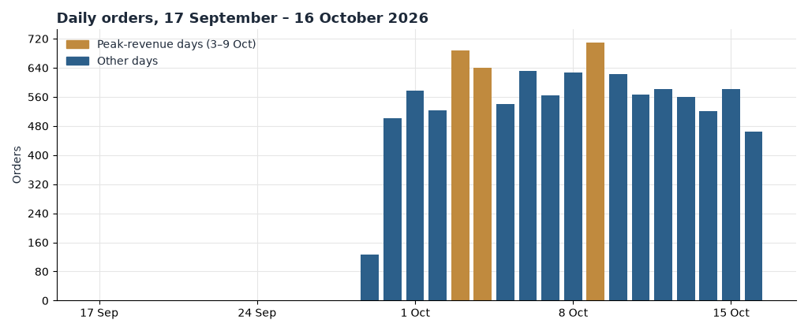
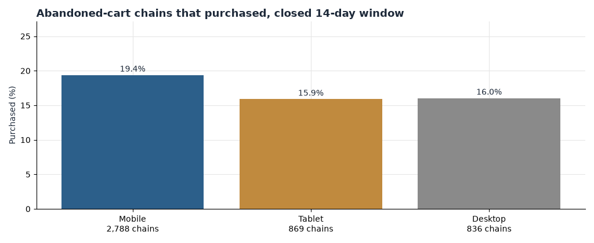
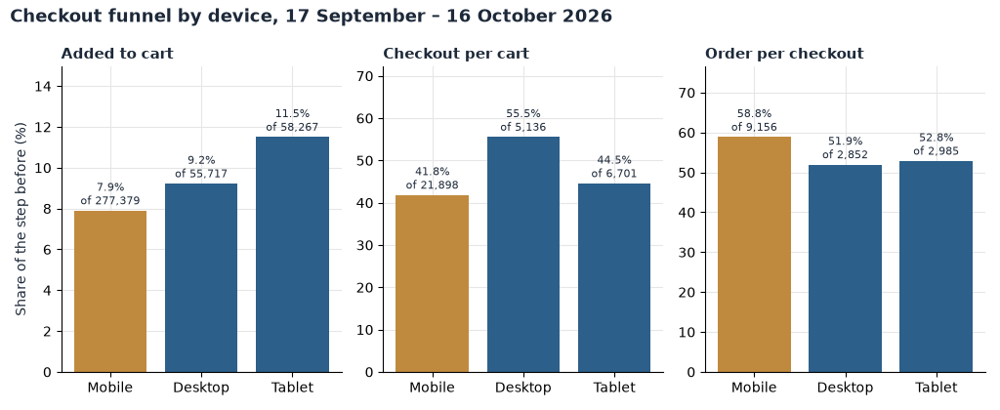
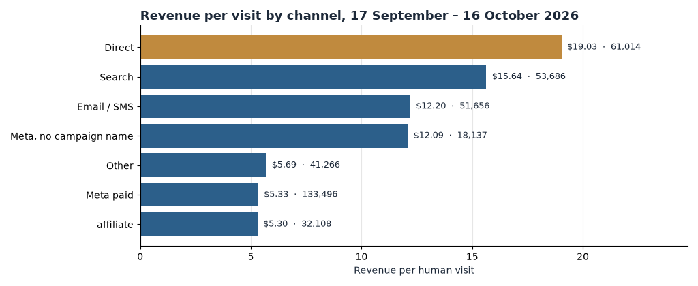
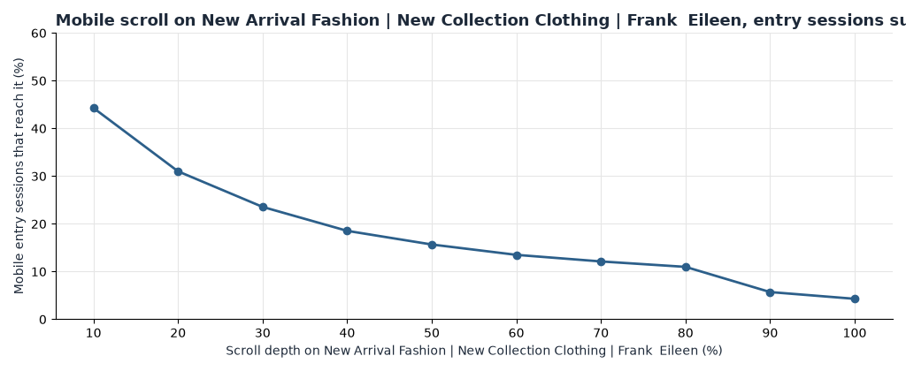

**HEATMAP**

**Frank & Eileen**

**Site Opportunity Report**

frankandeileen.com | 17 September – 16 October 2026 (tracked 29 September – 16 October) | Prepared 16 October 2026

We re-analysed 10,026 orders worth $4,657,331.63, 391,363 human visits across the tracked days, and the click, scroll and selector datasets for the New Arrivals collection page (`/collections/new-arrivals`) — the page the on-page record describes, not the homepage.

## Contents

The biggest wins · At a glance · The month in numbers · Opportunity 1 — Bring back the shoppers who leave without buying · Opportunity 2 — Close the mobile cart-to-checkout gap · Opportunity 3 — Make every paid-social dollar accountable · Opportunity 4 — Lift the baskets sitting under the free-shipping line · Opportunity 5 — Make the paid landing page earn its traffic · Opportunity 6 — Stop sending paid traffic to pages that cannot convert · Opportunity 7 — Treat the repeat buyer as the core of the business · Opportunity 8 — Fix the measurement gaps before scaling spend · Worth watching · What's working · Suggested next 30 days · Method and caveats

## The biggest wins

These six moves cover most of the opportunity in the window. Two raise the value of traffic already being paid for, two recover shoppers who already signalled intent, one raises the value of every order, and one stops spend landing on pages that cannot convert.

1. **Close the mobile cart-to-checkout gap.** Mobile adds to cart at 7.9% but only 41.8% of mobile carts reach checkout, against 55.5% on desktop, and mobile carries 70.9% of all visits. Fixing that single step is worth up to about $1,400,000 a month. (Opportunity 2)
2. **Push browse recovery toward cart recovery.** Browse-interest chains purchase at 9.8% while abandoned-cart chains purchase at 18.1%; browse chains outnumber cart chains three to one. Half the gap is worth up to about $2,000,000 a month. (Opportunity 1)
3. **Tag the paid links and stop the zero-order campaigns.** One in three visits arrives from Meta paid at $5.33 per visit against $19.03 for direct, and six paid campaigns spent the whole tracked period with volume and zero orders. Up to about $140,000 a month. (Opportunity 3)
4. **Make the paid landing page earn its traffic.** Campaign entries on the New Arrivals page monetise at $4.2 per session against $12.8 for search entries on the same page, and 61% of campaign entries view a single page. Half the gap is worth up to about $450,000 a month. (Opportunity 5)
5. **Lift the 1,079 baskets under $250 over the free-shipping line.** 10.8% of orders paid shipping in a store whose median order is $341. Up to about $90,000 a month if every sub-$250 basket crossed the line. (Opportunity 4)
6. **Stop sending paid traffic to editorial pages that cannot convert.** The Jessica Springsteen Edit and the New to Frank and Eileen page took 11,000 visits and produced 12 buyers between them. Re-pointed at converting collections, up to about $250,000 a month. (Opportunity 6)

The supporting plays: build the replenishment cadence around the repeat buyer, who converts at 29.4% (Opportunity 7), and repair the tagging and visit-matching gaps before any of these numbers is used to scale spend (Opportunity 8).

## At a glance

| # | Finding | Recommended action | Priority |
| --- | --- | --- | --- |
| 1 | Mobile cart-to-checkout is 41.8% vs 55.5% on desktop, on 70.9% of visits | Shorten the cart; test express checkout on mobile | High |
| 2 | Browse chains purchase at 9.8% vs 18.1% for cart chains | Add browse-abandonment flows mirroring cart flows | High |
| 3 | Meta paid delivers $5.33 per visit vs $19.03 direct; six campaigns had volume and zero orders | Tag all paid links; pause or re-point the zero-order campaigns | High |
| 4 | 10.8% of orders sit under the $250 free-shipping line | Cart threshold prompt plus low-price add-ons | Medium |
| 5 | Campaign entries on the New Arrivals page monetise at $4.2 vs $12.8 for search | Improve the page's first screen and product-grid depth on mobile | High |
| 6 | Two editorial pages took ~11,000 visits and produced 12 buyers | Re-point paid links to converting collections | Medium |
| 7 | Devices that bought in the prior 30 days convert at 29.4% and carry nearly all tracked revenue | Build the replenishment and win-back cadence around them | Medium |
| 8 | 38.3% of raw traffic is dead sessions; 14.8% of orders have no matched visit | Repair tagging and visit matching before scaling spend | Watch |
| 9 | Affiliate converts at 1.04% with $5.30 per visit on 32,108 visits | Audit affiliate placements and codes | Watch |
| 10 | Peak days 3–4 and 9 October lifted every channel at once | Record the promotion calendar next to the numbers | Watch |

Table 1 — The live findings, with the numbers as of the tracked window 29 September – 16 October 2026. Sizes are monthly estimates from current volumes, not forecasts.

## The month in numbers

| Measure | Value |
| --- | --- |
| Orders, report window | 10,026 |
| Revenue, report window | $4,657,331.63 |
| Average order | $464.53 |
| Median order | $341.14 |
| Human visits (tracked days) | 391,363 |
| Visit conversion (buyer visits / human visits) | 2.16% |
| Add-to-cart rate (visits) | 8.62% |
| Dead sessions removed | 242,675 (38.3% of 634,038 raw) |
| Returning share of visits | 22.8% |
| High-value orders (≥ $850) | 981 orders, $1,125,601.64 (24.2% of revenue) |

Table 2 — Definitions and window totals. Dead sessions — one pageview or none, no click, no scroll and no order — are removed from every visit-level table; a visit with an add to cart, a checkout or an order is never excluded.

Weekly orders and revenue, Mondays:

| Week | Orders | Revenue |
| --- | --- | --- |
| 28 Sep (from 29th) | 3,055 | $1,492,695.60 |
| 5 Oct | 4,262 | $1,923,662.44 |
| 12 Oct (through 16th) | 2,709 | $1,240,973.59 |

Table 3 — Weekly orders and revenue from the order file. The first week contains the tracked days 29–30 September only; the last contains 12–16 October.

*Figure 1. Daily orders, 29 September – 16 October 2026. Gold days are the three peak-revenue days of the window — 3, 4 and 9 October, each between $320,000 and $338,000; the first tracked week contains 29–30 September only.*

The week of 5 October is the only complete week: 4,262 orders and $1,923,662.44. The partial weeks around it run at roughly the same daily pace outside the peaks. The three peak days — 3 October (688 orders, $337,918), 4 October (639 orders, $320,014) and 9 October (710 orders, $320,505) — carried an average order of $480 against $460 on the other days, and the lift appears in every channel at once: direct, email, search and Meta all gained share together. A lift across every channel at once is a promotion or a code, not a retention story; this bundle has no confirmed promotion calendar, so the cause is not named.

**Two contexts matter for reading the month.** First, volume against the prior period: this bundle contains no tracked rows before 29 September, so nothing here is a trend — every rate should be read against a peer in the same table (a device, a channel, the next funnel step), not against an earlier fortnight. Second, where demand concentrates: mobile carries 70.9% of visits and 67.8% of orders, and the devices that had already bought in the prior 30 days produced 8,283 of the 8,538 orders in the visit-matched tables — the repeat buyer is not a segment of this business, it is the business.

## Opportunity 1 — Bring back the shoppers who leave without buying

**What we saw.** We followed every triggered recovery chain in the first tracked days (29 September – 2 October) for a closed 14-day window.

| Trigger | Chains | Returned | Purchased | Purchase rate | Recovered revenue | Revenue per chain |
| --- | --- | --- | --- | --- | --- | --- |
| Abandoned cart | 4,493 | 67.6% | 812 | 18.1% | $539,210 | $120.01 |
| Showed interest (browse) | 13,583 | 63.8% | 1,332 | 9.8% | $866,307 | $63.78 |
| Super shopper | 5,316 | 84.1% | 675 | 12.7% | $436,257 | $82.06 |

Table 4 — Recovery chains by trigger, cohort of 29 September – 2 October, each followed 14 days.

Mobile dominates every trigger: 2,788 of the 4,493 abandoned-cart chains are mobile, and mobile cart chains recovered $349,880 of the $539,210.

- Abandoned-cart chains already return well — 67.6% come back — and purchase at 18.1% once they do.
- Browse chains are the volume line: three times as many chains as carts, but only 9.8% purchase and half the revenue per chain.
- The gap is in the follow-up, not the intent: a browsing visitor and a carting visitor are similarly engaged, yet the browse recovery converts at roughly half the rate.

*Figure 5. Abandoned-cart and browse chains that purchased within the closed 14-day window, by device. Mobile carries most chains and most recoveries in both triggers.*

**Why it matters.** Browse chains outnumber cart chains three to one and recover $63.78 each against $120.01. If browse chains continue at the observed rate and half the purchase-rate gap to carts closes, that is worth up to about $2,000,000 a month — an upper bound that assumes re-engaged browsers convert like today's cart returners, which they will not fully do.

**Recommended actions.**

- Mirror the abandoned-cart flow for browse abandoners: same cadence, same incentive logic, product imagery from the viewed items.
- Put the mobile cart flow on the phone-first template; 62% of cart chains are already mobile.
- Sequence the super-shopper trigger behind the cart trigger so the highest-intent message wins.
- Track: browse-chain purchase rate, now 9.8%; recovered revenue per browse chain, now $63.78.

## Opportunity 2 — Close the mobile cart-to-checkout gap

**What we saw.** The device funnel for the tracked window:

| Device | Visits | Share | Add to cart | Cart → checkout | Checkout → order | Conversion | Revenue per visit |
| --- | --- | --- | --- | --- | --- | --- | --- |
| Mobile | 277,379 | 70.9% | 7.9% | 41.8% | 59.5% | 1.94% | $8.79 |
| Desktop | 55,717 | 14.2% | 9.2% | 55.5% | 52.5% | 2.66% | $13.91 |
| Tablet | 58,267 | 14.9% | 11.5% | 44.6% | 53.5% | 2.71% | $12.92 |

Table 5 — Device funnel, tracked window 29 September – 16 October 2026. Rates use human visits; dead sessions excluded.

The gap sits between cart and checkout. Mobile adds to cart at 7.9% against 9.2% on desktop — close — but only 41.8% of mobile carts reach checkout against 55.5% on desktop. Once a mobile shopper is in checkout, they finish more often than desktop (59.5% against 52.5%). These are ready buyers fidgeting at the moment of commitment, not browsers losing interest at the top.

*Figure 2. The checkout funnel by device, 29 September – 16 October 2026. Mobile loses most of its ground between cart and checkout; checkout-to-order is strongest on mobile.*

**Why it matters.** 21,898 mobile visits added to cart in the tracked 18 days; closing the 13.7-point step gap to desktop, with everything downstream held at mobile's own rates, is worth up to about $1,400,000 a month. That assumes every rescued mobile cart converts at the mobile checkout-to-order rate of 59.5% — an upper bound, not a forecast.

**Recommended actions.**

- Audit the mobile cart drawer: line-item editing, discount-code field placement, and the express-checkout buttons (Shop Pay, PayPal, Afterpay, Klarna) above the fold.
- Test a one-page mobile checkout; checkout-to-order is already 59.5% on mobile, so the friction is the step before it.
- Keep tablet on the same template as mobile until the step gap narrows; tablet cart-to-checkout is 44.6%.
- Track: mobile cart-to-checkout, now 41.8%; mobile conversion, now 1.94%.

## Opportunity 3 — Make every paid-social dollar accountable

**What we saw.** Channel is last touch — the link the visit arrived on. Revenue per visit is on-site value only; ad spend is not in this bundle.

| Channel | Visits | Share | Conversion | Revenue per visit |
| --- | --- | --- | --- | --- |
| Meta paid | 133,496 | 34.1% | 1.25% | $5.33 |
| Direct | 61,014 | 15.6% | 3.79% | $19.03 |
| Search | 53,686 | 13.7% | 3.27% | $15.64 |
| Email/SMS | 51,656 | 13.2% | 2.61% | $12.20 |
| Other | 41,266 | 10.6% | 1.23% | $5.69 |
| Affiliate | 32,108 | 8.2% | 1.04% | $5.30 |
| Meta untagged | 18,137 | 4.6% | 2.89% | $12.09 |

Table 6 — Referrer channels, tracked window. Meta paid is the largest channel and converts at a third of the rate of direct.

Inside the paid channels:

| Campaign (source) | Visits | Orders | Revenue per visit |
| --- | --- | --- | --- |
| prospecting-international-test (facebook fb/ig) | 8,533 | 0 | $0.00 |
| prospect-daba-international (facebook) | 1,868 | 0 | $0.00 |
| s_soc_g_US_consideration…multi_pin (pinterest) | 1,803 | 0 | $0.00 |
| s_sdi_g_prospecting_smart… (google) | 1,027 | 0 | $0.00 |
| s_prog_g_US_consideration…stackadapt | 868 | 0 | $0.00 |
| new-arrivals-prospect-volume (facebook) | 852 | 2 | $1.98 |
| remkt core-skus consolidated (facebook, paid) | 3,753 | 66 | $7.67 |
| remkt creative sid-…[spec-consolidated-remkt] | 3,163 | 52 | $7.02 |

Table 7 — The weak paid campaigns with enough volume to act on, plus the remarketing lines that work. Visit counts are last-touch arrivals on those links.

- Meta paid is a third of all visits and earns $5.33 per visit — 28% of direct's $19.03 and 34% of search's $15.64. Some of that gap is prospecting versus harvest; some is not.
- Six paid campaigns ran the whole tracked period with real volume and zero orders, among them an international prospecting test (8,533 visits) and the Pinterest consideration campaign (1,803 visits, zero add to carts).
- Remarketing works: the consolidated remarketing campaign earns $7.02–$7.67 per visit, five times the new-arrivals prospecting volume campaign.
- The tags themselves are incomplete: of 133,496 Meta paid visits, only 14,075 arrive on a properly labelled Meta campaign link; 119,421 land under generic `other_tagged` links, and a further 18,137 Meta visits carry no paid tag at all ($219,277 in revenue the ad account cannot claim).

*Figure 3. Revenue per visit by referrer channel, 29 September – 16 October 2026. Meta paid earns $5.33 per visit against $19.03 for direct and $15.64 for search.*

**Why it matters.** The zero-order campaigns alone spent roughly 14,100 tracked visits in 18 days for nothing. If that traffic were re-pointed at the remarketing-proven creative and converted at the blended site rate of about $10 per human visit, that is up to about $140,000 a month. The full accountability picture is larger, but spend is not in this bundle, so no profit claim is made — pull the cost columns from Ads Manager beside this table.

**Recommended actions.**

- Pause or re-point the six zero-order campaigns; keep the international test only with a conversion floor.
- Move prospecting budget toward the consolidated remarketing creative family ($7.02–$7.67 per visit) while prospecting is rebuilt.
- Enforce utm_source/medium/campaign on every paid link; today 90% of Meta paid arrivals cannot be tied to a campaign.
- Track: tagged share of Meta paid visits, now about 10%; revenue per visit on Meta paid, now $5.33.

## Opportunity 4 — Lift the baskets sitting under the free-shipping line

**What we saw.** The live site offers free UPS Ground shipping on orders of $250+ (read on the storefront on 16 October 2026). Against that line:

| Order band | Orders | Share |
| --- | --- | --- |
| Under $100 | 47 | 0.5% |
| $100–200 | 454 | 4.5% |
| $200–250 | 578 | 5.8% |
| $250–300 | 2,487 | 24.8% |
| $300–850 | 5,479 | 54.7% |
| $850 and over | 981 | 9.8% |

Table 8 — Order-value bands for the 10,026 window orders. The order-value distribution chart was not drawn for this run, so the bands are shown as a table.

The median order is $341.14 and the store sits comfortably above its own shipping line — yet 1,079 orders (10.8%) finished below $250 and paid shipping, 578 of them in the $200–250 band, an average of $16 under the line. Just above the line, 2,487 orders (24.8%) cluster at $250–300: shoppers already respond to the threshold.

- Most baskets clear the line easily; the opportunity is the $16 gap, not the basket size.
- 2,964 orders (29.6%) carried more than one item's worth of value (paid_to_item above 1.5), so low-price add-ons are already a natural behaviour.

**Why it matters.** If every sub-$250 basket crossed the line with a low-price add-on, the added revenue is on the order of $90,000 a month (the measured shortfall to $250 across those 1,079 orders is $52,803 in the tracked 18 days) — an upper bound that assumes every basket adds enough to reach $250.

**Recommended actions.**

- Add a cart progress message at $200: "You're $X from free shipping," with one-tap add-ons (socks, tees, the EILEEN Ballerina accessories line).
- Merchandise the add-on rail from the products high-value buyers already over-index on (Opportunity 7 table).
- Do not move the $250 line; 24.8% of orders sit within $50 above it.
- Track: share of orders under $250, now 10.8%; average order, now $464.53.

## Opportunity 5 — Make the paid landing page earn its traffic

**What we saw.** The on-page record describes one page: New Arrivals (`/collections/new-arrivals`). It is the site's biggest entry page — 77,081 window visits, 62,731 of them entries — and it is where the paid social campaigns point.

| Source of page entries | Entry sessions | Orders | Revenue per session | Single-pageview share |
| --- | --- | --- | --- | --- |
| Campaign | 63,166 | 664 | $4.56 | 60.9% |
| Social | 6,456 | 155 | $10.90 | 43.4% |
| Direct | 3,048 | 58 | $10.31 | 55.3% |
| Search | 860 | 27 | $18.50 | 52.3% |

Table 9 — Entries to the New Arrivals page by arrival source, tracked window. Sessions are counted per source link and do not sum to page visit totals; compare rows only inside this table.

The page also over-indexes with the best buyers: 48% of visitors with a high-value (≥ $850) order reached it, against 13.3% of all visitors — 3.6 times over. The problem is the first screen on mobile. Of 51,357 mobile entry sessions across the tracked weeks, only 44% reach the first depth decile past the top and 4.3% reach the bottom decile; median engaged time on mobile is 31 seconds against 61 seconds on desktop.

- Campaign entries view a single page 61% of the time and monetise at $4.56 per session — $4.22 in the independent weekly baseline — a quarter of the $18.50 per session search entries earn on the same page ($12.81 in the weekly baseline).
- High-value buyers love this page once they reach it; the page is not losing the wrong people, it is losing everyone early.
- Rage clicks are negligible (34 sessions in the heaviest mobile week of 53,188 clicking sessions), so this is layout and load order, not broken elements.

*Figure 4. Mobile scroll depth on the New Arrivals page, entry sessions summed across the tracked weeks. Fewer than half of mobile entry sessions pass the first depth decile; 4.3% reach the bottom.*

**Why it matters.** Closing half the revenue-per-session gap between campaign entries and search entries on this page — $4.22 against $12.81 in the weekly baseline, on roughly 105,000 campaign entry sessions a month at the current rate — is worth up to about $450,000 a month, assuming re-pointed campaign traffic monetises like today's search arrivals — an upper bound, since paid browsers arrive colder.

**Recommended actions.**

- Rebuild the mobile first viewport: product grid visible without scrolling, filter and sort controls collapsed into one bar.
- Move the strongest new-arrival tiles (EILEEN Navy and Gold Italian Washed Velvet, the two biggest revenue titles) into the first two rows on mobile.
- Quick-add on tile tap for the top ten tiles; quick-add sessions are already instrumented and near zero today.
- Track: campaign-entry revenue per session on this page, now $4.56 per session against $18.50 for search; mobile reach of the second depth decile, now 31%.

## Opportunity 6 — Stop sending paid traffic to pages that cannot convert

**What we saw.** Two editorial pages receive real traffic and return almost nothing.

| Page | Visits | Buyers | Buyer rate | Campaign entries | Campaign orders | Single-pageview share |
| --- | --- | --- | --- | --- | --- | --- |
| /pages/the-jessica-springsteen-edit | 8,392 | 10 | 0.12% | 5,292 | 0 | 93.5% |
| /pages/new-to-frank-and-eileen | 6,919 | 2 | 0.03% | 5,603 | 0 | 93.3% |

Table 10 — The two editorial destinations, tracked window. Campaign entries are the paid and email links pointing at them.

For contrast, the collections convert: /collections/tops turns 6.7% of visits into buyers and /collections/eileen-gold-italian-washed-velvet 5.2%. The Jessica Springsteen Edit is campaign-linked to the tune of 5,292 entry sessions with zero orders and a 93.5% single-pageview share — shoppers arrive, read nothing measurable, and leave. These are dead-end destinations paid to stay dead.

**Why it matters.** Together the two pages took 15,311 visits in 18 days and produced 12 buyers. If that traffic were re-pointed at the converting collections and shopped like the site average ($10.14 per human visit), that is up to about $250,000 a month. The assumption — that editorial clickers shop when they land somewhere shoppable — is exactly what makes this an upper bound.

**Recommended actions.**

- Re-point the campaign links at /collections/new-arrivals and /collections/eileen; keep the editorial pages for organic and email storytelling only.
- If the content must keep paid support, add a shoppable product rail above the fold and a single exit CTA to the collection.
- Track: buyer rate on the two editorial pages, now 0.12% and 0.03%; their campaign entries, now 10,895 sessions.

## Opportunity 7 — Treat the repeat buyer as the core of the business

**What we saw.** Visits from devices that bought in the prior 30 days convert at 29.4% — 27,888 such visits produced 8,283 orders and $3,856,625 of the $3,966,842 in the visit-matched tables. Returning visits are 22.8% of human visits but produce 23.9% of orders. The owned channels that reach these buyers perform: automated email flows earn $36.79 per visit (3,702 visits, 8.3% conversion) and campaign email/SMS $23.42.

Email and SMS volume tripled in the second half of the window — 4,090 devices arrived once from email in the first half against 19,316 in the second — and frequency pays: 3,816 devices visited three or more times from email in the second half, and 437 of them bought (11.4%).

- The repeat buyer is not a segment of this business; it is the business. Nearly every visit-matched order in the window came from a device that had bought before.
- The automated flows are the strongest channel in the whole bundle per visit; they are also the smallest (3,702 visits).
- High-value buyers (≥ $850) over-index on /cart (27 times the visitor average) and on the New Arrivals page (3.6 times): when they return, they return to buy.

**Why it matters.** Devices that bought in the prior 30 days generated $3,856,625 of the $3,966,842 in the visit-matched tables — a monthly run-rate on the order of $6.4 million from this one segment. A 5% lift in repeat-device purchasing at current volumes is worth up to about $300,000 a month, an upper bound that assumes the added orders carry the current repeat-buyer average order.

**Recommended actions.**

- Grow the automated flows: welcome, post-purchase replenishment at 30–45 days for the EILEEN shirting lines, and win-back at 90.
- Send the second-half volume deliberately: the first half's 133 three-plus-visit email devices became 3,816 in the second; hold that cadence and measure decay.
- Merchandise replenishment to the repeat buyer's entry pages — New Arrivals and the cart — not the homepage.
- Track: returning share of visits, now 22.8%; automated-flow revenue per visit, now $36.79.

## Opportunity 8 — Fix the measurement gaps before scaling spend

**What we saw.** Three breaks make some of this month's numbers hard to act on:

| Gap | Size | Effect |
| --- | --- | --- |
| Dead sessions | 242,675 of 634,038 raw tracked visits (38.3%) | Visit tables exclude them; page tables include them — the two never reconcile |
| Orders with no matched visit | 1,488 of 10,026 (14.8%), ~$690,000 of revenue | Those orders sit outside every funnel, channel and device table |
| Untagged Meta paid | 119,421 visits under generic tags + 18,137 untagged | Nine in ten Meta paid arrivals cannot be tied to a campaign |

Table 11 — The measurement breaks in this bundle.

- The hist30 repeat flag understates true repeats because the untracked gap (17–28 September) hides earlier purchases; the 29.4% repeat conversion is, if anything, conservative.
- `page_period` still contains dead sessions, so page-level rates run below visit-level rates for the same page; both appear in this document and each is labelled.
- The line-items extract is partial (844 rows) and is not used for basket counts anywhere here.

**Why it matters.** About $690,000 of window revenue — 14.8% of orders — is invisible to the funnel analysis, and 38% of raw traffic is filtered before any table begins. Scaling spend or renaming campaigns on numbers with this much shadow is how budgets drift; none of the opportunities above needs to wait on this fix, but every sizing should be re-read after it.

**Recommended actions.**

- Repair order-to-visit matching for the unmatched 1,488 orders; check consent and tag health on the checkout events first.
- Add utm coverage to every paid and email link (see Opportunity 3).
- Record the promotion calendar next to the daily numbers so the next window can name its peaks.
- Track: matched-order share, now 85.2%; tagged share of Meta paid visits, now about 10%.

## Worth watching

**Affiliate is weak but not yet sized.** Affiliate brings 32,108 visits (8.2% of human visits) and converts at 1.04% with $5.30 per visit — half the site blend. The second half of the window improved ($145,462 revenue against $24,661 in the first half), so watch one more window before cutting placements.

**Meta untagged revenue is real.** 18,137 visits with no paid tag produced $219,277. If Ads Manager is under-reporting Meta's contribution, budget shifts based on last touch will over-cut it. Resolve the tags (Opportunity 3) before judging the channel.

**Markdown activity was minimal.** Only 182 orders (1.8%) carried an item under its first-half median price, and the peak days were not markdown-led. If promotions are planned for the next window, their baseline is the cleanest this store has been.

**New prospecting campaigns launched inside the window.** new-arrivals-prospect-volume (3 October) and prospect-daba-international (8 October) are still accumulating; their early revenue per visit is $1.34–$1.98. They are in Opportunity 3's zero-order table only where the volume already forces the question.

## What's working

We checked these areas closely. Each is healthy and needs no change today.

- **Checkout-to-order on mobile.** 59.5% against 52.5% on desktop — once a mobile shopper commits, they finish. Protect this while fixing the step before it.
- **Remarketing creative.** The consolidated remarketing campaign and creative earn $7.02–$7.67 per visit with 4–5% conversion, five times the prospecting lines. This is the template for new prospecting.
- **Search.** $15.64 per visit at 3.27% conversion, steady across all three tracked weeks ($12.28–$12.87 per entry session on the analysed page). Leave it alone.
- **Automated email flows.** $36.79 per visit — the best revenue per visit in the bundle. Under-used, not broken.
- **High-value demand.** 981 orders at $850+ produced $1,125,601.64, 24.2% of window revenue, and those buyers reach /cart at 27 times the visitor average. The top of the range is healthy.
- **Rage clicks on the analysed page.** Negligible in every tracked week (at most 34 mobile sessions against 53,188 clicking sessions). No element is fighting back.

## Suggested next 30 days

| Week | Action | Owner |
| --- | --- | --- |
| 1 | Tag every paid and email link; pull the six zero-order campaigns into review; repair checkout event tagging | Paid media / E-commerce |
| 1 | Add the $200 cart progress message with one-tap add-ons | E-commerce |
| 2 | Rebuild the mobile cart drawer and test one-page mobile checkout; watch cart-to-checkout daily | E-commerce / Dev |
| 2 | Launch the browse-abandonment flow mirroring the cart flow | CRM |
| 3–4 | Rebuild the mobile first viewport of the New Arrivals page; move top tiles and quick-add into the first two rows | E-commerce / Dev |
| 3–4 | Re-point editorial campaign links at converting collections; keep editorial for organic only | Paid media |
| 4 | Stand up the replenishment flow at 30–45 days and the 90-day win-back; hold the second-half email cadence | CRM |
| 4 | Re-run the order-to-visit match; re-read every sizing in this report against the repaired tables | E-commerce |

## Method and caveats

**Window.** The profile names a report window of 17 September – 16 October 2026; the tracked rows in this bundle cover 29 September – 16 October for both orders and visits (orders file 2026-09-29 through 2026-10-16, 10,026 orders, $4,657,331.63; daily visit tables across the same days). There are no pre-window rows in this bundle, so no period-over-period trend is computed anywhere in this document; every comparison is inside the window — device against device, channel against channel, step against step. Weekly tables start on Monday; the week of 28 September contains 29–30 September only and the week of 12 October contains 12–16 October only.

**Traffic rule.** Dead sessions — one pageview or none, no click, no scroll and no order — are removed from visit-level tables; 242,675 of 634,038 raw tracked visits (38.3%) were removed. A visit with an add to cart, a checkout start or an order is never excluded. `page_period` retains dead sessions, so page-level and visit-level rates differ by construction; each table here is labelled with its source.

**Attribution.** Channel is last touch: the link the visit arrived on. Revenue per visit is on-site value only; ad spend is not in this bundle, so no profit or ROAS claim is made — the paid recommendations name the Ads Manager columns to pull beside them. Buyers are counted by device.

**Sizes.** All monthly figures are upper bounds estimated from this window's volumes, not forecasts; each states the behaviour it assumes (re-pointed traffic converting like the destination's existing traffic, re-engaged browsers converting like cart returners, every sub-$250 basket crossing the line). They scale to this site only.

**Breaks.** 1,488 orders (14.8%, roughly $690,000) matched no tracked visit and sit outside the funnel, channel and device tables; the prior-30-day repeat flag cannot see purchases in the untracked 17–28 September gap, so repeat conversion is conservative; the line-items extract is partial (844 rows) and unused; there is no confirmed promotion calendar, so markdown flags use the first half as a price baseline and the peak days are attributed to "a promotion or a code" without naming one. The high-value line is $850 (the window's 90th percentile of order revenue, rounded); the free-shipping line of $250 was read from the live storefront on 16 October 2026.
