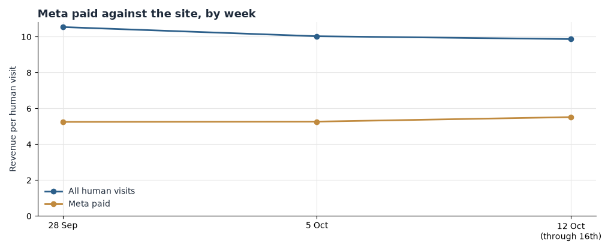

**HEATMAP**

**Frank & Eileen**

**Today's Plan: Stop Paying for Visits That Cannot Convert**

frankandeileen.com | A one-hour ad-account intervention · three switches that change tomorrow's numbers | Prepared 16 October 2026

PREPARED OCTOBER 16, 2026 · DATA THROUGH OCTOBER 16, 2026

The full Site Opportunity Report found the leaks. This document is today's fix. Three settings — two impact.com partners, two Meta ad sets prospecting outside the United States, and one Google PMax campaign aimed at every country at once — are still bleeding in the most recent week of tracked data, 12 through 16 October. Each is a switch an owner can flip this morning. No new creative, no new code, nothing that takes a week to read.

> **Why these three and not the bigger ideas.** The larger plays — the mobile cart-to-checkout gap, browse recovery, the New Arrivals landing page — are worth more and take longer. Tomorrow's spend is committed tonight. These three stop paid placements that have produced almost nothing for two straight weeks, and they are in effect the day they are made.

## Contents

01 The Situation This Morning · 02 Action 1 — Re-point or pause the two impact.com partners that convert at $1 a visit · 03 Action 2 — Pause the Meta ad sets prospecting outside the US · 04 Action 3 — Cap the Google PMax multi-country campaign to the US · 05 How to Read Tomorrow · 06 The Rest of the Week · A Data and Method

## 01 The Situation This Morning

The most recent week — Monday 12 October through Friday 16 October, the five tracked days ending on the last day of the report window — carried 2,709 orders worth $1,240,973.59 on 108,686 human visits: $9.87 per visit. The steady channels held. Direct delivered $16.63 a visit, search $15.62, and the automated email flows $34.54. Nothing in the week's totals needs fixing.

Three paid placements underneath those totals do. Between them they bought 11,771 visits last week — one visit in nine on the whole site — and returned $9,407, less than one cent on each visit against $9.87 for the site.

| # | Leak | Latest reading (12–16 Oct) | What it is worth |
| --- | --- | --- | --- |
| 1 | impact.com partners 2340682 and 116548 send traffic that does not convert | 5,485 visits, 17 orders, $6,372.77 — $1.16 a visit, against $34 for the rest of the programme | Up to about $140,000 a month, re-pointed |
| 2 | Two Meta ad sets prospecting outside the US | 4,974 visits, 7 orders, $2,717 — $0.55 a visit, against $5.52 for Meta paid as a whole | Up to about $100,000 a month, spend re-allocated |
| 3 | Google PMax campaign targeted at all countries at once | 1,312 visits, 1 order, $317.53 — $0.24 a visit, against $15.46 for Google Ads as a whole | Up to about $55,000 a month, geo-capped to the US |

Table 1 — The three live leaks, with the numbers as of the most recent week of tracked data, 12–16 October 2026. Sizes are monthly estimates from current volumes, not forecasts, and each assumption is named in its action.

*Figure 1 — Revenue per visit by week, Meta paid against the site. Gold is Meta paid, blue is all human visits. Meta paid ran $5.25, $5.27 and $5.52 a visit in the weeks of 28 September (from 29th), 5 October and 12 October (through 16th), against $10.54, $10.03 and $9.87 for the site. The gap is not closing.*

The leak is the gold line, and it is flat. Meta paid has held at roughly half the site's revenue per visit for three consecutive weeks, so it is structural, not a bad send or a single off day. Two of the three switches below are on that line.

## 02 Action 1 — Re-point or pause the two impact.com partners that convert at $1 a visit

Owner: partnerships. Time: about 20 minutes.

This one is first because it is the largest leak still open, and because commission on 5,485 visits is being committed with every sale the partners touch. The affiliate programme as a whole is healthy. These two partners are not.

- Open impact.com and pull up partner **2340682**. Last week it sent 3,796 visits that produced 12 orders and $4,675.34 — $1.23 a visit. The week before: 5,223 visits, 25 orders, $1.95. The week before that: $1.18.
- Pull up partner **116548**. Last week it sent 1,689 visits that produced 5 orders and $1,697.43 — $1.00 a visit. Prior weeks: $0.73 and $0.26. Where the order record shows an entry page for these partners, it is the homepage.
- For each, check the default link and placements and re-point them at a converting destination — the New Arrivals collection (`/collections/new-arrivals`) or the product partner 2340682 already sells (`/products/quinn-white-vintage-jersey`). If a partner will not take a product link, set it to paused.
- Do not touch the rest of the programme. Partners 10579, 75421 and 101044 converted at $91, $94 and $121 a visit last week. One in five of the programme's visits and almost none of its revenue is not a programme problem; it is these two lines.

Expected result: up to about $140,000 a month, calculated as 5,485 visits a week converting at $7.24 — the rate of 3430295, the nearest large partner that converts — instead of $1.16. That is the upper bound: it assumes re-pointed traffic converts like the destination's existing traffic. If the partners are paused instead, the on-site revenue at risk is about $6,400 a week, and the saving to check is the commission column in impact.com, which is not in this data.

## 03 Action 2 — Pause the Meta ad sets prospecting outside the United States

Owner: paid media. Time: about 20 minutes.

Two ad sets have now spent two full weeks buying visits that almost never buy. Every day they run, the account's average sinks toward theirs.

- In Ads Manager, find `cid-120241382721300606-cn-[c8-prospecting-international-test]-[c1-asc-mix]-[c2-scale]-[c3--wc-p]-[c4--20260115]-[c5-cbo]-[c6--bid-auto]-[c7-n]-[c9-both]`. Last week: 2,686 visits, 2 orders, $720 — $0.27 a visit. The week before: 4,891 visits, 4 orders, $0.40.
- Find `cid-120253889587550606-cn-[c8-prospect-daba-international]-[c1-1-pro-x4]-[c2-scale]-[c3--wc-v]-[c4-20261008]-[c5-cbo]-[c6--bid-auto]-[c7-n]-[c9-both]`. Last week: 2,288 visits, 5 orders, $1,997 — $0.87 a visit. The week before: $0.95.
- Pause both, or cap both to the US. The seven matched orders across the two campaigns came from Australia (3), Canada (2), Saudi Arabia (1) and Switzerland (1) — this is not a US audience underperforming; it is spend aimed at the wrong countries.
- Do not pause prospecting as a class, and do not pause remarketing. The US prospecting ad sets still convert — new-arrivals-prospect-volume at $3.77 a visit and consolidated-prospect-volume at $2.43 — and the remkt-core-skus campaign, the account's biggest, runs at $8.51. These two ad sets sit in the same CBO structure as ad sets that work, so pausing them hands the budget back to the US sets.

Expected result: up to about $100,000 a month, calculated as 4,974 visits a week converting at $5.52 — the account's existing paid-social average — instead of $0.55. Even at the weakest US prospecting rate, $2.43, the same spend is worth about $40,000 a month more than it is delivering now.

## 04 Action 3 — Cap the Google PMax multi-country campaign to the US

Owner: paid media. Time: about 15 minutes.

The third leak is the smallest, which is why it is third.

- In Google Ads, open `s_pmax_g_medium__frank-and-eilen__all_c-multi_m_rev_go_en_mult_total_`. Last week it took 1,312 visits and produced one order, $317.53 — $0.24 a visit. It has now run three tracked weeks at $2.16, $1.62 and $0.24.
- The same account's US PMax campaigns ran at $5.47 and $10.12 last week, and Google Ads as a whole ran at $15.46. The "all countries" targeting is the difference, not the creative.
- Change the campaign's location targeting to the United States only, or pause it and move the budget into the two US PMax campaigns.
- Do not touch brand search ($35.65 a visit) or shopping ($16.17), and do not broaden the multi campaign to "all countries" inventory elsewhere to compensate.

Expected result: up to about $55,000 a month, calculated as 1,312 visits a week at the US PMax rate of $5.47–$10.31 instead of $0.24.

## 05 How to Read Tomorrow

Direction should be visible the next morning; on a site this size — about 21,000 human visits a day — size is readable after three or four days, and a full week removes any doubt.

| Watch | Now | Target |
| --- | --- | --- |
| Orders per week from impact partners 2340682 + 116548 | 17 orders on 5,485 visits (0.31%) | ≥ 75 orders (about 1.4%) within a week |
| Meta paid account revenue per visit | $5.52 | ≥ $6.30 within days of the pause |
| PMax multi revenue per visit | $0.24 | ≥ $5.00 after the geo cap |

Table 2 — The scoreboard for tomorrow's read.

On the first line, one order moves the pair's weekly rate by about 0.02 points on 5,485 visits, so judge it on the week, not the day. On the second, the pause lifts the Meta account to roughly $6.38 a visit mechanically — 4,974 visits at $0.55 come out of a $5.52 average — so anything above $6.30 means the freed budget is doing work. On the third, a single order on 1,312 visits is the difference between $0.24 and $0.48, so require the target for two consecutive days before calling it.

One caution: a promotion or a send inside the reading window moves orders on its own. This window contains the 15 October New Arrivals Pt 2 email (3,570 visits, 73 orders) and the 16 October Pumpkin Spice SMS. Note them beside the numbers before reading the switches.

## 06 The Rest of the Week

These are deliberately not today's work. They are the larger plays from the Site Opportunity Report, queued once the three switches are on. Each takes days to build and weeks to read; none is a setting.

| When | Action | Size |
| --- | --- | --- |
| Tue | Shorten the mobile cart and test express checkout — mobile cart-to-checkout is 41.8% against 55.5% on desktop, on 70.9% of visits (Opportunity 2) | Up to about $1,400,000 a month |
| Wed | Add browse-abandonment flows mirroring the cart flows — browse chains purchase at 9.8% against 18.1% for abandoned-cart chains (Opportunity 1) | Up to about $2,000,000 a month |
| Thu | Make the New Arrivals page earn its campaign traffic — campaign entries monetise at $4.2 a session against $12.8 for search, with 61% viewing a single page (Opportunity 5) | Up to about $450,000 a month |
| Fri | Re-point paid links off the Jessica Springsteen Edit and New to Frank and Eileen pages — 11,000 visits and 12 buyers in the window (Opportunity 6) | Up to about $250,000 a month |

Table 3 — The week's queue, after the switches. Queued behind them: lifting the sub-$250 baskets over the free-shipping line (Opportunity 4, up to about $90,000 a month) and repairing the tagging and visit-matching gaps (Opportunity 8) before any of these numbers is used to scale spend.

## A Data and Method

Report window 17 September – 16 October 2026 for orders; visits are tracked 29 September – 16 October, so the first weekly table starts on the 29th. "Last week" throughout is the Monday–Sunday week of 12 October, which contains the five tracked days 12–16 October; the window's last day is 16 October 2026. All three actions were re-checked against that week before being named; a leak that had closed was not today's plan.

Dead sessions — one pageview or none, no click, no scroll and no order — are removed from every visit table: 242,675 of 634,038 raw sessions (38.3%). A visit with an add to cart, a checkout or an order is never excluded. Channel is last touch, the link the visit arrived on; revenue per visit is on-site value only, and ad spend and affiliate commission are not in this bundle, so profit checks run in Ads Manager and impact.com. Buyers are counted by device. Entry-session tables and human-visit tables use different denominators and are not mixed in any sentence above.

About 15% of orders in the window did not match a tracked, non-dead visit, so channel reads understate the channels that lost the match; the three leaks here are read on visits, which are complete. There is no confirmed promotion calendar in the bundle; the peak days — 3, 4 and 9 October — lifted every channel at once, which reads as promotion or code activity. All dollar sizes are monthly upper bounds from this window's volumes with the conversion assumption named at the action, not forecasts.
