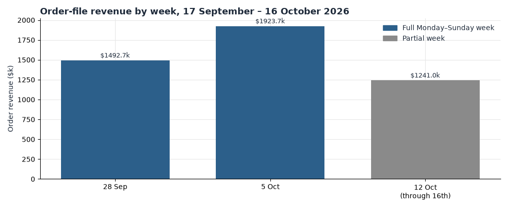
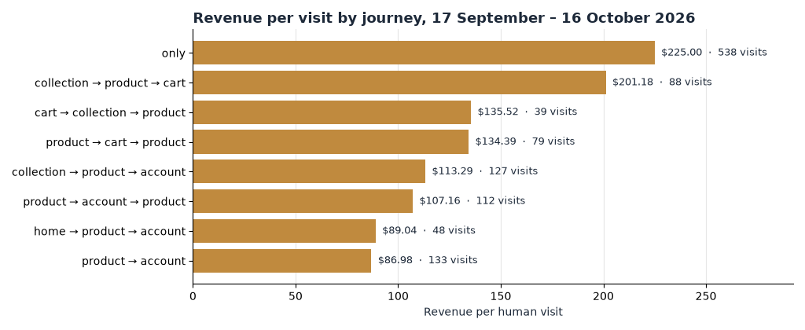

**HEATMAP · User Journey Opportunity Analysis**

Frank & Eileen · frankandeileen.com

Prepared 16 October 2026 | Data window 17 September – 16 October 2026 (tracked 29 September – 16 October)

Site behaviour, funnel and shopper-journey analysis · 18 days of tracked visits

---

**Frank & Eileen**

**User Journey Opportunity Analysis**

PREPARED OCTOBER 16, 2026 · DATA THROUGH OCTOBER 16, 2026

This report follows how shoppers move through frankandeileen.com: the paths the tracker recorded, where a visit that stays on one page class earns $4.27, and where a visit that works through a second product page earns $12.01. Figures are human visits and the orders matched to them, 29 September through 16 October 2026 — the tracked rows in this bundle; the nominal report window is 17 September – 16 October. The order file holds 10,026 orders worth $4,657,331.63 for the window. 8,538 of those orders match a human visit, and those visits carry $3,966,841.50. Dead sessions are 242,675 of 634,038 raw tracked visits (38.3%) and they are out of every rate below.

> **How to read a journey.** A journey is the sequence of page classes in a visit: home, product, collection, content, cart, account, and a small `other` class. Consecutive repeats of a class count once. On this site the classes are well tagged: `other` holds only about 2,300 entry visits — resale pages, the wishlist, 404s and policy pages — so product-style entries already live in the product class and no combination is needed. Quick-add means a buying visit can show no product page at all: 98,241 visits saw zero product pages yet still placed 1,072 orders at $4.85 a visit. One class is not "no order".

# Contents

01 The Month in Journeys
02 The Journeys That Make Money
03 Where the Journeys Leak
04 More Traffic, the Same Funnel
05 Returning Visitors
06 Behaviour Signals Worth Watching
07 Where the Journey Data Points
A Data and Method

# 01 The Month in Journeys

The order file is 10,026 orders and $4,657,331.63, average $464.53, median $341.14. On the 391,363 human visits the matched picture is 8,446 buyer visits, 8,538 orders and $3,966,841.50 — $10.14 a visit, 2.16% conversion. Nearly half of every tracked visit went no further than one page class.

| **Measure** | **Value** | **Reading** |
|----|----|----|
| Orders / revenue | 10,026 / $4,657,331.63 in the order file · 8,538 / $3,966,841.50 on human visits | 1,488 orders, $690,490.13, sit outside the visit split |
| Where visits land | Product 221,489 · Collection 115,760 · Home 38,491 · Content 11,555 | Entry class of the human visit; product is 56.6% of the month |
| Most common journey | `product` only | 190,741 visits (48.7% of human visits), 1.10% ordered, $4.53 each |
| Best common journey | `home → collection → product` | 11,663 visits, 8.20% ordered, $38.90 each |
| One class vs a journey that moves | One class 276,373 visits at $4.27 · changes class 112,538 visits at $22.85 | A visit that crosses a page-class boundary earns five times more |
| Homepage effect | Visits that saw home: 44,769 at $33.21 (6.81%) · did not: 346,594 at $7.16 (1.56%) | The homepage is a staging page, not a destination |
| Second-product effect | One product page 166,579 visits at $4.15 · two 46,183 at $12.01 · nine or more 15,278 at $54.67 | The second product view roughly triples the visit's value |
| Peak days | 3, 4 and 9 October | $11.04 a visit against $10.03 across the rest of the second half; add-to-cart 9.26% against 8.57% |

Table 1 — The month, from human visits unless the row says otherwise. The journey table lists 388,911 of the 391,363 human visits; 2,452 visits sit on paths too thin to list.

*Figure 1 — Order-file revenue by week, 17 September – 16 October 2026. Blue is the one full Monday–Sunday week, 5 October; grey weeks are partial: 28 September contains the tracked days 29–30 September only, and 12 October runs through the 16th, the last day of the window.*

The week of 5 October is the only complete week: 4,262 orders and $1,923,662.44. The partial weeks around it hold $1,492,695.60 (28 September, from the 29th) and $1,240,973.59 (12 October, through the 16th), a similar daily pace. The three peak-revenue days — 3 October (688 orders, $337,918), 4 October (639, $320,014) and 9 October (710, $320,505) — carried an average order of $480 against $460 on the other days, and the lift appears in every channel at once. A lift across every channel at once is a promotion or a code, not a retention story; this bundle has no confirmed promotion calendar, so the cause is not named.

# 02 The Journeys That Make Money

The classifier recorded the month's journeys across six page classes. The table lists the twelve with the most visits; the chart after it ranks the highest-earning ones.

| **Journey** | **Visits** | **Orders** | **Order rate** | **Revenue per visit** |
|----|---:|---:|---:|---:|
| product | 190,741 | 2,093 | 1.10% | $4.53 |
| collection | 67,140 | 156 | 0.23% | $1.10 |
| collection → product | 33,006 | 835 | 2.53% | $10.38 |
| product → collection → product | 16,141 | 1,002 | 6.21% | $33.85 |
| collection → product → collection | 12,407 | 699 | 5.63% | $28.50 |
| home → collection → product | 11,663 | 956 | 8.20% | $38.90 |
| product → collection | 9,725 | 97 | 1.00% | $4.70 |
| content | 8,676 | 9 | 0.10% | $0.45 |
| home | 8,100 | 495 | 6.11% | $27.86 |
| home → collection | 6,021 | 23 | 0.38% | $1.55 |
| home → product | 3,868 | 250 | 6.46% | $26.95 |
| home → product → collection | 3,552 | 222 | 6.25% | $34.07 |

Table 2 — Human visits, 29 September – 16 October 2026. A journey is page classes with consecutive repeats counted once. Twelve rows shown of 88 recorded paths.

*Figure 2 — Revenue per human visit for the eight highest-earning journeys (at least 30 visits each), 17 September – 16 October 2026. Gold marks journeys above the window average of $9.65. The labelled journeys run through the cart and the account page: collection → product → cart earns $201.18 a visit on 88 visits, and product → account earns $86.98 on 133.*

- `product` only is 190,741 human visits and $4.53. It is nearly half the month and a fifth of the matched revenue. These visits are not dead — 1.10% order — but the visit ends where it started.

- The second product view is the whole game. Visits with exactly one product page earn $4.15; two product pages earn $12.01, almost three times as much; nine or more earn $54.67. Merchandising that creates a second product view multiplies the visit; everything else in this section is a route to that second view.

- Collection → product is the strongest common transition: 80,868 visits (20.7% of the month) make it, at $26.64 each and 5.29% conversion, against $5.84 and 1.34% on the 310,495 visits that never do. The collection on its own is nearly worthless — 67,140 visits at $1.10 — but it is the doorway.

- The homepage stages the best long paths. Home → collection → product earns $38.90 on 11,663 visits; home as an entry earns $28.17. The homepage is where a returning shopper restarts, and it moves people toward product.

- Cart and account arrive late and hot. Journeys that reach the account page convert at 24–29% on counts of 90–160 visits — directional, but consistent. The cart earns most inside a longer visit rather than as a destination.

> **So what.** Judge merchandising by the second product view it creates. If the 166,579 visits that saw exactly one product page had earned the $12.01 of the two-product visits, the gap is about $1,310,000 in this window — up to about $2,200,000 a month. If the 67,140 collection-only visits had reached a product at the $10.38 of collection → product, that is another $623,000 in the window, up to about $1,000,000 a month. Both are upper bounds: they assume the added view causes the value, and shoppers who browse further are partly different people. The two bounds overlap and are not a forecast of what both changes earn together.

# 03 Where the Journeys Leak

First, the entries to the analysed page — New Arrivals (`/collections/new-arrivals`), the site's biggest landing. These are pipeline entry sessions, counted per source link with the pipeline's own bot filter; they are not the human-visit totals above.

| **Source of entries** | **Sessions** | **Orders** | **Revenue per session** | **Single-page share** |
|----|---:|---:|---:|---:|
| Campaign | 63,166 | 664 | $4.56 | 60.9% |
| Social | 6,456 | 155 | $10.90 | 43.4% |
| Direct | 3,048 | 58 | $10.31 | 55.3% |
| Search | 860 | 27 | $18.50 | 52.3% |

Table 3 — Entries to the New Arrivals page by arrival source, tracked window. Campaign is mostly paid social and email links; 61% of those sessions view a single page.

Campaign entries on this page earn $4.56 a session against $18.50 for search entries on the same page. That leak is specified in the Site Opportunity Report as Opportunity 5 — Make the paid landing page earn its traffic — and this document does not repeat its action list.

Second, the site's landing pages, from the page table. These rows include dead sessions and use entries as the count; compare rows inside the table only.

| **Landing page** | **Class** | **Entries** | **Entry buyers** | **Entry-buyer rate** |
|----|---|---:|---:|---:|
| /collections/new-arrivals | collection | 62,731 | 768 | 1.22% |
| /collections/fall-clothes | collection | 34,868 | 229 | 0.66% |
| /products/galway-26-2002-wash-italian-dream-denim | product | 12,821 | 150 | 1.17% |
| /pages/the-jessica-springsteen-edit | content | 8,252 | 1 | 0.01% |
| /products/belfast-quilted-vintage-green-itailan-peached-twill | product | 8,151 | 48 | 0.59% |
| /pages/new-to-frank-and-eileen | content | 6,909 | 1 | 0.01% |
| /products/eileen-gold-italian-washed-velvet | product | 5,448 | 137 | 2.51% |
| /products/belfast-trench-classic-navy-triple-terry | product | 4,933 | 7 | 0.14% |
| /collections/tops | collection | 2,913 | 106 | 3.64% |

Table 4 — The nine landing pages with the most entries, tracked window. The two editorial pages and the Belfast Trench product are the leaks; the page beside each is the row that converts.

The two editorial pages are dead ends that campaigns pay to keep open. Between them they took 15,161 entries and produced 2 entry buyers. The Jessica Springsteen Edit is campaign-linked to the tune of 5,292 entry sessions with zero orders and a 93.5% single-page share; New to Frank and Eileen took 5,603 campaign entries, zero orders, 93.3% single-page. The page beside them is /collections/tops: a tenth of the entries and 106 entry buyers at 3.64%. That is Opportunity 6 in the Site Opportunity Report — Stop sending paid traffic to pages that cannot convert.

The same shape sits at product level. The Belfast Trench in Classic Navy Triple Terry took 4,933 entries and 7 buyers (0.14%), while the Eileen Gold Italian Washed Velvet beside it — a comparable hero product — turned 5,448 entries into 137 buyers at 2.51%, the best product-landing rate in the table. A product landing that cannot start a journey behaves like an editorial page.

> **So what.** Re-pointing the 15,161 editorial entries at converting collections, valued at the site average of $10.14 a human visit, is worth up to about $250,000 a month — the same upper bound the Site Opportunity Report states for Opportunity 6, and it assumes editorial clickers shop when they land somewhere shoppable. Closing the Belfast Trench gap to its neighbour's entry-buyer rate would add roughly 117 buyer entries in this window, on the order of $90,000 a month at the window's average order — an upper bound for the same reason. Both assume re-pointed traffic converts like the destination's existing traffic.

# 04 More Traffic, the Same Funnel

There is no pre-window context in this bundle: both files start on 29 September. The nominal first half of the window (17 September – 1 October) is present only as 29 September – 1 October, three days that include the 29 September ramp-up day (4,653 human visits against 17,000–28,000 a day after it). Read the phase table for direction, not magnitude. Orders below are the 8,538 matched to human visits.

| **Phase** | **Visits / day** | **Orders / day** | **Add to cart** | **Checkout / add** | **Order / checkout** | **Revenue per visit** |
|----|---:|---:|---:|---:|---:|---:|
| First (29 Sep – 1 Oct, 3 days) | 14,549 | 326 | 9.00% | 46.0% | 54.2% | $10.95 |
| Second (2 – 16 Oct, 15 days) | 23,181 | 504 | 8.57% | 44.2% | 57.3% | $10.03 |
| Peak (3 days) | 24,821 | 575 | 9.26% | 42.6% | 58.7% | $11.04 |
| All human visits (18 days) | 21,742 | 474 | 8.62% | 44.4% | 56.9% | $10.14 |

Table 5 — Human visits by phase. Add to cart is an add-to-cart visit divided by human visits. Checkout per add is a checkout visit divided by an add-to-cart visit.

The change across the tracked window is traffic, not conversion. Visits per day rise 59% from the first three days to the 15 after them; conversion holds at 2.22% against 2.15%. Revenue per visit slips from $10.95 to $10.03 because the mix dilutes, not because the funnel breaks: add-to-cart holds near 8.6–9.0%, checkout visits per add hold at 44–46%, and orders per checkout actually improve from 54.2% to 57.3%. No event break shows in the sequence, so the funnel is read at face value.

# 05 Returning Visitors

The returning flag is the measure this extract supports. A returning human visit earned $12.24 against $9.51 for a new visit, on 89,335 returning visits (22.8% of the month) and 302,028 new ones. The order rate is 2.66% against 2.01%.

| **Week starting** | **New visits** | **New revenue / visit** | **Returning visits** | **Returning revenue / visit** |
|----|---:|---:|---:|---:|
| 28 September (from 29th) | 99,531 | $9.96 | 16,021 | $14.16 |
| 5 October | 126,658 | $9.17 | 40,467 | $12.72 |
| 12 October (through 16th) | 75,839 | $9.51 | 32,847 | $10.71 |

Table 6 — Human visits by the returning flag, weekly cube. The returning share of visits climbs from 13.9% to 24.2% to 30.2% across the three weeks; the first week is two days.

`bought_before` is not a repeat rate here. That class is 27,888 visits carrying 8,283 of the 8,538 matched orders — the visit's own order is inside the flag, so nearly every buying visit reads as a repeat. Repeat purchase is read from `ret` throughout this report.

> **So what.** The returning visitor leads every tracked week, and the gap is the business: returning visits earn $12.24 against $9.51. The returning share of traffic climbs steeply across the window (13.9% to 30.2%), which is what a store looks like when its buyers come back within days. Two things to hold: the returning lead is stable, but returning revenue per visit slides from $14.16 to $10.71 across the three weeks while new holds near $9.2–$10.0 — watch that drift beside the repeat-buyer work in Opportunity 7 of the Site Opportunity Report.

# 06 Behaviour Signals Worth Watching

Kept where the rate differs from the rest of the site and the count is large enough to read. Click flags match selector text: they describe the visit, they do not prove the click caused the order.

| **Signal** | **Visits** | **Revenue per visit** | **The rest of the site** |
|----|---:|---:|---:|
| Clicked the menu | 78,680 | $39.07 | $2.86 on 312,683 visits with no menu click |
| Clicked a colour swatch | 57,034 | $30.26 | $6.70 on 334,329 visits with no swatch click |
| Clicked a size control | 18,899 | $42.74 | $8.48 on 372,464 visits with no size click |
| Clicked search | 18,595 | $28.92 | $9.20 on 372,768 visits with no search click |
| Clicked a review | 16,270 | $31.06 | $9.23 on 375,093 visits with no review click |

Table 7 — Human visits, tracked window. The size click is the strongest single signal per visit ($42.74) and the strongest converter (8.71%).

- The size click is the moment of commitment: 18,899 visits at $42.74, converting at 8.71%. Keep size selection above the fold and thumb-reachable on the mobile product page; a shopper who cannot find the size control is a shopper who never becomes a size clicker.
- The swatch click behaves the same way at larger volume — 57,034 visits at $30.26. Variant selection is the on-ramp to the second product view; treat both selectors as one mechanism.
- The menu click is the navigation that works: 78,680 visits at $39.07. Menu users are finding product; keep the menu's collection links stable while the landing-page work moves.
- Search earns inside a longer visit: 18,595 visits at $28.92. It is already worth its placement; do not bury it on mobile.
- Review clickers are in the decision: 16,270 visits at $31.06. Keep reviews visible near the buy button rather than behind a tab.

The FAQ flag is 49 visits and the popup flag is 848; both are below the count worth ranking on and are left out of the table.

# 07 Where the Journey Data Points

Cross-references name the Site Opportunity Report. This is not a second action list.

| **Move** | **Journey evidence** |
|----|----|
| Judge merchandising by the second product view it creates (Opportunity 5) | One product page $4.15 on 166,579 visits; two $12.01 on 46,183; nine or more $54.67. Collection → product is $26.64 against $5.84 for everything else. |
| Take paid and email entries off the editorial pages (Opportunity 6) | 15,161 entries and 2 entry buyers at 0.01%; 93%+ single-page. /collections/tops beside them converts at 3.64%. |
| Close the mobile cart-to-checkout step (Opportunity 2) | 8.62% of human visits add to cart; only 44.4% of those reach checkout. Mobile is 41.8% against 55.5% on desktop, on 70.9% of visits. |
| Hold the returning share and watch returning value (Opportunity 7) | Returning visits earn $12.24 against $9.51; the returning share climbs 13.9% → 30.2% across the tracked weeks while returning revenue per visit slides $14.16 → $10.71. |

Four numbers to track each week, on the same definitions as this report:

- Revenue per visit on visits with exactly two product pages, against $12.01 (one product page: $4.15).
- Entry-buyer rate on /pages/the-jessica-springsteen-edit and /pages/new-to-frank-and-eileen, against 0.01% (/collections/tops: 3.64%).
- Checkout visits per add-to-cart visit, against 44.4%.
- Returning share of human visits, against 22.8%, with returning revenue per visit against $12.24.

# A Data and Method

- The profile names a report window of 17 September – 16 October 2026. Both files in this bundle start on 29 September: the order file runs 29 September – 16 October (all 10,026 window orders, $4,657,331.63, sit inside it) and the daily visit tables cover the same 18 days. The last day of the window is 16 October 2026. There are no pre-window rows and no prior fortnight; the nominal first half of the window exists only as 29 September – 1 October.

- Visit rates use human visits. Dead sessions — one pageview or none, no click, no scroll and no order — are removed from visit-level tables; 242,675 of 634,038 raw tracked visits (38.3%) were removed. A visit with an add to cart, a checkout start or an order is never excluded. 1,488 orders ($690,490.13, 14.8% of window orders) matched no tracked visit and sit outside every funnel, channel and journey table.

- The journey is page classes in visit order, with consecutive repeats counted once. Classes: home, product, collection, content, cart, account and `other`; `other` holds resale, wishlist, 404 and policy pages and is about 0.6% of entry visits. The journey table (visit_cohorts `journey3`) keeps paths with 50+ visits and lists 388,911 of 391,363 human visits. The peak period overlaps the two halves and is never added to totals.

- Entry tables use two different denominators and are labelled: Table 3 is pipeline entry sessions per source link on the analysed page (bot filter `exclude_confirmed`); Table 4 is page-table entries and includes dead sessions. They are not mixed with human-visit rates in one sentence.

- `bought_before` contains the visit's own order (8,283 of 8,538 matched orders) and cannot measure repeat rate; repeat purchase is read from the returning flag. Channel is last touch. Ad spend is not in the bundle, so revenue per visit is on-site value only.

- Weekly tables start on Monday. The week of 28 September contains 29–30 September only; the week of 12 October runs through the 16th. The three peak days (3, 4 and 9 October) are the highest-revenue days in the window; the bundle has no promotion calendar, so they are attributed to a promotion or a code without naming one.

- Dollar sizes are monthly estimates from this window's volumes, stated as upper bounds with the behaviour each assumes: that a second product view causes the higher value, that re-pointed traffic converts like the destination's existing traffic, and that added buyers spend the window's average order ($464.53). Shoppers who browse further are partly different people; overlapping bounds are not additive.
