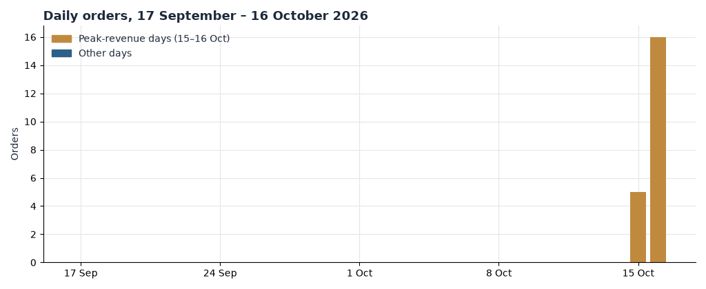
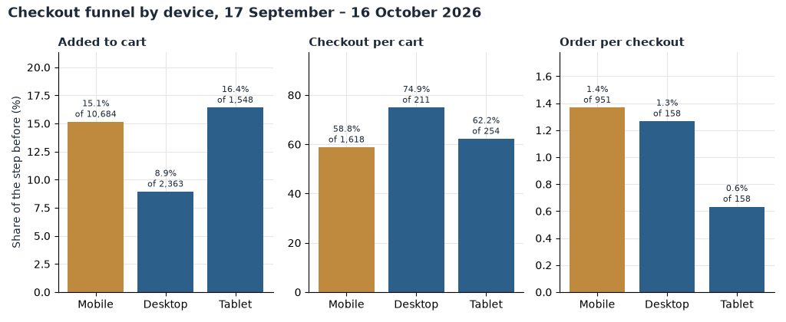
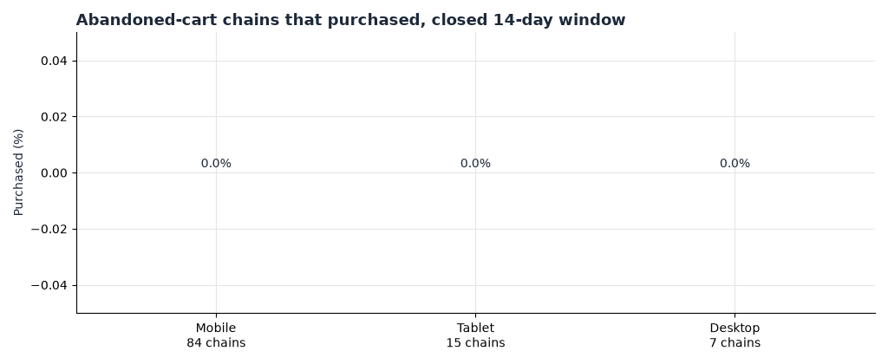
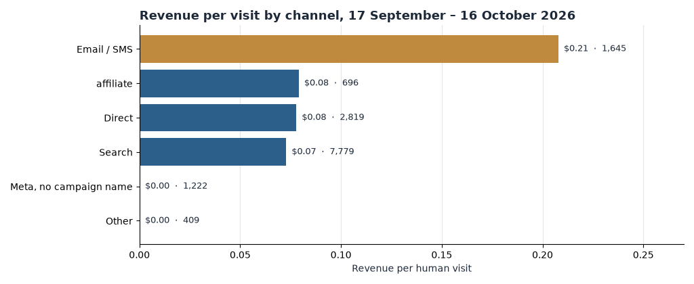
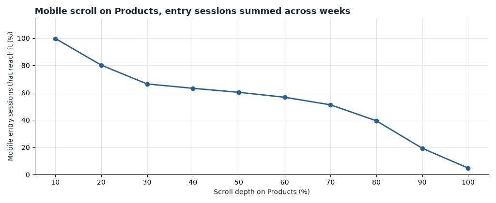

**HEATMAP**

**Peter Thomas Roth**

**Site Opportunity Report**

peterthomasroth.com  |  17 September – 16 October 2026, with the order file back to 18 August for context  |  Prepared 17 October 2026

This report combines a full re-analysis of the order, traffic, campaign, product, page and behavioural datasets for peterthomasroth.com: 21 orders, 14,595 human visits and the complete click and scroll record for the Products page (`/collections/all`). Peter Thomas Roth is a very small store — 21 orders in the window, all of them on the final two days — so one order moves every rate. Every finding below carries its counts, and segments under about 100 visits or 10 orders are flagged as directional.

# Contents

The biggest wins, first · At a glance · The month in numbers · Opportunity 1 — Find the leak between checkout started and order · Opportunity 2 — Bring back the shoppers who leave a cart · Opportunity 3 — Make the Meta spend accountable · Opportunity 4 — Send traffic to pages that close · Opportunity 5 — Turn the 21 new buyers into a second order · Opportunity 6 — Clean the measurement before moving money · Worth watching · What's working · Suggested next 30 days · Method and caveats

# The biggest wins, first

Six moves cover most of the opportunity in this report. One finds a funnel leak that sits at the last step, one switches on a recovery programme that has never recovered a cart, one makes eight weeks of paid social answer for its spend, one routes traffic to the two pages that close, one converts the window's new buyers into repeat buyers, and one keeps every number trustworthy. Each is detailed in the section referenced.

**1. Find out why 1,267 checkout visits became 16 orders.**

14.3% of human visits add to cart and 8.7% reach checkout — then 1.3% of those checkouts complete. On 15–16 October the same funnel produced 16 orders in two days, so the machinery can work. Walk the checkout on a real device before spending a dollar on traffic. (Opportunity 1)

**2. Switch on cart recovery — it has never recovered one.**

We followed 281 abandoned-cart, browse and high-intent chains for 14 days: 83 shoppers came back, and not one bought. The abandonment flows exist in the traffic tags and are firing — their visits just convert at nothing. A working programme is worth up to about $2,000 a month at current cart volume. (Opportunity 2)

**3. Make the Meta spend accountable.**

About 1,250 Meta-tagged visits arrived in the window across four named campaigns, link-in-bio and three creatives — zero orders, against a site average of 0.11% of visits. A further 1,222 Meta visits carry no paid tag at all. Whatever this account spends, it has no order to show for it in four weeks of tracked traffic. (Opportunity 3)

**4. Send traffic to the pages that close.**

The Products grid (`/collections/all`) took 1,880 search entry sessions and produced one $59.23 order; the Masks & Treatments collection, two clicks away, converted four buyers from 901 entries. Meta lands on kit pages with 830 sessions and zero buyers. Route paid and campaign traffic at the pages that close. (Opportunity 4)

**5. Turn 21 new buyers into a second order.**

Every matched buyer in the window was a first-time visitor; the store's returning visitors bought nothing. The campaign sends on 15–16 October proved the list buys when the offer is right. A replenishment flow over the new buyers is the cheapest revenue this store can earn. (Opportunity 5)

**6. Clean the measurement before moving money.**

16.6% of raw traffic is dead sessions, five of the 21 orders matched no tracked visit, the checkout event fired 1,267 times against 21 orders, and the click record on the analysed page names 15 clicks in four weeks. Until these are settled, every rate above is directional. (Opportunity 6)

# At a glance

| **#** | **Finding** | **Recommended action** | **Priority** |
|----|----|----|----|
| 1 | 1,267 checkout visits (8.7% of visits) produced 16 matched orders — 1.3% completion, and zero orders before 15 October despite full-funnel traffic. | Walk mobile and desktop checkout end to end; audit the checkout_started event for double-firing. | High |
| 2 | 281 recovery chains followed 14 days: 83 returned (29.5%), 0 purchased. Cart, browse and high-intent triggers all at zero. | Audit the Listrak abandonment flows; fix trigger links and timing; measure the 14-day recovery rate. | High |
| 3 | Meta: ~1,250 tagged visits across asc, acquisition, retention and retargeting campaigns, link-in-bio and three creatives — 0 orders; 1,222 further Meta visits untagged. | Judge weekly on revenue per visit; re-point campaigns at Masks & Treatments and Bestsellers; tag every link. | High |
| 4 | Products grid: 1,880 search entry sessions, 1 order ($0.03 a session). Masks & Treatments: 901 entries, 4 buyers. Social lands 830 sessions on zero-buyer kit pages. | Re-point paid and campaign links at converting collections; give the Products grid a best-seller default sort. | High |
| 5 | All 16 matched buyers were first-time visitors; returning visitors (9.0% of visits) bought nothing; triggered flows produced 0 orders while campaign sends produced 4. | Launch a post-purchase replenishment sequence over the 21 new buyers; audit why triggered flows convert at zero. | Medium |
| 6 | 2,911 dead sessions (16.6% of raw traffic); 5 of 21 orders matched no visit, all on 16 October; checkout event 1,267 vs 21 orders; named click capture on Products is 15 clicks in four weeks. | Confirm bot filtering, order-visit matching and event dedupe before reading any trend. | High |
| 7 | Non-US traffic: about 2,400 visits (16%) from a spread of countries with zero orders; US took 14 of 21 orders. | Confirm geo-targeting and shipping availability; exclude or localise. | Watch |
| 8 | Two high-value orders (≥$110) carried $240.73 — 16% of revenue; both buyers touched Masks & Treatments or the FIRMx collection before ordering. | Keep kits and multi-mask baskets visible in campaign landing modules. | Watch |
| 9 | Visit volume grew through the window (496 visits on 2 October to 1,894 on 16 October) while order volume stayed at zero until the final two days. | Treat the whole window as a baseline; read next month against 15–16 October, not before. | Watch |
| 10 | Three of the 21 orders paid below the stored item price, and one $108.11 order's highest-priced line is "Shipping Protection by Route" with a one-second session. | Check BOGO discount recording and the Route upsell's order creation. | Watch |

# The month in numbers

| Orders | 21 |
|----|----|
| Revenue | $1,460.70 |
| Average order | $69.56 (median $59.23) |
| Orders by device | Mobile 18 (86%) · Tablet 2 (10%) · Desktop 1 (5%) |
| Human visits | 14,595 — 73% mobile, 16% desktop, 11% tablet |
| Dead sessions (excluded) | 2,911 (16.6% of raw traffic), peaking at 547 on 16 October |
| Visits by channel | Search 53% · Direct 19% · Email/SMS 11% · Meta untagged 8% · Affiliate 5% · Other 3% · Meta paid under 1% |
| Funnel | Add-to-cart 14.3% of visits · checkout started 8.7% · orders 0.11% |
| Returning visitors | 9.0% of visits, 0 buyers |
| High-value orders (≥$110) | 2 orders, $240.73 — 16% of revenue |
| Versus the prior period | No comparison available — visit tables begin 28 September and the order file contains nothing before 15 October |

### Weekly orders across the period

| **Week starting** | **Orders** | **Revenue** | **Visits** | **Note** |
|----|----|----|----|----|
| 28 Sep | 0 | $0 | 2,002 | First week of the visit extract |
| 5 Oct | 0 | $0 | 6,148 | Full week, zero orders |
| 12 Oct (through 16th) | 21 | $1,460.70 | 6,445 | All orders on 15–16 October |

The store ran at zero orders a day for the first 27 days of the window, then took 5 orders on 15 October ($287.97) and 16 orders on 16 October ($1,172.73). Those are the window's only revenue days — there is no third day to name. They were traffic days and conversion days at once: 1,552 visits a day against a 676 daily average before them, and 0.52% of visits ordering against 0.0% on every earlier day. The lift was broad. Search produced 8 of the 16 matched orders, email and SMS 4, direct 3 and affiliate 1 — every channel converted on those two days, which is the signature of a site-wide offer, not one channel's win. The campaign links name it: a "Masks & Treatments are BOGO FREE!" email and the BOGOMask SMS, RCS and MMS sends of 16 October, and the products bought skew to masks and peels (two Pumpkin Enzyme Masks, the Even Smoother Instant Reveal Peel, the Even Clearer Therapeutic Sulfur Mask, the FIRMx Peeling Gel, the Strawberry Scrub). There is no confirmed promotion calendar in this data, so the offer's terms and margins are the merchant's to confirm.

*Figure 1. Daily orders, 17 September – 16 October 2026. Gold days are the window's only revenue days (15 and 16 October); grey days are zero-order days.*

Two contexts matter for reading the month. First, the month is two days long: the order file reaches back to 18 August and contains nothing before 15 October, and the visit tables begin 28 September, so no prior-period comparison exists and every rate in this report rests on 21 orders. Second, demand concentrates where the campaigns point: the Listrak list drove 4 of 21 orders in 48 hours, the Masks & Treatments collection is the best-converting large page on the site (four buyers), and mobile carries 73% of visits and 13 of the 16 matched orders. The strategy levers for a store this shape are the last step of the funnel, recovery, and the campaign calendar — not traffic growth.

# Opportunity 1 — Find the leak between checkout started and order

## What we saw

| **Device** | **Visits** | **Add-to-cart** | **Cart → checkout** | **Checkout → order** | **Visit → order** | **Rev / visit** |
|----|----|----|----|----|----|----|
| Mobile | 10,684 (73%) | 15.1% | 58.8% | 1.4% | 0.12% | $0.08 |
| Desktop | 2,363 (16%) | 8.9% | 74.9% | 1.3% | 0.08% | $0.07 |
| Tablet | 1,548 (11%) | 16.4% | 62.2% | 0.6% | 0.06% | $0.08 |
| All | 14,595 | 14.3% | 60.8% | 1.3% | 0.11% | $0.08 |

Table 1 — The device funnel, 17 September – 16 October 2026, human visits. Order counts rest on 16 matched orders (13 mobile, 2 desktop, 1 tablet); every device row is directional, and one order moves checkout completion by 0.08 points.

*Figure 2. Funnel steps by device, 17 September – 16 October 2026, human visits. The final step — checkout started to order — is the broken one on every device.*

- The gap sits between checkout started and order. 2,083 visits add to cart (14.3%), 1,267 start checkout (8.7% of visits, 60.8% of carts) — and 16 matched orders come out. That is 1.3% completion; even counting all 21 orders it is only 1.7%.

- The upper funnel is healthy, which is what makes the last step suspicious. A 60.8% cart-to-checkout rate says the checkout button works. Then nearly everyone stops.

- Half the buyers never show a normal path: 9 of the 16 matched orders came from visits that viewed no product page at all, and only 3 of the 16 clicked anything matching checkout keywords. Some of that is accelerated checkout and campaign deep links; some is likely tracking loss.

- Five of the 21 orders (worth $278.92) matched no tracked visit at all. All five are on 16 October, clustered 10:08–11:18 and 22:30–22:43 — alongside the window's biggest traffic day, with 547 dead sessions. Tracking on that day looks partial, which flatters or distorts everything measured on it.

## Why it matters

Every point of checkout completion on this volume is about 12 orders — roughly $880 a month at the $69.56 average order. Lifting completion from 1.3% to even 5%, still a poor rate, would be worth up to about $3,300 a month. Treat that as an upper bound: it assumes the 1,267 checkout visits are real shoppers finishing real checkouts, and the evidence above says part of them are not being recorded properly. If the event is inflated, the first win is measurement, not conversion — but on a store where 21 orders is the whole month, even a handful of recovered checkouts is material.

## Recommended actions

- Walk the checkout end to end on mobile and desktop with a real card — Shop Pay, PayPal, card entry, discount field — and note every step where the tracked journey ends early.

- Audit the `checkout_started` event for double-firing (repeated events per session would explain 1,267 events against 21 orders) and check whether accelerated-checkout completions skip the pages the tracking expects.

- Verify order-visit matching on 16 October: five orders that day have no visit, and the tracking on the window's biggest day should be complete before its numbers are believed.

- Track one number weekly: checkout started to order (1.3% today), by device.

# Opportunity 2 — Bring back the shoppers who leave a cart

## What we saw

We followed every trigger chain triggered between 28 September and 2 October — each followed for 14 days, counting only chains whose window had closed by the analysis date.

| **Trigger** | **Chains** | **Returned within 14 days** | **Rate** | **Purchased** | **Recovered revenue** |
|----|----|----|----|----|----|
| Abandoned cart | 106 | 23 | 21.7% | 0 | $0 |
| Showed interest (browse) | 156 | 45 | 28.8% | 0 | $0 |
| Super shopper (high intent) | 19 | 15 | 78.9% | 0 | $0 |
| All | 281 | 83 | 29.5% | 0 | $0 |

Table 2 — Trigger chains, 28 September – 2 October cohort, each followed 14 days, by trigger. Mobile carried 210 of the 281 chains (desktop 31, tablet 40).

*Figure 3. Share of abandoned-cart chains that became orders within 14 days, 28 September – 2 October cohort, by device. No bar rises: recovery is zero on every device. Cart counts: 210 mobile, 31 desktop, 40 tablet.*

- Recovery is not weak; it is absent. 83 of the 281 shoppers returned to the site on their own, including 15 of the 19 highest-intent browsers — and not one chain, on any device, ended in a purchase.

- The abandonment flows exist in the traffic. The links `sms-cart-abandon`, `em-trig-cart-abandon`, `sms-browse-prod-abandon`, `em-trig-browse-prod-abandon` and the welcome triggers all carried visits in the window — and produced zero orders. The machinery is wired; the recovery does not happen.

- The audience is demonstrably reachable: 29.5% came back within two weeks without, it appears, buying anything. These are warm shoppers fidgeting at the moment of commitment, and nothing is closing them.

## Why it matters

At the pace of the cohort, the store adds roughly 600 abandoned-cart chains a month (106 in five days), before the browse and high-intent pools. Recovering even 5% of the carts — a fifth of what a working programme earns — is about 30 orders a month, up to roughly $2,000 at the average order. That is an upper bound: it assumes the recovery messages bring back the same shoppers the chains already prove return, and that those shoppers convert at the site rate. Given the flows demonstrably fire, the gap between 29.5% returning and 0% buying is the cheapest revenue in this report.

## Recommended actions

- Audit the Listrak flows first, not the creative: confirm each abandonment trigger is live, its timing, and that the message's cart link resumes the actual checkout rather than landing on the homepage.

- Split checkout starters into their own track — shorter delay, direct resume link, SMS where consented.

- Give the recovery message the same offer discipline the campaign sends have: the 15–16 October sends converted at $0.21 a visit with a clear offer; the abandonment touches carry no visible incentive.

- Track one number monthly: abandoned-cart chains that purchase within 14 days (0% today), by device.

# Opportunity 3 — Make the Meta spend accountable

## What we saw

*Figure 4. Revenue per human visit by referrer channel, 17 September – 16 October 2026. Visit counts in brackets.*

Meta campaigns and creatives with material volume in the window (last touch — the link the visit arrived on):

| **Campaign or creative (as tagged)** | **Visits** | **Cart adds** | **Checkouts** | **Orders** | **Rev / visit** |
|----|----|----|----|----|----|
| asc_ecomm_conversions_ptr_sr | 489 | 74 | 36 | 0 | $0.00 |
| acquisition_ecomm_conversions_ptr_sr | 158 | 22 | 5 | 0 | $0.00 |
| retention_ecomm_conversions_ptr_sr | 136 | 26 | 15 | 0 | $0.00 |
| retargeting_ecomm_conversions_ptr_sr | 120 | 19 | 14 | 0 | $0.00 |
| Creative: static_na_eyepatchtriokit | 327 | 36 | 15 | 0 | $0.00 |
| Creative: static_na_wdcloudcreamkit | 254 | 56 | 38 | 0 | $0.00 |
| Creative: link_in_bio | 157 | 21 | 4 | 0 | $0.00 |
| Creative: gif_6s_fallbundles | 145 | 20 | 4 | 0 | $0.00 |

Table 3 — Meta campaign links in the window. The creative rows overlap the campaign rows (creatives sit inside the campaigns); every row is zero orders.

- Meta as a whole took about 1,250 tagged visits in the window (8.6% of human traffic) plus 1,222 untagged Meta referrer visits, ordered at 0.00% and earned $0.00 a visit — against the site's 0.11% and $0.08. Meta's 190 tagged cart-add visits and 87 checkout starters produced no order on their own visits.

- This is not one bad set. Four named campaigns spanning acquisition, retargeting and ASC, plus link-in-bio and three creatives, all zero. The `static_na_wdcloudcreamkit` creative alone put 56 visitors in the cart and 38 into checkout, none of whom ordered.

- The account is mostly untagged by referrer: 1,222 of 1,247 Meta visits arrive with no paid medium, so even the zero-order pattern cannot be fully audited. Ad spend is not in this bundle; the checks that matter live in Ads Manager.

## Why it matters

The size of this opportunity is sitting in Ads Manager: whatever these campaigns spent over four weeks of tracked traffic with zero orders on their own visits is spend with no on-site return. Re-pointing the traffic is worth up to about $250 a month — the ~1,250 visits at the email channel's $0.21 a visit, an upper bound that assumes re-pointed social traffic converts like campaign traffic. Modest in dollars, but on a 21-order month, two or three orders is the difference between a flat month and a growth month — and an account that cannot be audited will keep quietly failing.

## Recommended actions

- Pull the 30-day spend for `asc_ecomm_conversions_ptr_sr` and the acquisition, retention and retargeting sets; judge each on revenue per visit and orders, not clicks or cart adds.

- Re-point the campaigns at the pages that close — Masks & Treatments and Bestsellers (Opportunity 4) — with the offer in the ad matching the landing page.

- Tag every ad at account level so the 1,222 untagged Meta visits become auditable, and confirm the retargeting audience is not being built from the dead-session traffic (Opportunity 6).

- Track one number weekly: Meta revenue per visit ($0.00 today).

# Opportunity 4 — Send traffic to pages that close

## What we saw

The analysed page is the Products grid, `/collections/all`. It is the store's single largest search landing destination — and it barely converts:

| **Page** | **Visits** | **Buyers** | **Entries** | **Entry buyers** | **Buyer rate** |
|----|----|----|----|----|----|
| /collections/all (Products grid) | 2,045 | 1 | 1,797 | 1 | 0.05% |
| /collections/masks-treatments | 1,260 | 4 | 901 | 4 | 0.32% |
| /collections/bestsellers | 1,745 | 2 | 809 | 2 | 0.11% |
| /products/instant-firmx-eye-temporary-eye-tightener-easy-wear-formula | 1,733 | 2 | 1,144 | 2 | 0.11% |
| /products/full-size-eye-patch-trio-3-piece-kit-of-full-sizes | 641 | 0 | 548 | 0 | 0.00% |
| /products/full-size-hydration-haul-2-piece-bestsellers-kit | 554 | 0 | 421 | 0 | 0.00% |
| /collections/shop-all | 841 | 0 | 159 | 0 | 0.00% |
| Homepage | 4,615 | 1 | 3,550 | 1 | 0.03% |

Table 4 — Window pages by period (first and second), all devices. `page_period` keeps dead sessions, so rates run below the visit-table figures; compare rows within this table.

*Figure 5. Share of mobile entry sessions on Products reaching each scroll depth, 17 September – 16 October 2026, entry sessions summed across weeks.*

- By entry channel on the Products grid: search sent 1,880 sessions that produced one order ($59.23, $0.03 a session) and a 31% single-page share; direct sent 45 sessions of which 76% saw one page. The page takes traffic and does not convert it.

- Mobile shoppers do scroll the grid — 80% reach the first fifth, 60% the halfway mark, 19% the 90% line, 5% the bottom — so the problem is not that nobody gets past the header. It is that nothing on the page closes.

- We cannot see what they click. The named click record for the analysed page captures 15 clicks in four weeks ("Shop All", 14 sessions, and "SHOP", 1). The page pipeline is covering the sessions — 1,880 search entries are recorded — but the click naming for this storefront is effectively empty, so the grid's tiles, filters and quick-add are invisible in the data.

- Meta's money lands on the wrong pages: 460 social entry sessions on the full-size eye-patch trio kit and 370 on the full-size hydration haul kit — the two kit pages with zero buyers in the window — plus 203 on online-exclusive bundles.

## Why it matters

The Products grid's ~2,900 monthly search entries at the Masks & Treatments buyer rate would be roughly eight more orders — up to about $500 a month, an upper bound that assumes grid arrivals convert like collection arrivals who came for a reason. The larger prize is routing: every campaign and social visit pointed at a zero-buyer page is a visit the store has already paid for or earned, handed to a page that cannot close. On a store this size, fixing where traffic lands is worth more than growing it.

## Recommended actions

- Re-point Meta and campaign links at Masks & Treatments and Bestsellers until the kit pages have a working next step; kill the kit-page destinations first.

- Give the Products grid a job: default sort to best-sellers, put the masks and treatments block first, and keep a one-tap add on every tile.

- Complete the click naming for the storefront (this page carries named selectors for a handful of elements) so the next report can see what grid shoppers actually click.

- Track one number weekly: entry-buyer rate on /collections/all (0.05% today) and single-page share on search entries (31% today).

# Opportunity 5 — Turn the 21 new buyers into a second order

## What we saw

- Every matched buyer in the window arrived as a new visitor. All 16 matched orders sit on first-visit (`ret = 0`) traffic; the store's 1,306 returning visits (9.0% of human visits) produced no buyer at all.

- The 30-day purchase-history flag cannot measure repeat purchase here: it counts the visit's own order, so all 16 buyers read as `bought_before`. The returning flag above is the honest read — and it says the store has no repeat-purchase engine working.

- The triggered flows are running but not selling: welcome (181 SMS visits, 20 email), browse-abandonment (67 SMS, 42 email) and cart-abandonment (33 SMS, 5 email) touches all carried visits and produced zero orders. Meanwhile the plain campaign sends on 15–16 October produced four orders in two days. The list buys when the offer is clear.

- The highest-intent browsers tell the same story: 19 "super shopper" chains, 15 returned within 14 days, zero purchased.

## Why it matters

The window added 21 first-time buyers on a replenishable catalogue — masks, peels and moisturisers that run out. The store has no mechanism turning a first order into a second. If one in five of the new buyers reorders within two months, that is about four extra orders a month once it matures — up to roughly $300 a month at the average order, an upper bound that assumes the replenishment timing matches how fast the products run out. The compounding matters more than the size: every month this is missing, the buyer base resets to zero.

## Recommended actions

- Stand up a post-purchase sequence over the 21 new buyers: an order confirmation that sets replenishment expectations, a timed "your mask is running out" touch, and a second-order incentive.

- Audit the triggered flows alongside Opportunity 2 — the same zero-conversion pattern runs through welcome, browse and cart triggers, which points at a common cause (timing, links or deliverability) rather than six separate problems.

- Give returning visitors a reason: the 1,306 returning visits saw no offer aimed at them all window.

- Track one number monthly: share of orders from returning devices (0 of 16 matched today).

# Opportunity 6 — Clean the measurement before moving money

## What we saw

- One visit in six was not a shopper. Dead sessions — one page or none, no click, no scroll, no order — numbered 2,911 (16.6% of 17,506 raw visits), running 100–240 a day and peaking at 547 on 16 October, the window's biggest traffic day. They are excluded from every visit figure in this report; a fifth of 16 October's raw traffic was dead.

- Order-visit matching is incomplete on the days that matter most. 16 of 21 orders matched a tracked human visit ($1,181.78 of $1,460.70); the five that did not are all on 16 October, in two clusters (10:08–11:18 and 22:30–22:43). Either tracking lost coverage on the biggest day, or some checkout path is invisible to it.

- The checkout event fired 1,267 times against 21 orders. Some of that is the Opportunity 1 leak; some is likely double-firing. Until the event is audited, the 8.7% checkout rate is an upper bound.

- Tagging is thin where money is spent: on the analysed page's 1,957 entry sessions, only 96 carry a utm_source; 84% rely on session tags. By referrer, 1,222 of 1,247 Meta visits carry no paid medium. Campaign-level reads of paid performance are guesses.

- One order looks misrecorded: a $108.11 order whose highest-priced line is "Shipping Protection by Route", from a one-second session with no clicks. If the Route upsell writes its own orders, order value and product reads are slightly distorted.

## Why it matters

Every opportunity above leans on these numbers. The checkout leak, the Meta zero, the spike-day revenue — each is read through tracking that demonstrably lost five orders on the window's biggest day and counts one insurance upsell as a $108 order. Cleaning this costs no media budget and protects every dollar moved on the back of this report.

## Recommended actions

- Confirm the bot filter catches the 16-October pattern (547 dead sessions in a day) and keep an automated-share line on the dashboard.

- Verify tracking coverage and consent behaviour on high-traffic campaign days, starting with the two unmatched-order windows on 16 October.

- Audit `checkout_started` for duplicate events per session; report completion against orders, not events.

- Add the account-level UTM template at Meta and check how the Route upsell records orders.

- Treat every rate in this report as directional until the above are done; on 21 orders, one order moves most rates by five points.

# Worth watching

### The spike pattern

21 orders in 48 hours after four orderless weeks. Whether the BOGO cadence repeats — and whether the orders hold after the window closes on 16 October — decides whether this store's baseline is "two big days a month" or "flat". The data cannot see past 16 October.

### Traffic growth without orders

Visits grew from 496 on 2 October to 1,894 on 16 October, and the zero-order stretch covered all of it. Growth bought before the funnel is fixed will show the same flat line at a bigger scale.

### Paid-below-price orders

Three of the 21 orders (FIRMx Peeling Gel, Potent-C Niacinamide, Pumpkin Enzyme Mask) paid below the stored item price — consistent with the BOGO mechanics, but worth a margin check on how the offer recorded.

### The Route order

One $108.11 order whose highest-priced line is shipping protection, from a one-second session. If upsell apps are writing orders, product and value reads are slightly inflated.

### The high-value pair

Two orders ≥$110 carried $240.73 (16% of revenue), and the only high-value over-indexing pages — Masks & Treatments (5.9x) and the FIRMx collection (7.4x) — rest on one visitor each. Directional, but it points the same way as everything else: the franchise is masks and FIRMx.

# What's working

We checked these areas closely. Each is healthy and needs no change today.

- **The campaign list.** Email/SMS converted at 0.24% and earned $0.21 a visit — the best revenue per visit of any channel and three times search. The 16 October RCS and SMS sends earned $0.61–$0.65 a visit.

- **Masks & Treatments as a destination.** 0.32% buyer rate, the best of any large page, and it took the campaign traffic and closed it. The BOGO push chose the right page.

- **The free shopping feed.** Google's `sag_organic` product listings took 593 visits and produced 2 orders ($154.81, $0.26 a visit) without a media dollar.

- **The mobile upper funnel.** Mobile adds to cart at 15.1% and reaches checkout at 58.8% of carts. The intent is there on the device that matters.

- **Popup engagement.** 10 of the 16 matched buyers clicked the Klaviyo popup during their buying visit (0.64% conversion against 0.39% for non-clickers). The capture is earning its place.

- **Frustration is contained.** 11 rage-click sessions across four weeks on the analysed page, out of tens of thousands of clicking sessions.

# Suggested next 30 days

| **Week** | **Action** | **Owner** |
|----|----|----|
| 1 | Walk the mobile and desktop checkout end to end; audit `checkout_started` for double-firing; verify 16 October order-visit matching. | E-commerce / Dev |
| 1 | Audit the Listrak abandonment and welcome triggers — status, timing, cart-resume links; fix the common zero-conversion cause. | CRM |
| 1 | Pull Meta spend for the four named campaigns; add the account-level UTM template; confirm geo-targeting on every ad set. | Paid media |
| 2 | Re-point Meta and campaign links to Masks & Treatments and Bestsellers; remove the zero-buyer kit pages as paid destinations. | Paid media |
| 2 | Launch the post-purchase replenishment sequence over the 21 new buyers; set the returning-device share baseline. | CRM |
| 2 | Give the Products grid a best-seller default sort and a masks-first block; start the click-naming coverage for the storefront. | E-commerce / Dev |
| 3–4 | Confirm the Route upsell order recording; review the BOGO margin and paid-below-price orders; complete bot-filter verification for spike days. | E-commerce |
| 4 | Review: checkout completion (1.3% today), 14-day cart recovery (0% today), Meta revenue per visit ($0.00 today), Products-grid entry-buyer rate (0.05% today), returning-device order share (0 of 16 today). | E-commerce |

# Method and caveats

- Figures are order totals as recorded on peterthomasroth.com for 17 September – 16 October 2026. The orders file reaches back to 18 August and holds no orders before 15 October; the visit tables begin 28 September (and no prior-period comparison exists). The 28 September week is the first of the visit extract and the 12 October week runs through the 16th.

- Traffic, funnel and per-visit figures use human visits only: 14,595 in the window. Dead sessions (one page or none, no click, no scroll, no order) are excluded and reported separately — 2,911, 16.6% of raw traffic. A visit with an add to cart, a checkout or an order is never excluded.

- Volumes are tiny. A rate built on fewer than about 100 visits or 10 orders is directional; nearly every figure in this report is, and the text says so where it matters. Monthly dollar sizes scale the window's volumes to 30 days, assume the change described, and are upper bounds, not forecasts.

- Recovery figures follow chains triggered 28 September – 2 October, each for 14 days, at session level; a shopper who abandons twice counts as two chains. Only chains whose 14-day window had closed by the analysis date are counted.

- 16 of 21 window orders matched a tracked human visit ($1,181.78 of $1,460.70); the five unmatched orders are all on 16 October. Channel and campaign figures credit the visit to the link it arrived on (last touch); assisted value is not visible. Ad spend is not in this data; revenue per visit is on-site value only.

- Landing-page tables use `page_period` (dead sessions included) and pipeline entry-session tables, both of which count differently from the human-visit totals; compare rows within one table, not across tables.

- Order-line analysis uses the highest-priced line per order; multi-item baskets are not itemised. Order value is the recorded order total. No shipping or gift threshold could be confirmed — the live site blocked automated reading on 17 October 2026 and the bundle carries no promotion calendar — so no basket-threshold opportunity is sized. The BOGO offer on 15–16 October is inferred from campaign link tags, not a confirmed calendar.

- Buyers are counted by device, not by named account. The 30-day purchase-history flag counts the visit's own order, so it cannot measure repeat purchase; returning-visitor figures use the visit's returning flag instead.

- The analysed page's pipeline datasets describe `/collections/all` (Products), not the homepage. Currency is USD throughout.
