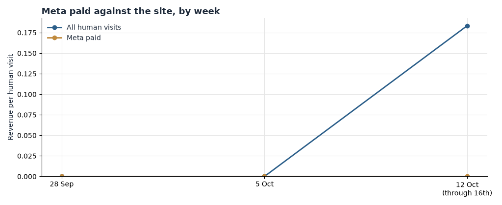

**HEATMAP**

**Peter Thomas Roth**

**Today's Plan: Stop Paying for Visits That Never Order**

peterthomasroth.com  |  October 17, 2026  |  A one-hour ad-account intervention · three switches that change tomorrow's numbers

*PREPARED OCTOBER 17, 2026 · DATA THROUGH OCTOBER 16, 2026*

The full analysis found the leaks; this document is today's fix. Three switches across the paid channels, about an hour of work in total, each one taking effect the day it is made. The latest week of data (starting October 12, through the 16th) confirms all three leaks are still open: the four Meta campaigns took 351 visits and produced zero orders even on the two days every other channel converted; thirteen affiliate partners took about 295 visits and produced zero orders; and Meta links keep arriving untagged, the same pattern that hid the account's failure for four weeks. Nothing in this plan requires new creative, new code, or a meeting — it requires Ads Manager, the Rakuten and ShopMy dashboards, and an hour.

> **Why these three and not the bigger ideas.** The checkout leak, the cart-recovery flows and the post-purchase programme are worth more in total, but they take days to build and weeks to read. The three switches below are the only findings where the waste is happening today and stops tomorrow — tomorrow's spend and commissions are being committed tonight. Everything else stays queued for the week (section 06).

# Contents

01  The Situation This Morning
02  Action 1 — Re-Point the Meta Campaigns at Masks & Treatments
03  Action 2 — Pause the Zero-Order Affiliate Partners
04  Action 3 — Tag Every Meta Link at Account Level
05  How to Read Tomorrow
06  The Rest of the Week
A   Data and Method

# 01  The Situation This Morning

The store finally converted in the week of October 12: 21 orders worth $1,460.70 across 6,445 human visits — but all 21 orders landed on the last two days (5 on the 15th, 16 on the 16th), carried by the Masks & Treatments BOGO sends, with search as the steady channel behind them (8 of the 21 orders). Monday through Wednesday of that week the site took 3,342 human visits and produced no order at all. Against that, three paid-traffic leaks are live in the same week:

| **Leak** | **Latest reading (week starting Oct 12, through the 16th)** | **What it is worth** |
|----|----|----|
| Meta campaigns → kit pages | 351 visits on the four named campaigns (457 Meta visits in all), zero orders, $0.00 — the only channel with no order on the two days every other channel converted | Up to about $500 a month |
| Zero-order affiliate partners | About 295 visits across 13 named partners (Zorannah, Skimlinks.com, Nita, Corre Larkin, Capital One, LTK, Rakuten Rewards, dealmoon.com, FATCOUPON, RebatesMe, Wildfire Systems, EdgeBingFlow, Kim Strother), zero orders, in a week the site converted at 0.33% of visits | Up to about $280 a month |
| Untagged Meta links | About 80 Meta visits arrived with no full tag set; window-wide, 1,222 of 1,247 Meta visits carry no paid medium | The Action 1 upper bound itself |

Table 1 — The three live leaks, with the numbers as of the most recent week of tracked data. Sizes are monthly estimates from current volumes, not forecasts.

*Figure 1 — Revenue per visit by week, Meta paid against the site, for the weeks starting 28 September, 5 October and 12 October (the last through the 16th, the window's final day). Meta earned $0.00 in every week; the site's only revenue week is the last, at $0.23 a visit.*

Each fix is a setting, not a project. None of them rebuilds the site, the checkout, or the email programme.

# 02  Action 1 — Re-Point the Meta Campaigns at Masks & Treatments

Owner: paid media. Time: about 20 minutes. This is the largest of the three, and it comes first because the budget for tomorrow's traffic is committed tonight. Every day it waits, another 50-odd paid visitors land on pages that have never once closed.

In Meta Ads Manager, this morning:

- Find the four named campaigns, exactly as tagged: `asc_ecomm_conversions_ptr_sr` (142 visits in the latest week), `acquisition_ecomm_conversions_ptr_sr` (112), `retention_ecomm_conversions_ptr_sr` (54) and `retargeting_ecomm_conversions_ptr_sr` (43). Together they carried about 1,250 tagged visits across the window and produced zero orders.
- Do not pause the campaigns — re-point them. Change the destination URL from the kit pages (the full-size eye-patch trio kit and the full-size hydration haul kit, which took 460 and 370 social entry sessions in the window with zero buyers) to `/collections/masks-treatments`. That collection is the best-converting large page on the site — a 0.32% buyer rate, four buyers in the window — and it closed the BOGO traffic: four of the sixteen matched orders entered there on 15–16 October.
- Keep the offer in the ad consistent with the landing page. The two kit creatives (`static_na_eyepatchtriokit`, `static_na_wdcloudcreamkit`) put 92 visits into carts and 53 into checkout in the second period alone; the destination, not the intent, is the broken step.
- While you are there, check whether any website-visitor or lookalike audiences are built from all site visitors — 18.4% of the latest week's raw traffic was dead sessions, and they should be excluded before they poison targeting.

Expected result: the 351 re-pointed visits a week at the campaign list's latest-week value of $0.34 a visit — the rate the Listrak sends earned on 15–16 October — is up to about $120 a week, or up to about $500 a month. Treat that as an upper bound: it assumes re-pointed social traffic converts like list traffic with a live offer, which bargain-driven ad traffic usually does not. Even a third of it is the cheapest money available this morning.

# 03  Action 2 — Pause the Zero-Order Affiliate Partners

Owner: e-commerce. Time: about 15 minutes. The affiliate channel as a whole is not the problem — one partner converted. The other thirteen are taking traffic in a week the whole store converted at 0.33% of visits, and delivering nothing.

In the Rakuten and ShopMy dashboards, this morning:

- Pause or de-list the thirteen zero-order partners from the latest week, named as they appear in the bundle: Zorannah (64 visits), Skimlinks.com (43), Nita (36), Corre Larkin (34), Capital One (30), LTK (19), Rakuten Rewards (18), dealmoon.com (14), FATCOUPON (14), RebatesMe (7), Wildfire Systems (6), EdgeBingFlow (5) and Kim Strother (5) — about 295 visits, zero orders.
- Do not touch the one converting partner: Nicole Keshishian | KALEJUNKIE® (50 visits, one order, $54.96 in the latest week). The channel earns its keep through her this week.
- Note the caveat before pausing: cashback and coupon-site visitors often arrive post-checkout to claim a rebate, so part of this traffic can never convert on-site. That is exactly why these partners should be judged on orders, not visits — and on orders they are at zero.

Expected result: about 295 visits a week at even the site average of $0.23 a visit is up to about $65 a week, or up to about $280 a month, if that traffic is re-earned by the partners and pages that do close. That is an upper bound and it assumes coupon traffic can convert at all; the certain win is the commission stopped on thirteen partners who have produced nothing in the store's best week.

# 04  Action 3 — Tag Every Meta Link at Account Level

Owner: paid media. Time: about 10 minutes. This one earns no revenue by itself — it is the switch that makes Action 1 judgeable. The account failed for four weeks partly because nobody could see it failing.

In Meta Ads Manager, this morning:

- Add the account-level UTM template so every ad carries source, medium (`paid social` or the account's house medium), campaign and content (per creative). No exceptions for the small sets.
- The untagged tail is still live in the latest week: 30 visits arrived as `meta_no_link`, 48 more as instagram/social with no campaign name, and 91 second-period visits sat under creatives with no `utm_content` at all. Window-wide, 1,222 of 1,247 Meta visits carry no paid medium, so even the zero-order pattern could only be half-audited.
- Do not judge Action 1 on referrer alone. Meta referrer traffic mixes paid and organic social; without the template, a failing campaign can hide behind a healthy-looking channel total exactly as this one did.

Expected result: every future paid visit reads by campaign and creative, and next week's report can score the re-pointed sets on revenue per visit instead of inference. The upper bound in Action 1 — up to about $500 a month — is only verifiable with this switch on.

# 05  How to Read Tomorrow

Four numbers tell you whether the switches worked. Direction should be visible tomorrow; give it a week before judging size, and remember that on 6,445 weekly visits one order moves any rate by about 0.02 points — read direction first, size after seven days.

| **Watch** | **Now** | **Target** |
|----|----|----|
| Meta paid revenue per visit | $0.00 last week (0 orders on 457 visits) | Above $0.10 within a week; the site average is $0.23 |
| Orders on the four re-pointed campaigns | 0 in four weeks of tracked traffic | First orders attributed to `asc`, `acquisition`, `retention` or `retargeting` campaign tags |
| Visits from the paused partners | About 295 last week | Near zero once paused, with KALEJUNKIE untouched |
| Meta visits without a full campaign tag | About 80 a week | Zero |

Table 2 — The scoreboard for this plan. Read revenue per visit on filtered, human-only traffic; ad spend itself is not in this data, so confirm savings in Ads Manager.

One caution: a promotion landing inside the reading window moves orders on its own — the 15–16 October BOGO took the store from zero orders to 21 in 48 hours. If another send or offer lands this week, note it beside the numbers before crediting the switches.

# 06  The Rest of the Week

These are the larger plays from the Site Opportunity Report. They are deliberately not today's work — queue them once the three switches are on.

| **When** | **Action** | **Size** |
|----|----|----|
| Tue | Walk the mobile and desktop checkout end to end; audit the `checkout_started` event for double-firing (1,267 events against 21 orders); verify the five unmatched orders from 16 October. | Lifting completion from 1.3% to 5% ≈ up to $3,300 / month |
| Tue | Audit the Listrak abandonment and welcome flows — 83 of 281 chains returned within 14 days and none purchased; the triggers fire but convert at zero. | A working programme ≈ up to $2,000 / month |
| Wed | Launch the post-purchase replenishment sequence over the 21 new buyers; every matched buyer in the window was a first-time visitor. | One-in-five reordering ≈ up to $300 / month |
| Thu | Give the Products grid (`/collections/all`) a best-seller default sort and a masks-first block; 1,880 search entry sessions produced one $59.23 order. | Grid converting like Masks & Treatments ≈ up to $500 / month |
| Fri | Confirm bot filtering on spike days (547 dead sessions on 16 October), check how the Route shipping-protection upsell records its $108.11 order, and complete the click naming for the storefront. | Every other number depends on it |

Table 3 — The queue behind today's plan, drawn from the Site Opportunity Report's suggested 30 days.

# A  Data and Method

Figures come from Heatmap visit, campaign and order records for peterthomasroth.com, September 17 – October 16, 2026, with the order file reaching back to August 18 for context. "Last week" is the week starting October 12 (Monday–Sunday, running through Friday the 16th, the window's last day); it holds all 21 of the window's orders, on the 15th and 16th.

Traffic and funnel figures use human visits only. Dead sessions — one page or none, no click, no scroll, no order — are excluded and reported separately: 2,911 of 17,506 raw visits in the window (16.6%), and 1,457 of 7,902 in the latest week (18.4%). A visit with an add to cart, a checkout or an order is never excluded.

Channel and campaign figures credit the visit to the link it arrived on (last touch); assisted value is not visible. Ad spend and affiliate commissions are not in this data, so revenue per visit is on-site value only, and the savings checks belong in Ads Manager and the affiliate dashboards. Buyers are counted by device, not by named account.

Five of the 21 orders (worth $278.92) matched no tracked visit; all five are on 16 October, so the latest week's channel split is partly inferred. There is no confirmed promotion calendar — the BOGO on 15–16 October is inferred from the campaign link tags (`BOGOMask_SMS_10.16.26` and its RCS and MMS siblings), not from a merchant calendar.

Monthly sizes scale the latest week's volumes and assume the change described: the Action 1 bound assumes re-pointed social traffic converts like campaign-list traffic did under the BOGO; the Action 2 bound assumes paused-partner traffic is re-earned at the site average. Both are upper bounds, not forecasts. On volumes this small — 21 orders, 6,445 weekly visits — every rate is directional and one order moves any weekly rate by about 0.02 points.

Sources: Peter Thomas Roth Site Opportunity Report (October 17, 2026); latest-week figures re-run from the analyst bundle at `~/work/analysis/peterthomasroth`. The one chart drawn for this document (Figure 1) rendered; no chart was skipped. Currency is USD throughout.
