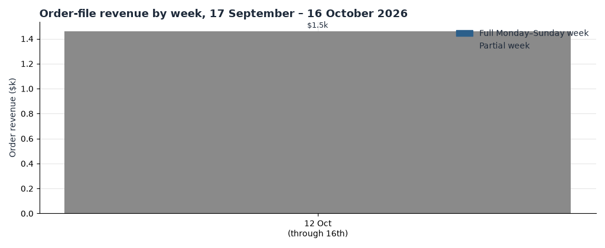
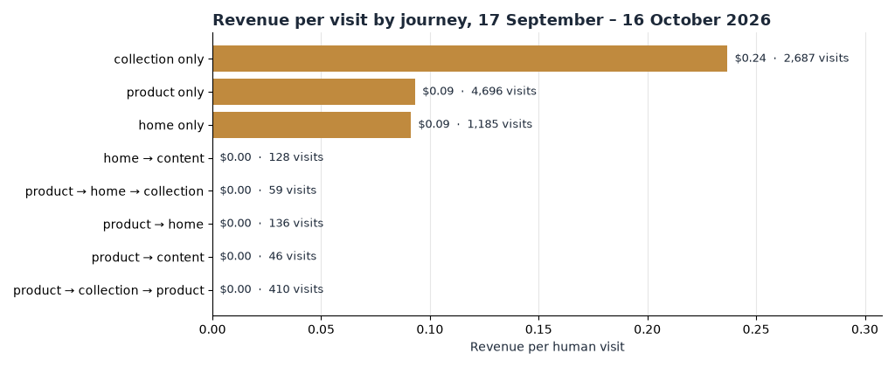

**HEATMAP · User Journey Opportunity Analysis**

**Peter Thomas Roth**

peterthomasroth.com | September 17 – October 16, 2026, with the order file back to August 18 for context | Prepared October 17, 2026

This report follows how shoppers move through peterthomasroth.com — where visits land, which paths reach an order, how the final two days of the window carried the entire month, and where the journey record points to recoverable revenue. All figures come from tracked visits and matched orders for September 17 – October 16, 2026. Peter Thomas Roth is a very small store: 21 orders in the window, worth $1,460.70, all of them on October 15 and 16. One order moves every rate, and the counts beside each rate say how much to trust it. Sixteen of the 21 orders matched a tracked human visit ($1,181.78 of the $1,460.70); visit-level rates use those 16. Dead sessions — 2,911 visits with one page or none, no click, no scroll and no order, 16.6% of recorded traffic — are excluded throughout.

> **How to read a journey.** A journey is the sequence of page classes in a visit: home (the site root), product (`/products/…`), collection (`/collections/…`), content (`/pages/…`), cart or checkout, search, account, and other. Repeated views of the same class count once. On this bundle `other` is nearly empty — four visits — so product-style entries are effectively the `/products/` URLs. Quick-add means a buying visit can be a single tracked page: a one-page-class visit is not a failed visit. On this site, it is usually the whole story.

## Contents

01 The Month in Journeys
02 The Journeys That Make Money
03 Where the Journeys Leak: Pages That Never Close
04 How the BOGO Weekend Reshaped the Funnel
05 The Business Is New Buyers
06 Behaviour Signals Worth Watching
07 Where the Journey Data Points
A Data and Method

## 01  The Month in Journeys

The window took 21 orders worth $1,460.70, at an average order of $69.56 and a median of $59.23 — every one of them in the final two days, October 15 and 16. Human traffic ran 73% mobile, 16% desktop and 11% tablet, and arrived 53% from search, 19% direct, 11% from email and SMS, 8% from untagged Meta, 5% from affiliate and 3% other. Beneath those totals the journey data shows the shape a channel report cannot: this store is entered at the shelf, and the shelf is where it closes.

| Measure | Value | Reading |
| --- | --- | --- |
| Orders / revenue | 21 / $1,460.70 | Average order $69.56, median $59.23; all orders on October 15–16 |
| Where visits land | 41% a `/products/` page · 35% a collection · 21% the homepage · 3% content | Entries go straight to merchandise, not to the homepage |
| Most common journey | One page class, then leaves | 8,763 visits (60%), holding all 16 matched orders at 0.18% and $0.13 a visit |
| Best common journey | Collection only | 2,687 visits, 8 matched orders, $0.24 a visit — lifted by Masks & Treatments in the BOGO |
| Homepage effect | Visits that touch the homepage at any point | 4,196 visits, 1 order ($108.11, 0.02%); visits that skip it order at 0.14% |
| Second-product effect | Visits viewing 2+ product pages | 1,868 visits, zero orders this window — directional at 16 matched orders |
| Peak days | October 15–16 | 21% of window visits, all 21 orders, $1,460.70 at $0.47 a visit |

Table 1 — Journey context for the report window, September 17 – October 16, human visits.

*Figure 1 — Order-file revenue by week, 17 September – 16 October 2026. The only non-zero bar is the final, partial week (12–16 October); earlier full weeks of the window show zero. The month's revenue is a two-day event, not a steady run rate.*

## 02  The Journeys That Make Money

On larger stores in this report series, movement between pages is the buying signature. Here the signature is the opposite, and it is just as actionable: the visits that buy are the visits that never needed a second page. All 16 matched orders came from single-page-class journeys; about 5,400 visits that changed class at least once produced none. With 16 orders that inversion is thin evidence in each direction — but it matches the mechanics of a Shopify store with quick-add: the page the shopper lands on is the page that must sell.

*Figure 2 — Revenue per visit by page-class journey, 17 September – 16 October 2026. Gold bars mark journeys above the site average of $0.08 a visit; the average sits on 16 matched orders over 14,595 human visits, so every bar is one order away from moving.*

| Journey anywhere in the visit | Visits | Order rate | Revenue per visit |
| --- | --- | --- | --- |
| One page class only | 8,763 | 0.18% | $0.13 |
| Collection only | 2,687 | 0.30% | $0.24 |
| Product page only | 4,696 | 0.15% | $0.09 |
| Reached a `/products/` page | 9,385 | 0.07% | $0.05 |
| Two or more product pages | 1,868 | 0.00% | $0.00 |
| Collection → product | 3,208 | 0.00% | $0.00 |
| Reached the homepage (at any point) | 4,196 | 0.02% | $0.03 |
| Clicked reviews | 253 | 0.00% | $0.00 |
| Used on-site search | 889 | 0.00% | $0.00 |
| Clicked an FAQ or accordion | 2,418 | 0.00% | $0.00 |
| Clicked cart | 2,183 | 0.50% | $0.38 |
| Clicked an express-pay button | 98 | 2.04% | $1.19 |

Table 2 — Journey patterns, September 17 – October 16, all devices. Review, search and FAQ clicks produced no orders this window; at these counts that is absence of evidence, not evidence of absence.

Three readings:

- Collections are the strongest shelf. Collection-only visits earn $0.24 a visit against $0.09 for product-only — the only journey comfortably above the site average. Masks & Treatments did the heavy lifting during the BOGO, but Bestsellers and FIRMx also closed from collection entries.
- The corridor is empty. Collection → product is the classic browsing move — 3,208 visits made it this window — and not one ordered. Do not read that as "browsing is worthless"; read it as "the pages do not yet hand the browser a reason to stop browsing and buy." That work is specified in the Site Opportunity Report (Opportunity 4).
- Intent clicks concentrate the orders. Visits that clicked a cart element hold 11 of the 16 matched orders (0.50% order rate, $0.38 a visit); express-pay clickers convert at 2.04%. When this store gets a shopper to the commit controls, the shopper commits. The gap is upstream of them.

> **So what:** judge merchandising by whether the landing page can close on its own — offer, price, quick-add and reviews visible without a second click — because 60% of visits never take that second click. A page that needs a journey to sell is a page that sells 40% of the traffic at best. The multi-step journeys earn their keep in the Site Opportunity Report's plan; the journey data's own job is to say which landing pages must carry the close.

## 03  Where the Journeys Leak: Pages That Never Close

The leak is not between pages; it is at the page. Of the 32,483 tracked page visits in the window (this table keeps dead sessions), 17,630 — 54% — landed on URLs with no buyer all month, spread across 131 pages. The ones with real volume:

| Landing page | Visits | Entries | Buyers | Buyer revenue |
| --- | --- | --- | --- | --- |
| `/collections/all` (Products, analysed page) | 2,045 | 1,797 | 1 | $59.23 |
| `/collections/shop-all` | 841 | 159 | 0 | $0.00 |
| `/products/full-size-eye-patch-trio-3-piece-kit-of-full-sizes` | 641 | 548 | 0 | $0.00 |
| `/products/instant-firmx-eye-temporary-eye-tightener-2201357` | 615 | 351 | 0 | $0.00 |
| `/pages/rewards` | 606 | 194 | 0 | $0.00 |
| `/collections/online-exclusive-bundles` | 571 | 213 | 0 | $0.00 |
| `/products/instant-firmx-temporary-face-tightener-1301354` | 561 | 250 | 0 | $0.00 |
| `/collections/kits-bundles` | 537 | 173 | 0 | $0.00 |
| `/collections/eye-treatments` | 482 | 96 | 0 | $0.00 |
| `/collections/bestsellers` (the page next door) | 1,745 | 809 | 2 | $110.09 |
| `/collections/masks-treatments` (the page next door) | 1,260 | 901 | 4 | $341.76 |

Table 3 — Window visits by page, with the two pages next door that did close. Buyers are visits that ordered and reached the page; the order is not attributed to the page.

The pages next door prove the traffic is fine. Shop-All took 841 visits and produced zero buyers, while Bestsellers — same slot in the navigation, one aisle over — produced two buyers from 1,745 visits and Masks & Treatments four from 1,260. Eye Treatments, Kits & Bundles, Online Exclusive Bundles and Exclusive Offers all took 400–570 visits each and none. The visitors are shoppers; the pages are not closing them.

The FIRMx line is split across duplicate URLs. The Instant FIRMx Eye tightener exists twice: the Easy-Wear Formula URL drew 1,733 visits and 2 buyers ($146.53), while `…-2201357` drew 615 visits and none. The face tightener repeats the pattern — Easy-Wear 1,445 visits and a buyer, `…-1301354` 561 visits and none. Together the legacy duplicates absorbed 1,176 visits with zero buyers, splitting reviews, links and ad history across two doors to the same product. That is specified alongside the other destination fixes in the Site Opportunity Report (Opportunity 4).

Paid social enters the store and buys nothing. Meta-tagged links sent 1,257 human visits in the window (25 paid-tagged, 1,222 untagged) and not one ordered; on the Products page, social entries are the worst-behaved row in the entry table — 71% see a single page and revenue per session is $0.00, against $0.17 for campaign entries. The fix is not the landing page alone; it is which page the campaign points at (Opportunities 3 and 4 in the Site Opportunity Report).

| Entry channel on Products | Entry sessions | See one page only | Revenue per session | Orders |
| --- | --- | --- | --- | --- |
| Social (Meta-led) | 1,643 | 71.2% | $0.00 | 0 |
| Direct | 2,772 | 61.5% | $0.06 | 2 |
| Campaign (email, SMS, ads) | 2,400 | 55.0% | $0.17 | 5 |
| Search (Google-led) | 7,779 | 50.5% | $0.07 | 8 |
| Website (internal) | 352 | 43.5% | $0.00 | 0 |

Table 4 — Entry sessions on the Products page by channel, full extract period. Entry sessions are a pipeline denominator and do not equal human visits; compare rows inside this table only.

> **So what:** the zero-buyer pages took more than half of all tracked page visits. Re-pointing the Meta entries at campaign-style closing pages is worth up to about $280 a month at current volumes (1,643 social sessions at the $0.17 a session campaign entries already earn — an upper bound that assumes re-pointed traffic converts like the destination's existing traffic). Closing the seventeen zero-buyer pages that took 300 or more visits each — 8,478 visits in the window — at the Bestsellers page's buyer rate (0.11%) is worth up to about $675 a month more. Treat both as ceilings, not forecasts — one order is $69.56 here, and the shoppers who would convert on a fixed page are partly different people from the ones who left.

## 04  How the BOGO Weekend Reshaped the Funnel

The funnel did not drift this window — it sat silent for thirteen days and then fired. There is no pre-window visit context to compare against: the visit extract effectively begins 28 September, with only 27 human visits before 2 October, so the honest phases are the quiet middle of the window, the full window, and the two peak days.

| Funnel phase | Visits per day | Add-to-cart | Checkout per add-to-cart | Orders | Conversion | Revenue per visit |
| --- | --- | --- | --- | --- | --- | --- |
| Early window, 17 Sep–1 Oct | 9 (27 visits) | 14.8% | 75.0% | 0 | 0.00% | $0.00 |
| Late window, 2–14 Oct | 882 | 13.4% | 59.7% | 0 | 0.00% | $0.00 |
| Full window, 17 Sep–16 Oct | 487 | 14.3% | 60.8% | 16 matched | 0.11% | $0.08 |
| Peak days, 15–16 Oct | 1,552 | 17.5% | 64.0% | 16 matched | 0.52% | $0.38 |

Table 5 — Funnel by phase, human visits, matched orders. The early-window phase is tracking ramp, not demand; treat its rates as directional.

The break is an event, not a behaviour trend. Traffic built steadily through the window — 496 human visits on 2 October rising to 1,894 on 16 October — and converted at nothing for thirteen straight days. Then 15 October produced five orders from search and direct entries, and 16 October produced sixteen: four through the Listrak "Masks & Treatments are BOGO FREE" email and SMS sends (campaign names `BOGOMask_SMS_10.16.26`, `BOGOMask_RCS_10.16.26`, `BOGOMask_MMS_10.16.26`), one through the KALEJUNKIE affiliate post, the rest through search and direct. The bundle holds no promotion calendar, but the campaign names evidence the offer, and the lift concentrates where the offer was sent — this is a promotion story, not a retention story. Add-to-cart rose from 13.4% to 17.5% and checkout-per-add-to-cart held near 60%, so the BOGO brought ready buyers rather than diluted browsers.

**Watch out:** the checkout_started signal over-fires. It recorded 1,267 checkout visits in the window against 16 in-visit orders, and daily checkouts ran at 53–88 even on days with zero orders. Some of that gap is the checkout-to-order leak the Site Opportunity Report specifies (Opportunity 1); some is likely double-firing. Until the event is audited, read the funnel at add-to-cart → order, not at checkout → order.

## 05  The Business Is New Buyers

Every matched buyer in the window was a first-touch device. Returning visitors are a growing share of traffic and a zero share of orders — which makes the second-order programme the cheapest revenue on the table, and the subject of the Site Opportunity Report's Opportunity 5.

| Week (Monday) | New visits | Returning visits | Returning share | Orders |
| --- | --- | --- | --- | --- |
| 28 Sep (from 28th) | 1,888 | 114 | 5.7% | 0 |
| 5 Oct | 5,594 | 554 | 9.0% | 0 |
| 12 Oct (through 16th) | 5,802 | 643 | 10.0% | 16 |

Table 6 — New versus returning devices by week, human visits. Buyers are counted by device: a returning customer on a new device appears as new here.

The 30-day shopper-history flag cannot measure repeat purchase on this extract — 17 of the window's visits carry `bought_before` and 16 of them are the buying visits themselves, so the label is the order, not prior history. The returning flag is the reliable measure, and it says: 1,311 returning visits, zero orders, while the 13,284 new visits took all 16. The campaign sends of 15–16 October prove the list buys when the offer is right; the buyers simply arrived on fresh devices. Watch whether returning visits keep climbing — the share has risen three weeks running — and whether any of them start to order.

> **So what:** the store converts strangers during promotions and converts returners never. The growth lever is not more first-time traffic; it is a second touch on the 21 buyers the window already produced. Do not build it on the `bought_before` flag — build it on the order file itself.

## 06  Behaviour Signals Worth Watching

Four signals survive the count test (a rate that differs from the site on enough visits to mention). Everything else — the email-popup click, review clicks, rage clicks — either shows no rate difference or sits under threshold this window.

- **Buyers decide in under a minute.** Visits dwelling 15–60 seconds on a product page ordered 4 times in 2,555 (0.16%), the strongest dwell band; the under-15-second band managed one order in 901. The decision aids — price, offer, reviews, add-to-cart — belong in the first screen, and the median engaged time on Products of 36–58 seconds says that is where the visit actually happens.
- **Long dwellers are stuck, not convinced.** Past the deciding minute, product-page dwell pays a fifth of the fast band's rate: the one-to-three-minute, three-to-ten-minute and ten-minute-plus bands together ordered twice in 5,929 visits (0.03%) against 0.16% for the 15–60-second band. Something is holding them — unanswered shipping, shade or usage questions most likely — and nothing in the funnel rescues them. A timed help or offer trigger for long product dwellers is the test.
- **Deep scrollers do not buy.** Of visits scrolling a product page past the halfway mark, none ordered (1,407 visits); the 11–50% bands hold 5 of the 7 product-page orders. The bottom of the page is where people hunt for answers and leave. Move the answers up.
- **On-site searchers leave empty-handed.** 889 visits used search and none ordered this window, against a site order rate of 0.11% — directional, but searchers are the most goal-directed visitors a store gets. If the pattern holds another fortnight, audit the results page for the FIRMx and mask terms before spending on anything else.

## 07  Where the Journey Data Points

The journey record supports four moves, ranked by journey evidence rather than traffic volume. Where a leak is already specified in the Site Opportunity Report, the move is named against it and its action list is not repeated here.

| Priority | Move | Journey evidence |
| --- | --- | --- |
| 1 | Send Meta entries to pages that close (Opportunities 3–4) | 1,257 Meta-tagged visits site-wide, zero orders; 1,643 social entry sessions on Products, 71% one page, $0.00 a session |
| 2 | Make the zero-buyer collections self-closing (Opportunity 4) | 17,630 visits (54%) landed on zero-buyer URLs; Bestsellers and Masks & Treatments close at 0.11–0.32% buyer rates next door |
| 3 | Consolidate the duplicate FIRMx product URLs (Opportunity 4) | 1,176 visits on the two legacy URLs, zero buyers, against 3 buyers on the Easy-Wear URLs |
| 4 | Build the second-order path on the 21 new buyers (Opportunity 5) | Returning share rose 5.7% → 10.0% over three weeks with zero orders; every matched buyer was a first-touch device |

Table 7 — Where the journey data points, September 17 – October 16, 2026. Sizes for these moves appear in section 03 and in the Site Opportunity Report.

Track four numbers weekly: matched orders (16 this window); revenue per human visit ($0.08); email and SMS visits with their orders (1,645 visits → 4 orders, $0.21 a visit); and the single-page share of social entries on Products (71%). Direction should be visible the week a change ships; on a store this small, size needs three to four weeks, and any send, restock or promotion inside the reading window moves the numbers on its own — note it beside them.

## A  Data and Method

**Window and periods.** Report window 17 September – 16 October 2026; the final day of the window is 16 October 2026. The order file covers 18 August – 16 October and holds no orders before 15 October. The visit extract effectively covers 28 September – 16 October — the weeks of 28 September, 5 October and 12 October, both partial — so there is no pre-window visit context; phases in section 04 are the early window (17 September–1 October, 27 tracked visits), the late window (2–14 October) and the two peak days (15–16 October, named in the site profile as the highest-revenue days).

**Traffic rule.** Dead sessions — one pageview or none, no click, no scroll, no order — are removed from visit-level tables: 2,911 of 17,506 recorded visits, 16.6%. A visit with an add-to-cart, a checkout or an order is never excluded. `page_period` keeps dead sessions, so its counts exceed the visit tables. Entry-session tables (`entry-by-channel`) are a pipeline denominator and are never mixed with human-visit counts in one sentence.

**Orders and journeys.** Sixteen of 21 orders matched a tracked non-dead visit ($1,181.78 of $1,460.70); visit-level conversion and revenue-per-visit rates use those 16. A journey is the sequence of page classes in a visit, consecutive repeats counted once; `other` — which on larger bundles holds product URLs stored with a full domain — contains four visits here. Buyers are counted by device. Channel is last touch: the link the visit arrived on. Ad spend is not in the bundle, so revenue per visit is on-site value only.

**Breaks and limits.** The checkout_started event over-fires (1,267 checkout visits against 16 in-visit orders), so funnel rates are read at add-to-cart → order until the event is audited. The `bought_before` 30-day flag counts the visit's own order and cannot measure repeat purchase; section 05 uses the returning flag instead. With 21 orders and 16 matched, every rate in this document is one order away from moving; segments under about 100 visits are flagged as directional in place. Dollar sizes are monthly upper bounds from this window's volumes — they assume re-pointed traffic converts like the destination's existing traffic and that fixed pages convert like the pages next door, and they are not forecasts.
